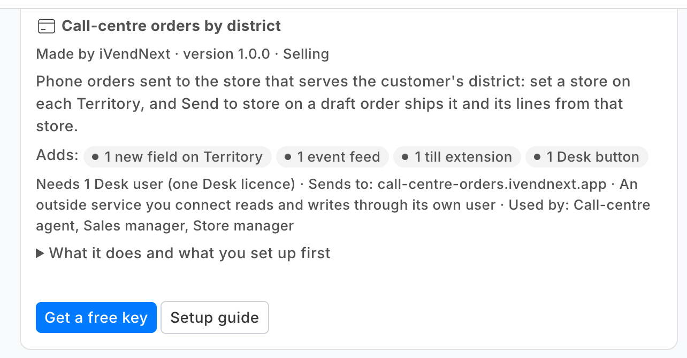
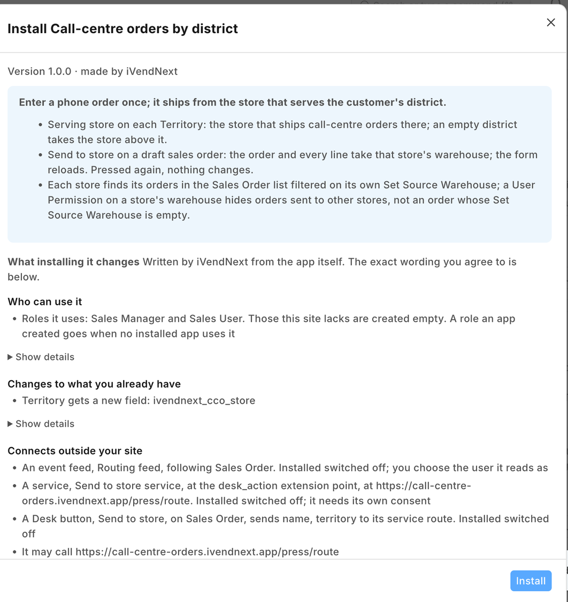
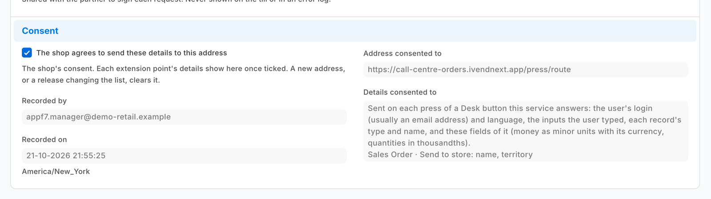
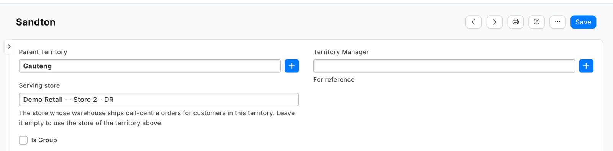
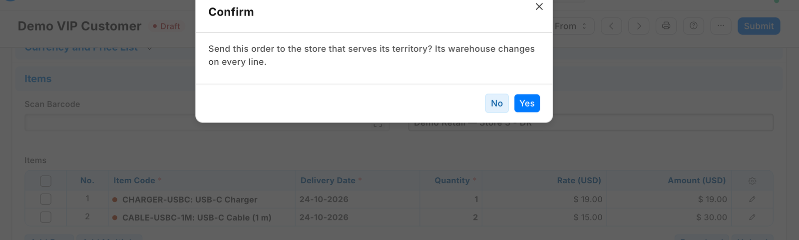
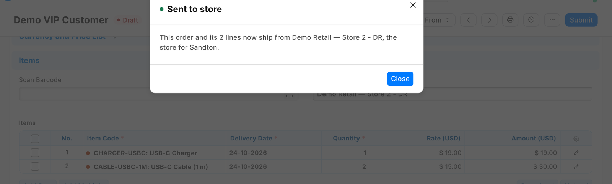
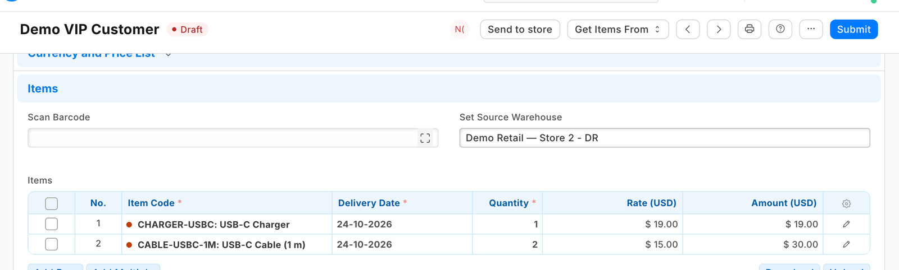
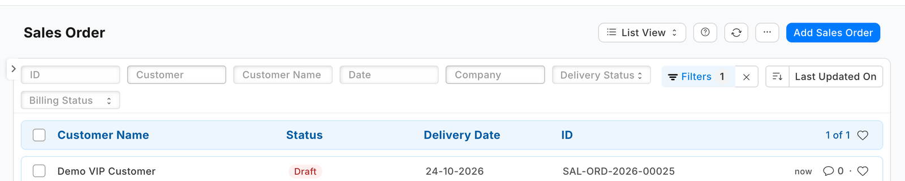

# S35 — Call-centre orders by district (`pp_cco`): a button that routes a phone order

A customer phones the call centre; the agent enters the order once, in Desk, and presses **Send to store**. The order then ships from the store that serves the customer's district, and appears on that store's own list. This sample is for a developer who wants a button on a Desk record whose service **changes that same record**: here, the warehouse of a draft Sales Order and of every line on it.

**When to use it:** you want a press in Desk to decide something about the record from data the shop already holds, and write the answer back onto it.

## What happens

1. The shop's manager sets a **Serving store** (a warehouse) on each district in the shop's own **Territory** tree. A district left empty takes the store of the territory above it: a governorate's store serves its districts that have none.
2. A call-centre agent (a Sales User) enters a Sales Order as today. The order's **Territory** comes from the customer, and the agent can change it for this order. The agent saves it.
3. The agent presses **Send to store** on the draft order and confirms.
4. The shop sends your service, signed, the order's name and territory.
5. Your service reads the order **with its own key**, walks the territory up the tree to the first Serving store, and writes that warehouse on the order (*Set Source Warehouse*), on every line and on a bundle's parts (the shop fills a part's warehouse only when it is empty). Every line, a supplier-delivered one too, as Desk's own *Set Source Warehouse* does. Then it answers.
6. The form reloads with the store in place: *"This order and its 2 lines now ship from Maadi Store, the store for Maadi."* The agent submits it. The store sees it in its own list, and its delivery note ships from the store's warehouse.

Pressed again, the button changes nothing and says where the order already is.

| What the shop sees (on a demo shop, 2026-10-22) | |
|---|---|
| The app's card in the App library |  |
| What the install will change, read before you agree |  |
| The service switched on, with the shop's consent and the details it sends |  |
| A **Serving store** on a district of the Territory tree |  |
| **Send to store** on a draft order, and its question |  |
| The answer: the store, and the district it serves |  |
| The reloaded order, the store in *Set Source Warehouse* |  |
| The store's own list: Sales Order filtered on its *Set Source Warehouse* |  |

## What the shop does

1. **Install the app** (the shop's administrator). It comes in switched off: the service has no consent and is off, and the button is off. The install adds the **Serving store** field to Territory. It makes no role and no record type of its own.
2. **Give the app a user** (the shop's administrator, as in the [integration user recipe](../../recipes/integration_user.md)): tick **Is Desk User**, set no password, give it **no User Permissions**, and generate its API key. In **Role Permissions**, give a role of the shop's own **read and write on Sales Order** and **read on Territory, Customer and Warehouse** (the order's own save reads its customer with a rights check; the service checks the store's warehouse before it writes), and give the user that role alone. The role reaches every sales order (read and write) and every customer, territory and warehouse (read): give it to the app's user and no one else. *Sales User* also works, but it reaches further than the app uses: it creates and submits orders. A service for one shop takes the key in its settings. A service for many shops receives it from the shop: choose the user as the *Application User* of the feed **PP CCO Routing feed**, then press **Connect again** on the app (*Many shops, hosted* below).
3. **Switch the service on** (the System Manager). Open **Retail Extension Subscription**, the record *Send to store service*, read what it is sent, tick the consent and switch it on.
4. **Switch the button on** (the System Manager). Open **Retail Desk Action**, the record *Send to store*, and switch it on.
5. **Set a Serving store on each district** (a Sales Master Manager, in the Territory tree): the store's warehouse, of the same company as the orders, and never a group warehouse.
6. **Each store saves its list once:** the Sales Order list filtered on its own *Set Source Warehouse* and the status *To Deliver and Bill*. With a User Permission on its own warehouse, a store's staff see the orders sent to their store and not those sent to another; an order whose Set Source Warehouse is empty (none set, or lines on different warehouses) is seen by every store.

**Where it shows.** In Desk only: the Serving store on the Territory form and list, and the button on a **draft** Sales Order's form (Sales User, Sales Manager). Nothing on the till, on a print layout or in a report.

**What leaves the shop.** One address: your service (the manifest ships a test address; you write your own). Each press sends the order's **name** and **territory**, the pressing user (an e-mail address) and the language. Your service then **reads the whole order** (its customer, its addresses, its lines, quantities and prices) and the territories above it, and **writes the order back** with the new warehouse. Say so on your card. The feed *PP CCO Routing feed* is how the shop chooses the app's user: leave it switched off (it installs off): switched on, it would record every sales order's saves for the app's user.

## The files

| File | What |
|---|---|
| `manifest.json` | the Serving store on Territory, the service (`extension_subscriptions`, extension point `desk_action`), the button (`desk_actions`, a draft's form only) and the feed whose user is the app's, installed **switched off** |
| `route.py` | **the pure core**: the signature check, the press's one order, the walk up the territory tree, the write (the header and every line, the order's `modified` as read), the answers |
| `service/app.py` | the HTTP service (standard library): `POST /press/route`, `GET /health`; the record API as the app's user; one shop or many |
| `tests/test_service.py` | laptop tests: the real service, a stand-in record API, presses signed as the shop signs them: the store, the store above, a second press, no store, no territory, a submitted order, an edit saved in between, a refused store, a refused user |
| `tests/test_many_shops.py` | many shops: each shop's own secret and key, a press before *Connect again*, the field under the library's prefix, the record API's errors, the function entry |
| `tests/test_contract.py` | every answer, and every press our test shop recorded, against the published contract (`desk_action.v1.schema.json`) |
| `tests/canaries.py` | each test that guards a secret, a key, the order's other fields or an edit goes RED when its check is removed |
| `app.json` | how CitiXsys hosting runs it: a function, paid per call, packaging only the files it needs |

The recipe is [Call-centre orders by district](../../recipes/call_centre_orders.md). The button's own recipe is [`recipes/desk_action.md`](../../recipes/desk_action.md).

## Run it

```bash
cd samples/s35_call_centre_orders
python3 -m unittest discover -s tests -p 'test_*.py'
python3 tests/canaries.py
python3 service/app.py service/.env.local      # PP_BASE, PP_KEY, PP_SECRET, PP_POINT_SECRET, PP_PORT
```

## Many shops, hosted

The App library's *Call-centre orders by district* runs this same `service/app.py` for every shop that installs it, as a function on CitiXsys hosting (`app.json`): it costs nothing between presses. Set `IVN_LIBRARY_APP` (the library's id), a shops store (`IVN_SHOPS_TABLE` on hosting, `IVN_SHOPS_FILE` on your own server) and `CCO_PREFIX` (`IVENDNEXT CCO`: the Serving store field is then `ivendnext_cco_store`).

1. After its install the shop's site connects itself (the app template's handshake, guide chapter 14b): the service stores the shop with its library key and the press's secret, `<app>:sub:route`.
2. The shop chooses its app user on the feed and presses *Connect again*: the service receives that user's key (`user:<email>`).
3. Each press names its shop (`X-iVendNext-Site`); it is checked with **that shop's** secret and the order is read and written with **that shop's** user's key. Another shop's secret, or a shop the service does not know, is refused (401).
4. A press before step 2 is answered in words: *Send to store is not set up yet.* A shop that refuses the user is told to check the user, its role and its API key, then press *Connect again*.

**No claim on a press is needed.** Unlike S16, which creates a record, this service gives the same answer every time: a second press, a retry or two copies of the function find the order already routed and write nothing. Two writes racing on one order are settled by the shop itself (below).

## Before you copy it

- **The whole order goes back.** The record API replaces a table whole, and the shop never copies the header's warehouse down to the lines, so the service sends every line back as it read it, with only its warehouse changed. Our test bench compared every field of the order and its lines before and after the press: only the warehouses and what the shop works out from them moved, and on that untaxed order the totals were equal. The service sets no price, but the shop's own save works the order out again at the new warehouse: a store's own item tax, or a price limited to a warehouse, can change the total, and the answer then says so (*Its total is now … (was …)*).
- **An edit is never overwritten.** The write carries the order's `modified` as read. If anyone saved the order since, the shop refuses the write (`TimestampMismatchError`, HTTP 417); the service reads it once more without writing: *Already with its store* if a second press routed it meanwhile, otherwise it asks the agent to reload. It never writes over the edit (a warehouse a person chose included).
- **Only a draft.** The button shows on drafts, and the service reads the order again and refuses a submitted one. To move a submitted order, cancel and amend it.
- **The shop's own words never reach the agent raw.** The service reads the shop's error type (`exc_type`), never its message, and answers in its own sentences.
- **The territory is the customer's.** An order for another district (a gift, a second address) needs its territory changed on the order before the press.
- **Test routes.** Delete `/test/received` from your copy.
- **Your address.** Write your own address in `allowed_urls`. The shop's server must trust your certificate: a real one for a shop.

## Technical notes

### Why it is built this way

| Option | Cost | Verdict |
|---|---|---|
| Do nothing: the agent picks the warehouse from a sheet | 0 | the routing is the agent's memory |
| A manifest only: the Serving store fetched onto the order, copied by hand | ~½ day | shows the right store; a person still routes the order |
| **A manifest plus a Desk action whose service writes the warehouse** | ~1½ days | **picked**: the only option that routes the order; S16's service reused |
| A document check that refuses a wrong warehouse at submit | ~1½ days | catches a wrong pick, never routes |

A manifest cannot write the order itself: `fetch_from` goes only on a field the manifest adds, a property setter on a shop's field changes only how it is shown, a save rule's *derived* value writes only numbers into the shop's own fields, and a document check fills only the manifest's fields.

### Bounds, stated

- **One order a press:** the button is on the form only.
- **Removing the app removes the Serving store field and its values** (the uninstall's export keeps a copy): the district → store table is set again after a reinstall.
- **The store's company:** a Serving store of another company, a group warehouse or a disabled one is refused by the service before it writes (the shop would save it on a draft and refuse it only at submit); the agent is told to ask the manager to check it.
- **Any other refusal by the shop** (a field the order now requires, say): *The shop would not save this order. Open it and press Save to see why.*
- **No notice to the store.** The store's filtered list is its inbox; a manifest notification on submit, mailed to the store's warehouse e-mail, is the next step.
- **The tree walk stops** after 12 territories or at a loop, and says no store serves the district.
- **What was proven where:** see the recipe's *What was proven where*.
