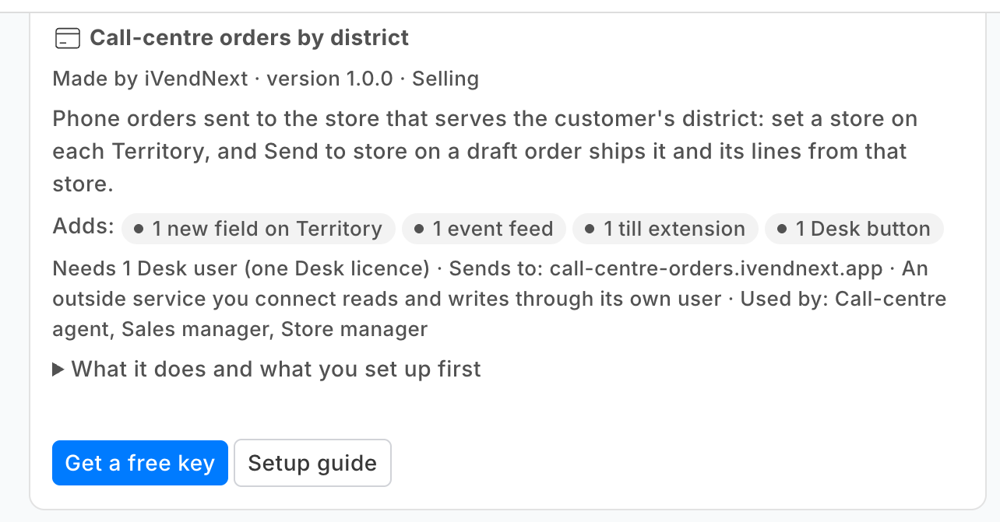

# S35 — Call-centre orders by district (`pp_cco`): a button that routes a phone order

A customer phones the call centre; the agent enters the order once, in Desk, and presses **Send to store**. The order then ships from the store that serves the customer's district and appears on that store's own list. The button's service changes that same record: the warehouse of a draft Sales Order and of every line on it.



**Industries:** Pharmacy

**When to use it:** you want a press in Desk to decide something about the record from data iVendNext already holds, and write the answer back onto it.

## Start from it

```bash
ivn new acme_district_orders --from s35
```

## What to change

What a partner usually changes:

- **The routing:** `route.py`, which walks the territory up the tree to the first **Serving store** and writes it on the order and every line.
- **The button:** `desk_actions` in `manifest.json` (its label and the roles that see it), on a draft Sales Order's form.
- **The field:** the **Serving store** field on Territory, in `custom_fields` in `manifest.json`.
- **The service's address:** every `host.docker.internal` in `manifest.json` is a test address; put your own there.
- **The answers the agent reads:** the sentences in `route.py`.

More: the [recipe](../../recipes/call_centre_orders.md).

**The customer sets:** a **Serving store** (a warehouse of the orders' company, never a group) on each district of its Territory tree; a district left empty takes the store above it.

**The app's role needs:** the install makes the role *PP CCO Integration* and the app's own user. On the retailer's own record types the retailer's administrator gives it read and write on Sales Order, and read on Territory, Customer (a sales order names its customer) and Warehouse. Give the role to no one else: it reaches every sales order. A read the role lacks does not stop the install: **Send to store** says the app may not read or change the order. Give the read and press it again ([What goes where](../../guide/07_manifests.md#what-goes-where)).

## Run it

```bash
ivn check
ivn try
```

## Versions

### 1.0.1

- The press asks no confirmation.

### 1.0.0

- First version in the kit: a Desk button that routes a phone order to its district's store.
- Each setting in app.json says its purpose (the line the Settings screen shows), whether it is required, and which settings go with it.
- The set-up steps say the install makes the app's own user (POS 2.1.0.667 or later).
