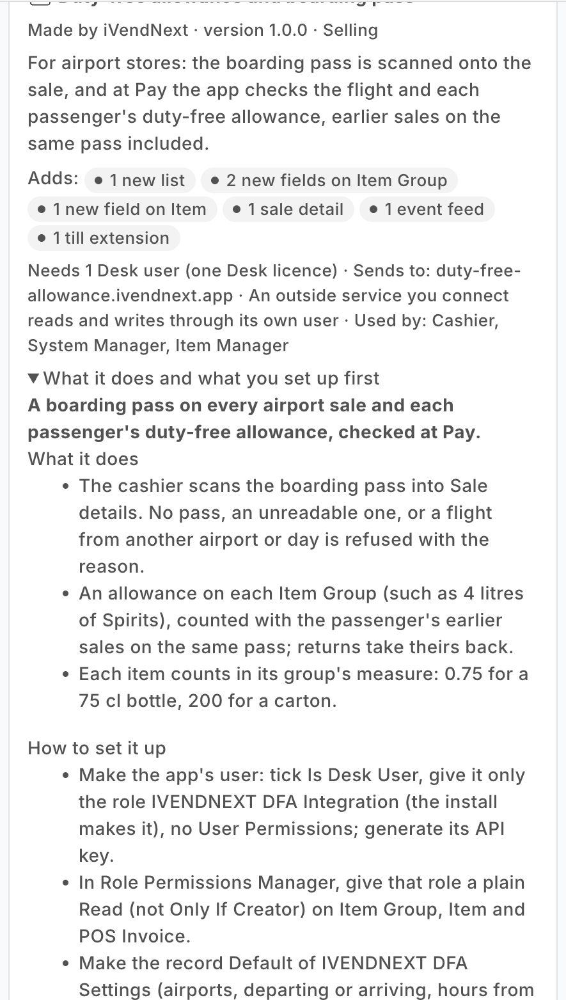
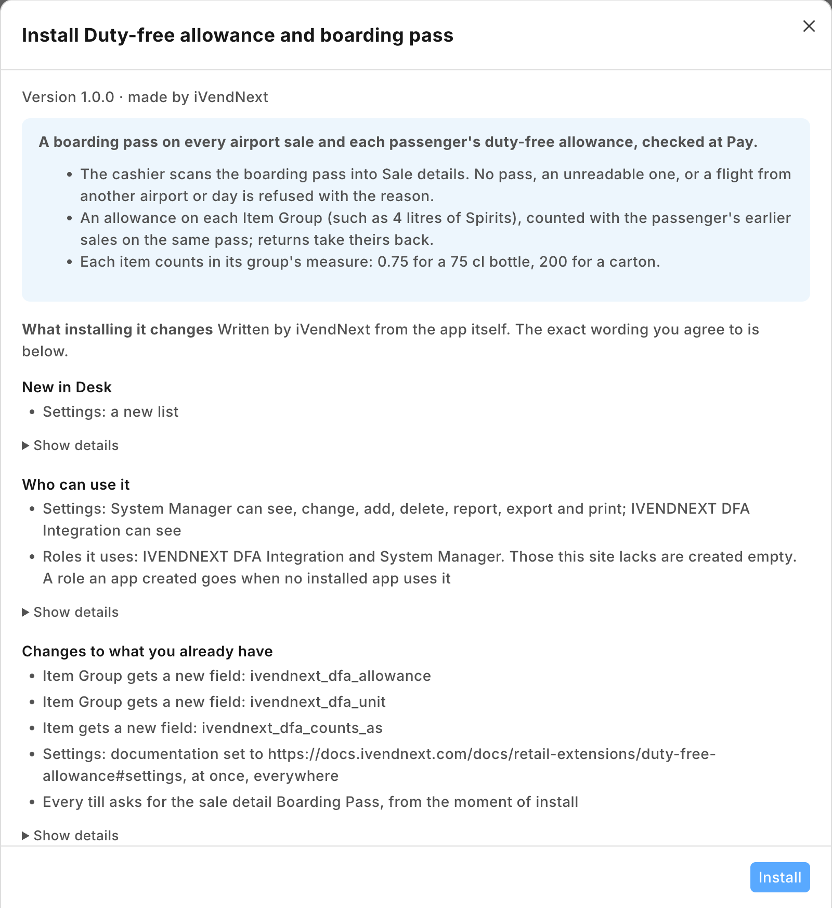
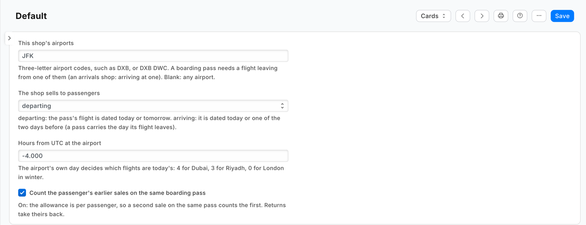
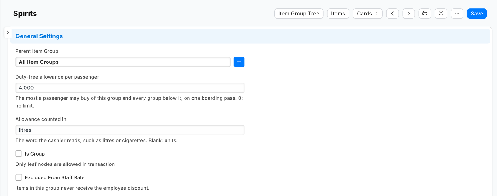
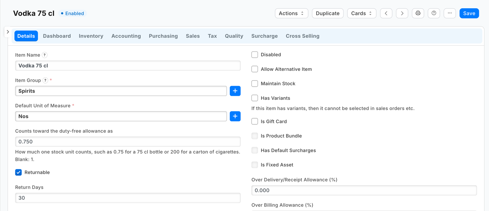
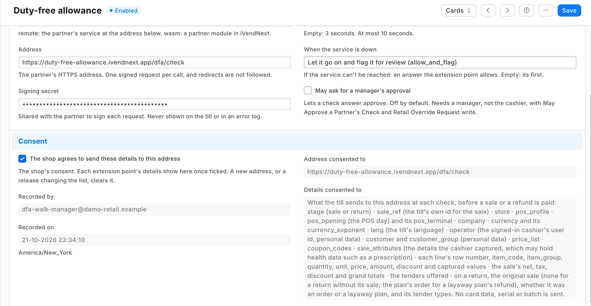
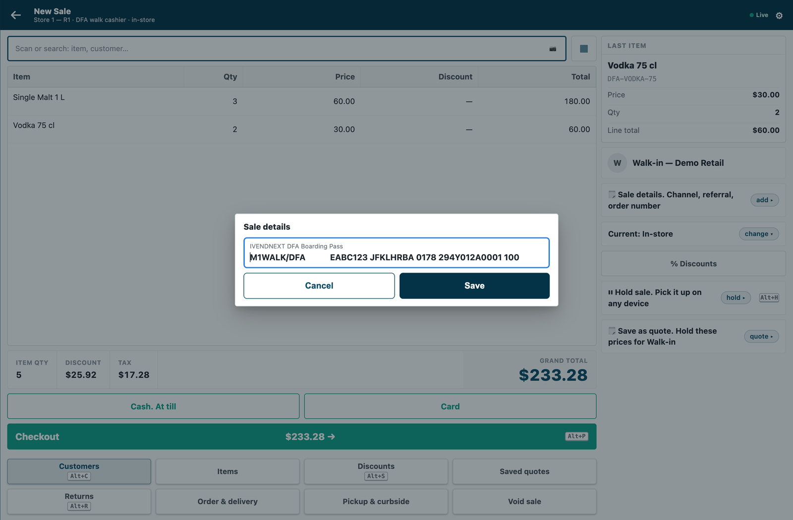
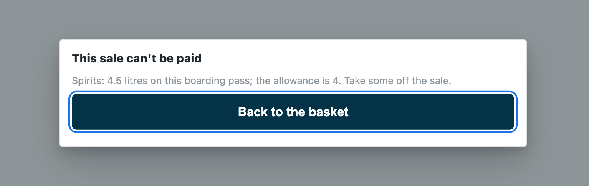
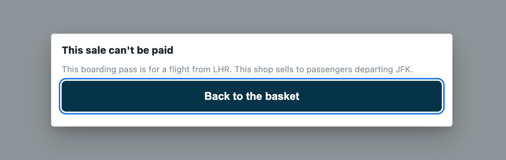
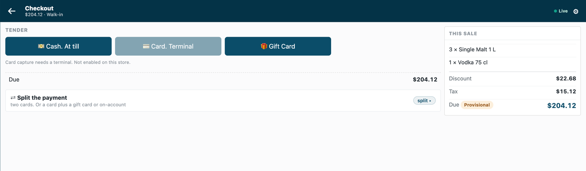

# S36 — Duty-free allowance and boarding pass (a check before payment for an airport shop)

An airport shop sells only to passengers with a valid boarding pass, and only up to each passenger's customs allowance. The cashier scans the customer's boarding pass into **Sale details** on the basket; when the cashier presses **Pay**, the app reads the pass and the basket:

| The sale | What the cashier sees (*"This sale can't be paid"* and …) |
|---|---|
| no boarding pass | *"Scan the customer's boarding pass into Sale details, then press Pay again."* |
| a code that is not a boarding pass | *"The boarding pass could not be read. Scan it again into Sale details."* |
| a flight that does not leave from the shop's airport (an arrivals shop: does not arrive there) | *"This boarding pass is for a flight from LHR. This shop sells to passengers departing DXB."* |
| a flight on another day | *"This boarding pass is for a flight on another day. Ask for the pass for today's flight."* (an arrivals shop: *"…Ask for the pass of the flight the customer just arrived on."*) |
| more than an item group's allowance, this sale with the passenger's earlier sales on the same pass | *"Spirits: 4.5 litres on this boarding pass; the allowance is 4. Take some off the sale."* |

Everything else is allowed. A refund is never judged; an exchange is judged for what it sells. The recipe: [`recipes/duty_free_allowance.md`](../../recipes/duty_free_allowance.md).

| What the shop sees (on a demo shop, 2026-10-22) | |
|---|---|
| The app's card in the App library |  |
| What the install will change, read before you consent |  |
| The settings record *Default* for a store at JFK |  |
| A duty-free allowance on the item group *Spirits*: 4 litres |  |
| A 75 cl bottle counts as 0.75 |  |
| The check switched on, with the shop's consent and the details it sends |  |
| The boarding pass in **Sale details** on the till |  |
| No pass: the till refuses the sale |  |
| 4.5 litres of spirits on one pass: refused |  |
| A flight from another airport: refused |  |
| Within the allowance: the payment screen opens |  |

## What the shop does

**Before you install:** every `host.docker.internal` address in `manifest.json` (in `allowed_urls`, and where the manifest calls it) is our test bench's own address for the sample's service, and it resolves only where Docker provides it. Replace it with your own service's address first, or the shop's calls never reach your service; if this manifest is already installed, raise its `version` and install it again ([the manifest recipe](../../recipes/manifest.md), step 6).

1. **Install the app** from the App library (or paste its manifest into **Retail Extension Package** in Desk), read what it will do and consent. The install adds the record type *PP DFA Settings*, two fields on Item Group, one on Item, the sale detail *PP DFA Boarding Pass*, the role `PP DFA Integration`, the check and the feed registration, the check switched off. Nothing changes at the till yet.
2. **Make the app's integration user** (the [integration user recipe](../../recipes/integration_user.md)): tick *Is Desk User*, give it the role **PP DFA Integration** alone and generate its API key. In *Role Permissions*, give that role a plain **read on Item Group, Item and POS Invoice** (the app reads the group tree, each item's measure and the passenger's earlier sales; not *Only If Creator*), and give the user no User Permissions: with either, the earlier sales are only partly seen and a passenger can buy past the allowance. Choose the user on the feed registration **PP DFA Allowance**, then press **Connect again** on the app's record, which sends that user's key to the service.
3. **Make the settings record `Default`** in *PP DFA Settings*: the shop's airports (three-letter codes, such as `DXB`; a word that is not one is kept, so every pass is refused naming it and the typo shows at once), whether it sells to passengers *departing* or *arriving*, the airport's hours from UTC (`4` for Dubai), and whether earlier sales on the same pass count (on by default).
4. **Set the allowances:** on each limited item group (*Spirits*, *Tobacco*), *Duty-free allowance per passenger* and *Allowance counted in* (*litres*, *cigarettes*); a group's allowance covers every group below it. On each item whose unit is not one of those, *Counts toward the duty-free allowance as* (0.75 for a 75 cl bottle, 200 for a carton of cigarettes; blank counts 1).
5. **Switch the check on:** open *Duty-free allowance* in *Retail Extension Subscription*, read what is sent, tick the consent, choose the **airport stores' POS Profiles** (a city store's tills are not asked) and switch it on.

**Where it shows.** At the till, the basket's **🗒 Sale details** row holds the boarding pass (a keyboard scanner types it into the field; the field shows on every till of the site, and only the tills whose POS Profiles the check serves need it); at **Pay**, a refusal in the app's words. In Desk, the settings record, and the fields on Item Group and Item. A sale the service could not check goes on and is flagged on *Sales to review*.

**What leaves the shop.** At **Pay**, the priced basket goes to the service's address: each line's item, group, quantity and amounts, the totals, the store and till, the cashier's user, the customer, the sale details (the boarding pass: the passenger's name, booking reference, flight and seat) and the payment methods offered; never a card. The service reads the shop's settings, item groups, the basket's items and the passenger's earlier sales on the same pass, with the integration user's key. It writes nothing. The manifest names that one address; the shop sees it, and the check's consent, on the install screen and on the check's own record before it is switched on.

## What is in the folder

| File | What it is |
|---|---|
| `manifest.json` | the record type `PP DFA Settings` (the record *Default*), two fields on Item Group and one on Item, the sale detail `PP DFA Boarding Pass` (never required: the check's POS Profiles choose where a pass is needed), a feed registration naming the app's one integration user, a help address, and one `check`, installed switched off; when the service is down the sale goes on, flagged |
| `dutyfree.py` | the pure core: the signature check (`verify`), the shape check, the boarding pass read (`legs`, IATA's bar-coded pass, format M), the airport and the day (`pass_problem`), the group tree (`limited_groups`) and the allowance (`over_allowance`) |
| `service/app.py` | the service, standard library only: `POST /dfa/check`, `GET /health`, and the app template's handshake for many shops; one `handle` answers the web server and the function entry (`lambda_handler`) alike |
| `Dockerfile` · `app.json` | the settings file for hosting (`"runs": "function"`: on CitiXsys hosting it is a function, paid per call) and an image for your own server (built from the kit's root) |
| `tests/` | the pass and the rules, the service over the wire with signed calls (one shop and many), the shop's reads against a stand-in shop, every answer against the published contract, the manifest; `canaries.py` breaks each guarded rule and expects its test to fail |

## Run it

```bash
python3 -m unittest discover -s samples/s36_duty_free/tests -p 'test_*.py'
```
```bash
python3 samples/s36_duty_free/tests/canaries.py
```
```bash
python3 samples/s36_duty_free/service/app.py samples/s36_duty_free/service/.env.local
```

**Settings, one shop** (`service/.env.local`, never committed): `IVN_CHECK_SECRET` (handed back at install as `pp_dfa:sub:allowance`), `IVN_SHOP_URL`, `IVN_SHOP_KEY` (`<api key>:<api secret>` of the integration user), `PORT`. **Many shops** (the [app template](../../tools/app_template/README.md)'s handshake): `IVN_LIBRARY_APP` and a store (`IVN_SHOPS_TABLE` on CitiXsys hosting, else `IVN_SHOPS_FILE`); each shop hands over the check's secret when it connects and its integration user's key on *Connect again*; until the key arrives the service answers 503 and the down answer applies. `DFA_PREFIX` names the record type, the fields and the sale detail (default `PP DFA`).

## Technical notes

- **The boarding pass** is IATA's bar-coded boarding pass (format `M`, one to four legs): the service reads each leg's airports, flight and day of the year. A leg that leaves from one of the shop's airports, dated the airport's today or tomorrow, passes. An arrivals shop takes a leg that arrives at one of its airports dated today or the two days before: a pass carries the day its flight leaves, and a long flight arrives up to two days later. A pass's second leg passes too when it fits in the till's 140 characters; on most real passes the first leg's own data fills that space, so a connecting passenger shows the pass of the flight that leaves here. The airport's day is UTC plus the settings' hours from UTC.
- **The till keeps 140 characters of a sale detail**, so a long pass (a phone's pass with its security part) is cut: every leg that fits whole is read, and a pass's first leg always fits (it ends at the 60th character).
- **Earlier sales on the same pass:** the submitted POS Invoices whose sale detail starts with the pass's first 60 characters (the passenger's name, booking, flight, seat and check-in number), at most 20, each read for its lines; a return's lines take theirs back. They are read only when this sale holds an item of a limited group, and never kept.
- **The measure:** each line's quantity in its item's stock unit (a line rung in another unit is converted by the item's own units) times *Counts toward the duty-free allowance as*. Only the groups this sale's own lines fall under are judged, so an earlier sale alone never refuses this one.
- **What is read, and kept:** the settings record and the item groups, kept one minute per shop and per key; the items and the earlier sales, live. A sale with no pass is refused, and a refund allowed, without reading the shop.
- **The shop cannot be read** (no answer, an error answer other than 401 or 403, an answer cut short, not records, an item on the sale it does not return): 503, so the till applies the down answer. **The shop refuses the key** (401 or 403): the sale is refused in words that say so, never sold unchecked. A redirect is never followed with the key.
- **The basket lock is the till's:** an allowed answer holds for exactly the basket checked; another line or another pass is refused before any money until the cashier presses Pay again.
- **Offline,** the till does not call the service: the down answer applies and the sale is flagged when it syncs.
- **Bounds:** the passenger's purchases at another shop, on another site, or in a sale not yet submitted are not counted; two sales on one pass checked at the same moment at two tills both see the other as not yet made; passenger categories (transit, crew, airport staff) and their tax are not judged; a time-zone change in the year (summer time) needs the hours updated; a departing flight delayed past midnight is refused after midnight as another day's (the pass carries the day it was due to leave), and nothing in this version lets that sale through.
- It logs one line per call: the route, the status and the milliseconds, never the body.

### What was proven where

- **On the laptop:** the tests and canaries above.
- **On a demo shop** (2026-10-22, iVendNext POS 2.0.0.658): installed from the App library with a free key and set up in the card's order; at the till, a sale with no pass, over the allowance and from another airport refused in the app's words, and one within the allowance opened the payment screen, against the service hosted by CitiXsys (the pictures above). Then uninstalled, the walk's data removed and its key withdrawn.
- **On our test bench** (2026-10-22, the iVendNext POS app at `84185344` (the programme's own clone the bench mounts), the engine at `dc65d832`; the service in its one-shop form, reading the shop with a user holding only the app's role and a read on Item Group, Item and POS Invoice; the shop's settings DXB, departing, UTC+4; a group *Spirits* allowed 4 litres, with a 1-litre whisky in a group below it and a 75 cl vodka), **12 of 12, twice**, through the till's own calls inside one day that was closed after: a sale with no pass refused in the app's words, the card push refused, no sale booked · a pass for a flight from London refused, naming LHR and DXB · a pass dated three days ago refused as another day · a passenger's 2 whiskies and 2 vodkas (3.5 litres) allowed and booked with the pass on the sale · that passenger's next sale of 1 whisky refused at 4.5 litres (the booked sale found by its pass and counted live) · an item of no limited group allowed and booked · another passenger's 3.75 litres allowed · the service received the pass whole, as the sale detail, with each line's item group. Before the scenario, each read the service makes was made as the app's user and none was refused. The install, the uninstall (the schema as found; the sale detail kept, switched off) and the rights put back were checked too, and no POS day was left open. **In a browser** on that bench, as a System Manager with Item Manager: the settings record and the allowance on the item group opened as set, and an item's measure changed and saved; at the till as a cashier: 5 bottles of the whisky and no pass refused, the pass typed into *Sale details*, 5 litres refused, 4 litres allowed to the payment screen (the sale voided, nothing paid). **The library copy rehearsed** on a new site with developer mode off: check, install, update, export and uninstall, reinstall, each without error; the site as found after the uninstall; the reinstall made the app's role. **Not run on the bench:** an arrivals shop, a pass with two legs, an earlier return taking its amount back, a line in another unit, many shops (each in the laptop tests), offline.
