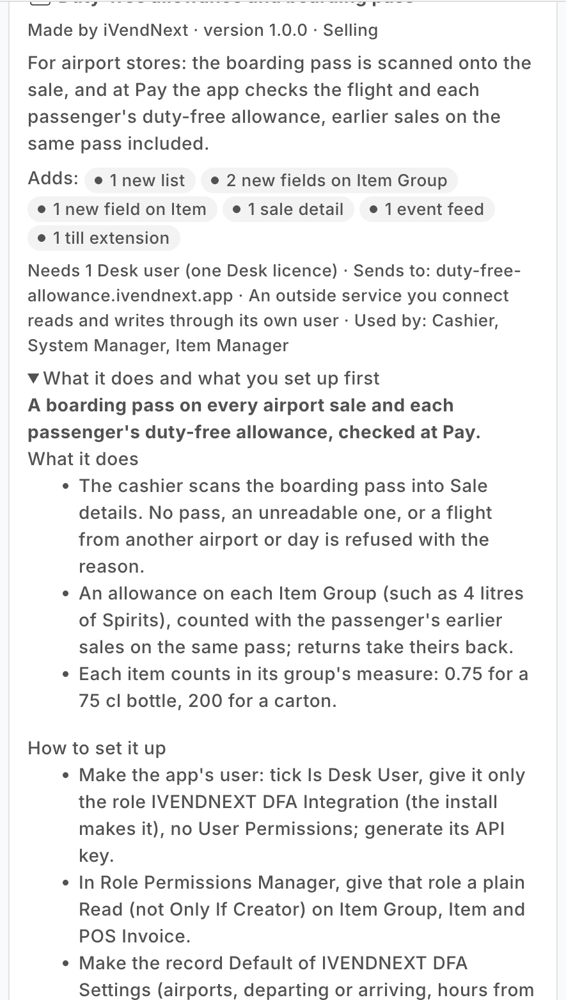

# S36 — Duty-free allowance and boarding pass (a check before payment for an airport store)

An airport store sells only to passengers with a valid boarding pass, and only up to each passenger's customs allowance. The cashier scans the boarding pass into **Sale details** on the basket; at **Pay** the app reads the pass and the basket. It refuses, in words the cashier can act on, a sale with no pass, a code that is not a pass, a flight from another airport or on another day, and more of an item group than the allowance, counting the passenger's earlier sales on the same pass. Everything else is allowed. A refund is never judged.



**Industries:** Travel retail

## Start from it

```bash
ivn new acme_dutyfree --from s36
```

## What to change

What a partner usually changes:

- the service's address: `allowed_urls` and the check's endpoint in `manifest.json` name the sample's test address; write your own;
- the settings record `Default` in *PP DFA Settings*: `airports`, `direction` (departing or arriving), `hours_from_utc`, `count_earlier_sales`;
- the allowances: *Duty-free allowance per passenger* (`pp_dfa_allowance`) and *Allowance counted in* (`pp_dfa_unit`) on each limited item group, and *Counts toward the duty-free allowance as* (`pp_dfa_counts_as`) on an item whose unit is not that measure;
- how the pass is read and judged: `legs`, `pass_problem` and `over_allowance` in `dutyfree.py`;
- the record type, field and sale-detail names: the `DFA_PREFIX` setting of the service (default `PP DFA`).

More: the [recipe](../../recipes/duty_free_allowance.md).

**The customer sets:** its airports and whether it sells to departing or arriving passengers, the allowances on its item groups, the airport stores' POS Profiles the check serves, and the app's integration role: a plain read on Item Group, Item and POS Invoice, with no User Permissions on its user.

## Run it

```bash
ivn check
ivn try
```

## Try it at the till

- Sell a bottle of spirits with no boarding pass; the till stops it at Pay.
- Scan the boarding pass into Sale details and press Pay again.
- Close the till day when you are done.

## Versions

### 1.0.0

- First version in the kit: a check before payment that reads the boarding pass and each passenger's allowance.
- Each setting in app.json says its purpose (the line the Settings screen shows), whether it is required, and which settings go with it.
- The set-up steps say the install makes the app's own user (POS 2.1.0.667 or later).
