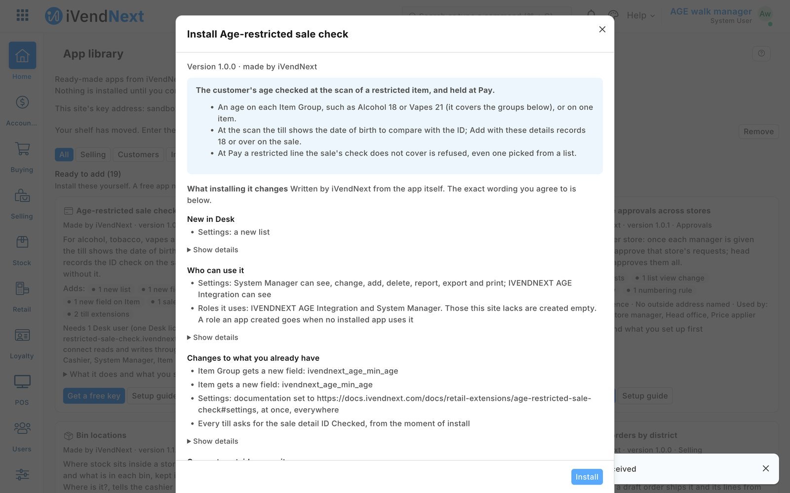

# S37 — Age-restricted sale check (a capture on scan and a check before payment)

A retailer that sells alcohol, tobacco, vapes, knives or some medicines must see the customer's ID before it sells them. Each restricted item group (or item) gets its age. When the cashier scans a restricted item, the till shows the date of birth the customer must be born on or before, and one tap records the check on the sale. At **Pay**, a restricted line the sale's check does not cover is refused, in words that say what to do. No date of birth or ID number is asked or kept: the sale records the age band the cashier confirmed. A refund is never judged.



**Industries:** Grocery, Hospitality, Liquor and wine, Pharmacy, Travel retail

## Start from it

```bash
ivn new acme_age_check --from s37
```

## What to change

What a partner usually changes:

- **The words the cashier reads:** `on_scan` and `on_check` in `agecheck.py`.
- **The settings record:** `hours_from_utc` and `look_under` on `PP AGE Settings` in `manifest.json` (the retailer's hours from UTC; ask for ID from anyone who looks under that age).
- **The age:** the field *Customers must be at least this old* on Item Group and on Item, in `custom_fields`.
- **The sale detail:** `PP AGE ID Checked` in `sale_attributes`.
- **The service's address:** every `host.docker.internal` in `manifest.json` is a test address; put your own there.

More: the [recipe](../../recipes/age_check.md).

**The customer sets:** the age on each restricted item group (or item), its hours from UTC in the settings record, and the restricted groups on the scan service's settings (`"item_groups": ["Alcohol", "Tobacco"]`).

## Run it

```bash
ivn check
ivn try
```

## Try it at the till

- Scan a bottle of wine; the till shows the date of birth to check. Press Add with these details.
- Pick a restricted item from the list instead of scanning it; the till stops it at Pay.
- Close the till day when you are done.

## Versions

### 1.1.2

- Manifest 0.2.2: the scan waits 3 seconds and the check at Pay 4, as the App library copy does (a hosted function can be slow on its first call after a quiet spell). The service is unchanged.

### 1.1.1

- The settings field reads *Hours from UTC at your store*, and the manifest says store where it said shop. Manifest 0.2.1. The recipe says more than one app may answer the scan on a POS Profile, in turn.

### 1.1.0

- The role's rights beyond the feed's reads move into the manifest (`role_rights`): the install gives the feed's user its reads and the manifest the rest, so the retailer's administrator grants none. Needs POS build `2.1.0.691` or later.

### 1.0.0

- First version in the kit: the date of birth to check at the scan, recorded on the sale, and Pay refused without it.
- Each setting in app.json says its purpose (the line the Settings screen shows), whether it is required, and which settings go with it.
- The set-up steps say the install makes the app's own user (POS 2.1.0.667 or later).
