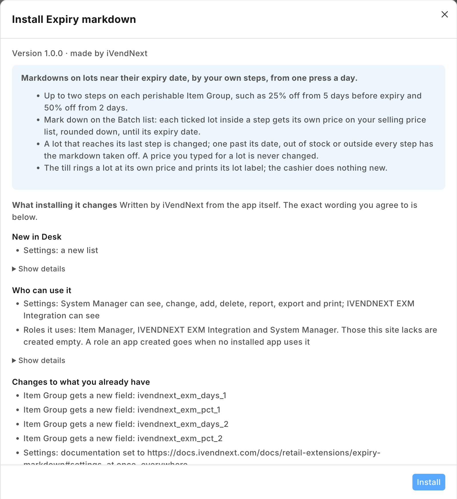
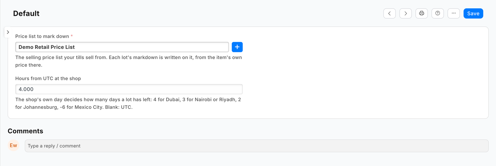
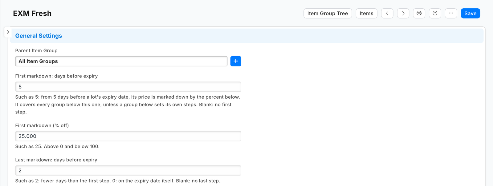
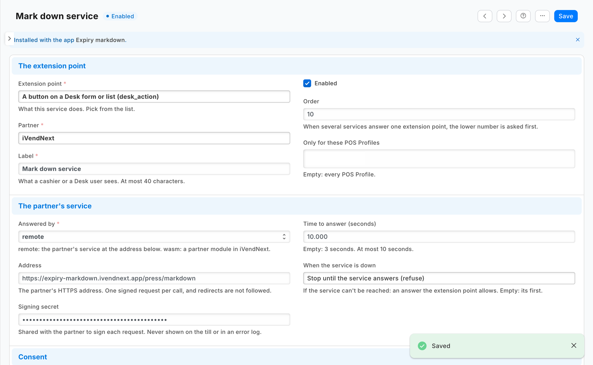
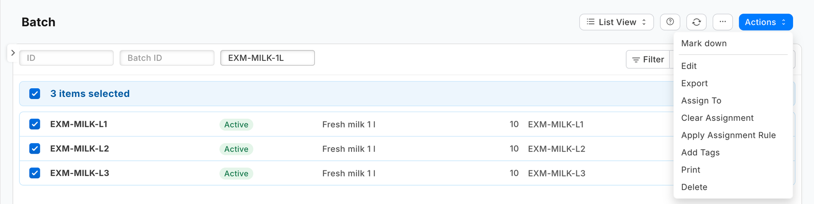
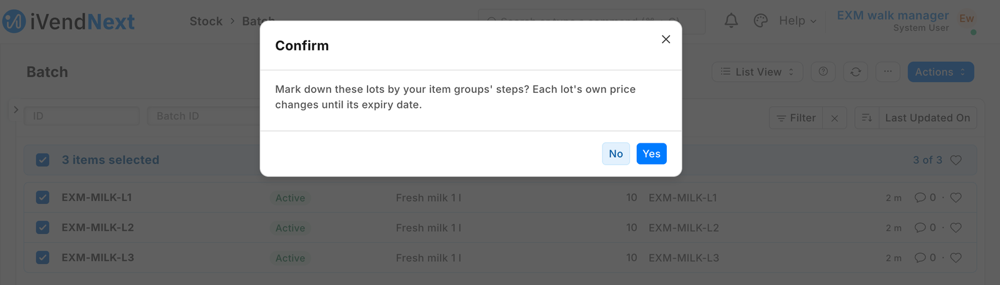
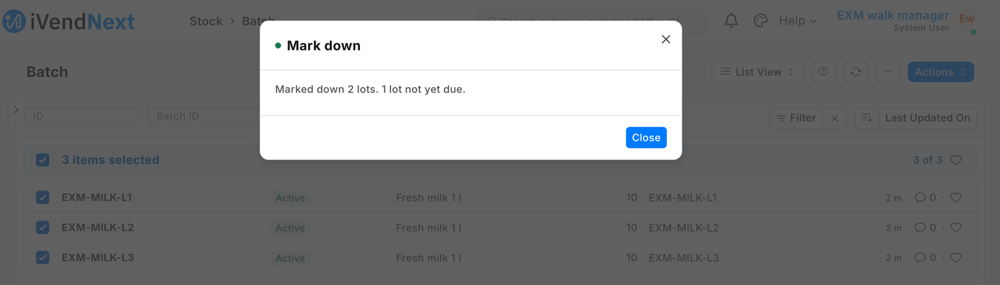
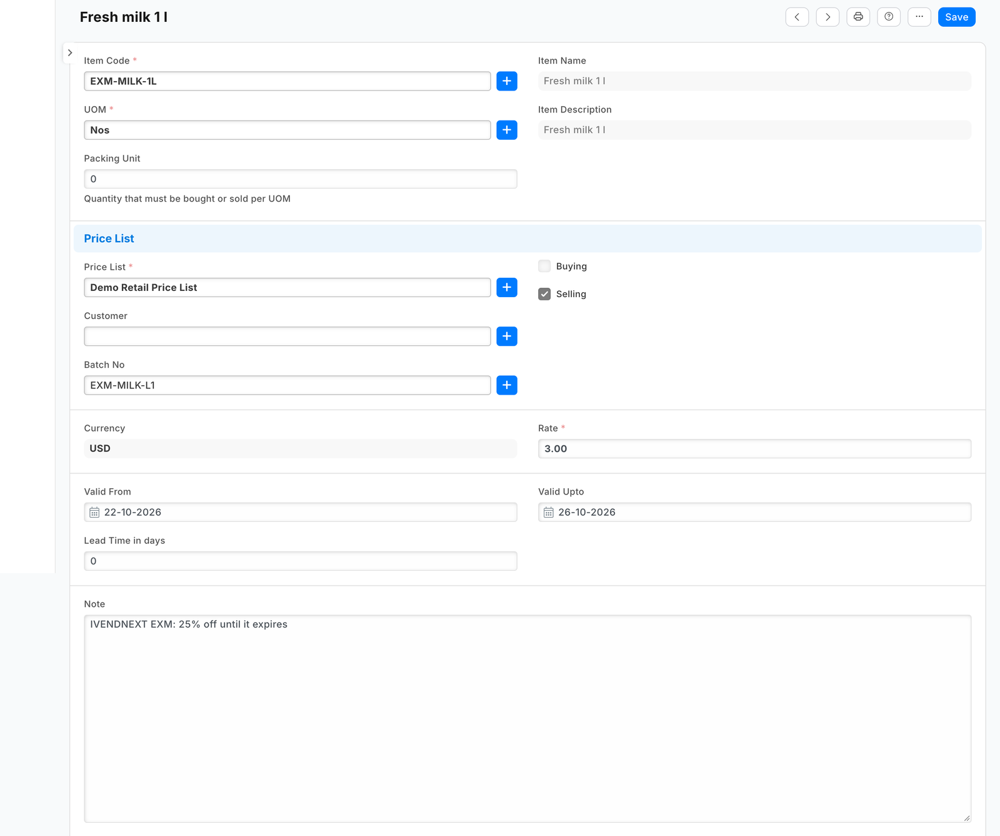

# S38 — Expiry markdown (`pp_exm`): mark down stock as its expiry date nears

*Start from this sample: `python3 tools/manifest/start.py s38_expiry_markdown --prefix "ACME EXM"` copies it into `apps/` of your repository under your own prefix (your company's first word, then a short name for the app) and checks it ([how](../../recipes/make_it_your_own.md)).*

A grocery, bakery or pharmacy marks down stock whose expiry date is near, so it sells before it is thrown away. The retailer sets its markdown steps once on its item groups: 25% off from 5 days before expiry, 50% off from 2 days, say. Each morning a manager ticks the lots in the Batch list and presses **Mark down**. Every ticked lot inside a step gets its own price on the retailer's selling price list, valid until its expiry date. The till already rings a lot at its own price and prints its lot label, so the cashier does nothing new. This sample is for a developer who wants a button on a Desk list whose service **writes the retailer's own records** by a rule the retailer keeps.

**When to use it:** the retailer's rule decides a value on many records at once, a person decides when to apply it, and iVendNext already reads the value where it matters (here: a lot's own Item Price, which the till honours).

## What happens

1. The retailer's manager gives each perishable item group its steps (*First markdown: days before expiry*, *First markdown (% off)*, *Last markdown: …*). A group without steps takes the nearest group above it that has some.
2. Each morning the store's manager (an *Item Manager*) filters the **Batch** list to lots expiring this week, ticks them, and presses **Mark down** (or presses it on one lot's form).
3. iVendNext sends your service, signed, each ticked lot's name, item and expiry date.
4. Your service reads, **with its own key**, the retailer's settings, the lots, their items, the item group tree, the price list's currency and those items' prices on the list. For each lot inside a step it writes the lot's own **Item Price**: the item's price less the step's percent, rounded **down** to the currency's smallest unit, valid from today until the lot's expiry date, its note naming the app (*PP EXM: 25% off until it expires*). A lot that reached its last step has its row changed. A lot past its date, out of stock or outside every step has the app's price taken off. Then it removes up to 20 of the app's prices whose date has passed, anywhere.
5. The list reloads, and the answer counts what happened: *"Marked down 12 lots. 3 lots not yet due. 1 lot with a price of the shop's own, left as it is."*
6. The manager prints the lot labels from the till (*Print label*, the lot chosen): the label shows the lot's price and expiry date. The cashier scans as always, and the lot rings at its markdown.

Pressed again, the button writes nothing: *"2 lots already marked down."*

| What the retailer sees (on a demo site, 2026-10-22) | |
|---|---|
| What the install will change, read before you agree |  |
| The settings record *Default*: the price list and the hours from UTC |  |
| The steps on an item group |  |
| The service switched on, with its address and its time to answer |  |
| **Mark down** in the Batch list's *Actions*, three lots ticked |  |
| The question before the press |  |
| The answer from the hosted service |  |
| A lot's own price: 3.00 instead of 4.00 until its expiry date, with the app's note |  |

## What the retailer does

**Before you install:** every `host.docker.internal` address in `manifest.json` (in `allowed_urls`, and where the manifest calls it) is our test bench's own address for the sample's service, and it resolves only where Docker provides it. Replace it with your own service's address first, or iVendNext's calls never reach your service; if this manifest is already installed, raise its `version` and install it again ([the manifest recipe](../../recipes/manifest.md), step 6).

1. **Install the app** (the retailer's administrator). It comes in switched off: the service has no consent and is off, and the button is off. The install adds the four step fields to Item Group, the settings record type **PP EXM Settings** and the role **PP EXM Integration**.
2. **Give the app a user** (as in the [integration user recipe](../../recipes/integration_user.md)): tick **Is Desk User**, set no password and no User Permissions, give it the role **PP EXM Integration** alone, and generate its API key. In **Role Permissions**, give that role these rights (measured on our test bench: iVendNext refused the app's user each one until it was given):

   | Record type | Right | Why |
   |---|---|---|
   | Batch | Read | the ticked lots: item, expiry date, stock |
   | Item | Read | each lot's item group (with *select* alone iVendNext answers only the fields it lists for search, which a retailer may change) |
   | Item Group | Read | the steps, and the tree they are read up (with *select* alone iVendNext lists the names only, and every lot reads as having no steps) |
   | Price List | Read | the settings' list: is it a selling list that is on, and its currency |
   | Currency | Read | the currency's smallest unit, for the rounding |
   | Item Price | Read, Write, Create, Delete | the item's own price, and each lot's own price |

   The role reaches every price on every list: give it to the app's user and no one else. A service for one retailer takes the key in its settings. A service for many retailers receives it from iVendNext: choose the user as the *Application User* of the feed **PP EXM Markdown feed**, then press **Connect again** on the app (*Many retailers, hosted* below).
3. **Fill in the settings:** open **PP EXM Settings**, make the record **Default**, choose the selling **price list** your tills sell from, and the retailer's **hours from UTC** (the retailer's own day decides how many days a lot has left).
4. **Give the steps** to your perishable item groups (Item Group form).
5. **Switch the service on** (the System Manager): **Retail Extension Subscription**, the record *Mark down service*: read what it is sent, tick the consent, switch it on. Then **Retail Desk Action**, the record *Mark down*: switch it on. The button shows to an *Item Manager*, the engine's role that reads Batch (iVendNext checks, at every press, that the user may read each ticked lot). If the retailer's markdowns are someone else's job, add their role on the button and give that role read on Batch.

**Where it shows.** In Desk: the four steps on the Item Group form, the settings record, and the button on the Batch list and form. At the till: nothing new; a lot rings at its own price.

**What leaves the retailer's iVendNext.** One address: your service (the manifest ships a test address; you write your own). Each press sends the ticked lots' names, items and expiry dates, the pressing user (an e-mail address) and the language. Your service then reads the lots, their items' groups, the steps, the price list and those items' prices on it, and writes the lots' prices. It keeps nothing of a press; a hosted copy holds each retailer's press secret and its user's API key from *Connect again* until the retailer removes the app. Say so on your card.

⚠ **The till offline.** The till's offline price list has no lot in it, so while **any** lot on the site has a price of its own (expired ones and buying lists' included), the retailer's tills do not sell a lot-tracked item offline: they refuse it rather than promise one price and book another. Each press removes up to 20 of the app's prices whose date has passed, so once no markdown is left and the last expired one is removed by a press, the tills sell lots offline again from their next start. A till that started before the first markdown keeps selling lots offline until its next start, at the item's own price.

## The files

| File | What |
|---|---|
| `manifest.json` | the settings record type, the four steps on Item Group, the service (`extension_subscriptions`, extension point `desk_action`), the button (`desk_actions`, Batch, form and list), the feed whose user is the app's, a help address; installed **switched off** |
| `markdown.py` | **the pure core**: the signature check, the press's lots, the steps on the group tree, the percent by days left, the rounding, each lot's writes, the answer |
| `service/app.py` | the HTTP service (standard library): `POST /press/markdown`, `GET /health`; the record API as the app's user; one retailer or many |
| `tests/test_service.py` | laptop tests: the real service, a stand-in record API, presses signed as iVendNext signs them |
| `tests/test_many_shops.py` | many retailers: each retailer's own secret and key, a press before *Connect again*, the fields under the library's prefix, the record API's errors, the function entry |
| `tests/test_manifest.py` · `tests/test_contract.py` | the manifest's shape; every answer, and every press our test site recorded, against the published contract (`desk_action.v1.schema.json`) |
| `tests/canaries.py` | each test that guards a secret, a key, a price the retailer typed, an edit, the step chosen or the rounding goes RED when its check is removed |
| `app.json` | how CitiXsys hosting runs it: a function, paid per call, packaging only the files it needs |

The recipe is [Expiry markdown](../../recipes/expiry_markdown.md). The button's own recipe is [`recipes/desk_action.md`](../../recipes/desk_action.md).

## Run it

```bash
cd samples/s38_expiry_markdown
python3 -m unittest discover -s tests -p 'test_*.py'
python3 tests/canaries.py
python3 service/app.py service/.env.local      # PP_BASE, PP_KEY, PP_SECRET, PP_POINT_SECRET, PP_PORT
```

## Many retailers, hosted

The App library's *Expiry markdown* runs this same `service/app.py` for every retailer that installs it, as a function on CitiXsys hosting (`app.json`): it costs nothing between presses. Set `IVN_LIBRARY_APP` (the library's id), a shops store (`IVN_SHOPS_TABLE` on hosting, `IVN_SHOPS_FILE` on your own server) and `EXM_PREFIX` (`IVENDNEXT EXM`: the step fields are then `ivendnext_exm_days_1` and so on, and the note *IVENDNEXT EXM: …*).

1. After its install the retailer's site connects itself (the app template's handshake, guide chapter 14b): the service stores the retailer with its library key and the press's secret, `<app>:sub:markdown`.
2. The retailer chooses its app user on the feed and presses *Connect again*: the service receives that user's key (`user:<email>`).
3. Each press names its retailer (`X-iVendNext-Site`); it is checked with **that retailer's** secret and the prices are read and written with **that retailer's** user's key. Another retailer's secret, or a retailer the service does not know, is refused (401).
4. A press before step 2 is answered in words: *Mark down is not set up yet.*

## Make it your own

What a partner usually changes:
- **the rule:** steps per store, per item or per brand; a price rounded to the retailer's price points (x.99); a markdown by stock age instead of expiry; a third step;
- **when it runs:** a daily run with no press (a schedule on your own server), or a press that also prints the lot labels on your own label service;
- **the prefix:** `tools/manifest/rename.py` makes your copy under your own reserved prefix in one step; the service takes its prefix from `EXM_PREFIX`;
- **its records:** `tools/deploy/copy_records.py` moves the settings record and the item groups' steps between a test site and the retailer's iVendNext.

## Before you copy it

- **A price the retailer typed is never changed.** The app touches only rows whose note starts with its prefix and a colon. A lot that already has a price of the retailer's own is reported and left.
- **An edit is never overwritten.** An update carries the row's `modified` as read; iVendNext refuses a stale write (`TimestampMismatchError`), and the answer asks for another press. A second press that created the same row a moment earlier is no failure either.
- **iVendNext's own words never reach the user.** The service branches on the error's type (`exc_type`), never shows its message.
- **A press stops in time.** iVendNext waits 10 seconds at most for a Desk button; the service starts no new lot after 6 seconds and says how many are left (*Did 40 of 100 lots. Press Mark down again for the rest.*). A repeated press is harmless.
- **Removing the app leaves the lots' prices it wrote** (they are the retailer's Item Price rows). Before you remove it, filter the Item Price list on *Note* starting with your prefix and delete them (a *Sales Master Manager* reads that list): once the app is gone nothing removes them, and while they exist the tills do not sell lot-tracked items offline.
- **Test routes.** Delete `/test/received` from your copy.
- **Your address.** Write your own address in `allowed_urls`. The retailer's server must trust your certificate: a real one for a retailer.

## Technical notes

### Why it is built this way

| Option | Cost | Verdict |
|---|---|---|
| Do nothing: a manager types each lot's price in Desk | 0 | works, and the till honours it; every lot every day by hand, and prices nobody removes keep the tills from selling lots offline |
| A manifest only: the steps on Item Group and a report of lots inside a step | ~½ day | shows what to mark down; the prices are still typed by hand |
| **A manifest plus a Desk action whose service writes each lot's price** | ~1½ days | **picked**: the retailer's rule, one press a day, the till unchanged; S35's service shape reused |

A manifest cannot write an Item Price: a save rule's derived value writes only numbers into the record being saved, and nothing in a manifest runs on a date. A price module (the pricing extension point) never sees which lot a line is.

### Bounds, stated

- **Lot-tracked items only:** an item with no lots has no expiry date to read.
- **One set of steps per item group** and one price list per site. Put steps only on item groups whose every item may be sold below its price: a group below takes its parent's steps, and a step of 0 is no step, so a group of price-regulated medicines must not sit under one with steps.
- **The first markdown and the tills.** After the first press, restart the tills (or sign them in again) before they go offline: a till started before any lot had its own price keeps selling lots offline at the item's own price, above the markdown on the label.
- **The service does not answer in time.** If the service does not answer in time, some lots may already be marked down: press again, and a repeat writes nothing.
- **Which lot rings:** a scanned lot label names its lot. An item's own barcode lets iVendNext pick the lot (Stock Settings *Pick Serial / Batch Based On*): with *Expiry*, the lot nearest its date sells first, at its markdown.
- **Up to 100 lots a press** (the Desk action's own limit), and as many as fit in 6 seconds.
- **What the till shows before it prices the line.** The item's tile and a scan show a price the till reads from any of the item's prices on the list, so on a store with lot prices it can show another lot's price; the line, the total and the receipt then carry the right one (measured on our bench; a POS request).
- **A line from several lots.** A line the till fills from more than one lot is priced once for the whole line; scan each lot's label to ring each lot at its own price (not measured on our bench).
- **A newer item price.** A new price for the item, or one dated to start later, takes the markdown off a scanned lot label from that day until the next press, which moves the lot's price to it.
- **The rounding.** The rounding is to the currency's own digits (its number format); a site whose currency precision is set to fewer digits rounds the line again, which can add up to half of its smallest unit.
- **A customer with their own price.** With a customer on the sale who has a price of their own for the item, a scanned lot rings the customer's price, not the lot's markdown (the retailer's own price order).
- **The retailer's day** is the hours from UTC in the settings: change it when your clocks change. A press made just before midnight on a site ahead of UTC with the hours left at 0 writes yesterday's date, which the till reads as valid.
- **The app's own rows** are those whose note starts with its prefix and a colon. A price you edit on such a row is the app's again at the next press; to keep a lot price of your own, write your own note.
