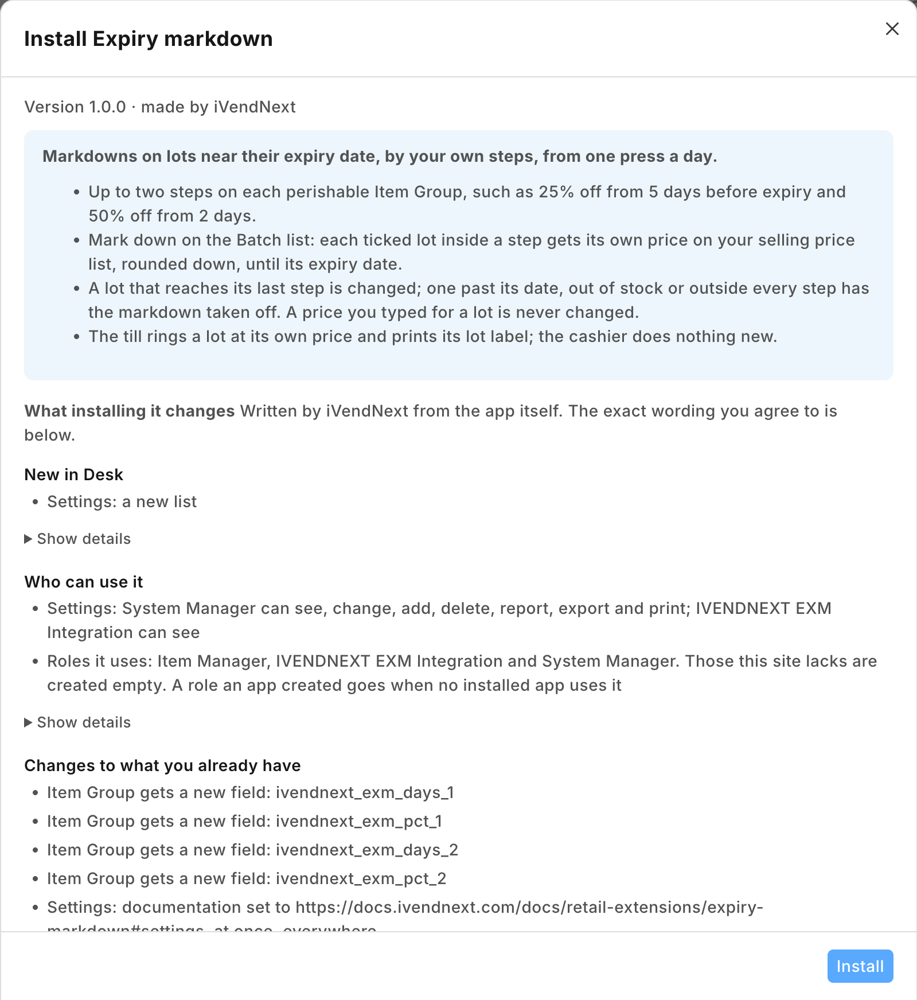

# S38 — Expiry markdown (`pp_exm`): mark down stock as its expiry date nears

A grocery, bakery or pharmacy marks down stock whose expiry date is near, so it sells before it is thrown away. The retailer sets its markdown steps once on its item groups: 25% off from 5 days before expiry, 50% off from 2 days, say. Each morning a manager ticks the lots in the Batch list and presses **Mark down**. Every ticked lot inside a step gets its own price on the retailer's selling price list, valid until its expiry date, and the same price on any other selling price list (a member list, say) whose own price is higher, so a member never pays more for a marked-down lot than a walk-in. The till already rings a lot at its own price, so the cashier does nothing new.



**Industries:** Beauty and cosmetics, Grocery, Liquor and wine, Pharmacy

**When to use it:** the retailer's rule decides a value on many records at once, a person decides when to apply it, and iVendNext already reads the value where it matters (here: a lot's own Item Price, which the till honours).

## Start from it

```bash
ivn new acme_expiry_markdown --from s38
```

## What to change

What a partner usually changes:

- **The rule:** `markdown.py`: the percent by days left, the rounding (down to the currency's smallest unit), each lot's writes. A third step, a price point such as x.99, or a markdown by stock age.
- **The steps:** the four fields on Item Group (`pp_exm_days_1`, `pp_exm_pct_1`, `pp_exm_days_2`, `pp_exm_pct_2`) in `custom_fields` in `manifest.json`.
- **The settings record:** `price_list` and `hours_from_utc` on `PP EXM Settings`.
- **The button:** `desk_actions` in `manifest.json` (*Mark down*, on the Batch list and form).
- **The service's address:** every `host.docker.internal` in `manifest.json` is a test address; put your own there.

More: the [recipe](../../recipes/expiry_markdown.md).

**The customer sets:** the selling price list its tills sell from and its hours from UTC in `PP EXM Settings`, and the steps on each perishable item group.

## Run it

```bash
ivn check
ivn try
```

## Try it at the till

- In Desk, tick a lot close to its expiry date on the Batch list and press Mark down.
- Scan that lot at the till; it rings at its marked-down price.
- Close the till day when you are done.

## Versions

### 1.1.2

- A member pays the marked-down price too: the lot's price also goes on each other selling price list in the same currency whose own price for the item is higher, and comes off it with the markdown. A list already priced lower keeps its price. Manifest 0.2.2.

### 1.1.1

- The settings field reads *Hours from UTC at your store*, and its help says *Your store's own day*. Manifest 0.2.1.

### 1.1.0

- The role's rights beyond the feed's reads move into the manifest (`role_rights`): the install gives the feed's user its reads and the manifest the rest, so the retailer's administrator grants none. Needs POS build `2.1.0.691` or later.

### 1.0.0

- First version in the kit: a Desk button on the Batch list that writes each lot's own price by the retailer's steps, until its expiry date.
- Each setting in app.json says its purpose (the line the Settings screen shows), whether it is required, and which settings go with it.
- The set-up steps say the install makes the app's own user (POS 2.1.0.667 or later).
