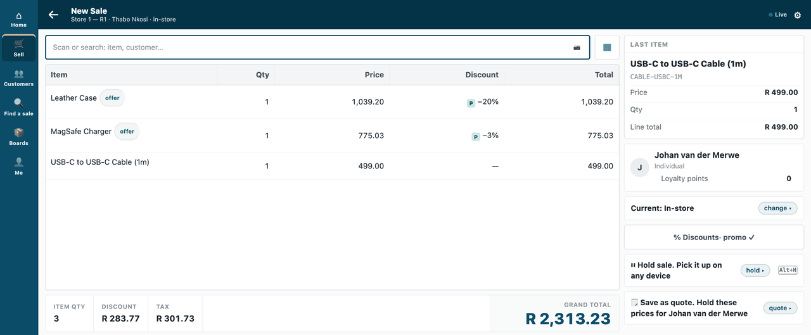
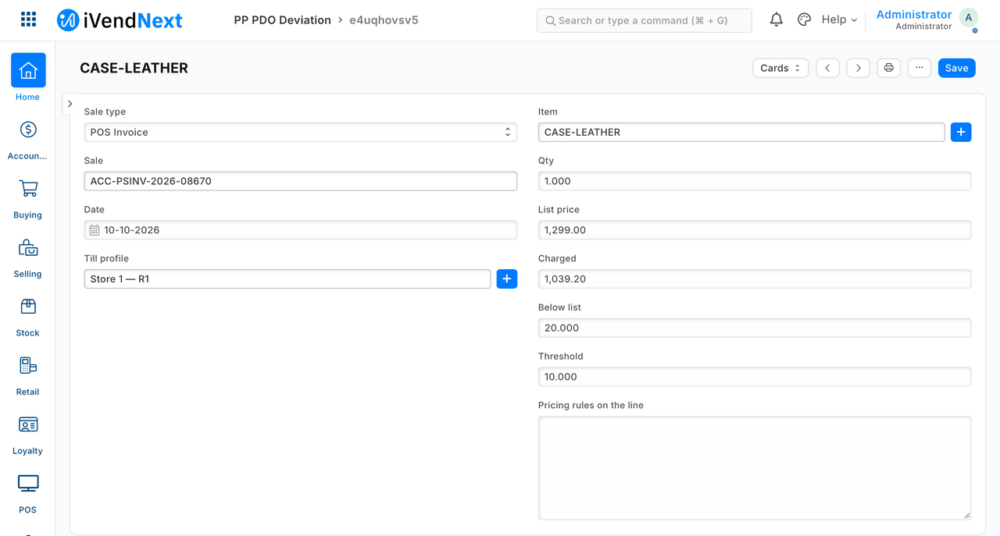

# S3 — price-deviation audit: every line sold below list by more than a threshold

*Start from this sample: `python3 tools/manifest/start.py s3_price_audit --prefix "ACME PDO"` copies it into `apps/` of your repository under your own prefix (your company's first word, then a short name for the app) and checks it ([how](../../recipes/make_it_your_own.md)).*


*A sale with two offers; after the sale, the audit records the one line sold too far below its list price.*

For each booked sale, this sample records each line charged below its price-list rate by more than the retailer's threshold (a store manager's audit). It runs as your own service, outside the retailer's iVendNext: for one retailer on your own server (`outside/service.py`), or for many retailers, each connecting itself after it installs the app from the App library (`outside/app.py`, the way CitiXsys hosts the library's *Price-deviation audit*). It is for a developer who wants to check every sale after it is booked, and keep the findings where store managers can read them in Desk.

**When to use it:** you want an after-the-sale check on prices, discounts or anything else a booked sale carries.

**Door:** Event feed

## What it looks like

| Step | Frame | Screenshot |
|---|---|---|
| 1. A sale with two offers: the case 20% off, the charger 3% off, the cable at list price | the till, 1440 wide |  |
| 2. After the sale, the deviations the service recorded: one line, the case | Desk |  |
| 3. The deviation: list price 1,299.00, charged 1,039.20, 20% below list, threshold 10% | Desk |  |

## What the retailer does

A retailer that wants every line sold well below its list price recorded for the store manager does this, in the order it meets it:

1. **Install the package.** The retailer's administrator opens **Retail Extension Package** in Desk, pastes `outside/manifest.json`, presses **Check**, reads the summary, ticks the consent and installs. It adds the record types `PP PDO Deviation` and `PP PDO Settings`, the report *PP PDO Deviations This Month*, a number card, a list setting, the event-feed registration `PP PDO Feed` (switched off and with no user) and the role `PP PDO Integration`, which the install makes: read and create on the deviations, read on the settings. The deviations are open to the retailer's own System Manager (everything) and Retail Manager (read and report).
2. **Make the service's own user.** In **Role Permissions** the administrator gives `PP PDO Integration` read on *POS Invoice* and *Sales Invoice* (a manifest cannot grant rights on the retailer's own record types). Then one integration user for the service ([integration user recipe](../../recipes/integration_user.md)): *Is Desk User* ticked, that role alone, and its API key.
3. **Switch the feed on.** The administrator asks iVendNext support to set that user on the registered application **PP PDO Feed** (a user made for the app alone, never a person's), then opens it and ticks *POS Invoice* and *Sales Invoice* (the ticks are what switch it on; [`recipes/event_feed.md`](../../recipes/event_feed.md), step 1). Until then the service is told of nothing. Run by yourself, the user's API key goes to the service's settings; installed from the App library, the retailer presses **Connect again** on the app's card, and the site hands that user's key to the hosted service (guide chapter 14b).
4. **The threshold.** A System Manager makes the `PP PDO Settings` record titled **Default** and sets **Threshold**: the percentage below list that counts as a deviation. A change applies within a minute (on the service's next pass). With no record, the service uses 10 (`PP_THRESHOLD` where you run it alone).
5. **Sell as usual.** After a sale is booked, the service reads it and records each sold line charged below its list price by more than the threshold. A return is judged only for the items it sells (an exchange); an item handed back is never judged. One record per sale line: a second delivery writes nothing.
6. **Read the findings.** A System Manager or a Retail Manager opens the `PP PDO Deviation` list and switches to its **Report** view (*PP PDO Deviations This Month*, largest percentage first), and narrows by date in the report's filter bar.

**Where it shows.** Only in Desk: the deviation records (sale, item, list price, charged price, percentage below list, threshold, the pricing rules on the line), the report and a number card that counts them. Nothing changes at the till and the sale is never held: it is flagged after it is booked. There is no print layout.

**What leaves the retailer's iVendNext.** The manifest names no webhook, till key, extension subscription or print format. It names one outside address, `https://pdo.partner.example` (write your own): the service the retailer's site connects to after an install from the App library, sending the app's library key, the site's address and, on **Connect again**, the feed user's API key (guide chapter 14b). The service, with that key, pulls each booked sale's event from iVendNext's feed, reads that whole sale over the record API (its lines, list prices, charged prices and pricing rules, and with them the customer's name, any tax ID, phone, email, address and loyalty points iVendNext holds on the sale, and the cashier's user: personal data it does not keep) and the retailer's threshold, and writes the deviation records back. It keeps only its own working file for which events it has handled.

## How it works (outsiders never write Python inside a customer's site)

**Outside** — `outside/`: the partner's own service reads `sale.booked`, `return.booked` and `invoice.booked` from the **event feed** ([`recipes/event_feed.md`](../../recipes/event_feed.md)), reads the sale over the API with its own narrow key, and writes `PP PDO Deviation` records — a record type its **manifest** installs (with the settings record type, a report, a number card, a list setting and the feed registration, switched off until the retailer turns it on). A second delivery writes nothing: the record's name is the sale line's id. The threshold is the retailer's own `PP PDO Settings` record *Default*, read with the same key once in each pass that judges a sale; a retailer whose iVendNext refuses that read leaves the sale not done, to be tried again, never judged at a default, and so does a line quantity or price the key cannot read.

**For many retailers** — `outside/app.py` and `outside/worker.py`, with `app.json` and the `Dockerfile` (built from the kit's root): the app template's handshake ([`tools/app_template`](../../tools/app_template/README.md)) stores each retailer that connects itself, and every 30 seconds one pass reads each connected retailer's feed with the key that retailer handed over on **Connect again**, on its own thread, with its own note of handled events. A retailer with no user yet is skipped (`no_user` in the log); one retailer's failure never stops another; `/health` answers 503 when no pass has finished for three minutes. `PDO_PREFIX` renames both record types for the App library's app (`IVENDNEXT PDA`), and a test holds that no record-type name keeps the sample's prefix. Hosted by CitiXsys, it runs as a function on a schedule (`app.json` `"runs": "function"`, a pass each minute; [chapter 14b](../../guide/14b_deploying_your_app.md#a-function-or-a-container)): each run claims each retailer before reading its feed, so two runs never work one retailer at once. On your own server, the `Dockerfile` runs it as a container.

**The report.** *PP PDO Deviations This Month* lists every recorded deviation, largest percentage first. A manifest report takes fixed filters only, so it has no rolling "this month" filter: the name is the sample's, and a retailer narrows by date in the report's filter bar. Open it from the record type's list (**Report** view), where it shows the columns the manifest names (marked *Not Saved* on the test site). At the Query Report route it opened empty.

**Before you build on it.** It flags a sale when its event arrives — after the sale, not during it. It has no till key: "Why this price?" needs the remote key (S2's pattern) and is not built here.

## Run it

```bash
python3 tools/manifest/validate.py samples/s3_price_audit/outside/manifest.json
python3 -m unittest discover -s samples/s3_price_audit/tests -p 'test_*.py'     # 29 tests
python3 samples/s3_price_audit/tests/canaries.py                                 # 30 canaries, each must go RED
```

## Technical notes

### The walk

The GIF: a cashier sells a leather case at 20% off, a charger at 3% off and a cable at list price; after the sale the partner's service reads the event and records one deviation: the case, 20% below list against a 10% threshold. Frames: the till (`/pos?frame=terminal`, 1440 wide), then Desk. Walked on our test bench on 2026-10-10, iVendNext POS app at `87812e141`. Built from the same screens as the stills below; every frame is cut above the till's key row.

The cashier is the bench's *Thabo Nkosi*, the customer *Johan van der Merwe*; the two offers are set up by the sample's bench run for the walk.

### Bounds

On our test bench (2026-10-10) the one-retailer service read the feed through our stand-in for the P-FEED extension point. The many-retailers service is tested without a running iVendNext (two retailers, each judged at its own threshold; a retailer with no user; a stuck one; the handshake). Its walk on a real retailer's feed is the App library's *Price-deviation audit*, recorded by CitiXsys when it lists the app.

It judges each line's own price against its list price: a discount on the whole sale, and an item with no list price, are not checked. A cancelled or amended sale keeps the deviations it was given; a sale deleted before the service reads it is passed over.

A pass reads at most 100 events a page and each sale once; a very large backlog after an outage is read over several passes, and `/health` does not restart a retailer that is catching up.
