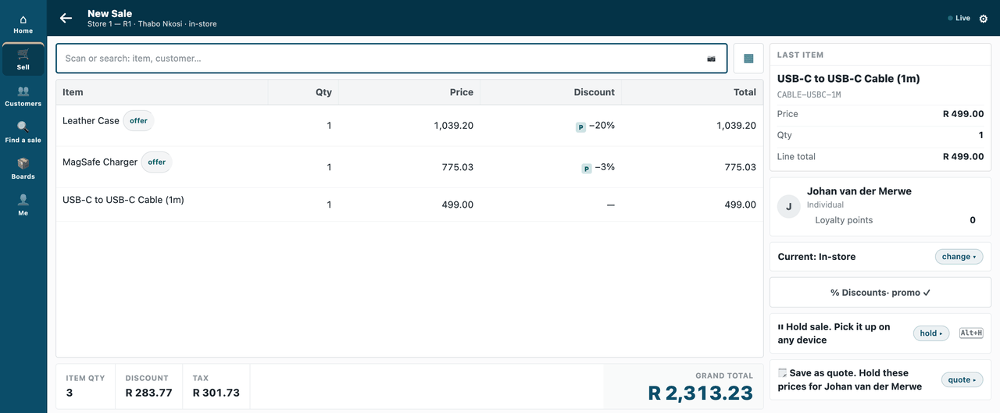

# S3 — price-deviation audit: every line sold below list by more than a threshold

After each booked sale, this sample records every line charged below its price-list rate by more than the retailer's threshold, so a store manager can read the findings in Desk. It runs as your own service outside the retailer's iVendNext and checks sales after they are booked: nothing changes at the till and no sale is held.



**What is in it:** runs on its own server and keeps one list (deviation).

**Industries:** Fashion and footwear, Thrift and resale

**When to use it:** you want an after-the-sale check on prices, discounts or anything else a booked sale carries.

**Door:** Event feed

## Start from it

```bash
ivn new acme_audit --from s3
```

## What to change

What a partner usually changes:

- **The default threshold:** `DEFAULT_THRESHOLD` in `outside/service.py` (10 per cent), used when the retailer has made no settings record. Where you run it alone, `PP_THRESHOLD` sets it.
- **What counts as a deviation:** the judging in `outside/service.py`. A line is compared with its own list price; a discount on the whole sale and an item with no list price are not checked.
- **The record types:** `PP PDO Deviation` and `PP PDO Settings` and the *PP PDO Deviations This Month* report in `outside/manifest.json`; `PDO_PREFIX` renames both record types.
- **Many retailers:** `outside/app.py`, `outside/worker.py` and `app.json` serve every retailer that installs it, each at its own threshold.

More: the [event feed recipe](../../recipes/event_feed.md).

**The customer sets:** the threshold, as the `PP PDO Settings` record titled **Default** (a System Manager makes it). The role `PP PDO Integration` needs no read from the retailer's administrator: the install gives it read on POS Invoice and Sales Invoice, the two record types the feed follows. **Needs POS build `2.1.0.691` or later:** on an earlier site the install gives the feed's user no read, so the events wait; the service's log says which record type was refused (`ivn logs`).

## Run it

```bash
ivn check
ivn try
```

## Versions

### 1.1.1

- Its two record types give a guide address, so an app with it can be listed for every retailer.

### 1.1.0

- Hosted on a schedule as a function, paid per call, instead of an always-on container.
- Each setting in app.json says its purpose (the line the Settings screen shows), whether it is required, and which settings go with it.

### 1.0.0

- First version in the kit: every line sold below list by more than a threshold, as an audit.
- Serves many retailers, each at its own threshold.
