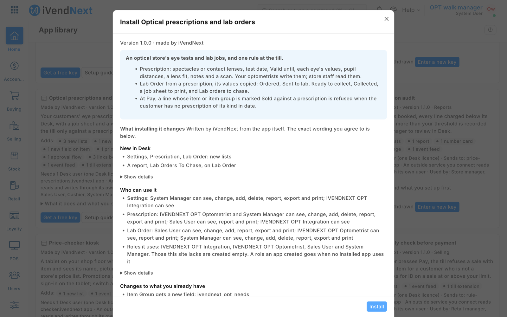
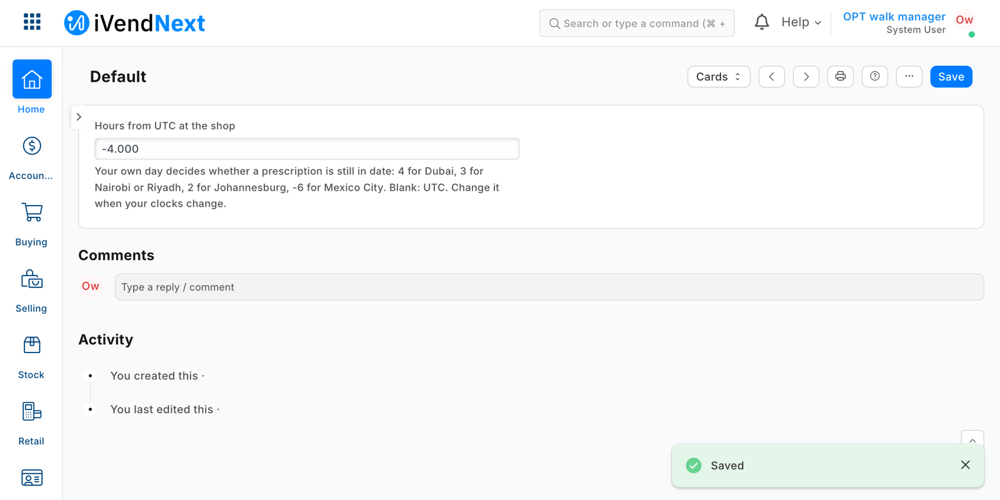
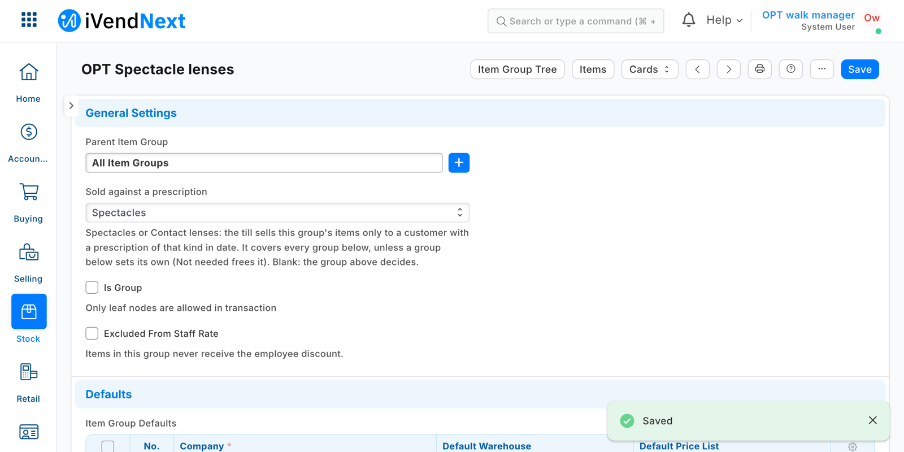
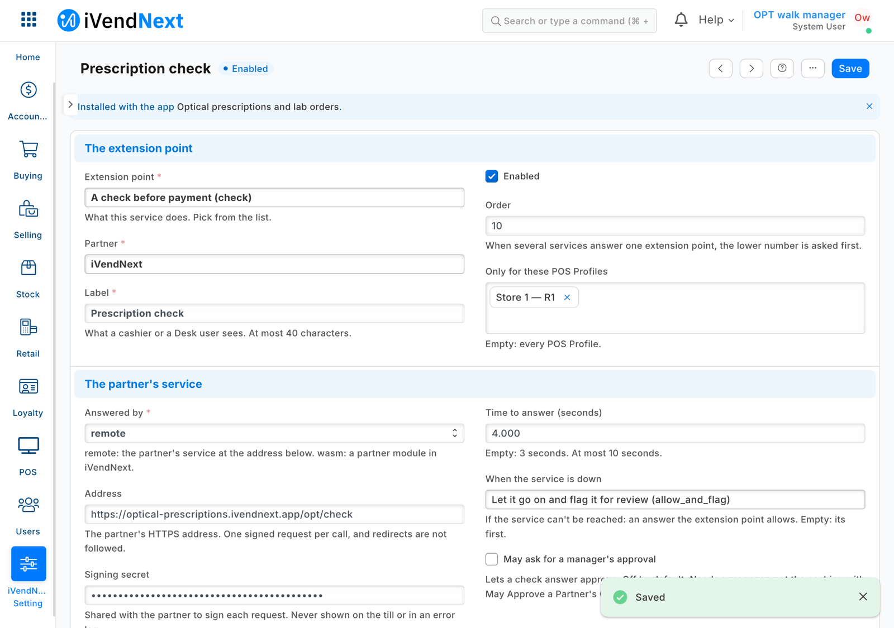
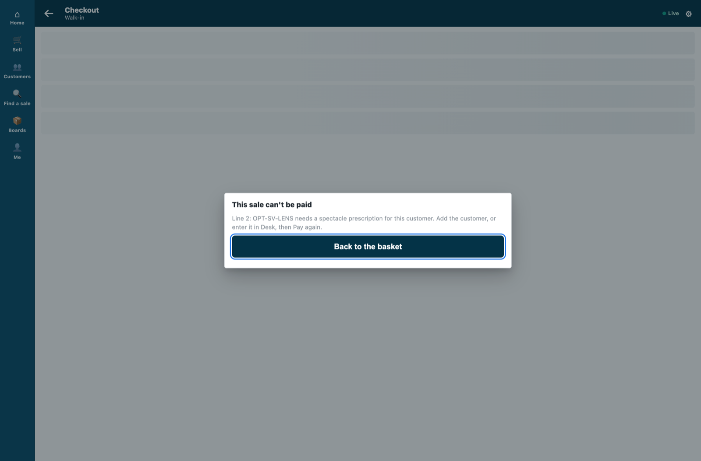
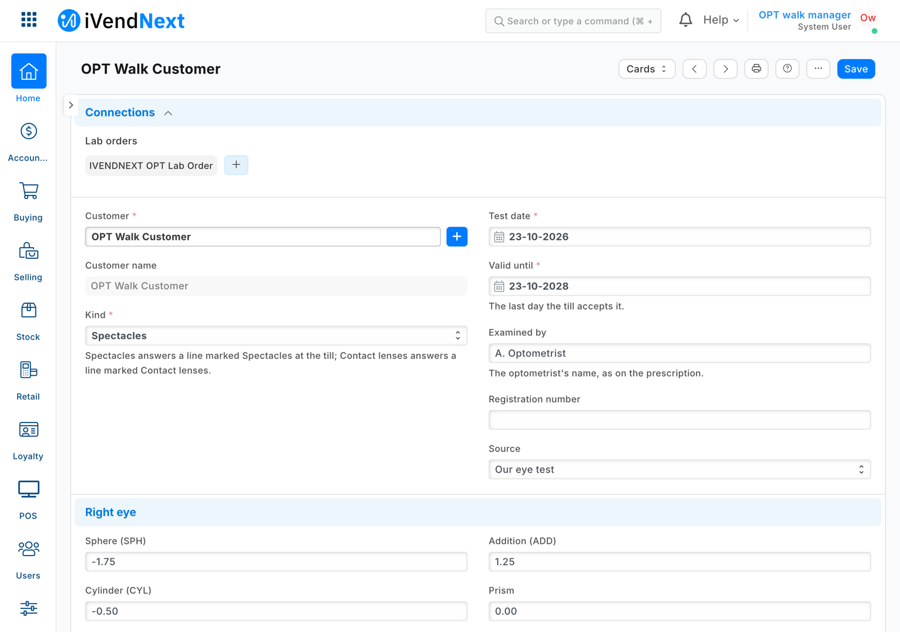
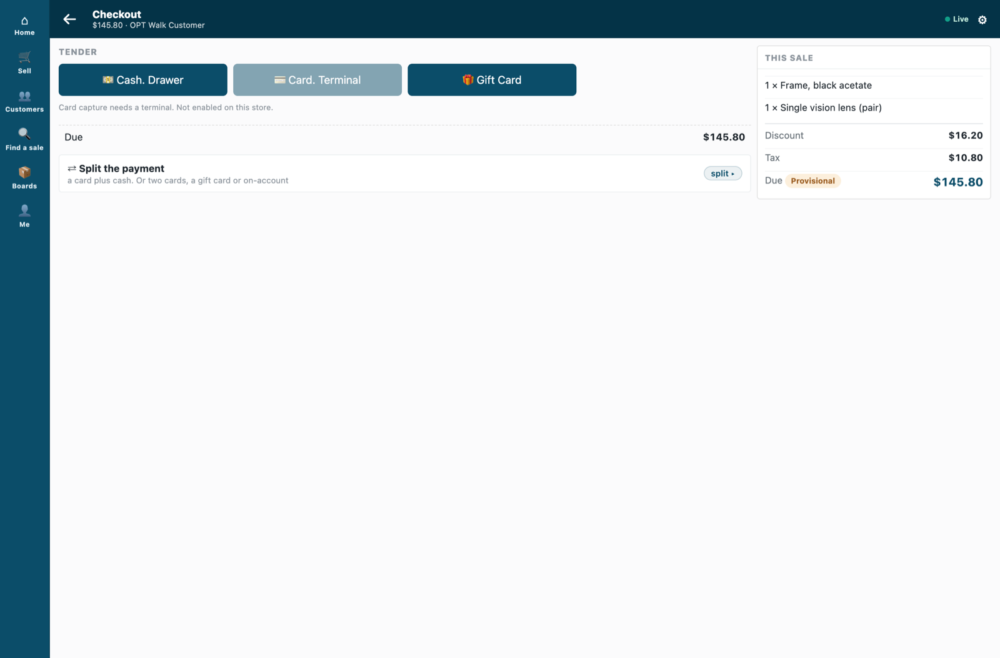
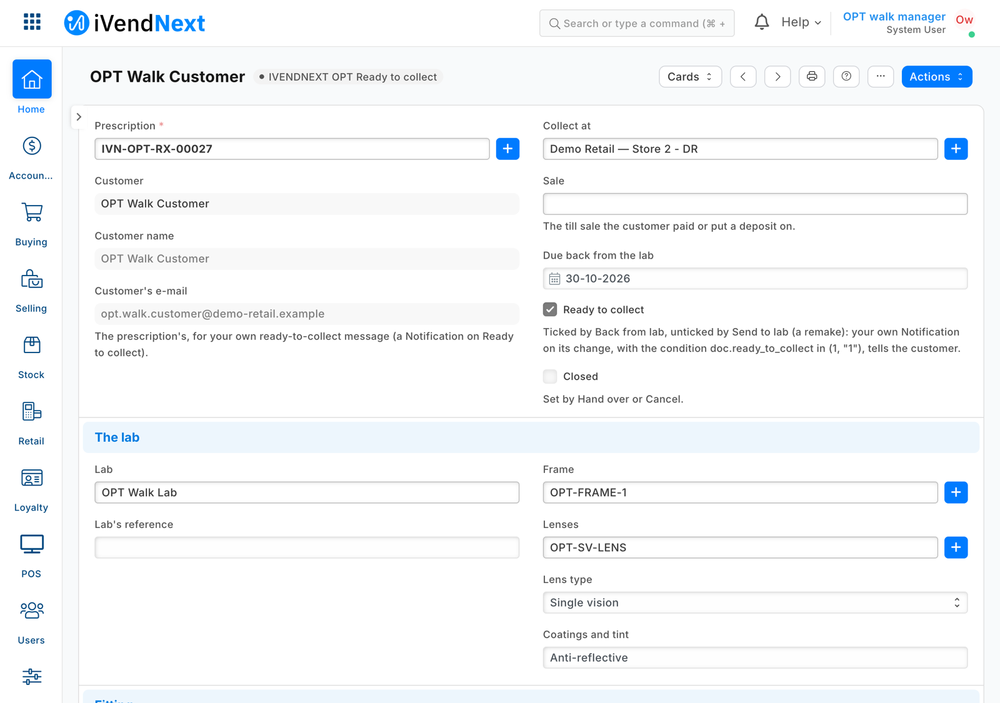
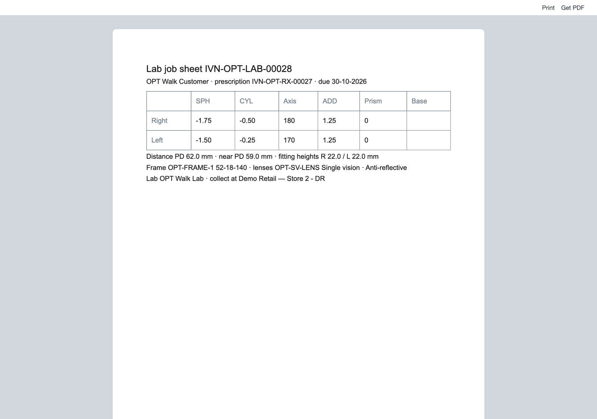
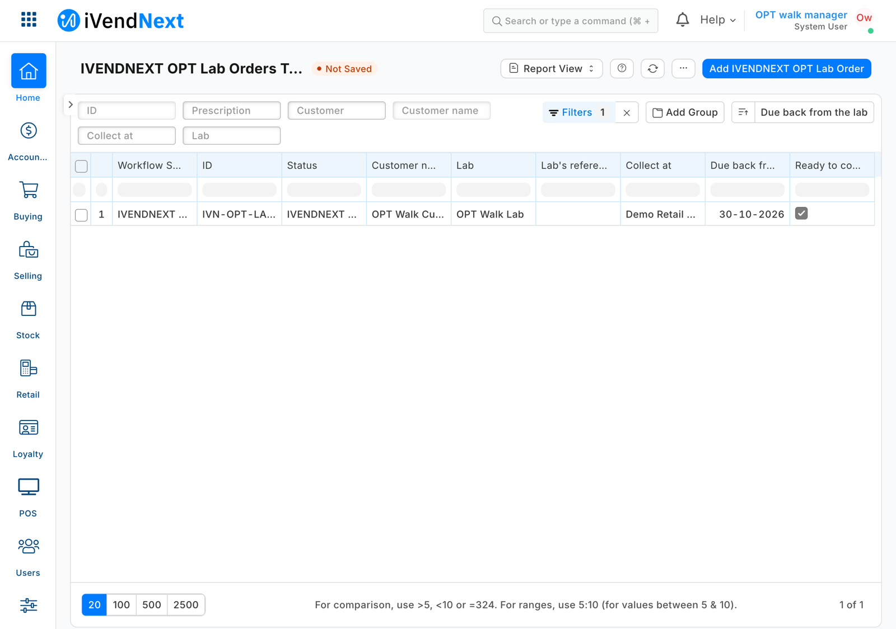

# S42 — Optical prescriptions and lab orders (`pp_opt`)

*Start from this sample: `python3 tools/manifest/start.py s42_optical_prescriptions --prefix "ACME OPT"` copies it into `apps/` of your repository under your own prefix (your company's first word, then a short name for the app) and checks it ([how](../../recipes/make_it_your_own.md)).*

The worked sample for an optical store: eye tests, lab jobs and one rule at the till. This sample gives the retailer its **prescriptions** and **lab orders** as its own records in Desk, with a workflow, a lab job sheet and the fields the retailer's own messages need. At the till, a check refuses a lens line when the customer has no prescription of that kind in date. It is for a developer who wants a retailer's own records with a workflow, and one rule at the till that asks for **only the two fields it needs** of them.

**When to use it:** a store keeps a record about its customers that decides whether some items may be sold, and the till must hold the rule while the record's contents stay in the retailer's iVendNext.

## What happens

1. The optometrist enters each eye test as a **Prescription**: the customer, *Spectacles* or *Contact lenses*, the test date and **Valid until**, each eye's sphere, cylinder, axis, addition, prism and base, the distances between pupils, a contact lens's base curve and diameter, notes, and a scan of another practice's prescription.
2. The retailer marks its lens item groups *Sold against a prescription*: **Spectacles** on spectacle lenses, **Contact lenses** on contact lenses. A group below takes the mark of the nearest group above it; **Not needed** frees one (plano lenses, say). An item can carry its own mark.
3. The cashier rings frames and lenses for the customer as always. At **Pay**, iVendNext sends your service, signed, the priced basket.
4. Your service reads, **with its own key**, the item groups' and the items' marks and, only when a sold line is marked, the customer's prescriptions: **their kind and Valid until, nothing else**. A marked line is paid only when the customer has a prescription of its kind valid until the retailer's today or later (the test date is not judged: Desk dates it by the site's time zone, the service by the retailer's settings). Otherwise it refuses, in words the cashier reads: *"Line 2: SV-LENS needs a spectacle prescription for this customer. Add the customer, or enter it in Desk, then Pay again."* or *"Line 1: ACUVUE-30: the customer's contact lens prescription ran out on 18 Sep 2026. Enter the new one in Desk, then Pay again."*
5. Staff make a **Lab Order** from the prescription: its customer and lens values are copied from it, read only, beside the lab, frame, lenses, coatings, fitting heights, frame size, the store to collect at, the till sale and the due date. It prints as a **job sheet**. ⚠ On a retailer's iVendNext whose release lacks the product's fix, the job sheet does not print yet: `/printview` answers 404 and Desk's preview keeps the standard layout ([guide chapter 7](../../guide/07_manifests.md#a-print-format-on-your-own-record-type-a-known-defect)).
6. The order moves **Ordered → Sent to lab → Ready to collect → Collected** (or **Cancelled**; **Send back to lab** for a remake) by the workflow's buttons. **Back from lab** ticks *Ready to collect*; **Send to lab** and **Send back to lab** untick it, so a remake is told again when it is back; **Hand over** and **Cancel** (from any step before *Collected*) tick *Closed*. The report **Lab orders to chase** lists every order not closed, the oldest due first.
7. The customer's form lists their prescriptions and lab orders under **Optical**.

A refund is never judged; an exchange is judged only for what it sells.

| What the retailer sees (on a demo site, 2026-10-23) | |
|---|---|
| What the install will change, read before you consent |  |
| The settings record *Default*: the retailer's hours from UTC |  |
| *Sold against a prescription* on the item group of spectacle lenses |  |
| The check at Pay switched on for two stores, with the retailer's consent |  |
| A frame and a pair of lenses, the customer with no prescription: Pay refused, naming the line |  |
| The optometrist enters the customer's spectacle prescription in Desk |  |
| The same basket for that customer: the payment screen opens |  |
| The lab order made from the prescription, back from the lab and ready to collect |  |
| Its job sheet for the lab |  |
| **Lab orders to chase**: the open order, before **Hand over** takes it off |  |

## What the retailer does

**Before you install:** every `host.docker.internal` address in `manifest.json` (in `allowed_urls`, and where the manifest calls it) is our test bench's own address for the sample's service, and it resolves only where Docker provides it. Replace it with your own service's address first, or iVendNext's calls never reach your service; if this manifest is already installed, raise its `version` and install it again ([the manifest recipe](../../recipes/manifest.md), step 6).

1. **Install the app** (the retailer's administrator). It comes in switched off: the check has no consent and is off. The install adds the three record types (**PP OPT Prescription**, **PP OPT Lab Order**, **PP OPT Settings**), the workflow, the job sheet, the report, the mark on Item Group and Item, and the roles **PP OPT Optometrist** and **PP OPT Integration**.
2. **Give the roles to people:** **PP OPT Optometrist** and **Sales User** to whoever writes prescriptions (Sales User reads customers for the form's picker, and the lab order's buttons are Sales User's); store staff (**Sales User**) read prescriptions and make and move lab orders. Whoever chooses the order's **Lab** (a supplier) needs a role that can see suppliers, such as **Stock User** or **Purchase User**: Sales User alone cannot, and the lab picker answers *No permission for Supplier*.
3. **Give the app's user its reads.** From POS 2.1.0.667 the install made the app's own user, `pp_opt@integration.invalid`, and named it on **PP OPT Check**. It holds the role **PP OPT Integration** alone, works through the API only and can never sign in to Desk, so there is no user to make; give it no User Permissions. In **Role Permissions**, give that role a plain **Read** on **Item Group** and **Item** (with *select* alone iVendNext answers names only, and the check answers 503: the sale is paid and flagged). The install already lets it read the settings and the prescriptions; it reads two fields of a prescription. A service for one retailer: press *Generate Keys* on that user (User, API Access) and put the key in the service's settings. A service for many retailers is handed the key by the retailer's site itself, after the install or an update (*Many retailers, hosted* below); press **Connect again** on the app only if the site could not reach the app, or a key was lost or changed.
4. **Fill in the settings:** open **PP OPT Settings**, make the record **Default**, set the retailer's **hours from UTC** (the retailer's own day decides whether a prescription is still in date).
5. **Mark your lens item groups** (Item Group form, *Sold against a prescription*).
6. **Switch the check on** (the System Manager): **Retail Extension Subscription**, the record *Prescription check*: read what it is sent, tick the consent, choose your optical stores' POS Profiles and switch it on.
7. **Tell your customers, if you like, with your own Notifications** (Desk's Notification screen; a manifest may only notify the retailer's own people): *Lab Order*, event **Value Change**, field **Ready to collect**, condition `doc.ready_to_collect in (1, "1")`, to the document's **Customer's e-mail** (*"Your glasses are ready to collect"*: the condition keeps a remake's *Send back to lab*, which unticks it, from sending one); and *Prescription*, event **Days Before**, **Valid until**, 30 days, condition `doc.remind`, to **Customer's e-mail** (*"Your eye test is due"*). Each prescription's e-mail is filled from the customer (and again when emptied); untick its **E-mail reminders** to send it none. Use the SMS channel the same way through your own SMS gateway.

**Where it shows.** In Desk: the two records, the settings, the mark on Item Group and Item, the report, and *Optical* on the customer's form. At the till: nothing new until a line is refused.

**What leaves the retailer's iVendNext.** One address: your service (the manifest ships a test address; you write your own). Each Pay, and each refund the till pays, sends the priced basket (lines, totals, store, till, the cashier's user, the customer and the sale's details). Your service then reads the item marks and the customer's prescriptions' kind and Valid until. It keeps the marks a minute and nothing about a prescription, and writes nothing. The app's user holds a read on the prescription record type: its key could read a whole prescription (values, notes, scans), so the service asks iVendNext for two fields, and the card says so. ⚠ That a customer has a spectacle or contact lens prescription, and until when, is health-related personal data: say so on your card, and host the service where the retailer's rules allow.

## The files

| File | What |
|---|---|
| `manifest.json` | the three record types, the mark on Item Group and Item, the lab order's workflow, the job sheet, the report, the links under Customer and Prescription, the check (`extension_subscriptions`, extension point `check`), the feed whose user is the app's, three help addresses; installed **switched off** |
| `optical.py` | **the pure core**: the signature check, the check's context, the marks on the group tree, the prescriptions in date, the refusal |
| `service/app.py` | the HTTP service (standard library): `POST /opt/check`, `GET /health`; the record API as the app's user; one retailer or many |
| `tests/test_rules.py` · `tests/test_service.py` | laptop tests: the rules, then the real service with a stand-in record API, calls signed as iVendNext signs them, one retailer and many |
| `tests/test_manifest.py` · `tests/test_contract.py` | the manifest's shape; every answer, and every call our test site recorded, against the published contract (`partner_check.v1.schema.json`) |
| `tests/canaries.py` | each test that guards a secret, a key, a read, a mark, a date or a refusal goes RED when its check is removed |
| `app.json` · `Dockerfile` | how CitiXsys hosting runs it (a function, paid per call), and a container for your own server |

The recipe is [Optical prescriptions and lab orders](../../recipes/optical_prescriptions.md). The check's own recipe is [`recipes/rule_guard.md`](../../recipes/rule_guard.md).

## Run it

```bash
cd samples/s42_optical_prescriptions
python3 -m unittest discover -s tests -p 'test_*.py'
python3 tests/canaries.py
python3 service/app.py service/.env.local      # IVN_CHECK_SECRET, IVN_SHOP_URL, IVN_SHOP_KEY, OPT_PREFIX, PORT
```

## Many retailers, hosted

The App library's *Optical prescriptions and lab orders* runs this same `service/app.py` for every retailer that installs it, as a function on CitiXsys hosting (`app.json`): it costs nothing between calls. Set `IVN_LIBRARY_APP` (the library's id), a shops store (`IVN_SHOPS_TABLE` on hosting, `IVN_SHOPS_FILE` on your own server) and `OPT_PREFIX` (`IVENDNEXT OPT`: the mark is then `ivendnext_opt_needs`, and the record types *IVENDNEXT OPT …*).

1. After its install the retailer's site connects itself (the app template's handshake, guide chapter 14b): the service stores the retailer with its library key and the check's secret, `<app>:sub:check`.
2. The install made the app's own user, and the retailer's site hands the service that user's key (`user:<email>`) when it connects, after the install or an update. *Connect again* is only for when the site could not reach the app, or a key was lost or changed.
3. Each call names its retailer (`X-iVendNext-Site`); it is checked with **that retailer's** secret and iVendNext is read with **that retailer's** user's key. Another retailer's secret, or a retailer the service does not know, is refused (401).
4. A call before step 2 is answered 503, so the till's down answer applies: the sale is paid and flagged.

## Make it your own

What a partner usually changes:
- **the records:** a country's own prescription fields (a registration body, a near-vision line, a child's myopia control), a lab's own order fields;
- **the lab:** an order sent to the lab's own system from the lab order (a Desk button on your server), its status read back;
- **the rule:** a spectacle prescription that only warns (ask the cashier instead of refusing), a contact lens fitting that must be newer than a year;
- **the prefix:** `tools/manifest/rename.py` makes your copy under your own reserved prefix in one step; the service takes its prefix from `OPT_PREFIX`;
- **its records:** `tools/deploy/copy_records.py` moves the settings and the item groups' marks between a test site and the retailer's iVendNext.

## Before you copy it

- **The service never reads a lens value.** It asks iVendNext for two fields of a prescription (`kind`, `valid_until`) of the sale's customer, at every Pay, and keeps none of them. A user that may only *select* the record type gets names back with a 200: the service then answers 503 rather than refusing (the field check in `prescriptions_of`).
- **A workflow's *who may edit* is a screen rule.** Over the record API anyone with write can change an order in any state; the buttons are the workflow's.
- **A lab order's copied values follow its prescription** on each save of the order: the job sheet shows the prescription as it is at the order's last save.
- **Test routes.** None in this sample. **Your address:** write your own in `allowed_urls`; the retailer's server must trust your certificate.

## Technical notes

### Why it is built this way

| Option | Cost | Verdict |
|---|---|---|
| Do nothing: prescriptions on paper or in a customer note, lab jobs on a spreadsheet | 0 | nothing at the till; no reminder |
| A manifest only: the records, the workflow, the print and the report | ~1 day | the store's whole back office, nothing to host; the till sells contact lenses with no prescription on file |
| **The manifest plus a check before payment** | ~1½ days | **picked**: the till holds the rule; the service reads two fields of a prescription; S37's service shape reused |

A manifest cannot notify a customer (its notifications go to the retailer's own users), so the two customer messages are the retailer's own Notifications on the fields the manifest adds. The print readers do not serve a package's own record types yet, so the lab order carries the lens values it prints.

### Bounds, stated

- Answered when the cashier presses Pay, not when the line is entered. A sale made in Desk, on the Desk POS screen or through the API is not checked.
- An insurer's or optical plan's share of the payment is the POS board's payer split (`PB-8`), not this app's.
- At most three checks per POS Profile, 10 seconds together; this app takes one per profile.
- **One customer record, one person's prescriptions:** the check passes a line on any prescription of the sale's customer, so a family sharing one record shares its prescriptions. Never enter a prescription on your walk-in customer: every walk-in sale would pass.
- **One time zone per site:** *Hours from UTC* holds for every store of the site.
- A newer eye test does not stop the older prescription's reminder: untick the older one's **E-mail reminders**.
