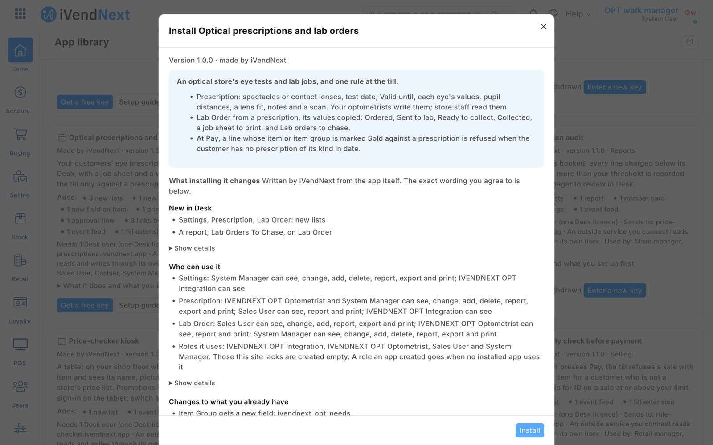

# S42 — Optical prescriptions and lab orders (`pp_opt`)

The worked sample for an optical store: eye tests, lab jobs and one rule at the till. The retailer's **prescriptions** and **lab orders** are its own records in Desk, with a workflow, a lab job sheet and a report, **Lab orders to chase**. At Pay, a check refuses a lens line when the customer has no prescription of that kind in date, in words the cashier reads, and asks your service for only two fields of the prescription: its kind and **Valid until**.



**Industries:** Optical

**When to use it:** a store keeps a record about its customers that decides whether some items may be sold, and the till must hold the rule while the record's contents stay in the retailer's iVendNext.

## Start from it

```bash
ivn new acme_optical --from s42
```

## What to change

What a partner usually changes:

- **The records:** a country's own prescription fields or a lab's own order fields, in the record types in `manifest.json` (`PP OPT Prescription`, `PP OPT Lab Order`).
- **The rule:** `optical.py`, for example a prescription that only warns, or a contact lens fitting that must be newer than a year.
- **The lab:** the order's workflow (*Ordered, Sent to lab, Ready to collect, Collected*) in `manifest.json`.
- **The mark:** `pp_opt_needs` on Item Group and Item (*Sold against a prescription*).
- **Your service's address:** `allowed_urls` in `manifest.json` names the sample's test address; write your own. `OPT_PREFIX` names the records for the service.

More: the [recipe](../../recipes/optical_prescriptions.md).

**The customer sets:** **Hours from UTC** in the settings record **Default** (the retailer's own day decides whether a prescription is in date), the mark on its lens item groups, the stores whose check is on, and the roles **PP OPT Optometrist** and **Sales User** for staff. Whoever chooses a lab needs a role that can see suppliers. To link the till sale on a lab order (its **Sale**), give **PP OPT Optometrist** *Select* on **POS Invoice** in Role Permissions Manager: without it, *Sale* offers no sale and the order saves without one. Never enter a prescription on a walk-in customer: every walk-in sale would pass. A prescription is health-related personal data.

## Run it

```bash
ivn check
ivn try
```

## Try it at the till

- Sell a prescription lens to a customer with no valid prescription; the till stops it at Pay.
- In Desk, enter the customer's prescription, then try again.
- Close the till day when you are done.

## Versions

### 1.1.5

- Manifest 0.2.5.
- The prescription sheet and the lab job sheet print each power to two places, signed as an optometrist writes it (*-1.00*, *+2.00*, *0.00*), the prism to two places, the axis as a whole number (blank when there is no cylinder), and a contact lens's base curve and diameter to one place (*14.0*): a field's own format dropped a whole number's decimals (*-1*).

### 1.1.4

- Manifest 0.2.4.
- *Print* on a prescription opens its own sheet (the prescription's default print format): *Right eye* and *Left eye* rows with each value in its field's format, and a contact lens's base curve, diameter and brand only on a contact-lens prescription.
- Desk shows plain names (*Prescription*, *Lab order*, *Sent to lab*, *Lab orders to chase*) through the manifest's `translations` block.
- *The customer sets* says how to let an optometrist link the till sale on a lab order.

### 1.1.3

- Manifest 0.2.3.
- The lab job sheet says *Collect at* with the store's own name (a read-only *Store name* field on the lab order), not the warehouse's record name with the company suffix. A lab order saved before the update prints the old name until it is saved again.
- The two eye rows read *Right eye* and *Left eye*: the shared language files translate a bare *Right* and *Left* as general words (a right, to leave), which a lab reads wrong.

### 1.1.2

- Manifest 0.2.2.
- The lab job sheet prints through the language files (`_()`) and takes its direction from the text (`dir="auto"`), so its words can be translated (Desk, Translation) and its direction follows the text, which reads right in a right-to-left language once translated; the lens values still print in their fields' own format.
- The *Ready to collect* field's help text reads as a sentence, not a code condition. The condition for your own Notification is in the [recipe](../../recipes/optical_prescriptions.md).
- *Your* where the text said *the shop's* (the description's Notifications and the Registered Application's settings).

### 1.1.1

- Manifest 0.2.1.
- The refusal at Pay names the item, not its code, and ends *try again* (it reads the same on an order, where there is no Pay): *Line 2: Single vision lens needs a spectacle prescription for this customer. Attach the customer or enter it in Desk, then try again.* The service reads the item's name once, at a refusal.
- *Print* on a lab order opens the job sheet (the lab order's default print format), so it is in the print picker.
- The settings field reads *Hours from UTC at your store*.

### 1.1.0

- The role's rights beyond the feed's reads move into the manifest (`role_rights`): the install gives the feed's user its reads and the manifest the rest, so the retailer's administrator grants none. Needs POS build `2.1.0.691` or later.

### 1.0.0

- First version in the kit: eye tests and lab jobs as the retailer's own records, and lenses refused at Pay without a prescription of their kind in date.
- Each setting in app.json says its purpose (the line the Settings screen shows), whether it is required, and which settings go with it.
- The set-up steps say the install makes the app's own user (POS 2.1.0.667 or later).
