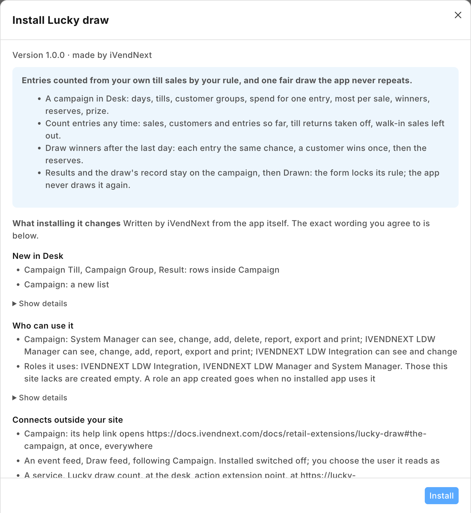

# S44 — Lucky draw (`pp_ldw`): entries by spend, and a fair draw of the winners

A retailer runs a *shop and win* campaign: every 200 spent at its tills during the campaign is one entry, say, and after the last day the winners are drawn. The retailer makes a campaign in Desk (its days, its tills, the spend for one entry, the customer groups that take part, how many winners and reserves, the prize). A manager presses **Count entries** to see how it is going, and after the last day presses **Draw winners** once: the app draws the winners and reserves, one prize per customer, each entry with the same chance, and writes the results on the campaign. A sale counts only when the cashier has added the customer; a till's walk-in customer is never an entry.



**Industries:** Fashion, Thrift and resale

**When to use it:** a rule the retailer keeps decides something from many of its own records (here, a campaign's sales), a person decides when, and the answer belongs on one record the retailer can keep and show.

## Start from it

```bash
ivn new acme_draw --from s44
```

## What to change

What a partner usually changes:

- **The rule:** `draw.py`, the pure core: how a sale earns entries (per item bought, double days, one entry per customer per day) and how the winners are drawn.
- **The campaign's fields and the results:** `PP LDW Campaign` and `PP LDW Result` in `manifest.json`.
- **The prize:** what a winner gets, written on the results by `service/app.py` (a gift card or loyalty points instead of a prize handed over).
- **The prefix:** `LDW_PREFIX` for the service, and the prefix your copy is made under.
- **Your address:** `allowed_urls` in `manifest.json`.
- **The app's id:** `IVN_LIBRARY_APP` in `app.json`.

More: the [recipe](../../recipes/lucky_draw.md).

**The customer sets:** the campaign itself, and who holds the role **PP LDW Manager** (whoever runs the campaigns).

## Run it

```bash
ivn check
ivn try
```

## Try it at the till

- In Desk, make a campaign that runs today.
- Sell more than the spend for one entry to a customer in the campaign's group.
- In Desk, press Count entries on the campaign; the sale is counted.
- Close the till day when you are done.

## Versions

### 1.0.0

- First version in the kit: entries by spend from the retailer's till sales, and a fair draw of the winners and reserves, once.
- Each setting in app.json says its purpose (the line the Settings screen shows), whether it is required, and which settings go with it.
- The set-up steps say the install makes the app's own user (POS 2.1.0.667 or later).
