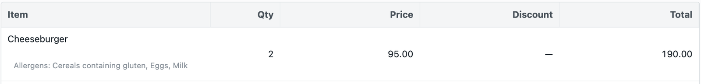
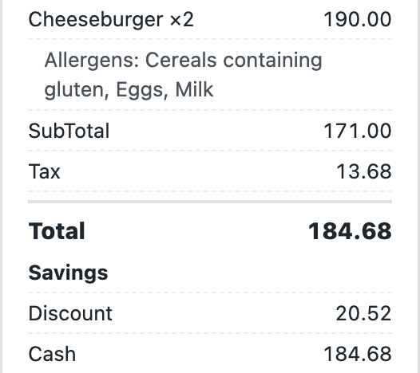
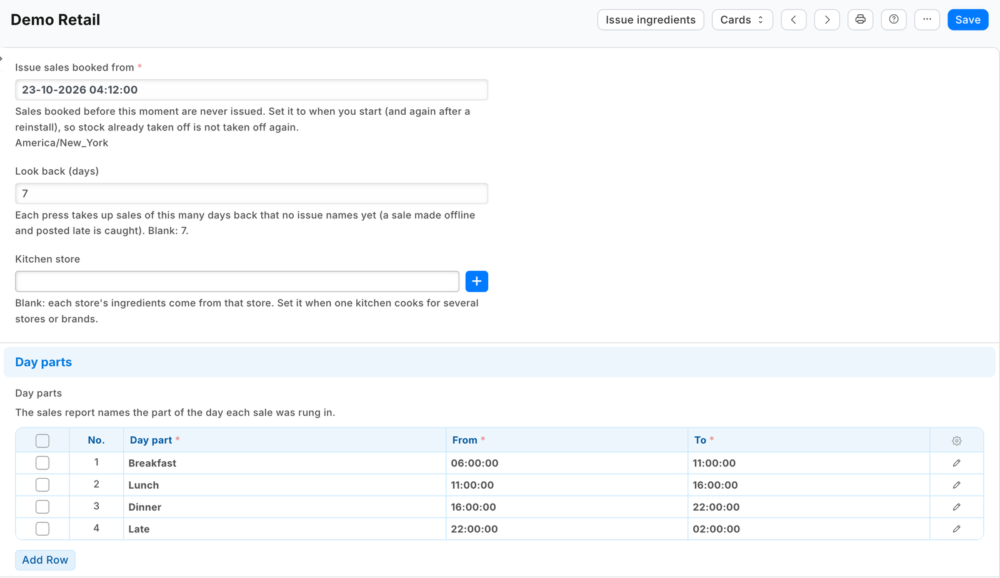
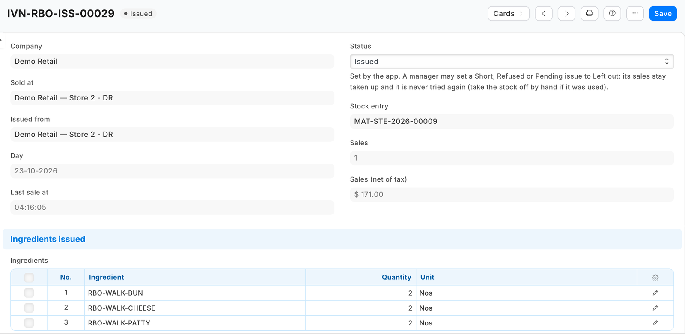
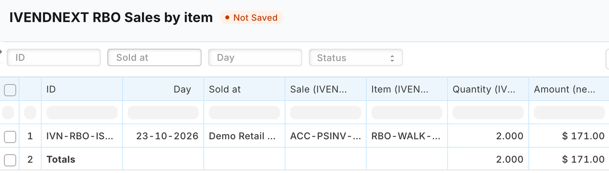
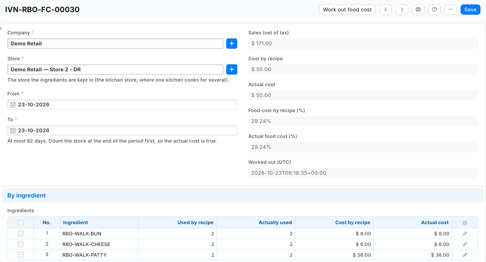
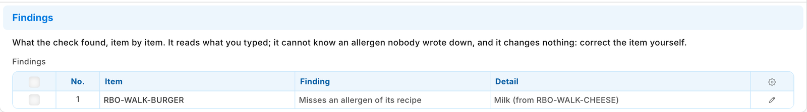

# S45 — Restaurant back office (recipes off stock, allergens, food cost, sales by day part)

*Start from this sample: `python3 tools/manifest/start.py s45_restaurant_back_office --prefix "ACME RBO"` copies it into `apps/` of your repository under your own prefix (your company's first word, then a short name for the app) and checks it ([how](../../recipes/make_it_your_own.md)).*

## What the retailer does

A café or restaurant rings its dishes at the till as it does today. A dish is a plain item that is not stocked, with the retailer's own **recipe** on it: the engine's bill of materials, the parts and how much of each makes one dish (a recipe may hold another, such as a sauce made per portion). Once a day, after the close, the manager presses **Issue ingredients** on the app's settings record, and the ingredients of everything sold come off the kitchen's stock.

| What happens | When |
|---|---|
| One **issue** per store and day: the sales it takes up, every line of them (for the sales report), and the ingredients its dishes used. Then the retailer's own **Material Issue** of those ingredients, from the store (or the kitchen store the settings name), dated at the day's last sale | **Issue ingredients** pressed; each sale booked since the settings' start moment that no issue names yet |
| Nothing booked twice: an issue names its sales before any stock moves; a press again finds them taken | a second press, a retry, a press that stopped half way |
| A sale made offline and posted later is taken up | the next press after it posts (it looks back 7 days by default) |
| The issue is booked at the moment of the press instead of the sales' time | the stock was booked in after the sales (a delivery entered late): at the sales' time the store was short |
| The issue reads **Short**, names every short part with what it needs and what the store has, and nothing of that store-day comes off | the store is short of a part now too; the next press after a delivery or a count books it |
| The issue reads **Refused**, with iVendNext's own words | iVendNext refuses the stock entry for another reason (a whole-unit ingredient used by half, a closed period): fix it and press again; the next press works the parts out again from the recipes as they are then. A manager may set a Short, Refused or Pending issue to **Left out** instead: its sales stay taken up and it is never tried again |
| The issue reads **Refused** with why, and nothing is booked | a recipe goes round in a loop, or the sales name no store and the settings no kitchen store: fix it, and the next press works it out again |
| **Work out food cost** fills a food cost record: per ingredient, what the recipes used, what was sold as it is, what other issues took (waste, staff meals) and what the count found missing; the cost by recipe and the actual cost, each as a percentage of the period's sales | the button pressed on a record naming a store and a period |
| **Check allergens** writes every finding to a check record and opens it: each ticked dish that leaves out an allergen one of its recipe's ingredients carries (at every depth, a stocked sauce's own recipe included), a variant with none of its template's allergens, a dish with none typed whose recipe carries none either, and any word not on the retailer's allergen list. It changes nothing on an item | the button pressed on the Item list or an item's form |
| The till shows a dish's allergens under its line, and the shipped receipt prints them under the item | the retailer adds two field rules in POS Studio to each theme its tills wear (setup step 6) |

| What the retailer sees (on a demo site, 2026-10-23) | |
|---|---|
| A dish rung at the till: its allergens under the line |  |
| The receipt prints them under the dish |  |
| The company's settings: the start moment, the look-back, the kitchen store, the day parts |  |
| After **Issue ingredients**: the store-day's issue, *Issued*, its Material Issue and the ingredients it took |  |
| **Sales by item**: each sale's lines, net of tax, from the issues |  |
| **Work out food cost** on a store and a day: cost by recipe and actual, against sales |  |
| **Check allergens**: a dish that leaves out *Milk*, which its cheese carries |  |

**What it costs the retailer.** The ingredients are booked as any issue of stock: to each ingredient's own expense account (its Item Defaults, else its Item Group's, else the company's stock adjustment account). A retailer that wants them under cost of goods sold sets that account on its ingredients' Item Defaults or their group; the app sends no account of its own.

**Bounds, said plainly.**
- The ingredients come off when someone presses, not at the moment of the sale. Until the press, the kitchen's stock reads high by the day's dishes.
- A dish that is itself a stock item (a can of soda) is never opened: iVendNext already moves its stock when it books the sale.
- A returned dish takes nothing back: the food was made.
- A part that is not stocked and has no recipe of its own (water, say) is skipped and named on the issue.
- A dish rung before its recipe was made issues nothing, and its issue names it (*BURGER: sold with no recipe*). Its sale is taken: book that day's ingredients by hand once the recipe is made.
- A combo whose side or drink the customer chooses at the till (an option line of its own) leaves that part out of its recipe, or the part comes off twice: through the combo and through its own line. A *No onions* option takes nothing off the dish: the recipe is the standard dish.
- Only till sales are taken up. A dish sold on a Desk invoice is not.
- Sales booked before the settings' **Issue sales booked from** are never issued. Set it to when you start, and again after a reinstall: the uninstall removes the app's issues, so without it the reinstall would take the same sales up again.
- A recipe that goes round (a dough whose recipe names itself) or deeper than five recipes is refused and named.
- An issue booked at the moment of the press, after a delivery, lands on that day in the stock ledger and the food cost, not on the sales' day.
- The sales report lists a sale once a press has taken it up. *Who rang it* is the till user.
- The kitchen ticket does not print the allergens. The till shows at most three extra item fields per theme, and *Allergens* holds 140 characters: use your list's short words.
- The till shows the allergens of the item sold. A variant (a double burger, a large coffee) has its own field: type it on each variant, or, where every variant has the template's allergens, add *Allergens* to **Item Variant Settings** (each save of the template then copies it over every variant, writing over what a variant had; save the template once to reach existing variants). A dish with nothing typed prints nothing, which reads like *no allergens*.
- The receipt prints them on the shipped receipt layout. A receipt layout of the retailer's own prints them only if it calls the till's item-fields reader (the till's field-rules guide, *The receipt*).
- A sale older than the look-back is never taken up: after a break, raise *Look back (days)* once. A till sale cancelled after its issue keeps its issue: take its ingredients back by hand if they were not used. A sale cancelled and amended in Desk keeps its first issue and is not issued again, as long as its date is left as it was: book a changed quantity by hand. An issue's Material Issue cancelled in Desk is not booked again: the issue stays *Issued*.
- Food cost counts every store-day's sales. A day still *Short* or *Refused* has its sales and what the count finds missing, but no cost by recipe until it is issued, so cost by recipe reads low until then. With a kitchen store, every store's sales count at the kitchen, but a stocked item sold at the front (a can of soda) comes off the front store's stock, so the kitchen's food cost leaves out its cost.
- After a reinstall, food cost still tells the app's earlier stock issues from the retailer's own by their remarks, but the earlier issues' sales figures went with the uninstall.
- The allergen check reads what the retailer typed: it cannot know an ingredient's allergen nobody wrote down. It writes its findings to a check record and changes nothing on an item. The allergen list it compares with is every company's settings together.

## What the retailer does to set it up

**Before you install:** every `host.docker.internal` address in `manifest.json` (in `allowed_urls`, and where the manifest calls it) is our test bench's own address for the sample's service, and it resolves only where Docker provides it. Replace it with your own service's address first, or iVendNext's calls never reach your service; if this manifest is already installed, raise its `version` and install it again ([the manifest recipe](../../recipes/manifest.md), step 6).

1. Install `manifest.json` (the retailer's administrator, on the install screen; on your sandbox, `tools/deploy/deploy.py`). It adds `PP RBO Settings`, `PP RBO Issue`, `PP RBO Food Cost`, `PP RBO Allergen Check` and their tables, the *Allergens* field on Item, the issue's link on Stock Entry, two reports, three buttons and their services (switched off), the feed registration *PP RBO Back office feed* and the role **PP RBO Integration**.
2. In **Role Permissions**, give PP RBO Integration **read** on POS Invoice, POS Profile, Item, BOM, Bin, Stock Ledger Entry, Stock Reconciliation and Warehouse, and **read, write, create and submit** on Stock Entry. Stock Managers may already set an issue to *Left out*; no one may delete an issue (its sales would be taken up again). ⚠ With these rights the key can book a stock issue of any item in any store of the company: give the role to this app's user alone. If the retailer limits back-dated stock entries to a role (Stock Settings), give that role to the app's user too, or every issue is booked at the press.
3. Make the app's integration user with that role and generate its API key; choose it on the feed registration *PP RBO Back office feed* (leave the feed off).
4. Make a **PP RBO Settings** record for each company: **Issue sales booked from** (now), the **kitchen store** where one kitchen cooks for several stores or brands (else each store's own), the **day parts** (Breakfast 06:00 to 11:00 …; a part whose end is before its start runs past midnight), and the allergen list (the EU's 14 to start).
5. Give each dish its recipe: a Bill of Materials on the item, submitted and default. ⚠ The Desk form's item picker lists only stock items for the dish: type the dish's code. Give dishes and ingredients their **Allergens**.
6. In **POS Studio**, on each theme your café's tills wear (save a shipped theme as a new one first), *Fields*: show `pp_rbo_allergens` on *A line of the sale* and on *The receipt*, labelled *Allergens*. For variants, type *Allergens* on each, or, where every variant has the template's allergens, add it to **Item Variant Settings**. A role you add to *Check allergens* also needs read on PP RBO Allergen Check, or Desk cannot open its findings.
7. In **Retail Extension Subscription**, open each of the three services, read what it is sent, tick the consent and switch it on; switch the three buttons on in **Retail Desk Action**. For a hosted service, press **Connect again** on the app's package record.

## What leaves the retailer's iVendNext

iVendNext calls nothing outside but the service's own address (`allowed_urls`), on a press: the pressing user's login and language, and the record's name (with the company, or the food cost record's store and dates, or the items' names). The service then **reads**, with the app's own user: the company's till sales and their lines, the tills' stores, items and their recipes, stock levels, the stock ledger and counts for a food cost, and its own records. It **writes**: its issues and food cost records, the press stamp on the settings record, and the retailer's Material Issues. It keeps nothing of a press.

## Run it

```bash
python3 -m unittest discover -s samples/s45_restaurant_back_office/tests -p 'test_*.py'
python3 samples/s45_restaurant_back_office/tests/canaries.py
```

On a sandbox, with the integration user's key in `service/.env.local` (never committed: `PP_BASE`, `PP_KEY`, `PP_SECRET`, `PP_SECRET_ISSUE`, `PP_SECRET_FOODCOST`, `PP_SECRET_ALLERGENS`, handed back once at install as `pp_rbo:sub:issue` …):

```bash
python3 samples/s45_restaurant_back_office/service/app.py samples/s45_restaurant_back_office/service/.env.local
```

Many retailers (the app template's handshake, [chapter 14b](../../guide/14b_deploying_your_app.md#one-app-many-retailers)): set `IVN_LIBRARY_APP` and a shops store; each retailer's site connects itself to the app's one `*.ivendnext.app` address after its install and hands over its integration user's key once the retailer presses *Connect again*. It only answers presses, so it runs as a **function**, paid per call.

## Make it your own

A partner usually changes: the allergen list for its market (the settings record), the day parts, the reports' columns, and a schedule instead of a press (a container on its own hosting, or a function schedule where its host has one, calling the same issue). The prefix comes from `RBO_PREFIX` (`PP RBO` here; `IVENDNEXT RBO` for the App library's copy); `tools/manifest/rename.py` makes a copy under your own reserved prefix, and `tools/deploy/copy_records.py` moves the settings records.

## Technical notes

- **The engine's own documents.** The recipe is the engine's Bill of Materials (`quantity` of the dish from each row's `stock_qty`; a row's own `bom_no`, else the part's default recipe, opens a part that is not stocked). The issue is the engine's Material Issue, posted and submitted in one call (`docstatus` 1), so it is all or nothing. The engine's own *Get Items* explodes one recipe per entry; a day of many dishes is one entry, so the service opens the recipes itself and books one entry with the day's parts. Nothing in the engine consumes a recipe on a sale; the app duplicates nothing.
- **Never twice.** The issue is written first, naming its sales (one per line, `sales`), so a later press never takes them again; the Material Issue carries the issue's name (`pp_rbo_issue`), so a press that stopped after booking it finds it and marks the issue *Issued* instead of booking again. An answer that never came back leaves the issue *Pending*; the next press looks for its entry first.
- **One press at a time per company.** A press stamps the settings record (`run_started`) with the retailer's `modified` check: a second press stamping at the same moment is refused by iVendNext and told *"Another press is issuing for this company now"*. A press clears its own stamp, except when iVendNext's answer never came back: then iVendNext may still be writing, so the stamp stays three minutes and lapses; the next press finds a stock entry already made by its link.
- **Short.** iVendNext refuses an issue when negative stock is off (Stock Settings, site-wide or per item) and names only the first item; the service then reads the store's stock and names every short part. With negative stock on, iVendNext books it below zero.
- **The press's 10 seconds.** A press first finishes an issue whose answer was lost, then takes up to 400 new sales, oldest first, then tries up to five issues left Short or Refused (Short first: a delivery fixes those), and starts no new set of store-days (those sharing a sale) after 5.5 seconds; the answer says when more is waiting and how many issues wait to be tried again. Recipes are read two lists a level (the recipes, then their rows), never one read per recipe.
- **Day parts** are the retailer's own times, compared with each sale's own time.
- **Lot-tracked ingredients** are picked by the retailer's own rule (Stock Settings, *Auto create serial and batch bundle for outward*, on by default, by *Pick Serial / Batch Based On*); with that switch off iVendNext refuses the issue and the issue reads *Refused*.
- **Food cost** reads the stock ledger at the store for the period: the app's own issues (an entry one of its issues names, or with no link at all the app's remarks), other Material Issues (a Desk copy of the app's entry counts here), sales booked from stock (Sales Invoice, POS Invoice, Delivery Note; a return counts back) and counts (counted less what the books held). Receipts, transfers and manufacture are not use.

### What was proven where

- **The laptop tests** (`tests/`): the rules (recipes, groups, day parts, food cost, allergens), the service against a stand-in iVendNext (claims, retries, the stamp, short and refused, the budget, food cost, the allergen check), many retailers and the function entry, the record API on a local port, the manifest and the contract; `canaries.py` turns each guard off in turn and its test goes RED.
- **The test bench** (a café on the Hospitality bench, at the Partner bench's pins, the service in its one-retailer form): dishes with recipes rung at the till and their day closed, one issue booked with the recipes' parts (a sauce opened through its own recipe, a burger inside a combo, water skipped and named), the booking Dr *Stock Adjustment* / Cr stock in hand, a second press booking nothing, a sale drained through the till's offline drain caught by the next press, a short store-day named and booked after the delivery, stock booked in after the sales booked at the press, a press stopped after its entry finished without a second entry, two presses at once, food cost moving by exactly a waste issue and a count, the allergen check, the allergen field on the line's rules and the receipt, the service down refused in iVendNext's words, and the uninstall leaving the schema as found. The run's record is in the programme's evidence.
