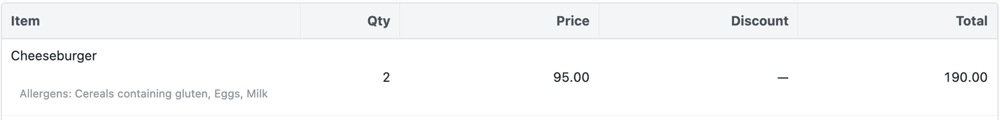

# S45 — Restaurant back office (recipes off stock, allergens, food cost, sales by day part)

A café or restaurant rings its dishes at the till as it does today. A dish is a plain item that is not stocked, with a **recipe** on it: the parts and how much of each makes one dish. Once a day, after the close, the manager presses **Issue ingredients** and the ingredients of everything sold come off the kitchen's stock. Two more buttons work out the food cost and check the dishes' allergens, and the till shows a dish's allergens under its line and on the receipt.



**Industries:** Hospitality

## Start from it

```bash
ivn new acme_back_office --from s45
```

## What to change

What a partner usually changes:

- **The allergen list, the day parts and the holds:** the settings record `PP RBO Settings` (`allergens`, `day_parts`, `holds`), per company.
- **The ingredients' rule:** `backoffice.py`: how a recipe opens into parts, the day part of a sale, the grouping per store and day.
- **The buttons:** *Issue ingredients*, *Work out food cost* and *Check allergens* in `desk_actions` in `manifest.json`.
- **The allergens field:** `pp_rbo_allergens` on Item in `custom_fields`.
- **The service's address:** every `host.docker.internal` in `manifest.json` is a test address; put your own there.
- **A schedule instead of a press:** a container or a function schedule on your own hosting, calling the same issue.

More: the [recipe](../../recipes/restaurant_back_office.md).

**The customer sets:** *Issue sales booked from* (now), the kitchen store where one kitchen cooks for several stores, the day parts, the holds and the allergen list in `PP RBO Settings`; a submitted default recipe on each dish; and the *Allergens* field shown on each till theme in POS Studio. A recipe is the engine's Bill of Materials, made in Desk by whoever owns the menu: that person needs the role **Manufacturing User** (or **Manufacturing Manager**), and the site and that user must keep the **Manufacturing** module open, or Desk answers *Page bom not found*. The app's own role reads recipes without either.

## Run it

```bash
ivn check
ivn try
```

## Try it at the till

- Sell a dish that has a recipe.
- In Desk, press Issue ingredients on the app's settings; the dish's ingredients come off stock.
- Close the till day when you are done.

## Versions

### 1.2.2

Manifest 0.3.2.

- *Covers, turns and tips* and *Sales by item* open on yesterday, the day a manager reads in the morning; change the *Date* filter for another day. They and *Food cost by ingredient* no longer show a *Totals* row: it added up only the rows on screen. For a day's sums, use the report's *Group By* (Server or Store) with *Sum* of Tip or Covers: the database adds every row.
- Their columns read *Check* and *Sale line* where they read *Ingredient issue check* and *Ingredient issue sale line*.
- *The customer sets* names who makes the recipes: the menu's owner, with the role Manufacturing User and the Manufacturing module open.

### 1.2.1

Manifest 0.3.1.

- The description says *the retailer's own* recipe, Material Issue and word list where it said *the shop's*. An update over 1.1.0 works from POS build `2.1.0.696`.
- A site that has not yet been updated to the version that gives the app *Read* on *Retail Open Check* and *Retail Floor Place* still books its issues: the covers, turn and server of its sales stay blank until it is updated.

### 1.2.0

- A hold (*No Onion*) leaves its ingredient out of the dish it is rung under, from a row under *Holds* on the settings. A swap (oat milk for whole) is the menu: the README and recipe say how.
- Each issue lists its sales with the check's table, server, covers, table turn and the tip taken at Pay, and a new report, *Covers, turns and tips*, adds them up. *Sales by item* names each check's server.
- Desk shows plain names (*Ingredient issue*, *Restaurant back office settings*) through the manifest's `translations` block.
- The role reads the till's checks and may write the stock entry's batch bundles (*Serial and Batch Bundle*): on a fresh install iVendNext asked for that right before it booked an issue. An update over 1.1.0 works from POS build `2.1.0.696` (a manifest with its own record types and `role_rights` was refused on update before that); a fresh install always worked.

### 1.1.0

- The role's rights beyond the feed's reads move into the manifest (`role_rights`): the install gives the feed's user its reads and the manifest the rest, so the retailer's administrator grants none. Needs POS build `2.1.0.691` or later. Warehouse read and write on Stock Entry are dropped: the service reads no warehouse record and never updates a stock entry.

### 1.0.0

- First version in the kit: recipes off stock, allergens on the till and receipt, food cost, and sales by item, till user and day part.
- Each setting in app.json says its purpose (the line the Settings screen shows), whether it is required, and which settings go with it.
- The set-up steps say the install makes the app's own user (POS 2.1.0.667 or later).
