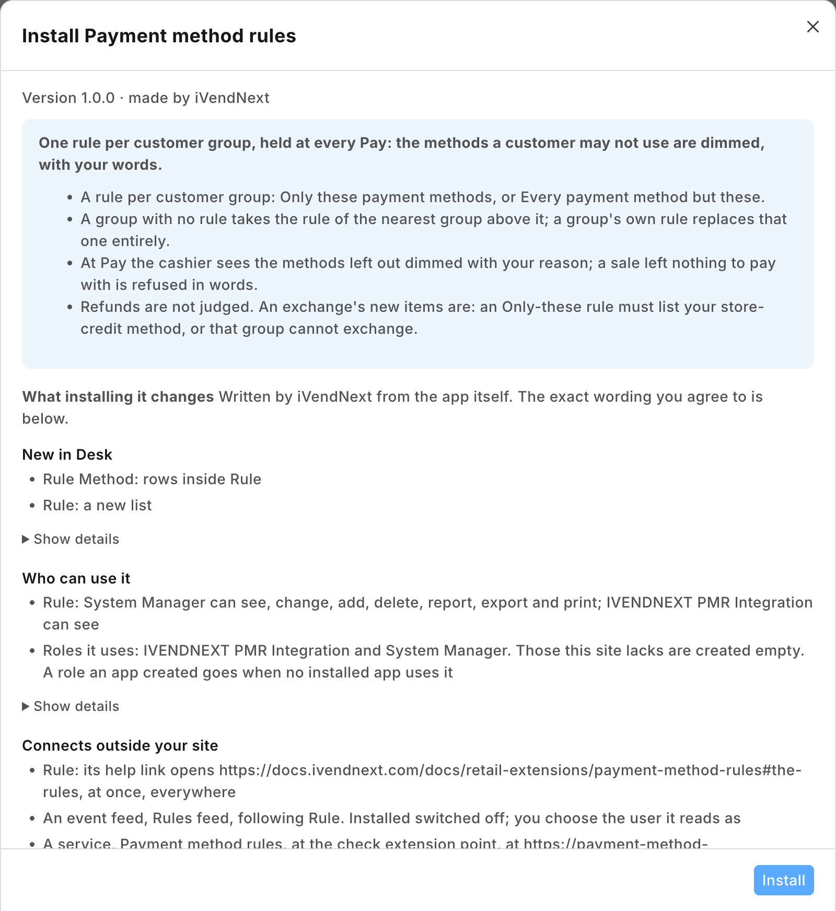

# S46 — Payment method rules (`pp_pmr`): which payment methods each customer group may use

The retailer decides which payment methods each group of its customers may use at the till: customers who order through a delivery platform pay only by that platform's method, only account customers may buy on account, a group that settles in dollars pays only in dollars. When the cashier presses **Pay**, the app leaves every other method off that sale's payment screen, dimmed, with the retailer's reason beside it. A method can also pay only from a minimum sale, for example Loyalty Points from 2,000. Refunds are never judged.



**Industries:** every industry

**When to use it:** a rule about the sale's customer decides which payment methods the till may take, and iVendNext keeps the rule itself, in Desk.

## Start from it

```bash
ivn new acme_paymethods --from s46
```

## What to change

What a partner usually changes:

- the rule's reach: a rule per POS Profile or per terminal (the check sends `pos_profile` and `pos_terminal`), or per customer, from a field you add to Customer, in `payrules.py`;
- amounts: a method from an amount is a method row's *From a sale of* already; cash up to a limit, or on account up to the customer's credit left, are yours to add;
- refunds: a refund only to the methods that paid the sale (the check sends `return_of.paid_by` on a return); keep store credit open, or every exchange is refused;
- the service's address: `allowed_urls` and the check's endpoint in `manifest.json` name the sample's test address; write your own;
- the rule record type's prefix: the `PMR_PREFIX` setting of the service (default `PP PMR`).

More: the [recipe](../../recipes/payment_method_rules.md).

**The customer sets:** the rules in *PP PMR Rule*, one per customer group that needs one, with its own *Mode of Payment* records; a read on Customer Group for the role **PP PMR Integration**; and who may move a customer into another group (set **Customer Group**'s *Perm Level* to 1 on Customer, and give level 1 *Write* only to managers). Loyalty Points must be one of the till's payment methods for a minimum sale to apply to it.

## Run it

```bash
ivn check
ivn try
```

## Try it at the till

- Choose a customer in a group with a rule and press Pay; the methods it may not use are dimmed, with the reason.
- Close the till day when you are done.

## Versions

### 1.1.0

- A payment method can pay only from a minimum sale (From a sale of); below it the till leaves the method out and says the amount needed.
- Each setting in app.json says its purpose (the line the Settings screen shows), whether it is required, and which settings go with it.

### 1.0.0

- First version in the kit: which payment methods each customer group may use at the till.
