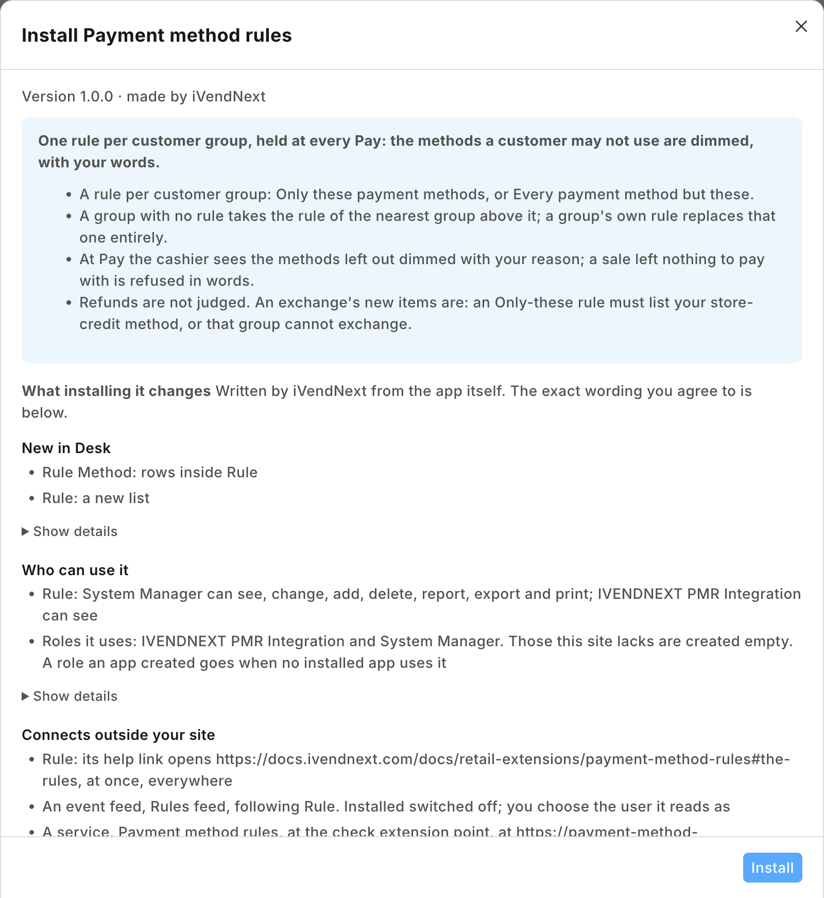
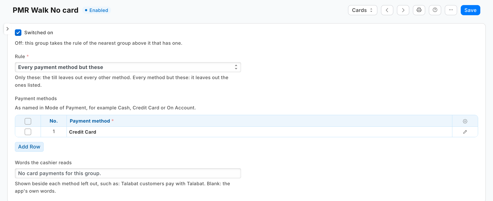
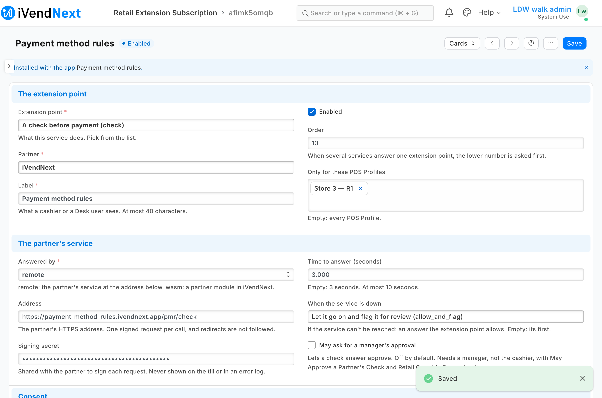
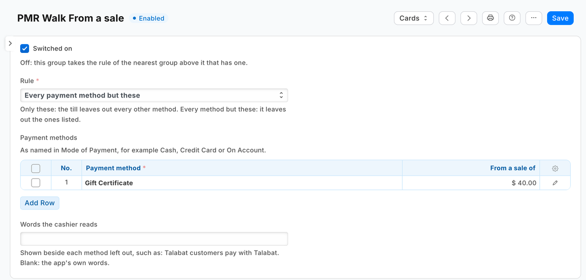
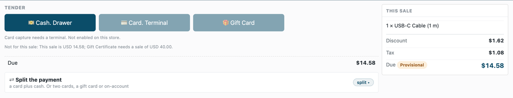

# S46 — Payment method rules (`pp_pmr`): which payment methods each customer group may use

*Start from this sample: `python3 tools/manifest/start.py s46_payment_method_rules --prefix "ACME PMR"` copies it into `apps/` of your repository under your own prefix (your company's first word, then a short name for the app) and checks it ([how](../../recipes/make_it_your_own.md)).*

The retailer decides which payment methods each group of its customers may use at the till: customers who order through a delivery platform pay only by that platform's method, only account customers may buy on account, a group that settles in dollars pays only in dollars. When the cashier presses **Pay**, the app leaves every other method off that sale's payment screen, dimmed, with the retailer's reason beside it.

**When to use it:** a rule about the sale's customer decides which payment methods the till may take, and iVendNext keeps the rule itself, in Desk.

## What happens

| When | What the cashier sees |
|---|---|
| A sale for a customer whose group's rule leaves methods out | The payment screen opens with those methods dimmed: *"Not for this sale: Talabat customers pay with Talabat."* The cashier takes one that is not |
| A rule that leaves out every method this till offers | *"This sale can't be paid"* and *"Customers in Talabat can't pay at this till: use one with Talabat."* |
| A sale below a method's *From a sale of* (Loyalty Points from 2,000, say) | The method's tile dimmed: *"Not for this sale: This sale is NGN 1,500.00; Loyalty Points needs a sale of NGN 2,000.00."* (or the rule's own words). The till's loyalty form still shows when the customer has points: a redemption entered anyway is refused when the payment completes, in those words, unless money has already moved (below). From the amount on, the method is offered |
| No rule for the customer's group, or for any group above it | The payment screen opens as always |
| A refund, the returned items of an exchange, a return rung without its sale | Not judged: the refund choices open as always |
| An exchange's new items | Judged as a sale. An exchange pays them with store credit: an *Only these* rule that does not list the store-credit method stops that group's exchanges |
| The service down, or the retailer's records unreadable | The check's down answer: the sale goes on with every method and is flagged on *Sales to review* |

**Which rule decides.** One rule per customer group, either *Only these payment methods* or *Every payment method but these*. A customer takes their own group's rule; a group with no rule takes the rule of the nearest group above it in the retailer's customer group tree. A group's own rule replaces the rule above it entirely: a method the rule above leaves out comes back unless the group's own rule leaves it out too. So two rules cover on-account credit for account customers only:

| Customer group | Rule | Methods |
|---|---|---|
| All Customer Groups | Every payment method but these | On Account |
| Account customers | Only these payment methods | Cash, Credit Card, On Account |

A customer in *Retail* (under *All Customer Groups*) cannot buy on account; a customer in *Account customers*, or a group below it, can.

**A minimum sale for a method** (version 1.1.0). Each method row may name an amount, *From a sale of*: under either kind of rule, that method pays only for a sale of at least that amount (the sale's total: rounded, after discounts, tax included, before any payment method's own discount; equal is enough). Loyalty points pay through the method *Loyalty Points*, so a retailer that lets points pay only from a sale of 2,000 writes one rule on *All Customer Groups*: *Every payment method but these*, *Loyalty Points*, from a sale of 2,000. A group with its own rule adds the same row to it, since one rule decides, whole. A row with no amount means what it meant before; a method on several rows takes the strictest (the largest amount, and under *Every payment method but these* a row with no amount keeps it out at any total). The amount is read in the sale's own currency. **Loyalty Points must be one of the till's payment methods** (on the POS Profile's Payment Template if it has one, else on the POS Profile: a profile linked to a template offers only the template's methods): the check can only leave out a method the till offers, and the till pays points without one. The Mode of Payment's own minimum amount is a different rule: the least one payment by that method may be, never the sale's size.

| What the retailer sees (on a demo site, 2026-10-23) | |
|---|---|
| What the install will change, read before you consent |  |
| A rule for a customer group: every payment method but Credit Card, with the words the cashier reads |  |
| The check switched on for one POS Profile, with its time to answer and its down answer |  |
| At Pay for a customer in that group: the card left out with the rule's words |  |
| A customer in a group with no rule of its own, below one whose rule is *Only these: Cash*: the card and the gift card left out |  |
| 1.1.0 (on a demo site, 2026-10-29): a rule with *From a sale of*, Gift Certificate from 40.00 |  |
| At Pay on a USD 14.58 sale: the gift card left out with the amount it needs |  |

## What the retailer does

**Before you install:** every `host.docker.internal` address in `manifest.json` (in `allowed_urls`, and where the manifest calls it) is our test bench's own address for the sample's service, and it resolves only where Docker provides it. Replace it with your own service's address first, or iVendNext's calls never reach your service; if this manifest is already installed, raise its `version` and install it again ([the manifest recipe](../../recipes/manifest.md), step 6).

1. **Install the app** from the App library (or paste its manifest into **Retail Extension Package** in Desk), read what it will do and consent. The install adds the record type *PP PMR Rule*, the role `PP PMR Integration`, the check and the feed registration, the check switched off. Nothing changes at the till yet.
2. **Give the app's user its reads.** From POS 2.1.0.667 the install made the app's own user, `pp_pmr@integration.invalid`, and named it on **PP PMR Rules feed**. It holds the role **PP PMR Integration** alone, works through the API only and can never sign in to Desk, so there is no user to make. In *Role Permissions*, give that role **read on Customer Group** (the service reads the group tree). A service for one retailer: press *Generate Keys* on that user (User, API Access) and put the key in the service's settings. A service for many retailers is handed the key by the retailer's site itself, after the install or an update; press **Connect again** on the app's record only if the site could not reach the app, or a key was lost or changed.
3. **Stop cashiers moving a customer into another group.** The till's edit sheet lets a cashier change a customer's group, and the retailer's cashier role can save customers: a cashier could move a customer into a group whose rule allows *On Account*, or into a group with no rule, and take a method the customer's own rule leaves out. In *Customize Form* for *Customer*, set **Customer Group**'s *Perm Level* to 1, and in *Role Permissions* give level 1 *Write* on Customer only to the roles that may move customers (your managers). A cashier's change then leaves the group as it was (measured with [S47](../s47_customers_by_store/) on the programme's bench, run `pp-20261023T115256Z-45139`). Two things follow: a cashier can no longer give a new customer a group either: a customer created at the till takes the default customer group (Selling Settings), or none when none is set, and a manager sets the right one (measured on the programme's bench, run `pp-20261023T162435Z-43204`, with a default group and without), and the till still says *Saved* after a group change it dropped. Check the level 1 rows already there: Sales Master Manager has one by default, and no cashier's role may hold level 1 *Write*.
4. **Write the rules** in *PP PMR Rule*: one per customer group that needs one. The payment methods are the retailer's own *Mode of Payment* records, as the till offers them (*Cash*, *Credit Card*, *On Account*). *From a sale of* on a method row is optional (blank: as the rule says). *Words the cashier reads* is optional: blank, the app writes *"Customers in ⟨group⟩ pay with ⟨methods⟩."*, *"Not for customers in ⟨group⟩."*, or, when a method is left out by its amount, *"This sale is ⟨total⟩; ⟨method⟩ needs a sale of ⟨amount⟩."*, followed by the rule's own sentence when other methods are left out too
5. **Switch the check on:** open *Payment method rules* in *Retail Extension Subscription*, read what is sent, tick the consent, choose the POS Profiles, and switch it on.

**Where it shows.** The rules are Desk records the retailer keeps (its System Manager, or a role the retailer gives the rights to in *Role Permissions*: that role also needs *Select* on **Customer Group** and **Mode of Payment**, or the rule's lookups answer nothing). At the till the cashier meets them at **Pay**: the methods left out are dimmed with the rule's words.

**What leaves the retailer's iVendNext.** At **Pay**, and before each refund the till pays, the priced basket goes to the service's address: each line's item, group, quantity and amounts, the totals, the store, till, POS day and terminal, the cashier's user, the customer and their customer group, the coupons, the sale details the cashier captured and the payment methods offered; never a card. The service reads the retailer's rule records and its customer group tree with the integration user's key, keeps them one minute, and keeps nothing of a sale. It writes nothing. A hosted copy holds each retailer's check secret and the API key of the app's user until the retailer removes the app. Say so on your card.

## The files

| File | What it is |
|---|---|
| `manifest.json` | the record type `PP PMR Rule` (one per customer group, named by it) and its table `PP PMR Rule Method`, a feed registration (it names the app's one integration user), a help address, and one `check`, installed switched off; when the service is down the sale goes on, flagged |
| `payrules.py` | the pure core: the signature check (`verify`), the shape check, the retailer's rules (`rules_of`) and tree (`tree_of`), the rule that decides (`deciding`) and the answer (`on_check`) |
| `service/app.py` | the service, standard library only: `POST /pmr/check`, `GET /health`, and the app template's handshake for many retailers; one `handle` answers the web server and the function entry (`lambda_handler`) alike |
| `Dockerfile` · `app.json` | the settings file for hosting (`"runs": "function"`: on CitiXsys hosting it is a function, paid per call) and an image for your own server (built from the kit's root) |
| `tests/` | the rules, the service over the wire with signed calls (one retailer and many), iVendNext's reads against a stand-in iVendNext, every answer against the published contract, the manifest; `canaries.py` breaks each guarded rule and expects its test to fail |

## Run it

```bash
python3 -m unittest discover -s samples/s46_payment_method_rules/tests -p 'test_*.py'
```
```bash
python3 samples/s46_payment_method_rules/tests/canaries.py
```
```bash
python3 samples/s46_payment_method_rules/service/app.py samples/s46_payment_method_rules/service/.env.local
```

**Settings, one retailer** (`service/.env.local`, never committed): `IVN_CHECK_SECRET` (handed back at install as `pp_pmr:sub:methods`), `IVN_SHOP_URL`, `IVN_SHOP_KEY` (`<api key>:<api secret>` of the integration user), `PORT`. `PMR_PREFIX` names the rule record type (default `PP PMR`).

## Many retailers, hosted

The service is the [app template](../../tools/app_template/README.md)'s shape: set `IVN_LIBRARY_APP` and a store (`IVN_SHOPS_TABLE` on CitiXsys hosting, else `IVN_SHOPS_FILE`). Each retailer connects itself after its install and hands over the check's secret and the key of the app's own user (*Connect again* is only for when the site could not reach the app, or a key was lost or changed). Until the key arrives the service answers 503 and the down answer applies. Every call names its retailer (`X-iVendNext-Site`), and each retailer is answered from its own rules with its own key.

## Make it your own

What a partner usually changes:
- **the rule's reach:** a rule per POS Profile or per terminal (the check sends `pos_profile` and `pos_terminal`), or per customer, from a field you add to Customer;
- **amounts:** a method from an amount is a row's *From a sale of* already; cash up to a limit, or on account up to the customer's credit left (read it with the integration user), are yours to add;
- **refunds:** a refund only to the methods that paid the sale (the check sends `return_of.paid_by` on a return); keep store credit open, or every exchange is refused;
- **the prefix:** `tools/manifest/rename.py` makes your copy under your own reserved prefix in one step; the service takes its prefix from `PMR_PREFIX`;
- **its records:** `tools/deploy/copy_records.py` moves the rules between a test site and the retailer's iVendNext.

## Before you copy it

- **The first card method.** A card terminal cannot tell a credit card from a debit card before it charges: leaving out the store's **first** card method stops card payments at the till (the check page's warning). Leave out another card method only if the cashier picks it by hand.
- **Nothing left to pay with refuses the sale.** A rule that leaves out every method the till offers answers *refuse* with words that say why; so does a rule that would leave out more than the contract's 20 methods. Never send part of the list: a method left off the list would be taken.
- **Down means every method.** The manifest declares `allow_and_flag`: an outage never stops a retailer selling, and a sale the rules could not judge is flagged on *Sales to review*. A retailer that must never take a method its rule leaves out (on-account credit, say) sets the check's down answer to `refuse`; every sale then waits on the service. A refused key (401 or 403) is iVendNext unreadable too, never an allow without the flag.
- **The customer's group is the retailer's.** The rule reads the group the customer record holds. Anyone who may change it (the till's edit sheet, Desk, an import) can move a customer into a group with other methods: put Customer Group at a permission level only your managers write (step 3).
- **A rule changed in Desk, or a new customer group,** reaches the service within a minute (it keeps the rules and the tree that long): until then a new group's customers keep every method.
- **A new key.** A key withdrawn or a user disabled (401 or 403) is iVendNext unreadable: every sale goes to the down answer until the user is switched back on or given a new key, and *Connect again* sends it. The log names it `KeyRefused`, apart from an outage.
- **Exchanges.** An exchange's new items are checked as a sale, and an exchange pays them with store credit: an *Only these* rule that does not list your store-credit method (such as *Store Credit*) stops that group's exchanges.
- **Your address.** Write your own address in `allowed_urls`. The retailer's server must trust your certificate: a real one for a retailer.

## Technical notes

### Why it is built this way

| Option | Cost | Verdict |
|---|---|---|
| Do nothing: one POS Profile per kind of customer, each with its own methods | 0 | a delivery platform's customers need their own till, and an account customer at an ordinary till is still offered *On account* |
| A manifest only: a field on Customer Group naming its methods | ~½ day | nothing reads it at the till; a manifest cannot answer a check |
| **A check before payment, answered by a function that leaves methods out** | ~1 day | **picked**: the rule holds at every door that takes money, on every till the retailer switches it on for, in the retailer's own words; S32's service shape and S44's group-tree walk reused |

### The answer, exactly

- **The reads:** `GET /api/resource/<prefix> Rule` with `fields` `["name","customer_group","kind","words","methods.mode_of_payment","methods.min_sale"]` (one row per method), `filters` `[["enabled","=",1]]`, `limit_page_length` 0 (a retailer still on 1.0.x answers HTTP 417 to `methods.min_sale`, a field its rows lack: the service reads again without it, so that retailer keeps every 1.0 answer); and `GET /api/resource/Customer Group` with `["name","lft","rgt"]`. Both at once (each read has its own timeout inside the check's 3 s), kept a minute per retailer and per key. Either one failing answers 503: never a decision on half the retailer's rules.
- **The rule that decides** is the customer's own group's, else the innermost group whose span (`lft`, `rgt`) holds the group's and that has a switched-on rule. A customer with no group takes the outermost group's rule. A group the tree does not know keeps every method unless it has its own rule.
- **The methods left out** are the offered methods (`offered_tenders`, the till's own order, each once) the rule does not allow: under *Only these*, every offered method not listed; under *Every method but these*, the listed ones offered; and, under either, a listed method with an amount when the sale's `totals.grand_minor` is below that amount in the sale currency's minor units (`currency_exponent`, rounded up: a minimum), while from the amount it is offered. None: `allow`. All of them, or more than 20: `refuse` in words.
- **The words** are the rule's own (up to 120 characters), else the app's; every sentence is plain text of 1 to 140 characters.

### Bounds, stated

- **A sale only.** A refund, a return against a sale, the returned items of an exchange and a return without its sale (`stage: "return"`) are allowed without reading iVendNext, a return without its sale that also sells included (the contract would judge its sold lines). An exchange's replacement basket is `stage: "sale"` and is judged.
- **Methods together.** The check answers before the cashier picks a method, so a rule cannot say *these two not in one sale*.
- **Any 417 on the first read** falls back to the listed fields, not only a missing field: on a 1.1.0 site an unrelated 417 would read the rules without their amounts (the fallback logs one line), and two reads of the rules can take longer than one inside the check's 3 s.
- **A minimum sale is judged at Pay,** on the sale's whole total, never on what is left to pay after another method; one amount per method per rule, read in the sale's own currency.
- **Once money has moved, the sale books and is flagged.** The door that books a sale cannot refuse money already taken: when a card on the bank's own machine, a wallet, or a split's earlier leg has paid part of the sale, a redemption below the amount books with it and the sale is flagged on *Sales to review*. With a card terminal the till drives, the card push checks the redemption first and refuses before the charge.
- **A rule per customer group.** A customer's own rule is a group of their own.
- **Offline,** the till does not call the service: the down answer applies and the sale is flagged when it syncs.
- **Where the check never runs:** a park to a till, a layaway deposit, an account collection (the check page, *Not in this version*) and the Desk's own POS screen.
- **Three checks a POS Profile.** At most three checks answer one POS Profile, ten seconds together; this one asks for 3.
- **Where it runs:** the App library's copy runs in CitiXsys hosting's US region. On CitiXsys hosting the first Pay after a quiet spell starts the function; past 3 s the down answer applies, flagged.
- It logs one line per call: the route, the status and the milliseconds, never the body.
