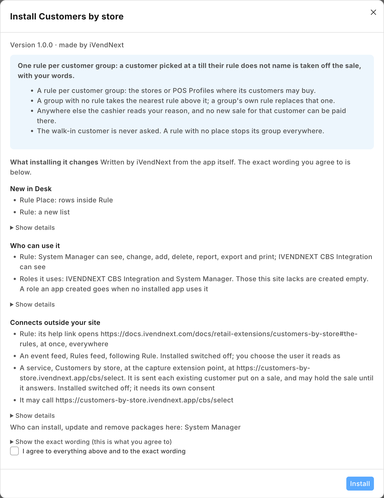
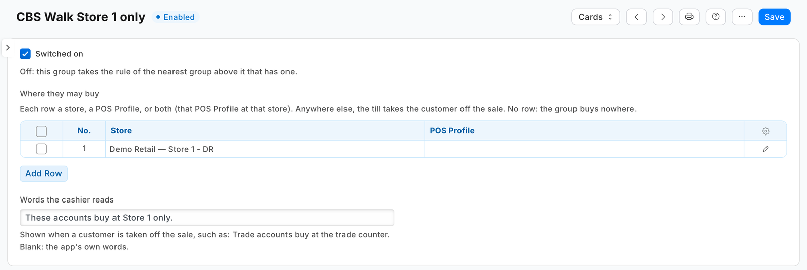
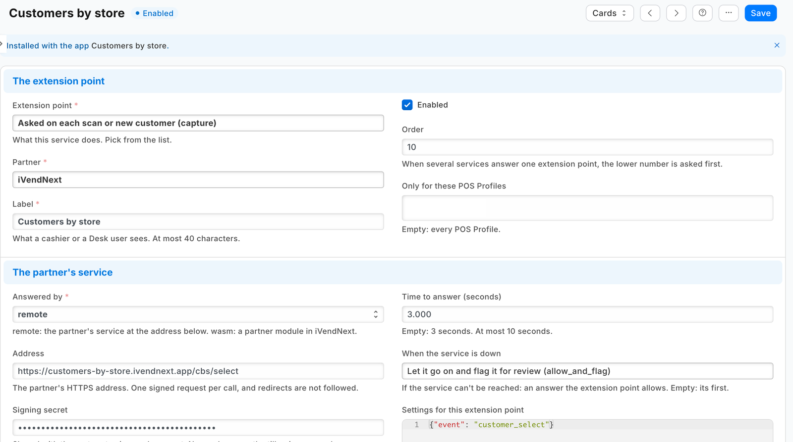
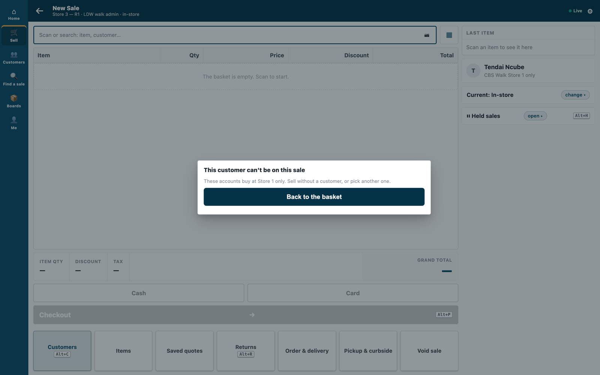
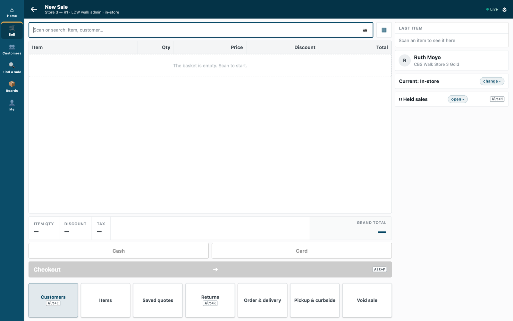

# S47 — Customers by store (`pp_cbs`): at which stores each customer group may buy

*Start from this sample: `python3 tools/manifest/start.py s47_customers_by_store --prefix "ACME CBS"` copies it into `apps/` of your repository under your own prefix (your company's first word, then a short name for the app) and checks it ([how](../../recipes/make_it_your_own.md)).*

The retailer decides at which stores each group of its customers may buy: account customers only at the store that holds their account, a trade group only at the trade counters, staff only at the staff store. When the cashier puts a customer on a sale at any other store, the till takes the customer off the sale with the retailer's reason, and no door that charges or books a new sale takes payment for that customer there.

**When to use it:** a rule about the customer decides where they may buy, and iVendNext keeps the rule itself, in Desk.

## What happens

| When | What the cashier sees |
|---|---|
| A customer whose group's rule names this store, or this till's POS Profile | The customer goes on the sale, as always |
| A customer whose group's rule names neither | *"This customer can't be on this sale"*, the rule's words (for example *"Customers in Trade accounts buy only at Harare, Sandton."*) and *"Sell without a customer, or pick another one."* The customer is off the sale |
| A rule with no place | Refused at every store: *"Customers in ⟨group⟩ can't buy at this store."* |
| No rule for the customer's group, or for any group above it | The customer goes on the sale, as always |
| The store's walk-in customer | Never asked |
| The service down, or the retailer's records unreadable | The capture's down answer: the customer stays on the sale, and the sale is flagged on *Sales to review* |

**The payment is held, not only the screen.** While this app's capture is switched on for a POS Profile, the retailer's server refuses every door that charges or books a sale (the card push, a split's card leg, a wallet, the payment, a layaway plan, an order) until it has recorded this app's *allow* for that cashier, that customer and that POS Profile. A customer taken off the sale and put back without a pick is refused at payment: *"This customer has not been checked. Pick them again, or sell without a customer."*

**Which rule decides.** One rule per customer group, with the places its customers may buy at. Each place is a store (every till whose POS Profile names that store) or a POS Profile (its tills). The till's store is always its POS Profile's own warehouse, so a row naming both matches only when they agree. A customer takes their own group's rule; a group with no rule takes the rule of the nearest group above it in the retailer's customer group tree. A group's own rule replaces the rule above it entirely. So two rules keep trade customers at the trade counters, and let a few of them buy anywhere:

| Customer group | Where they may buy |
|---|---|
| Trade accounts | the POS Profile *Trade Counter* |
| Trade accounts › Key accounts | Harare, Sandton, Bulawayo (each store) |

| What the retailer sees (on a demo site, 2026-10-23) | |
|---|---|
| What the install will change, read before you consent |  |
| A rule for a customer group: Store 1 only, with the words the cashier reads |  |
| The question switched on with no POS Profile chosen, so every till asks |  |
| At Store 3, that group's customer taken off the sale with the rule's words |  |
| A customer in a group below one whose rule names Store 3 stays on the sale |  |

**Before you install:** every `host.docker.internal` address in `manifest.json` (in `allowed_urls`, and where the manifest calls it) is our test bench's own address for the sample's service, and it resolves only where Docker provides it. Replace it with your own service's address first, or iVendNext's calls never reach your service; if this manifest is already installed, raise its `version` and install it again ([the manifest recipe](../../recipes/manifest.md), step 6).

## What the retailer does

1. **Install the app** from the App library (or paste its manifest into **Retail Extension Package** in Desk), read what it will do and consent. The install adds the record type *PP CBS Rule*, the role `PP CBS Integration`, the capture and the feed registration, the capture switched off. Nothing changes at the till yet.
2. **Make the app's integration user** (the [integration user recipe](../../recipes/integration_user.md)): tick *Is Desk User*, give it the role **PP CBS Integration** alone, no User Permissions, and generate its API key. In *Role Permissions*, give that role **read on Customer Group** (the service reads the group tree). Ask iVendNext support to set the user as the *Application User* of **PP CBS Rules feed** (a user made for the app alone, never a person's), then press **Connect again** on the app's record, which sends that user's key to the service.
3. **Stop cashiers moving a customer out of a locked group.** The till's edit sheet lets a cashier change a customer's group, and the retailer's cashier role can save customers: a cashier refused at one store could move the customer to a group with no rule and pick them again. In *Customize Form* for *Customer*, set **Customer Group**'s *Perm Level* to 1, and in *Role Permissions* give level 1 *Write* on Customer only to the roles that may move customers (your managers). The cashier's change then leaves the group as it was (measured on the programme's bench, run `pp-20261023T115256Z-45139`). Two things follow: a cashier can no longer give a new customer a group either: a customer created at the till takes the default customer group (Selling Settings), or none when none is set, and a manager sets the right one (measured on the programme's bench, run `pp-20261023T162435Z-43204`, with a default group and without), and the till still says *Saved* after a group change it dropped (the profile shows the group unchanged). Check the level 1 rows already there: Sales Master Manager has one by default, and no cashier's role may hold level 1 *Write*.
4. **Write the rules** in *PP CBS Rule*: one per customer group that needs one. A store is the retailer's own warehouse, as its tills' POS Profile names it. *Words the cashier reads* is optional: blank, the app writes *"Customers in ⟨group⟩ buy only at ⟨places⟩."*
5. **Switch the capture on:** open *Customers by store* in *Retail Extension Subscription*, read what is sent, tick the consent, leave its POS Profiles empty (every till asks), and switch it on. A POS Profile left off a list never asks, and every customer buys there: name POS Profiles only to leave out tills no locked customer can reach.
6. **Test it:** pick a customer whose rule names another store. The till must take them off the sale. If they stay on and the sale shows on *Sales to review*, check the read on Customer Group and press *Connect again*.

**Where it shows.** The rules are Desk records the retailer keeps (its System Manager, or a role the retailer gives the rights to in *Role Permissions*: that role also needs *Select* on **Customer Group**, **Warehouse** and **POS Profile**, or the rule's lookups answer nothing). At the till the cashier meets them when they pick a customer.

**What leaves the retailer's iVendNext.** Each time a cashier puts an existing customer on a sale, the retailer's server sends the service: the store, the POS Profile, the till's language, the cashier's user, the till's own id for the sale, an id for a code check, and the customer's id, name, phone, email and customer group. No price, total or tender. The service reads the retailer's rule records and its customer group tree with the integration user's key, keeps them one minute, and keeps nothing of a call. It never reads the customer record and writes nothing. A hosted copy holds each retailer's capture secret and its user's API key from *Connect again* until the retailer removes the app. Say so on your card.

## The files

| File | What it is |
|---|---|
| `manifest.json` | the record type `PP CBS Rule` (one per customer group, named by it) and its table `PP CBS Rule Place`, a feed registration (it names the app's one integration user), a help address, and one `capture` on `customer_select`, installed switched off; when the service is down the customer stays on, flagged |
| `storerules.py` | the pure core: the signature check (`verify`), the shape check, the retailer's rules (`rules_of`) and tree (`tree_of`), the rule that decides (`deciding`) and the answer (`on_select`) |
| `service/app.py` | the service, standard library only: `POST /cbs/select`, `GET /health`, and the app template's handshake for many retailers; one `handle` answers the web server and the function entry (`lambda_handler`) alike |
| `Dockerfile` · `app.json` | the settings file for hosting (`"runs": "function"`: on CitiXsys hosting it is a function, paid per call) and an image for your own server (built from the kit's root) |
| `tests/` | the rules, the service over the wire with signed calls (one retailer and many), iVendNext's reads against a stand-in iVendNext, every answer against the published contract, the manifest; `canaries.py` breaks each guarded rule and expects its test to fail |

## Run it

```bash
python3 -m unittest discover -s samples/s47_customers_by_store/tests -p 'test_*.py'
```
```bash
python3 samples/s47_customers_by_store/tests/canaries.py
```
```bash
python3 samples/s47_customers_by_store/service/app.py samples/s47_customers_by_store/service/.env.local
```

**Settings, one retailer** (`service/.env.local`, never committed): `IVN_CAPTURE_SECRET` (handed back at install as `pp_cbs:sub:on_select`), `IVN_SHOP_URL`, `IVN_SHOP_KEY` (`<api key>:<api secret>` of the integration user), `PORT`. `CBS_PREFIX` names the rule record type (default `PP CBS`).

## Many retailers, hosted

The service is the [app template](../../tools/app_template/README.md)'s shape: set `IVN_LIBRARY_APP` and a store (`IVN_SHOPS_TABLE` on CitiXsys hosting, else `IVN_SHOPS_FILE`). Each retailer connects itself after its install and hands over the capture's secret; *Connect again* hands over its integration user's key. Until the key arrives the service answers 503 and the down answer applies. Every call names its retailer (`X-iVendNext-Site`), and each retailer is answered from its own rules with its own key.

## Make it your own

What a partner usually changes:
- **the rule's reach:** a rule per customer, from a field you add to Customer (read the customer with the integration user, which then needs read on Customer); a store's own list of groups instead of a group's list of stores;
- **a code instead of a refusal:** answer `challenge` for a customer from another store, and let them on once they read out a one-time code sent to their phone (the capture's `verify` step);
- **the back office:** a sales order or invoice made in Desk for a customer at another store is not asked; a [document check](../../recipes/document_check.md) can hold it;
- **the prefix:** `tools/manifest/rename.py` makes your copy under your own reserved prefix in one step; the service takes its prefix from `CBS_PREFIX`;
- **its records:** `tools/deploy/copy_records.py` moves the rules between a test site and the retailer's iVendNext.

## Before you copy it

- **One app per question.** A POS Profile takes one service on each capture event, so this app's *customer selected* question cannot share a POS Profile with another app that answers it (a loyalty app that sends a code on select, say). It adds no check before payment.
- **Down keeps the customer on.** The manifest declares `allow_and_flag`: an outage never stops a retailer selling, and a customer the rules could not judge is flagged on *Sales to review*. A retailer that must never sell to a customer outside their stores sets the capture's down answer to `refuse`; every pick of a customer then waits on the service. A refused key (401 or 403) is iVendNext unreadable too, never an allow without the flag.
- **A rule with no place stops the group.** It refuses its customers at every store; it never lets them through. Desk drops a place row left blank, so a rule meant to stop a group simply has no rows.
- **Sixty picks in ten minutes.** One cashier sends at most 60 select rounds in ten minutes; past that the till shows *"Too many attempts. Try again in a few minutes."* without asking you, and a customer already let on stays on.
- **A rule changed in Desk, or a new customer group,** reaches the service within a minute (it keeps the rules and the tree that long). A customer in a group the kept tree does not know yet is answered 503 (the down answer, flagged), and the next pick reads iVendNext again. A sale already open keeps its answer until it books, twelve hours at most.
- **A new key.** A key withdrawn or a user disabled (401 or 403) is iVendNext unreadable: every pick goes to the down answer until the user is switched back on or given a new key, and *Connect again* sends it. The log names it `KeyRefused`, apart from an outage.
- **Your address.** Write your own address in `allowed_urls`. The retailer's server must trust your certificate: a real one for a retailer.

## Technical notes

### Why it is built this way

| Option | Cost | Verdict |
|---|---|---|
| Do nothing: a POS Profile per store and the cashier's training | 0 | the till shows every customer at every store; nothing stops a sale on account at the wrong store |
| A manifest only: a field on Customer naming its store, or the POS Profile's own *Customer Groups* | ~20 lines | the till reads neither; a manifest cannot answer a capture |
| A function on the same capture that reads the POS Profile's own *Customer Groups* table | ~350 lines | one list per POS Profile (a group per till, never a store), no words of the retailer's, and a table that already means *customers shown* on the Desk's own POS screen |
| A check before payment (S46's door) by store and group | ~420 lines (S46's own size) | it holds at the booking with no pass to go stale, but the cashier learns at Pay, after the basket is built; the capture takes the customer off at the pick |
| **A capture on customer select, answered by a function that refuses a customer whose group's rule does not name this till** | ~415 lines of core and service with their docstrings | **picked**: the server holds every payment door until the app lets the customer on here, in the retailer's own words, with no read of the customer record; S46's service shape and group-tree walk reused |

### The answer, exactly

- **The reads:** `GET /api/resource/<prefix> Rule` with `fields` `["name","customer_group","words","places.store","places.pos_profile"]` (one row per place), `filters` `[["enabled","=",1]]`, `limit_page_length` 0; and `GET /api/resource/Customer Group` with `["name","lft","rgt"]`. Both at once (each read has its own timeout inside the select's 3 s), kept a minute per retailer and per key. Either one failing answers 503: never a decision on half the retailer's rules.
- **The rule that decides** is the customer's own group's (from the call's `customer.customer_group`, which the retailer's server reads from the customer record), else the innermost group whose span (`lft`, `rgt`) holds the group's and that has a switched-on rule. A customer with no group takes the outermost group's rule. A group the kept tree does not know, while iVendNext has rules, answers 503 (the down answer, flagged) and drops what was kept; with no rules at all, everyone buys anywhere.
- **A place names this till** when each side it fills equals the call's own: `store` alone, `pos_profile` alone, or both. Any place that names this till: `allow`. None: `refuse` in words.
- **The words** are the rule's own (up to 120 characters), else the app's; every sentence is plain text of 1 to 140 characters.

### Bounds, stated

- **The till's own doors only.** A sales order or invoice made in iVendNext Desk is not asked (the capture is the till's).
- **Offline,** the till does not call the service: the down answer applies, and a sale paid offline with a customer the service was not asked about books when it syncs and is flagged. A sale paid after the connection returns is refused until the customer is picked again.
- **What the customer already holds** is not a new pick and is not held: a layaway plan's later payment and its settlement, an order's balance, a payment on their account. A locked customer can make those at any store.
- **The pass is per POS Profile.** The retailer's server records an *allow* for the cashier, the customer and the POS Profile, for twelve hours or until a booking uses it. A POS Profile has one store, so the pass never carries to another store (unless the retailer changes the POS Profile's store within those twelve hours).
- **The customer's group is the retailer's.** The rule reads the group the customer record holds. Anyone who may change it (the till's edit sheet, Desk, an import) can move a customer out of a locked group: put Customer Group at a permission level only your managers write (step 3).
- **A customer added at the till** is asked on the pick that follows. But while any customer-add app is switched on for the POS Profile, a customer this cashier added in the last ten minutes goes on the sale without this app being asked, whatever group the cashier gave them.
- **A rule per customer group.** A customer's own rule is a group of their own.
- **Where it runs:** the App library's copy runs in CitiXsys hosting's US region. On CitiXsys hosting the first pick after a quiet spell starts the function; past 3 s the down answer applies, flagged.
- It logs one line per call: the route, the status and the milliseconds, never the body.
