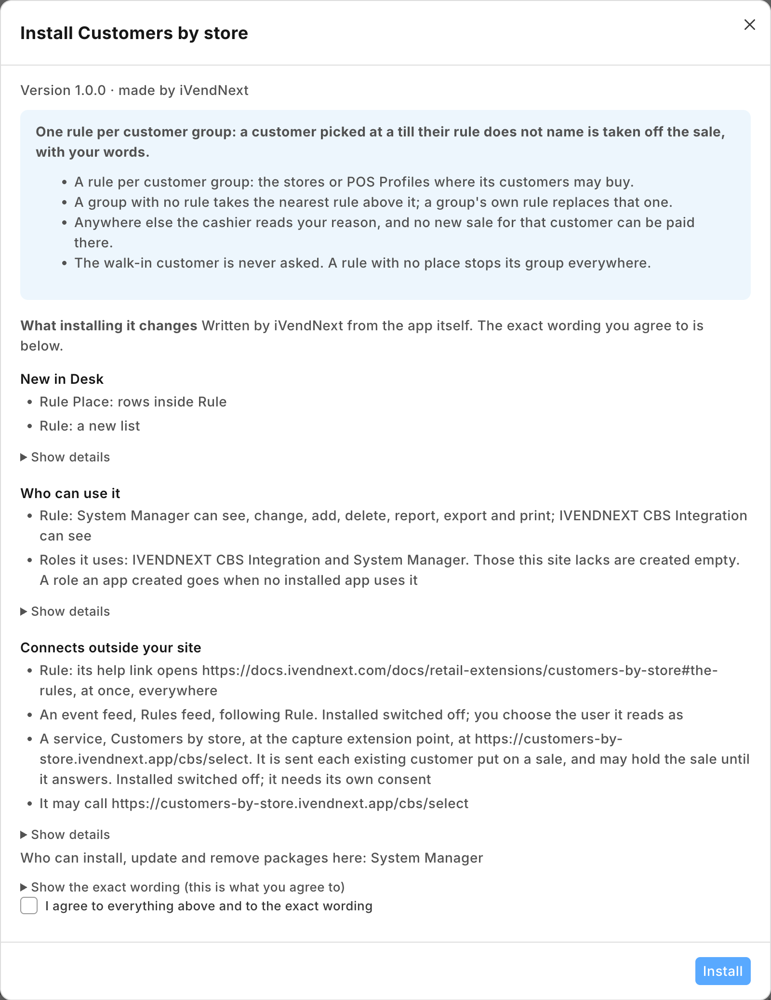

# S47 — Customers by store (`pp_cbs`): at which stores each customer group may buy

The retailer decides at which stores each group of its customers may buy: account customers only at the store that holds their account, a trade group only at the trade counters, staff only at the staff store. When the cashier puts a customer on a sale at any other store, the till takes the customer off the sale with the retailer's words, and no door that charges or books a new sale takes payment for that customer there. A group with no rule, and the walk-in customer, are never asked.



**Industries:** every industry

**When to use it:** a rule about the customer decides where they may buy, and iVendNext keeps the rule itself, in Desk.

## Start from it

```bash
ivn new acme_stores --from s47
```

## What to change

What a partner usually changes:

- **The rule's reach:** `PP CBS Rule` (one per customer group) and its table `PP CBS Rule Place` in `manifest.json`; the rule that decides is `deciding` in `storerules.py`. A rule per customer, from a field you add to Customer, needs read on Customer for the app's user.
- **A code instead of a refusal:** answer `challenge` in `storerules.py` for a customer from another store.
- **When the service is down:** the capture's down answer in `manifest.json` is `allow_and_flag`; `refuse` stops every pick while the service is down.
- **The record type's name:** `CBS_PREFIX` (default `PP CBS`).
- **Your service's address:** `allowed_urls` in `manifest.json` names the sample's test address; write your own.

More: the [recipe](../../recipes/customers_by_store.md).

**The customer sets:** the rules, one per customer group, naming the stores or POS Profiles where that group may buy, and the words the cashier reads.

## Run it

```bash
ivn check
ivn try
```

## Try it at the till

- Choose a customer whose group may not buy at this store; the till takes the customer off the sale, with the reason.
- Close the till day when you are done.

## Versions

### 1.1.0

- The role's rights beyond the feed's reads move into the manifest (`role_rights`): the install gives the feed's user its reads and the manifest the rest, so the retailer's administrator grants none. Needs POS build `2.1.0.691` or later.

### 1.0.1

- The description and README stop telling the retailer to lock *Customer Group*: who may move a customer is the customer's choice.

### 1.0.0

- First version in the kit: at which stores each customer group may buy.
- Each setting in app.json says its purpose (the line the Settings screen shows), whether it is required, and which settings go with it.
- The set-up steps say the install makes the app's own user (POS 2.1.0.667 or later).
