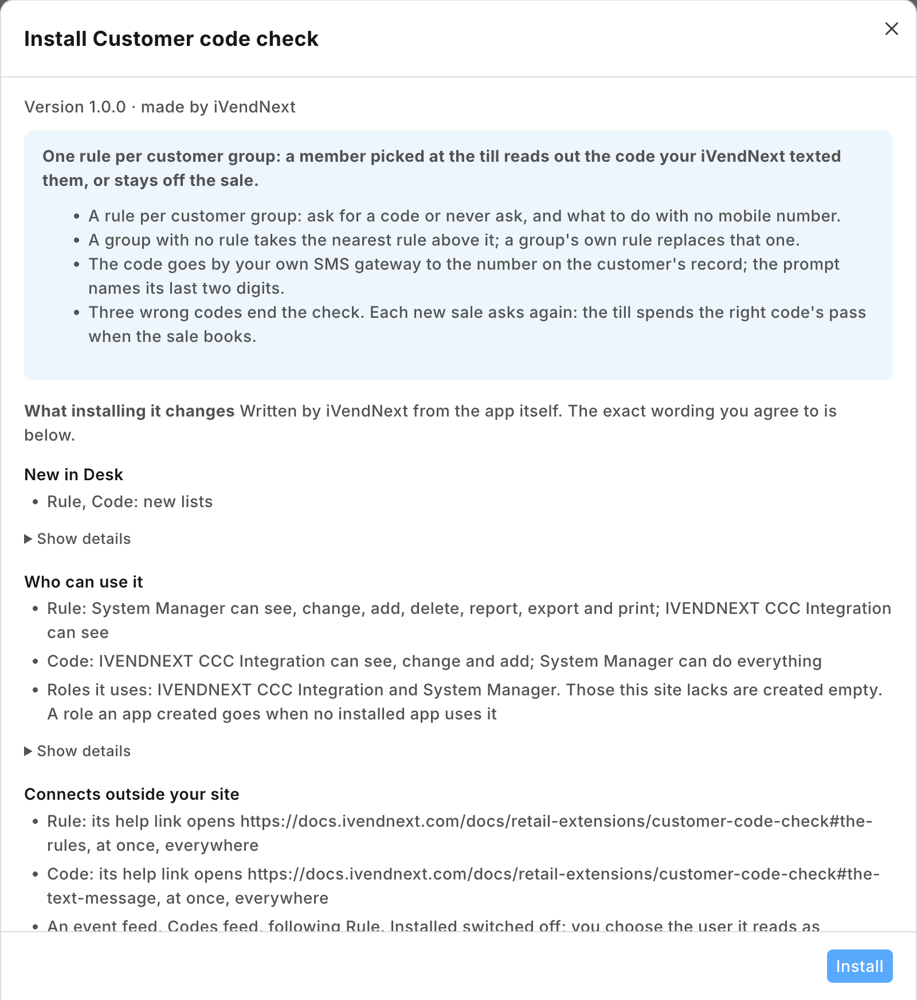
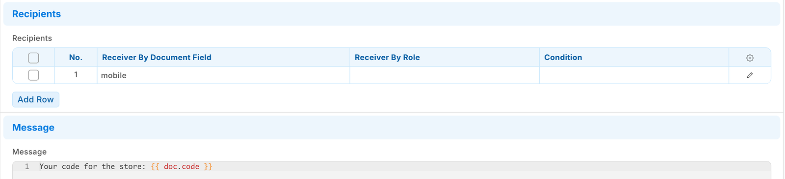
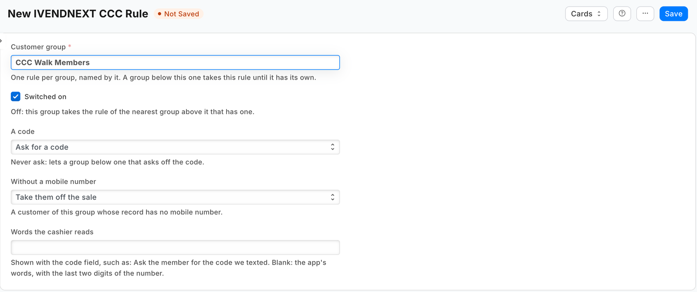
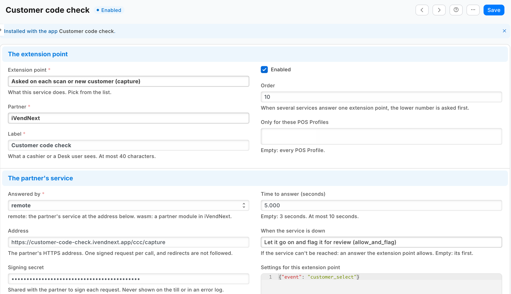
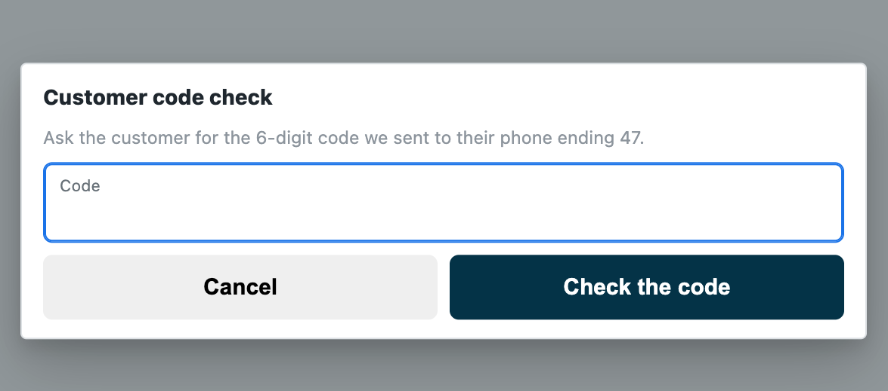
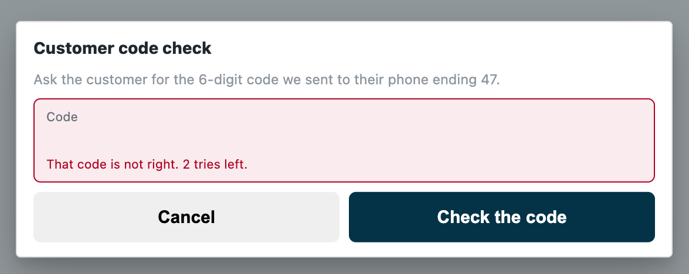
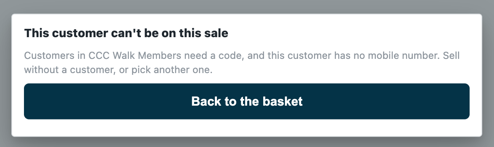

# S48 — Customer code check (`pp_ccc`): a one-time code before a customer's account is used

*Start from this sample: `python3 tools/manifest/start.py s48_customer_code_check --prefix "ACME CCC"` copies it into `apps/` of your repository under your own prefix (your company's first word, then a short name for the app) and checks it ([how](../../recipes/make_it_your_own.md)).*

The retailer decides which groups of its customers must prove they are at the counter before a sale can use their account: loyalty members before their points are spent, account customers before they buy on account. When the cashier puts such a customer on a sale, iVendNext texts a one-time code to the mobile number on the customer's record, and the cashier types the code the customer reads out. Until the code is right, no door that takes payment takes that customer.

**When to use it:** a customer's points, store credit or account must not be used by someone who only knows their name or number, and iVendNext sends text messages through its own SMS gateway.

## What happens

| When | What the cashier sees |
|---|---|
| A customer whose group's rule asks for a code | A code field with *"Ask the customer for the 6-digit code we sent to their phone ending 47."* (or the rule's own words). iVendNext texts the code to the number on the customer's record |
| The right code | The customer stays on the sale; every payment door takes them |
| A wrong code | *"That code is not right."* and *"⟨n⟩ tries left."* The third wrong code ends the check, and the customer is off the sale |
| A code check older than ten minutes, or already ended | The till's *"This code check has ended."* The cashier picks the customer again, and a new code is sent |
| The same customer picked again for the next sale, or a held sale resumed | Asked again: the till spends a right code's pass when the sale books |
| A customer whose rule asks, with no mobile number on their record | *Take them off the sale* (the rule's default): *"Customers in ⟨group⟩ need a code, and this customer has no mobile number."*; or *Let them on* |
| *Never ask*, or no rule for the customer's group or any group above it | The customer goes on the sale, as always |
| The cashier presses *Cancel* on the code field | The customer is off the sale |
| The pick's own call fails (the till cannot reach the retailer's iVendNext) | The customer stays on the screen, and payment says *"This customer has not been checked. Pick them again, or sell without a customer."* |
| The store's walk-in customer | Never asked |
| iVendNext's SMS gateway refuses the text or cannot be reached | The code field, but no code reaches the customer: the cashier sells without them or picks them again later. The retailer's *Error Log* records *Failed to send Notification* |
| The service down, or the retailer's records unreadable | The capture's down answer: the customer stays on the sale, and the sale is flagged on *Sales to review* |

| What the retailer sees (on a demo site, 2026-10-24) | |
|---|---|
| What the install will change, read before you consent |  |
| The Notification: channel SMS, sent to the code record's mobile field |  |
| A rule for a customer group: ask for a code, a customer with no mobile number taken off the sale |  |
| The question switched on with no POS Profile chosen, so every till asks |  |
| The code field, naming the last two digits of the number the code went to |  |
| A wrong code, with the tries left |  |
| A member with no mobile number taken off the sale in the rule's words |  |

**The payment is held, not only the screen.** While this app's capture is switched on for a POS Profile, the retailer's server refuses every door that charges or books a sale (the card push, a split's card leg, a wallet, loyalty points, store credit, the payment, a layaway plan, an order) until it has recorded a right code, or this app's *allow*, for that cashier, that customer and that POS Profile.

**Which rule decides.** One rule per customer group: *Ask for a code* or *Never ask*, and what to do when the customer has no mobile number. A customer takes their own group's rule; a group with no rule takes the rule of the nearest group above it in the retailer's customer group tree. A group's own rule replaces the rule above it entirely. So two rules ask every member except staff:

| Customer group | A code |
|---|---|
| Members | Ask for a code |
| Members › Staff members | Never ask |

**Where the code goes.** The app writes one *PP CCC Code* record per code, holding the code and the mobile number on the customer's record. The retailer's own **Notification** on that record type texts the code, through the retailer's own **SMS Settings**, inside the same save. A text the gateway refuses is not sent and the save still succeeds (the framework writes the failure to the retailer's *Error Log*): the customer gets no code and cannot be put on the sale, so a gateway fault closes the door, never opens it. The code never passes through the app's service on its way to the phone, and a right code is cleared from its record.

**Before you install:** every `host.docker.internal` address in `manifest.json` (in `allowed_urls`, and where the manifest calls it) is our test bench's own address for the sample's service, and it resolves only where Docker provides it. Replace it with your own service's address first, or iVendNext's calls never reach your service; if this manifest is already installed, raise its `version` and install it again ([the manifest recipe](../../recipes/manifest.md), step 6).

## What iVendNext does

1. **Install the app** from the App library (or paste its manifest into **Retail Extension Package** in Desk), read what it will do and consent. The install adds the record types *PP CCC Rule* and *PP CCC Code*, the role `PP CCC Integration`, the capture and the feed registration, the capture switched off. Nothing changes at the till yet.
2. **Make the app's integration user** (the [integration user recipe](../../recipes/integration_user.md)): tick *Is Desk User*, give it the role **PP CCC Integration** alone, no User Permissions, and generate its API key. In *Role Permissions*, give that role **read on Customer Group** (the service reads the group tree). The install gives the role its rights on the app's own two record types. Choose the user on the feed registration **PP CCC Codes feed**, then press **Connect again** on the app's record, which sends that user's key to the service.
3. **Stop cashiers moving a customer out of a group that asks.** The till's edit sheet lets a cashier change a customer's group, and the retailer's cashier role can save customers: a cashier could move a member into a group that is never asked, pick them with no code, and spend their account. In *Customize Form* for *Customer*, set **Customer Group**'s *Perm Level* to 1, and in *Role Permissions* give level 1 *Write* on Customer only to the roles that may move customers (your managers). A cashier's change then leaves the group as it was. Two things follow: a cashier can no longer give a new customer a group either (a customer created at the till takes the default customer group in Selling Settings, or none), and the till still says *Saved* after a group change it dropped. Check the level 1 rows already there: Sales Master Manager has one by default, and no cashier's role may hold level 1 *Write*. (Measured on the programme's bench, run `pp-20261023T163638Z-9485`.)
4. **Decide about the phone.** The code goes to the mobile number on the customer's record, and the edit sheet lets a cashier change that too: a cashier who types in their own number gets the customer's code (measured, run `pp-20261023T163638Z-9485`). To stop it, put the customer's phone field, the one the till edits (*Phone Number*, or *Mobile No* where there is no Phone Number field), at *Perm Level* 1 in the same step: a cashier's change then leaves the number as it was (measured). The cost, measured on the same run: a customer the cashier creates at the till is then saved with no phone, so a manager records new customers' numbers. A retailer that keeps its cashiers recording phones leaves the phone open and relies on the prompt's last two digits and on its *Extension Log*, which names each pick's cashier.
5. **Let iVendNext send text messages:** in **SMS Settings**, your SMS gateway's address and its parameters (the gateway's own guide says which; the receiver's parameter takes the number). Then make one **Notification**: *Document Type* **PP CCC Code**, *Send Alert On* **New**, *Channel* **SMS**, a recipient *Receiver By Document Field* **mobile**, and a message holding the code, for example `Your code at Shop: {{ doc.code }}`. Save it switched on.
6. **Write the rules** in *PP CCC Rule*: one per customer group that needs one. *Words the cashier reads* is optional: blank, the app writes *"Ask the customer for the 6-digit code we sent to their phone ending ⟨last two digits⟩."* Whoever writes them needs *Select* on *Customer Group* (a System Manager too, where the site removed it), or the lookup is refused.
7. **Switch the capture on:** open *Customer code check* in *Retail Extension Subscription*, read what is sent, tick the consent, leave its POS Profiles empty (every till asks), and switch it on. A POS Profile left off a list never asks.
8. **Test it:** pick a customer of a group that asks. A text with the code must reach their phone, and the code must let them on. If no text arrives, check the SMS Settings and the Notification. If the till does not ask and the sale shows on *Sales to review*, check the read on Customer Group, then press *Connect again*.

**Where it shows.** The rules are Desk records iVendNext keeps (its System Manager, or a role iVendNext gives the rights to in *Role Permissions*; whoever keeps them needs *Select* on **Customer Group**, or the rule's lookup is refused: check that your System Manager has it, since a site can remove it, as a demo site had, 2026-10-24). The code records are the app's own role's, and your System Manager's: the install gives every record type a System Manager row, as it does the SMS log. No cashier reads a code. The retailer's *Extension Log* records each pick and each code's verdict, by cashier. At the till the cashier meets the app when they pick a customer.

**What leaves the retailer's iVendNext.** Each time a cashier puts an existing customer on a sale, the retailer's server sends the service: the store, the POS Profile, the till's language, the cashier's user, the till's own id for the sale, an id for the code check, and the customer's id, name, phone, email and customer group; after a code, the code the customer read out. No price, total or tender. The service reads the retailer's rules, its customer group tree and the customer's code records with the integration user's key, keeps the rules and the tree one minute, and keeps nothing of a call. It writes one code record per code, and clears a right one. The text goes from the retailer's own server to its own SMS gateway. A hosted copy holds each retailer's capture secret and its user's API key from *Connect again* until the retailer removes the app. Say so on your card.

## The files

| File | What it is |
|---|---|
| `manifest.json` | the record types `PP CCC Rule` (one per customer group, named by it) and `PP CCC Code` (one per code, named by the till's code-check id; the manifest gives it to the integration role alone, and the install adds its own System Manager row), a feed registration (it names the app's one integration user), two help addresses, and one `capture` on `customer_select`, installed switched off; when the service is down the customer stays on, flagged |
| `codecheck.py` | the pure core: the signature check (`verify`), the shape check, the retailer's rules (`rules_of`) and tree (`tree_of`), the rule that decides (`deciding`), the answer to a pick (`on_select`), the code (`new_code`, `code_record`) and the answer to a code (`on_verify`) |
| `service/app.py` | the service, standard library only: `POST /ccc/capture` (the pick and the code, one address), `GET /health`, and the app template's handshake for many retailers; one `handle` answers the web server and the function entry (`lambda_handler`) alike |
| `Dockerfile` · `app.json` | the settings file for hosting (`"runs": "function"`: on CitiXsys hosting it is a function, paid per call) and an image for your own server (built from the kit's root) |
| `tests/` | the rules, the service over the wire with signed calls (one retailer and many), iVendNext's reads and writes against a stand-in iVendNext, every answer against the published contract, the manifest; `canaries.py` breaks each guarded rule and expects its test to fail |

## Run it

```bash
python3 -m unittest discover -s samples/s48_customer_code_check/tests -p 'test_*.py'
```
```bash
python3 samples/s48_customer_code_check/tests/canaries.py
```
```bash
python3 samples/s48_customer_code_check/service/app.py samples/s48_customer_code_check/service/.env.local
```

**Settings, one retailer** (`service/.env.local`, never committed): `IVN_CAPTURE_SECRET` (handed back at install as `pp_ccc:sub:on_select`), `IVN_SHOP_URL`, `IVN_SHOP_KEY` (`<api key>:<api secret>` of the integration user), `PORT`. `CCC_PREFIX` names the record types (default `PP CCC`).

## Many retailers, hosted

The service is the [app template](../../tools/app_template/README.md)'s shape: set `IVN_LIBRARY_APP` and a store (`IVN_SHOPS_TABLE` on CitiXsys hosting, else `IVN_SHOPS_FILE`). Each retailer connects itself after its install and hands over the capture's secret; *Connect again* hands over its integration user's key. Until the key arrives the service answers 503 and the down answer applies. Every call names its retailer's iVendNext (`X-iVendNext-Site`), and each retailer is answered from its own rules and its own code records with its own key.

## Make it your own

What a partner usually changes:
- **who is asked:** a code only for customers with a balance to spend (read their loyalty points or credit with the integration user, which then needs read on what holds them), or only at some POS Profiles (the capture's own list);
- **the channel:** a WhatsApp notification on the same record where the retailer has the WhatsApp app, or your own gateway called by your service (then the code passes through your service: say so on your card);
- **the code:** its length (4 to 8 letters and digits, the contract's) and its life (the retailer's own challenge ends at ten minutes);
- **the prefix:** `tools/manifest/rename.py` makes your copy under your own reserved prefix in one step; the service takes its prefix from `CCC_PREFIX`;
- **its records:** `tools/deploy/copy_records.py` moves the rules between a test site and the retailer's iVendNext.

## Before you copy it

- **One app per question.** A POS Profile takes one service on each capture event, so this app's *customer selected* question cannot share a POS Profile with another app that answers it (S47 *Customers by store*, say). It adds no check before payment.
- **The customer's group and number are the retailer's.** The rule reads the group the customer record holds, and the code goes to the number it holds. Anyone who may change them (the till's edit sheet, Desk, an import) can move a customer off the code or send it to another phone: lock the group (step 3) and decide about the phone (step 4).
- **Down keeps the customer on.** The manifest declares `allow_and_flag`: an outage of the service never stops a store selling, and the sale is flagged on *Sales to review*. A retailer that must never let a customer on without their code sets the capture's down answer to `refuse`; every pick of a customer of any group then waits on the service.
- **No text, and no error at the till:** a Notification switched off sends nothing, SMS Settings with no gateway address only print a message, and a gateway that refuses the text or cannot be reached is written to the *Error Log*; in each the save succeeds, the customer gets no code and cannot be put on the sale. The setup's test step catches the first two; watch the Error Log for the third.
- **The code comes at the pick, not at redemption.** The check before payment cannot ask the customer anything, so a customer of a group that asks is asked when picked, whether or not they spend from their account. Name the groups that need it.
- **Sixty picks in ten minutes.** One cashier sends at most 60 select rounds in ten minutes; past that the till shows *"Too many attempts. Try again in a few minutes."* without asking you, and a customer already let on stays on.
- **While the service does not answer, the code field takes any code.** Under `allow_and_flag` a code typed while the service is down or late counts as checked, and the sale is flagged on *Sales to review*. A retailer that must never let a customer on unchecked sets `refuse`.
- **A slow or hung SMS gateway.** The text goes inside the code record's save, and the framework's gateway call has no time limit of its own. The service waits at most 2.5 s for the save, its own waits ending by 3 s from the call's start (a connection's set-up is outside it) (the capture's time to answer is 5 s): past it the code field still opens, the save goes on, and the text arrives late. A gateway that never answers holds one of the retailer's web workers per pick until the web server ends the request: choose a gateway that answers quickly.
- **A rule changed in Desk, or a new customer group,** reaches the service within a minute. A customer in a group the kept tree does not know yet is answered 503 (the down answer, flagged), and the next pick reads iVendNext again.
- **A new key.** A key withdrawn or a user disabled (401 or 403) is the retailer's iVendNext unreadable: every pick goes to the down answer until the user is switched back on or given a new key, and *Connect again* sends it. The log names it `KeyRefused`, apart from an outage.
- **Your address.** Write your own address in `allowed_urls`. The retailer's server must trust your certificate: a real one for a retailer.

## Technical notes

### Why it is built this way

| Option | Cost | Verdict |
|---|---|---|
| Do nothing | 0 | anyone who gives a member's name or number spends their points, credit or account |
| A text to the customer after each sale that used their points (the retailer's own Notification on the sale) | ~10 lines of setup | tells the customer after the money moved; stops nothing |
| A partner wallet that asks its own code (`wallet/1` `otp_required`, S22's *Member cash*) | a wallet service and a payments app on the site | covers that wallet's balance only, never the retailer's own loyalty points, store credit or account |
| A capture on select whose service texts the code through its own gateway account | ~450 lines and a gateway per country, with its secrets | each country's gateway is a partner's; the retailer already has its own |
| **A capture on customer select that answers `challenge`, the code texted by the retailer's own Notification on the app's code record** | ~555 lines of core and service with their docstrings | **picked**: the server holds every payment door until the code is right, through the retailer's own gateway and in its words, with no read of the customer record; S47's service shape and S46's group-tree walk reused |

### The answer, exactly

- **On a pick, the reads:** `GET /api/resource/<prefix> Rule` with `fields` `["name","customer_group","ask","without_mobile","words"]`, `filters` `[["enabled","=",1]]`, `limit_page_length` 0; and `GET /api/resource/Customer Group` with `["name","lft","rgt"]`. Both at once (each read has its own timeout, 0.8 s, inside the capture's 5 s), kept a minute per retailer and per key. Either failing answers 503. Every pick of a customer whose rule asks makes a new code: the till spends a right code's pass when the sale books.
- **The rule that decides** is the customer's own group's (from the call's `customer.customer_group`, which the retailer's server reads from the customer record), else the innermost group whose span (`lft`, `rgt`) holds the group's and that has a switched-on rule. A customer with no group takes the outermost group's rule. A group the kept tree does not know, while the retailer has rules, answers 503 and drops what was kept.
- **The mobile number** is the first number the call's `customer.phone` holds (the retailer's server reads it from the customer record: `custom_phone_no`, else `mobile_no`), in the characters the retailer's Phone field accepts and at most 20 of them (`+971 50 123 4567 / …` keeps `+971 50 123 4567`); fewer than six digits is no number.
- **The code:** six digits from `secrets.randbelow`, written with `POST /api/resource/<prefix> Code` as `{challenge, customer, customer_name, mobile, code, store, pos_profile, operator, status: "Sent", sent_at}` (seconds since 1970, UTC), the record named by `challenge`. The save carries the retailer's Notification (a gateway that fails is logged by the framework, never raised, so the save succeeds); the service waits at most 2.5 s, its own waits ending by 3 s from the call's start (a connection's set-up is outside it). A save sent whole whose answer does not come in time still answers the code field (saved, the code works; not saved, every code is refused until the check ends); a save iVendNext refuses, or one that never reached it, answers 503, and no challenge is sent. A retailer's iVendNext that drops the connection after a whole save (a proxy's 502 or 504) is answered 503 too: rare, and stated.
- **On a code:** `GET /api/resource/<prefix> Code/<challenge_id>` (waited up to 2 s; 404: the code check has ended). *Sent*, a code that is not empty, `sent_at` within ten minutes, and the code equal (compared in constant time): `ok`, then `PUT` `{status: "Used", code: "", verified_at}`; a failed `PUT` answers 503. Else `refuse` in words. The retailer's server counts the tries.
- **The words** are the rule's own (up to 120 characters), else the app's; every sentence is plain text of 1 to 140 characters.

### Bounds, stated

- **The till's own doors only.** A sales order or invoice made in iVendNext Desk is not asked (the capture is the till's).
- **Offline,** the till does not call the service: the down answer applies, and a sale paid offline books when it syncs and is flagged.
- **What the customer already holds** is not a new pick and is not held: a layaway plan's later payment and its settlement, an order's balance, a payment on their account.
- **The pass is per POS Profile and cashier.** The retailer's server records a right code for the cashier, the customer and the POS Profile, for twelve hours or until a booking uses it. A new code withdraws an earlier pass.
- **A customer added at the till** is asked on the pick that follows. But while any customer-add app is switched on for the POS Profile, a customer this cashier added in the last ten minutes goes on the sale without this app being asked.
- **Unused codes stay in their records** (the app's role and your System Manager read them) until the app is removed, and the uninstall's export file keeps them. Each record holds a customer's mobile number: a System Manager can delete older ones from the list. A code older than ten minutes is never accepted.
- **iVendNext's SMS log** keeps each text the gateway was given, the code in it, and the Error Log the address of a text that failed (with a gateway called by GET, the message and its code in it): both are the retailer's System Manager's to read.
- **Where it runs:** the App library's copy runs in CitiXsys hosting's US region. On CitiXsys hosting the first pick after a quiet spell starts the function; past the capture's 5 s, the text included, the down answer applies, flagged.
- It logs one line per call: the route, the status and the milliseconds, never the body or a code.
