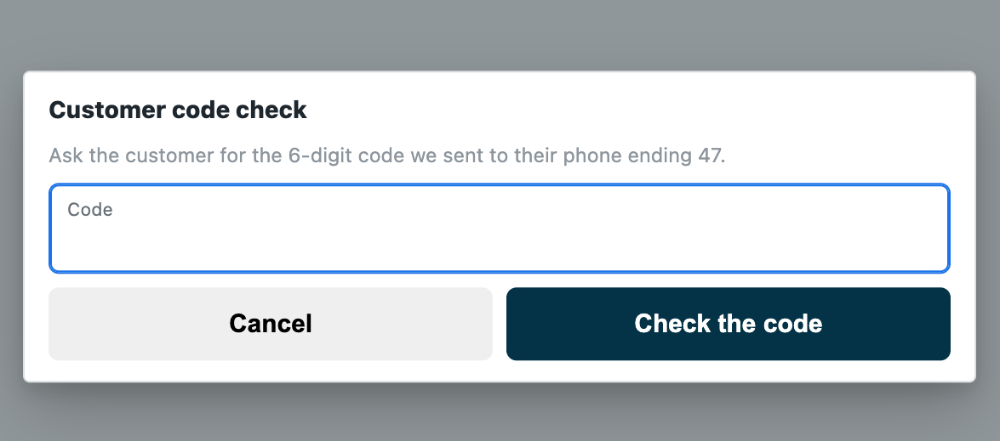

# S48 — Customer code check (`pp_ccc`): a one-time code before a customer's account is used

The retailer decides which groups of its customers must prove they are at the counter before a sale can use their account: loyalty members before their points are spent, account customers before they buy on account. When the cashier puts such a customer on a sale, iVendNext texts a one-time code to the mobile number on the customer's record, and the cashier types the code the customer reads out. Until the code is right, no door that takes payment takes that customer; three wrong codes end the check and the customer is off the sale.



**Industries:** Beauty and cosmetics

**When to use it:** a customer's points, store credit or account must not be used by someone who only knows their name or number, and iVendNext sends text messages through its own SMS gateway.

## Start from it

```bash
ivn new acme_codecheck --from s48
```

## What to change

What a partner usually changes:

- **Who is asked:** `on_select` and `deciding` in `codecheck.py` (a code only for customers with a balance to spend, or only at some POS Profiles).
- **The code:** `new_code` in `codecheck.py` (its length, 4 to 8 letters and digits, and its life).
- **The rule's fields:** `PP CCC Rule` in `manifest.json` (`customer_group`, `ask`, `without_mobile`, `words`).
- **The channel:** a different Notification on `PP CCC Code`, or your own gateway called by the service.
- **Your address:** `allowed_urls` in `manifest.json`.
- **The app's id:** `IVN_LIBRARY_APP` in `app.json`.

More: the [recipe](../../recipes/customer_code_check.md).

**The customer sets:** the retailer's SMS gateway in *SMS Settings*; one **Notification** on *PP CCC Code* (*Send Alert On* New, *Channel* SMS, the receiver the field `mobile`, a message holding `{{ doc.code }}`); one *PP CCC Rule* for each customer group that needs one; and who may change a customer's group and phone number.

## Run it

```bash
ivn check
ivn try
```

## Try it at the till

- Choose a customer in a group that needs a code; the till asks for the code texted to their mobile.
- Type the code the customer reads out, then sell as usual.
- Close the till day when you are done.

## Versions

### 1.1.0

- The role's rights beyond the feed's reads move into the manifest (`role_rights`): the install gives the feed's user its reads and the manifest the rest, so the retailer's administrator grants none. Needs POS build `2.1.0.691` or later.

### 1.0.0

- First version in the kit: a one-time code to the customer's phone before their account is used.
- Pictures from the demo-site walk, and two measured corrections.
- Each setting in app.json says its purpose (the line the Settings screen shows), whether it is required, and which settings go with it.
