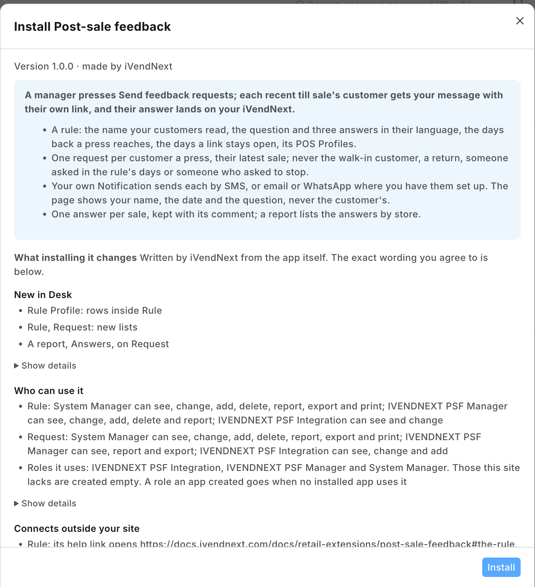

# S49 — Post-sale feedback (`pp_psf`): ask each customer how their visit was

After a till sale, the retailer's own message asks the customer how the visit was, with a link to a one-page answer: three answers in the retailer's words, an optional comment, and *Stop these messages*. A manager presses *Send feedback requests* on a rule and one request is made per customer to ask. Each answer lands once on the retailer's own record of that request, and a report lists the answers by store. A walk-in customer, a return or a sale with no customer is never asked.



**Industries:** every industry

**When to use it:** the retailer wants answers kept in iVendNext, by sale and store, sent through its own SMS gateway, e-mail account or WhatsApp app.

## Start from it

```bash
ivn new acme_feedback --from s49
```

## What to change

What a partner usually changes:

- **The answers:** a score out of five or ten, or a second question (the answer field's options and `ANSWERS` in `feedback.py`).
- **Who is asked:** only sales above an amount, or some customer groups (`choose` in `feedback.py`; the app's user then needs read on what holds them).
- **The page:** `service/page.html`, `page.js` and `page.css`.
- **Your service's address:** every `host.docker.internal` address in `manifest.json` is the sample's test address; write your own, and `PSF_PAGE_URL` for the links.
- **The channel:** WhatsApp's reply buttons through one provider's API, called by your service.

More: the [recipe](../../recipes/post_sale_feedback.md).

**The customer sets:** the message: its SMS gateway in **SMS Settings** and one **Notification** on *PP PSF Request* (channel SMS, e-mail or WhatsApp, the link in the text); and a rule in *PP PSF Rule*: the name customers read, the question and three answers, the days back and days open, and the POS Profiles. Give **PP PSF Manager** to the managers.

## Run it

```bash
ivn check
ivn try
```

## Try it at the till

- Sell to a customer who has a mobile number.
- In Desk, press Send feedback requests on a rule; the customer is sent the question.
- SMS was measured on our bench; e-mail and WhatsApp were not.
- Close the till day when you are done.

## Versions

### 1.1.1 (manifest 0.2.1)

- `role_rights` give **PP PSF Manager** *Select* on *POS Profile*, so a manager picks a rule's POS Profiles with no Role Permissions step.

### 1.1.0

- The role's rights beyond the feed's reads move into the manifest (`role_rights`): the install gives the feed's user its reads and the manifest the rest, so the retailer's administrator grants none. Needs POS build `2.1.0.691` or later.

### 1.0.3

- On a phone set to Arabic, each line of the page aligns by its own direction.
- Each setting in app.json says its purpose (the line the Settings screen shows), whether it is required, and which settings go with it.

### 1.0.2

- The page keeps the retailer's words in their own direction; pictures from the demo-site walk.

### 1.0.1

- Fixes from the completeness pass: stops kept by number and e-mail, no closed links sent, the link key's words.

### 1.0.0

- First version in the kit: ask each recent till sale's customer how the visit was.
