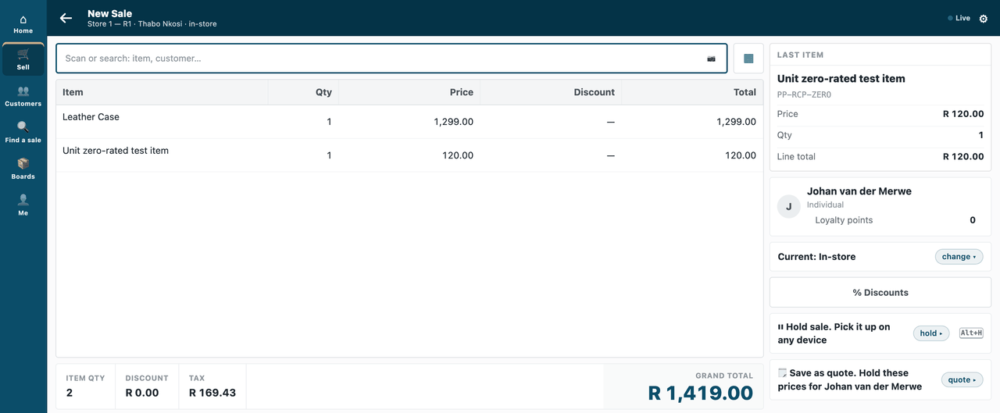

# S4 — the receipt pack: a UAE tax invoice on the till sale

A manifest with one POS Invoice print format. The till's Print sheet shows the company's tax registration number and address, a logo, one line per item with its VAT rate, the taxable value at each rate, and every label in English beside Arabic. Nothing leaves the retailer's iVendNext: the logo sits inside the layout and the layout reads the sale alone.



**Industries:** every industry

**When to use it:** the retailer's receipt must carry what your market's tax rules ask for, and you want to ship that layout as a package the retailer installs and removes cleanly.

## Start from it

```bash
ivn new acme_receipt --from s4
```

## What to change

What a partner usually changes:

- **The layout and wording:** `receipt.html`, then run `python3 build.py` in the same folder (in an app you made, `service/rcp/`): it writes the layout into the app's `manifest.json`, the one the site installs, and nothing else changes. The tests read the printed text: the totals rows by their English labels (*Total*, *Rounding*, *Discount included in the total*), and the whole receipt against `tests/golden/`. After a change you mean, rewrite the goldens as the top of `tests/test_clean.py` says.
- **The logo:** replace `logo.png`, then run `build.py` the same way.
- **The labels:** the English and Arabic pairs in `receipt.html`; change the pair for your market.
- **The tax rows:** the VAT rate and taxable-value rows in `receipt.html`. For a real market, start from a copy of the seeded `mPOS Receipt` rather than this simple layout.

More: the [recipe](../../recipes/receipt_format.md).

**The customer sets:** the company's **Tax ID** on the Company, an **Address** linked to the Company, the **Company Address** on the till's **POS Profile**, and the pack's format in the **Print Format** field of the POS Profile. The pack cannot set the profile for the retailer. A sale saved before the install prints *—* for the tax number. **Before removing the app** (*Export and uninstall*), set the POS Profile's *Print Format* back to what it was (or empty it): otherwise the profile still names the pack's format, which is gone, and the till prints the sale's plain form.

## Run it

```bash
ivn check
ivn try
```

## Versions

### 0.1.5

- The VAT line is every tax the sale books, a charge's own tax included (*Fulfillment Tax*, *Surcharge Tax*), and *Charges* is the charge money alone, as the till and its seeded receipt print them since POS build 2.1.0.726 (`receipt_tax.receipt_tax_figure`). Before, a delivery's or an item charge's own tax was printed inside *Charges*, so the VAT read low on such a sale.

### 0.1.4

- `build.py` writes the layout into the manifest's receipt and changes nothing else; in an app made from S4 it writes the app's own `manifest.json` (and the copy its tests read), so *edit `receipt.html`, then run `build.py`* reaches the site. Before, it wrote a `manifest.json` beside itself that the app never read.
- *The customer sets* says to set the POS Profile's *Print Format* back to what it was (or empty it) before removing the app; *What to change* says which labels the tests read.

### 0.1.3

- Desk shows plain names (UAE tax invoice) through the manifest's `translations` block, so a search for *tax invoice* finds the record. The stored names are unchanged: an installed site keeps its records.

### 0.1.2

- First version in the kit: a UAE tax invoice on the till sale, as a receipt pack.
