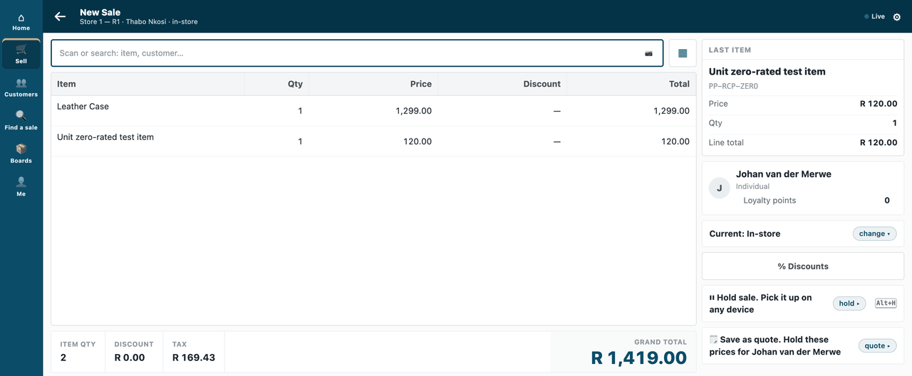
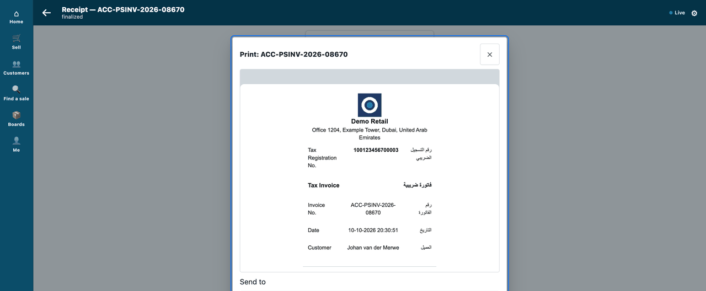
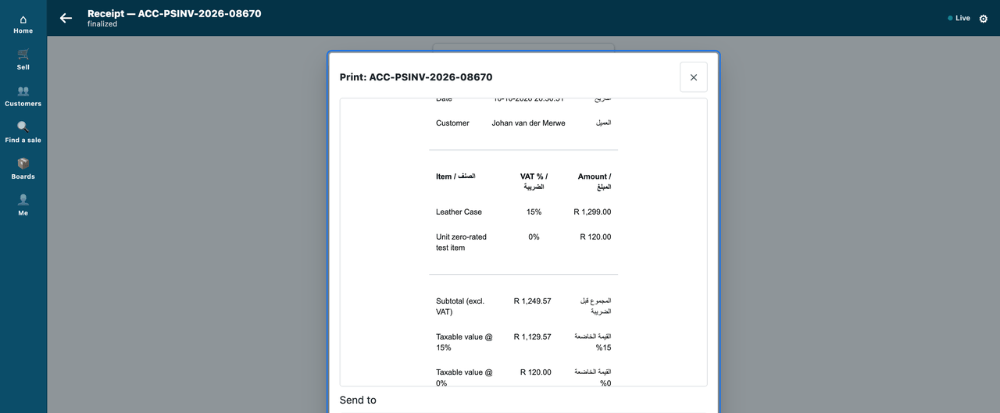
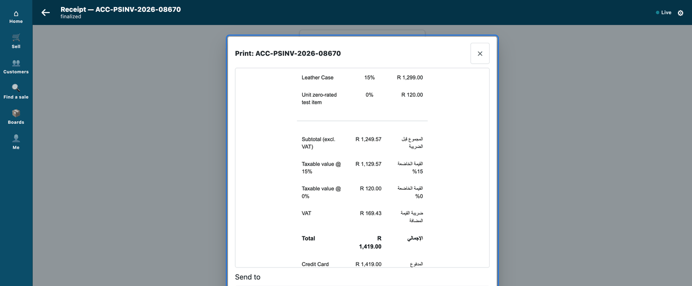

# S4 — the receipt pack: a UAE tax invoice on the till sale

*Start from this sample: `python3 tools/manifest/start.py s4_receipt_pack --prefix "ACME RCP"` copies it into `apps/` of your repository under your own prefix (your company's first word, then a short name for the app) and checks it ([how](../../recipes/make_it_your_own.md)).*


*A sale at two VAT rates, and its tax invoice, in English and Arabic, in the till's Print sheet.*

A manifest with one POS Invoice print format: the company's tax registration number and address, an inline logo, one line per item with its VAT rate, the taxable value at each rate, and every label in English beside Arabic. It is for a developer who needs the till to print a receipt that meets their market's rules. The recipe is [`recipes/receipt_format.md`](../../recipes/receipt_format.md).

**Industries:** every industry

**When to use it:** the retailer's receipt must carry what your market's tax rules ask for, and you want to ship that layout as a package the retailer installs and removes cleanly.

## What it looks like

The address and the tax number are made up. The invoice shows R (the Rand) where a UAE retailer shows its own currency.

| Step | Frame | Screenshot |
|---|---|---|
| 1. A sale at two rates: the case (15%) and a zero-rated item | the till, 1440 wide |  |
| 2. The Print sheet's preview: logo, address, tax registration number, *Tax Invoice / فاتورة ضريبية* | the till |  |
| 3. One line per item with its VAT rate | the till |  |
| 4. The taxable value at each rate, the VAT and the total | the till |  |

## What the retailer does

A retailer that must print a tax invoice for its market does this, in the order it meets it:

1. **Put the facts where iVendNext keeps them.** In Desk, the administrator enters the company's **Tax ID** on the **Company**, links an **Address** to the Company, and sets the **Company Address** on the till's **POS Profile**. When a sale is saved, iVendNext puts the company's address on it (the profile's, or else the Company's own) and the package's field copies the tax ID onto it; the layout prints what the sale holds, so no figure is typed into the layout.
2. **Install the package.** The administrator opens **Retail Extension Package** in Desk, pastes `manifest.json`, presses **Check**, reads the summary, ticks the consent and installs. It adds one print format, `PP RCP UAE Tax Invoice`, for the POS Invoice, and one read-only field on the POS Invoice, `pp_rcp_company_tax_id` (*Company tax ID (receipt)*), which copies the Company's tax ID when a sale is saved. It names no role and adds no workspace, record type or setting.
3. **Set it on the till's profile.** In Desk the administrator opens the **POS Profile**, picks the format in the **Print Format** field and presses **Save**. The package cannot do this step for the retailer. The till reads the profile's format each time it prints, so the next receipt uses it.
4. **Look at a real sale.** The cashier sells as usual and opens the till's **Print** sheet: the preview is the tax invoice.
5. **Make it the retailer's own.** The placeholder logo and wording are the sample's. The retailer's own logo and words are a change to `receipt.html` and `logo.png`; the package is then rebuilt with `build.py` and installed again.

**Where it shows.** On the till, in the **Print** sheet, as the sale's receipt. Nothing else changes: no workspace, report or setting is added.

**What leaves the retailer's iVendNext.** No data is sent to an address: the manifest names no outside address, webhook, till key, service or event feed, and the logo sits inside the layout, so printing fetches nothing. It does carry a **print format**, a template the retailer's own server runs when it prints, and the install screen lists it as one. It reads the sale alone (never another record), and it prints money the sale already holds.

## The files

| File | What |
|---|---|
| `receipt.html` | the layout — a readable template, with comments |
| `logo.png` | the placeholder logo (294 bytes); replace it with the brand's |
| `build.py` | builds `manifest.json` from the two files above (inlines the logo) |
| `manifest.json` | the manifest the installer reads (generated; `python3 build.py`) |
| `tests/` | the tests, the printed text each sale shape must give (`golden/`) and the canaries (below) |

## Run it

```bash
python3 samples/s4_receipt_pack/build.py && python3 tools/manifest/validate.py samples/s4_receipt_pack/manifest.json
```

## Before you build on it

- **A sale saved before the install has no tax number on it.** The field fills when a sale is saved, so an older sale reprints with *—* in the tax-number row. A UAE retailer's own company tax-number field (`company_trn`, which the retailer's UAE setup adds to the sale) is read first.
- **The address is the sale's own, in the retailer's own address layout (0.1.2).** The sale takes the profile's **Company Address**, or else the Company's own address; a sale with neither prints no address and no error, so set the profile's. The address prints on several lines as the retailer's address layout sets them (0.1.1 joined three fields into one line), and it carries whatever else that layout holds, such as a phone number.
- **The figures the template works out are formatted through one field it never prints.** A taxable value, the VAT figure and a charge have no field of their own, so the layout puts each on the sale's `write_off_amount` in memory, formats it with the retailer's own currency and number format, and puts the field's value back. Nothing is saved; the print view loads the sale afresh for each print. Do not print `write_off_amount` in a layout built from this one. A reader for the template that formats a figure directly is a request to ask for, through the feedback forms. (From POS build 2.0.0.654 a template may read other records through `ivn_rows` and `ivn_value`, guide chapter 7; they read rows, they do not format a figure, and this pack does not use them.)
- **The screenshots on this page show the earlier layout** (0.1.1): its address on one line and its tax number read from the Company. Everything else on the page is unchanged.
- **For a real market, start from the retailer's own receipt.** A copy of the seeded `mPOS Receipt` already carries the charge rows, the offline lines and the order lines. This sample leaves them out so the idea stays readable; the recipe lists what to copy back.
- **What it does not show.** It adds no QR code or fiscal mark, hides or requires no till field, and prints no labels. Each has shipped as its own extension point: the tax authority's QR and seal through the [fiscal reader](../../contracts/pages/fiscal_reader.md) (no kit sample yet; this sample's template would print them only by calling `receipt_fiscal_marks(doc)`, which it does not), field rules in [S21](../s21_field_rules/README.md), labels through the [label layout](../../contracts/pages/label_layout.md) (no kit sample yet). What has not shipped: a manifest that sets the profile's print format, so you set it in the profile yourself (step 5 of the recipe).

## Technical notes

### The walk

The GIF: a cashier sells a leather case (15%) and a zero-rated item, takes the card, and opens the till's **Print** sheet: the preview is this pack's tax invoice — the logo, the company's address and tax number, each line with its VAT rate, the taxable value at each rate, every label in English beside Arabic. Frame: the till (`/pos?frame=terminal`, 1440 wide). Walked on our test bench on 2026-10-10, iVendNext POS app at `87812e141`; the invoice heads the kit's demo site, *Demo Retail*; nothing was sent to a printer. Built from the same screens as the stills below; every frame is cut above the sheet's printer choices.

The cashier is the bench's *Thabo Nkosi*, the customer *Johan van der Merwe*. The address and the tax number are the sample's made-up ones, set on the company by its bench run for the walk; the bench's currency is the Rand, so the invoice shows R where a UAE retailer shows its own.

### 0.1.2: the layout reads only the sale

0.1.1 called the retailer's money formatter, a record reader for the Company and a record-list reader for its Address. 0.1.2 reads the sale alone. Checked on our sandbox on 2026-10-16, through the print view (not the till's Print sheet): the 0.1.1 and the 0.1.2 formats each printed the same draft till sales, a standard-rated sale, a zero-rated sale, and a mix of both, and every money line, label and Arabic cell was equal. The only differences were the two named above: the address on several lines, and the tax number *—* on sales saved before the install. Sales saved after the install carried the number. With no address on the profile or the Company, a sale printed no address and no error. A mix on a second profile without a Company Address still printed the Company's address, because iVendNext fills it from the Company.

**Not run on the sandbox:** a returned sale, a charge row, a discount or rounding (the laptop tests render them against stand-in sales, below), a UAE company's own `company_trn` field, and the till's Print sheet.

### The tests

| File | What |
|---|---|
| `tests/test_totals.py` | the printed totals add up: no Discount row inside the sum; the discount prints after the Total, as *Discount included in the total*; a Rounding row before the Total; the manifest carries this template and passes the checker |
| `tests/test_clean.py` | 0.1.2: the template reads only the sale (no other record, no name of the framework); seven sale shapes (standard-rated, zero-rated, a mix, a return, an item charge, a delivery charge, a discount with rounding) print the text recorded in `golden/`, which is what 0.1.1 printed for the same sales; a figure it works out uses the sale's own currency text; the tax number and the address are the sale's own. The recorded texts prove the figures, the rows and their order, not the retailer's own money or address text, which were checked on a sandbox (*0.1.2* above) |
| `tests/canaries.py` | 21 changes that each break one of those guards, and the tests must go RED on each (`python3 samples/s4_receipt_pack/tests/canaries.py`; needs `jinja2`) |
| *our test bench's own run (not in the kit)* | the bench tests: install, set on a profile, three sales, the render, uninstall and reinstall |

### Why this way (R6)

**0.1.2, the tax number.** *A field on the sale that copies the Company's tax ID* (picked: about six manifest lines, and step 1 of the recipe stays true) · *a number typed into `build.py`* (rejected: it breaks "put the facts where iVendNext keeps them", needs a rebuild and a higher version for every change, and serves one company per build) · *the number inside the address* (rejected: it depends on the retailer's address layout and has no Arabic label). **The money text:** *a currency field the layout never prints* (picked: the retailer's own text, to the cent and the symbol) · *a number format written in the template* (rejected: no currency symbol, and a retailer with another number format would print differently).

**0.1.0, the format itself.**

*A template in a manifest* (picked: the door that exists, proven, installs and removes cleanly, ~100 lines of template) · *edit the seeded receipt in place* (rejected: the next migrate keeps or overwrites it, and a hand-edit has no owner) · *a hosted app that ships a format* (rejected: it needs partner Python in the retailer's iVendNext) · *start from a copy of the seeded `mPOS Receipt`* (the safer base for a real market: it already carries the charge rows, the offline lines and the order lines; rejected for a SAMPLE because ~240 lines of hooks specific to iVendNext POS hide the idea. The sample copies only the VAT figure and the charge row, with their source named; the recipe lists what to copy back).

### Not used here

Shipped, and left out to keep this sample about the receipt: a QR or fiscal mark (P-RECEIPT, through the [fiscal reader](../../contracts/pages/fiscal_reader.md); a format of your own calls `receipt_fiscal_marks(doc)` to print it), hiding or requiring a till field (P-FIELDS, [S21](../s21_field_rules/README.md)), labels (P-LABEL, the [label layout](../../contracts/pages/label_layout.md)). Not shipped: a manifest that sets the profile's format (the last part of P-RECEIPT), so step 5 of the recipe is configuration.

## Versions

### 0.1.2

- First version in the kit: a UAE tax invoice on the till sale, as a receipt pack.
