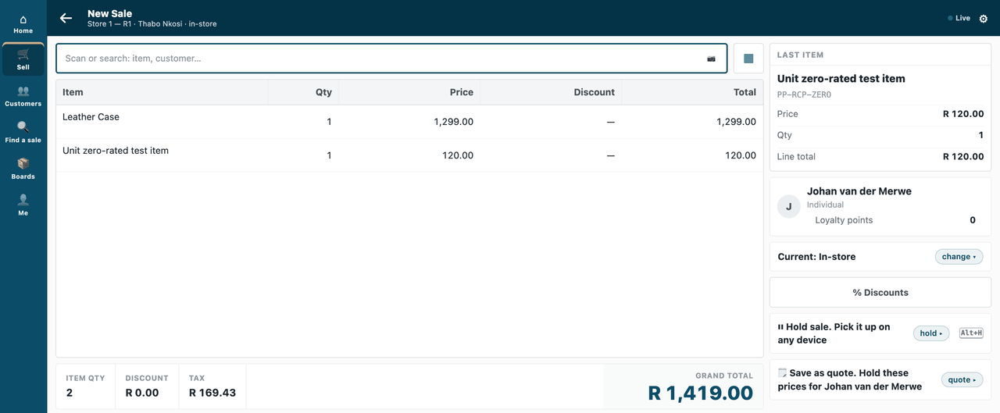

# S4 — the receipt pack: a UAE tax invoice on the till sale

A manifest with one POS Invoice print format. The till's Print sheet shows the company's tax registration number and address, a logo, one line per item with its VAT rate, the taxable value at each rate, and every label in English beside Arabic. Nothing leaves the retailer's iVendNext: the logo sits inside the layout and the layout reads the sale alone.



**Industries:** every industry

**When to use it:** the retailer's receipt must carry what your market's tax rules ask for, and you want to ship that layout as a package the retailer installs and removes cleanly.

## Start from it

```bash
ivn new acme_receipt --from s4
```

## What to change

What a partner usually changes:

- **The layout and wording:** `receipt.html`.
- **The logo:** replace `logo.png`, then rebuild the manifest with `python3 samples/s4_receipt_pack/build.py`.
- **The labels:** the English and Arabic pairs in `receipt.html`; change the pair for your market.
- **The tax rows:** the VAT rate and taxable-value rows in `receipt.html`. For a real market, start from a copy of the seeded `mPOS Receipt` rather than this simple layout.

More: the [recipe](../../recipes/receipt_format.md).

**The customer sets:** the company's **Tax ID** on the Company, an **Address** linked to the Company, the **Company Address** on the till's **POS Profile**, and the pack's format in the **Print Format** field of the POS Profile. The pack cannot set the profile for the retailer. A sale saved before the install prints *—* for the tax number.

## Run it

```bash
ivn check
ivn try
```

## Versions

### 0.1.3

- Desk shows plain names (UAE tax invoice) through the manifest's `translations` block, so a search for *tax invoice* finds the record. The stored names are unchanged: an installed site keeps its records.

### 0.1.2

- First version in the kit: a UAE tax invoice on the till sale, as a receipt pack.
