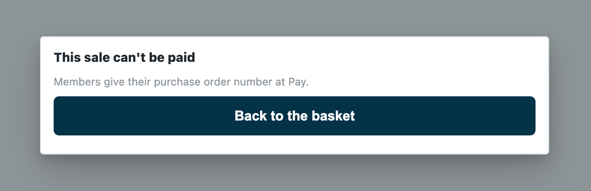

# S50 — Required sale details (`pp_rsd`): the details a customer group gives before paying

The retailer decides which sale details a group of its customers must give before they pay: an account customer's purchase order number, an insured patient's policy number, a contractor's project. When the cashier presses **Pay** and a detail the customer's group needs is empty, the till refuses the sale in the retailer's words. The cashier fills the detail under the sale's details and presses Pay again.



**Industries:** every industry

**When to use it:** a sale detail matters for some customers only. A Sale Attribute's own *Required* switch holds for every customer on every till; this app holds it for the groups and tills the retailer names.

## Start from it

```bash
ivn new acme_details --from s50
```

## What to change

What a partner usually changes:

- **What is checked:** `missing` and `on_check` in `details.py` (the value and not only its presence; a detail per line, which the check sends as `line_attributes`).
- **The rule's reach:** `deciding` in `details.py` (a rule per customer, from a field you add to Customer, or per terminal, which the check sends as `pos_terminal`).
- **The rule's fields:** `PP RSD Rule`, `PP RSD Rule Detail` and `PP RSD Rule Profile` in `manifest.json`.
- **Your address:** `allowed_urls` in `manifest.json`.
- **The app's id:** `IVN_LIBRARY_APP` in `app.json`.

More: the [recipe](../../recipes/required_sale_details.md).

**The customer sets:** the sale details themselves (one **Sale Attribute** for each, switched on, with no default value and its own *Required* left off), one *PP RSD Rule* for each customer group that needs one, and who may change a customer's group.

## Run it

```bash
ivn check
ivn try
```

## Try it at the till

- Choose a customer in a group that needs a detail and press Pay; the till stops it.
- Fill the detail in Sale details and press Pay again.
- Close the till day when you are done.

## Versions

### 1.1.0

- The role's rights beyond the feed's reads move into the manifest (`role_rights`): the install gives the feed's user its reads and the manifest the rest, so the retailer's administrator grants none. Needs POS build `2.1.0.691` or later.

### 1.0.0

- First version in the kit: the details a customer group gives before paying.
- On POS 2.1.0.669 the till asks for the details on the exchange screen and on orders and quotes too, so the work-arounds are for an earlier build only.
- Each setting in app.json says its purpose (the line the Settings screen shows), whether it is required, and which settings go with it.
