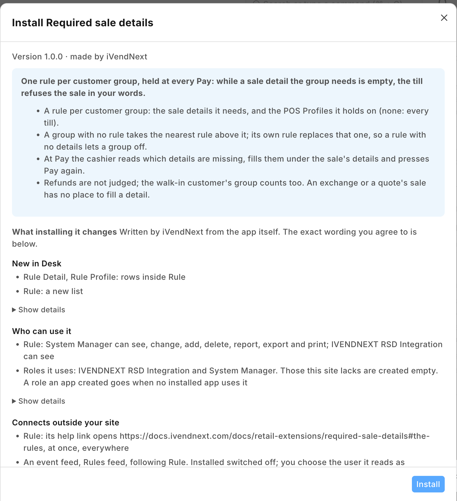
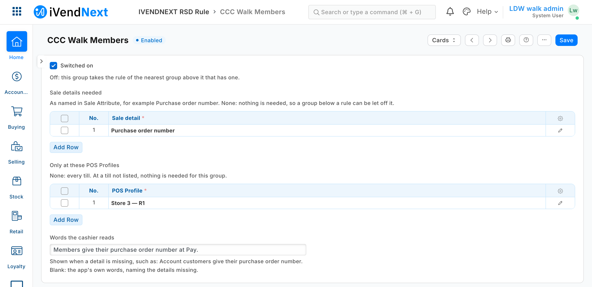
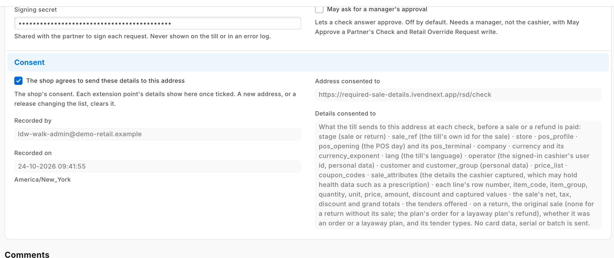
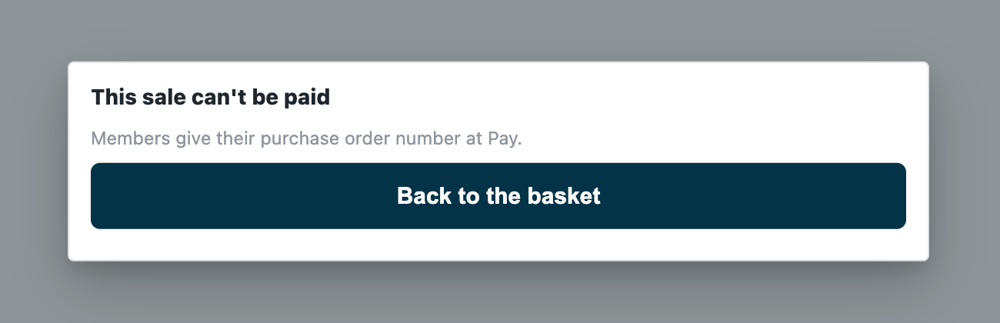
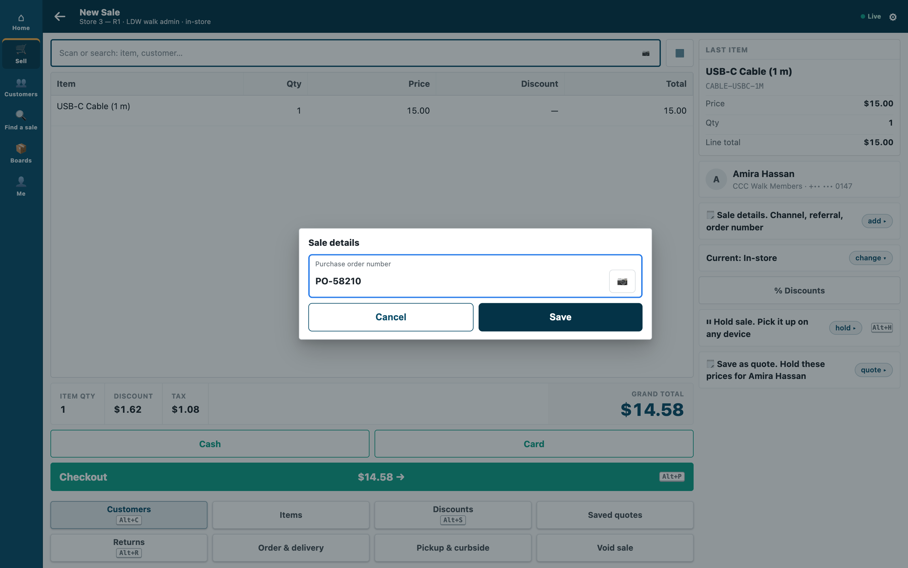

# S50 — Required sale details (`pp_rsd`): the details a customer group gives before paying

*Start from this sample: `python3 tools/manifest/start.py s50_required_sale_details --prefix "ACME RSD"` copies it into `apps/` of your repository under your own prefix (your company's first word, then a short name for the app) and checks it ([how](../../recipes/make_it_your_own.md)).*

The retailer decides which sale details a group of its customers must give before they pay: an account customer's purchase order number, an insured patient's policy number, a contractor's project. When the cashier presses **Pay** and a detail the customer's group needs is empty, the till refuses the sale in the retailer's words. The cashier fills the detail under the sale's details and presses Pay again.

**Industries:** every industry

**When to use it:** a sale detail matters for some customers only. A Sale Attribute's own *Required* switch holds for every customer on every till; this app holds it for the groups and tills the retailer names.

**In the App library:** [Required sale details](https://library.ivendnext.app/apps/ivendnext_rsd), free, for a retailer to install as it is. This sample is the code behind it, to copy and change.

## What happens

| When | What the cashier sees |
|---|---|
| A sale for a customer whose group needs a detail left empty | *"This sale can't be paid"* and the retailer's words, or the app's own: *"Customers in Account customers need Purchase order number. Fill in the sale's details, then Pay."* The cashier fills it and presses Pay again |
| Every detail the group needs filled | The payment screen opens as always |
| No rule for the customer's group or any group above it, or a till the rule does not name | The payment screen opens as always |
| A refund, the returned items of an exchange, a return rung without its sale | Not judged: the refund choices open as always |
| An exchange's new items | Judged as a sale; but an exchange rung without its sale when nothing is owed comes as a return, and is not judged |
| An exchange, or a sale made from a quote, whose customer's group needs a detail | The till refuses Pay. From POS version 2.1.0.669 the exchange screen, a sale made from a quote, an order made from a quote and an order's change screen each draw a *Sale details* row after a refusal, so the cashier fills the detail there and presses Pay again (a quote converted while the till is offline draws none). On an earlier build none of them has a place to fill it: fill the detail on the quote before converting it; for an exchange, refund and ring a new sale. From POS version 2.1.0.668 an order and a layaway plan are checked when placed, as a sale |
| The service down, or the retailer's records unreadable | The check's down answer: the sale goes on and is flagged on *Sales to review* |
| A sale rung offline | The till does not call the service: flagged when it reaches iVendNext, never refused |

| What the retailer and the cashier see (on a demo site, 2026-10-24) | |
|---|---|
| What the install will change, read before you consent |  |
| A rule for a customer group: one sale detail needed, at one POS Profile, with the words the cashier reads |  |
| The check switched on for one POS Profile, with what it is sent |  |
| At Pay, the detail empty: the sale refused in the rule's words |  |
| The cashier fills the detail under the sale's details, then presses Pay again |  |

**Which rule decides.** One rule per customer group: the sale details needed, and the POS Profiles it holds on (none: every till). A customer takes their own group's rule; a group with no rule takes the rule of the nearest group above it in the retailer's customer group tree. A group's own rule replaces the rule above it entirely, so a rule with no details lets a group off:

| Customer group | Sale details needed | Only at these POS Profiles |
|---|---|---|
| Account customers | Purchase order number | (every till) |
| Contractors (under Account customers) | Purchase order number, Project | Trade Counter |
| Staff | (none) | |

A contractor buying at the trade counter gives both; at any other till, nothing (their own rule replaces the account customers' rule). The store's walk-in customer is in a group too: a rule on its group asks every walk-in sale (for a mobile number, say); a rule on *All Customer Groups* asks the walk-in customer and every customer below it with no rule of its own.

## What the retailer does

**Before you install:** every `host.docker.internal` address in `manifest.json` (in `allowed_urls`, and where the manifest calls it) is our test bench's own address for the sample's service, and it resolves only where Docker provides it. Replace it with your own service's address first, or iVendNext's calls never reach your service; if this manifest is already installed, raise its `version` and install it again ([the manifest recipe](../../recipes/manifest.md), step 6).

1. **Install the app** from the App library (or paste its manifest into **Retail Extension Package** in Desk), read what it will do and consent. The install adds the record type *PP RSD Rule* with its two tables, the role `PP RSD Integration`, the check and the feed registration, the check switched off. Nothing changes at the till yet.
2. **Give the app's user its reads.** From POS 2.1.0.667 the install made the app's own user, `pp_rsd@integration.invalid`, and named it on **PP RSD Rules feed**. It holds the role **PP RSD Integration** alone, works through the API only and can never sign in to Desk, so there is no user to make. In *Role Permissions*, give that role **read on Customer Group** (the service reads the group tree). A service for one retailer: press *Generate Keys* on that user (User, API Access) and put the key in the service's settings. A service for many retailers is handed the key by the retailer's site itself, after the install or an update; press **Connect again** on the app's record only if the site could not reach the app, or a key was lost or changed.
3. **Stop cashiers moving a customer into another group.** The till's edit sheet lets a cashier change a customer's group: a cashier could move a customer into a group that needs nothing. In *Customize Form* for *Customer*, set **Customer Group**'s *Perm Level* to 1, and in *Role Permissions* give level 1 *Write* on Customer only to the roles that may move customers (your managers). A cashier's change then leaves the group as it was, and the till still says *Customer saved.*; a cashier can no longer give a new customer a group either (it takes the default customer group). Check the level 1 rows already there: Sales Master Manager has one by default, and no cashier's role may hold level 1 *Write*. (Measured with [S47](../s47_customers_by_store/); [S46](../s46_payment_method_rules/) gives the same step.)
4. **Make the sale details** the rules name, in **Sale Attribute** (iVendNext's own screen): one per detail, such as *Purchase order number*, with a *Sequence* of its own (no other active detail may hold it), switched on (*Active*), and no *Default Value* (a default fills the detail for the cashier, so the check passes with nothing typed). Leave its own *Required* off: this app decides who must give it. Its *Regex Pattern* still checks the value's shape for everyone who fills it. A detail switched off, or hidden by a field rule, cannot be filled at the till: take it off the rules first, or every sale for that group is refused.
5. **Write the rules** in *PP RSD Rule*: one per customer group that needs one. *Words the cashier reads* is optional.
6. **Switch the check on:** open *Required sale details* in *Retail Extension Subscription*, read what is sent, tick the consent, choose the POS Profiles, and switch it on.

**Where it shows.** The rules are Desk records the retailer keeps (its System Manager, or a role the retailer gives the rights to in *Role Permissions*: that role also needs *Select* on **Customer Group**, **Sale Attribute** and **POS Profile**, or the rule's lookups answer nothing; a System Manager too, where the site removed it). At the till the cashier meets them at **Pay**.

**What leaves the retailer's iVendNext.** At **Pay**, and before each refund the till pays, the priced basket goes to the service's address: each line's item, group, quantity and amounts, the totals, the store, till, POS day and terminal, the cashier's user, the customer and their customer group, the coupons, the payment methods offered, and **the sale's details with the values the cashier typed** (a purchase order number, a policy number, a phone number); never a card. The service reads the retailer's rule records and its customer group tree with the integration user's key, keeps them one minute, and keeps nothing of a sale. It writes nothing. A hosted copy holds each retailer's check secret and the API key of the app's user until the retailer removes the app. Say so on your card.

## The files

| File | What it is |
|---|---|
| `manifest.json` | the record type `PP RSD Rule` (one per customer group, named by it) and its tables `PP RSD Rule Detail` (a Sale Attribute) and `PP RSD Rule Profile` (a POS Profile), a feed registration (it names the app's one integration user), a help address, and one `check`, installed switched off; when the service is down the sale goes on, flagged |
| `details.py` | the pure core: the signature check (`verify`), the shape check, the retailer's rules (`rules_of`) and tree (`tree_of`), the rule that decides (`deciding`), the details not filled (`missing`) and the answer (`on_check`) |
| `service/app.py` | the service, standard library only: `POST /rsd/check`, `GET /health`, and the app template's handshake for many retailers; one `handle` answers the web server and the function entry (`lambda_handler`) alike |
| `Dockerfile` · `app.json` | the settings file for hosting (`"runs": "function"`: on CitiXsys hosting it is a function, paid per call) and an image for your own server (built from the kit's root) |
| `tests/` | the rules, the service over the wire with signed calls (one retailer and many), iVendNext's reads against a stand-in iVendNext, every answer against the published contract, the manifest; `canaries.py` breaks each guarded rule and expects its test to fail |

## Run it

```bash
python3 -m unittest discover -s samples/s50_required_sale_details/tests -p 'test_*.py'
```
```bash
python3 samples/s50_required_sale_details/tests/canaries.py
```
```bash
python3 samples/s50_required_sale_details/service/app.py samples/s50_required_sale_details/service/.env.local
```

**Settings, one retailer** (`service/.env.local`, never committed): `IVN_CHECK_SECRET` (handed back at install as `pp_rsd:sub:details`), `IVN_SHOP_URL`, `IVN_SHOP_KEY` (`<api key>:<api secret>` of the integration user), `PORT`. `RSD_PREFIX` names the rule record type (default `PP RSD`).

## Try it at the till

- Choose a customer in a group that needs a detail and press Pay; the till stops it.
- Fill the detail in Sale details and press Pay again.
- Close the till day when you are done.

## Many retailers, hosted

The service is the [app template](../../tools/app_template/README.md)'s shape: set `IVN_LIBRARY_APP` and a store (`IVN_SHOPS_TABLE` on CitiXsys hosting, else `IVN_SHOPS_FILE`). Each retailer connects itself after its install and hands over the check's secret and the key of the app's own user (*Connect again* is only for when the site could not reach the app, or a key was lost or changed). Until the key arrives the service answers 503 and the down answer applies. Every call names its retailer (`X-iVendNext-Site`), and each retailer is answered from its own rules with its own key.

## Make it your own

What a partner usually changes:
- **the value, not only its presence:** a policy number checked with the insurer, a purchase order number checked against the customer's open orders (read them with the integration user);
- **line details:** a detail per line for some item groups (the check sends each line's `line_attributes`);
- **the rule's reach:** a rule per customer, from a field you add to Customer, or per terminal (the check sends `pos_terminal`);
- **the prefix:** `tools/manifest/rename.py` makes your copy under your own reserved prefix in one step; the service takes its prefix from `RSD_PREFIX`;
- **its records:** `tools/deploy/copy_records.py` moves the rules between a test site and the retailer's iVendNext.

## Before you copy it

- **Present, not right.** The app checks that a needed detail holds something other than spaces. Its shape is the Sale Attribute's own *Regex Pattern*, which holds for every sale that fills it.
- **Down means the sale goes on.** The manifest declares `allow_and_flag`: an outage never stops a retailer selling, and a sale the rules could not judge is flagged on *Sales to review*. A retailer that must never take such a sale sets the check's down answer to `refuse`; every sale on that POS Profile then waits on the service. A refused key (401 or 403) is iVendNext unreadable too, never an allow without the flag.
- **The customer's group is the retailer's.** The rule reads the group the customer record holds: put Customer Group at a permission level only your managers write (step 3).
- **A rule changed in Desk, or a new customer group,** reaches the service within a minute (it keeps the rules and the tree that long).
- **A long list of details** is cut in the app's own sentence (the till shows at most 140 characters): write the rule's own words when a group needs more than two or three.
- **Three checks a POS Profile.** At most three checks answer one POS Profile, ten seconds together; this one asks for 3, so two other check apps fit beside it.
- **Your address.** Write your own address in `allowed_urls`. The retailer's server must trust your certificate: a real one for a retailer.

## Technical notes

### Why it is built this way

| Option | Cost | Verdict |
|---|---|---|
| Do nothing: tick *Required* on the Sale Attribute | 0 | every customer at every till must give it: a walk-in customer asked for a purchase order number |
| A new rule in [Till guard rules](../s23_till_guard/) | ~120 lines and a new rule kind on a listed app | its rules are store-wide limits on lines and totals, never keyed on the customer |
| A manifest only: a field on Customer Group listing its details | ~20 lines | nothing reads it at the till; a manifest cannot answer a check |
| **A check before payment, answered by a function that refuses while a needed detail is empty** | ~120 lines of core and service on S46's copy | **picked**: the rule holds at every door that takes money, on the tills the retailer switches it on for, in the retailer's own words; S46's service, its group-tree walk and its cache reused |

### The answer, exactly

- **The reads:** `GET /api/resource/<prefix> Rule` with `fields` `["name","customer_group","words","details.sale_attribute","profiles.pos_profile"]` (one row per detail and POS Profile), `filters` `[["enabled","=",1]]`, `limit_page_length` 0; and `GET /api/resource/Customer Group` with `["name","lft","rgt"]`. Both at once (each read has its own timeout inside the check's 3 s), kept a minute per retailer and per key. Either one failing answers 503: never a decision on half the retailer's rules.
- **The rule that decides** is the customer's own group's, else the innermost group whose span (`lft`, `rgt`) holds the group's and that has a switched-on rule. A customer with no group takes the outermost group's rule. A group the tree does not know needs nothing unless it has its own rule.
- **Where it holds:** at every till when the rule names no POS Profile, else only at the `pos_profile` it names.
- **The details missing** are the rule's details, in its order, that the sale's `sale_attributes` do not hold with a value other than spaces and direction marks. None: `allow`. Any: `refuse` with the rule's own words (up to 140 characters), else *"Customers in ⟨group⟩ need ⟨details⟩. Fill in the sale's details, then Pay."* (a group cut at 30 characters, the list at 52, so the instruction is never cut).

### Bounds, stated

- **A sale only.** A refund, a return against a sale, the returned items of an exchange and a return without its sale (`stage: "return"`) are allowed without reading iVendNext. An exchange's replacement basket is `stage: "sale"` and is judged, except an exchange rung without its sale when nothing is owed: the till sends it as a return with its sold lines, and this app allows it (the contract lets a check judge those lines by its sale rule; a partner's version may, with a sentence that does not say *then Pay*).
- **The sale's details, not a line's.** Line details are a partner's version.
- **An exchange or a sale from a quote.** From POS version 2.1.0.669 the exchange screen, a sale made from a quote, an order made from a quote and an order's change screen each draw a *Sale details* row after a refusal, so the cashier fills the detail there and presses Pay again (a quote converted while the till is offline draws none). On an earlier build none of them has a place to fill it (read in the till's code, not walked): fill it on the quote first; refund and ring a new sale instead of an exchange.
- **A rule per customer group.** A customer's own rule is a group of their own.
- **Offline,** the till does not call the service: the sale is flagged when it syncs, never refused.
- **Where the check never runs:** a park to a till, a layaway deposit, an account collection (the check page, *Not in this version*) and the Desk's own POS screen.
- **Where it runs:** the App library's copy runs in CitiXsys hosting's US region. On CitiXsys hosting the first Pay after a quiet spell starts the function; past 3 s the down answer applies, flagged.
- It logs one line per call: the route, the status and the milliseconds, never the body.

## Versions

### 1.0.0

- First version in the kit: the details a customer group gives before paying.
- On POS 2.1.0.669 the till asks for the details on the exchange screen and on orders and quotes too, so the work-arounds are for an earlier build only.
- Each setting in app.json says its purpose (the line the Settings screen shows), whether it is required, and which settings go with it.
