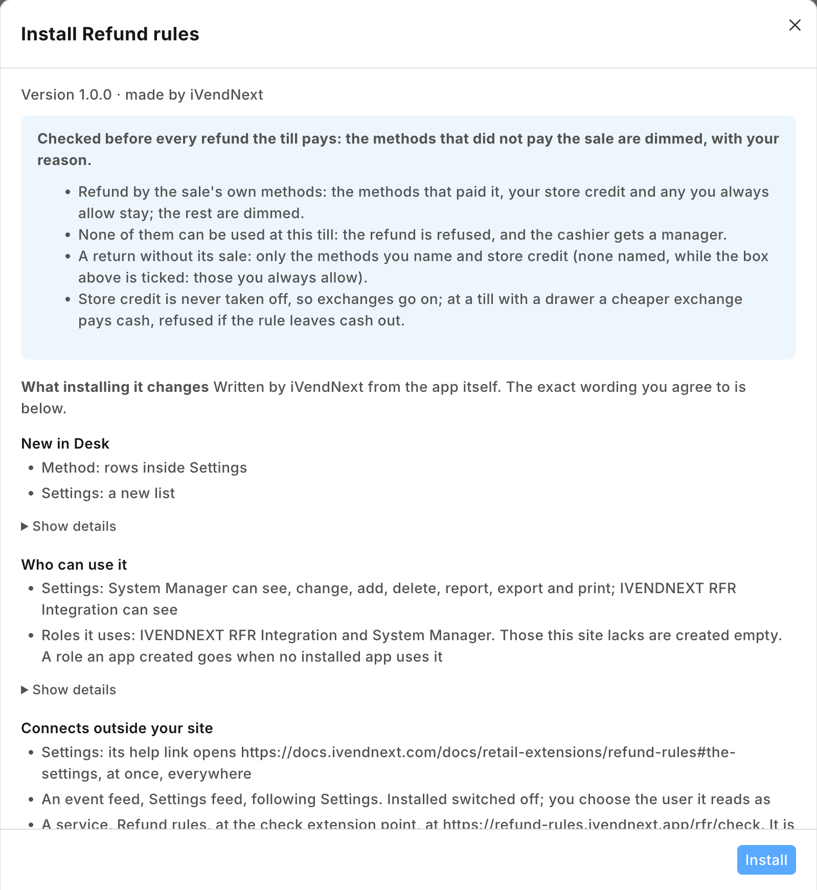

# S51 — Refund rules (`pp_rfr`): how the till may pay a refund back

The retailer decides how a refund goes back. A return against a sale goes back only by the payment methods that paid that sale, plus the retailer's store credit and any method it always allows. A return without its sale goes back only by the methods the retailer names. When the cashier opens a refund, the till dims the methods the rules leave out, with the reason, or refuses the refund in the app's words.



**Industries:** every industry

**When to use it:** a sale paid by card alone must not be refunded in cash, or a no-receipt return must go to store credit. A payment method's own *Allowed in Returns* holds for every refund alike; this app looks at the sale being refunded. Each store refunding only its own sales needs no app: leave *Use inter-store transactions* off in Retail Setting (the default), and a till opens only its own store's sales for a return against a sale (a layaway plan's refund is payable at any store of the company).

## Start from it

```bash
ivn new acme_refunds --from s51
```

## What to change

What a partner usually changes:

- **Whole sales only:** refuse a return that does not take back every line of its sale (`on_check` in `refunds.py`; read the sale's lines with the app's user).
- **A rule per store or customer group:** the check sends `store`, `pos_profile` and `customer_group`.
- **A manager for a refund outside the rules:** answer `approve`, knowing an approval carries no methods taken off.
- **Your service's address:** every `host.docker.internal` address in `manifest.json` is the sample's test address; write your own.
- **The words:** the sentences the cashier reads, in `refunds.py`.
- **When your service is down:** `allow_and_flag` in `manifest.json` lets the refund go on and flags it; `refuse` holds every refund.

More: the [recipe](../../recipes/refund_rules.md).

**The customer sets:** the settings record *Refund rules settings* (`PP RFR Settings`), named `Default`: *Refund by the sale's own methods*, the *Store credit method* (a Mode of Payment of type Store Credit, kept enabled), any *Always allowed* methods, and the methods for a return *Without its sale*. On each POS Profile, tick *Allowed in Returns* for the store credit method and each card method a refund may go back to.

## Run it

```bash
ivn check
ivn try
```

## Try it at the till

- Return an item from a sale paid by card; the refund dims the methods the rules leave out, with the reason.
- Close the till day when you are done.

## Versions

### 1.0.1

- Desk shows plain names (Refund rules settings, Refund method) through the manifest's `translations` block, so a search for *refund* finds the record. The stored names are unchanged: an installed site keeps its records. Manifest 0.1.1.

### 1.0.0

- First version in the kit: a refund goes back by the methods that paid its sale.
- Each setting in app.json says its purpose (the line the Settings screen shows), whether it is required, and which settings go with it.
- The set-up steps say the install makes the app's own user (POS 2.1.0.667 or later).
