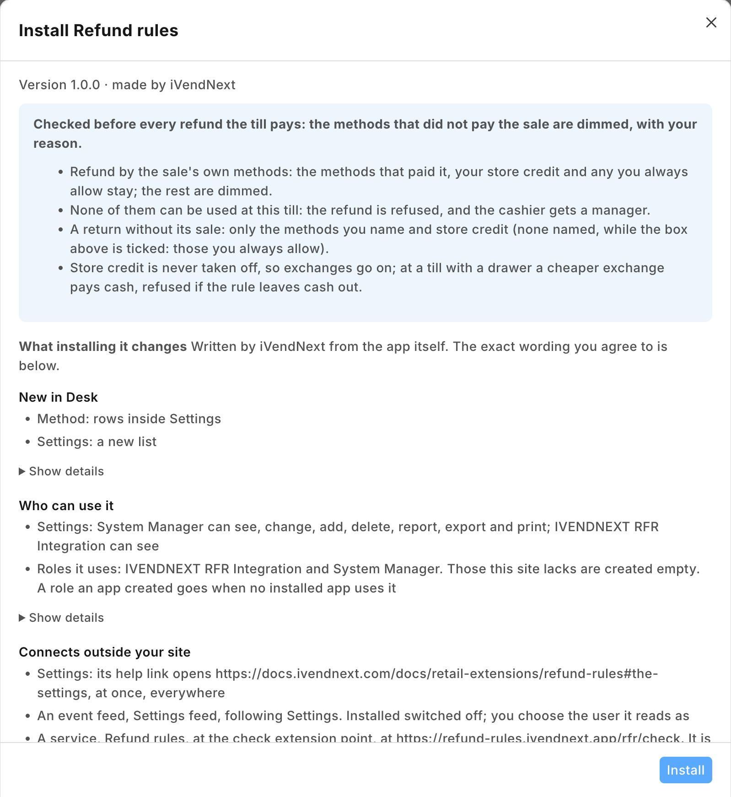
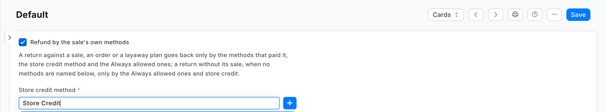
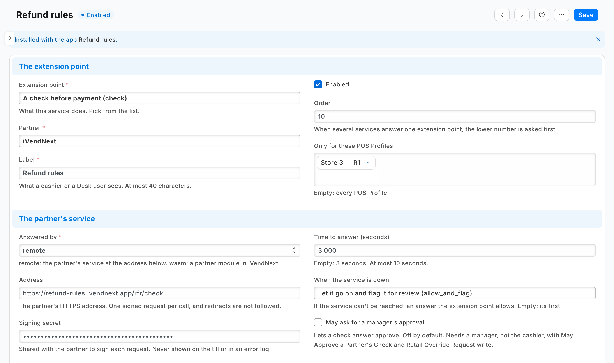

# S51 — Refund rules (`pp_rfr`): how the till may pay a refund back

*Start from this sample: `python3 tools/manifest/start.py s51_refund_rules --prefix "ACME RFR"` copies it into `apps/` of your repository under your own prefix (your company's first word, then a short name for the app) and checks it ([how](../../recipes/make_it_your_own.md)).*

The retailer decides how a refund goes back. A return against a sale goes back only by the payment methods that paid that sale, plus the retailer's store credit and any method it always allows. A return without its sale goes back only by the methods the retailer names. When the cashier opens a refund, the till dims the methods the rules leave out, with the reason, or refuses the refund in the app's words.

**When to use it:** a sale paid by card alone must not be refunded in cash, or a no-receipt return must go to store credit. A payment method's own *Allowed in Returns* holds for every refund alike; this app looks at the sale being refunded. Each store refunding only its own sales needs no app: leave *Use inter-store transactions* off in Retail Setting (the default), and a till opens only its own store's sales for a return against a sale (a layaway plan's refund is payable at any store of the company).

**In the App library:** [Refund rules](https://library.ivendnext.app/apps/ivendnext_rfr), free, for a retailer to install as it is. This sample is the code behind it, to copy and change.

## What happens

| When | What the cashier sees |
|---|---|
| A return against a sale paid by card, with *Refund by the sale's own methods* | The card method, the store credit method and the *Always allowed* ones are offered; the rest are dimmed: *"Not for this sale: Refunded only by the methods your rules keep for this sale."* |
| None of the till's methods would stay (the methods offered are the POS Profile's whole payment table, a method the store switched off for returns included) | *"This refund can't go ahead"* and *"None of the methods that paid for this can take its refund here. Get a manager."* |
| A return without its sale, with methods named | Only those and the store credit method; none of them offered here: refused, naming them |
| A return without its sale, no methods named, *Refund by the sale's own methods* ticked | Only the *Always allowed* methods and the store credit method: a no-receipt return is no way round the rule |
| An exchange | Its returned items are always judged (their credit note is checked alone, whatever the replacement costs) and keep the store credit method, so the exchange goes on; its new items are a sale, never judged |
| An exchange whose replacement costs less, at a till with a cash drawer | ⚠ The till pays the difference in cash; on a sale whose rules leave cash out, the credit note is refused after the exchange is rung. Return the items instead (to the methods kept) and ring the new ones as a sale |
| An order's or a layaway plan's refund | The methods rule as above (every method that paid into the order or plan stays) |
| A sale, or a return whose total is zero or more | Not judged |
| No settings record, or every rule off | As today |
| The service down, or the retailer's records unreadable | The check's down answer: the refund goes on and is flagged on *Sales to review* |

| What the retailer and the cashier see (on a demo site, 2026-10-24) | |
|---|---|
| What the install will change, read before you consent |  |
| The settings record Default: the methods rule ticked, the store credit method chosen |  |
| The check switched on for one POS Profile |  |
| The refund of a cash sale: the card dimmed with the app's reason, cash and store credit offered |  |

## What the retailer does

**Before you install:** every `host.docker.internal` address in `manifest.json` (in `allowed_urls`, and where the manifest calls it) is our test bench's own address for the sample's service, and it resolves only where Docker provides it. Replace it with your own service's address first, or iVendNext's calls never reach your service; if this manifest is already installed, raise its `version` and install it again ([the manifest recipe](../../recipes/manifest.md), step 6).

1. **Install the app** from the App library (or paste its manifest into **Retail Extension Package** in Desk), read what it will do and consent. The install adds the record type *PP RFR Settings* with its table *PP RFR Method*, the role `PP RFR Integration`, the check and the feed registration, the check switched off. Nothing changes at the till yet.
2. **Hand the service its key.** From POS 2.1.0.667 the install made the app's own user, `pp_rfr@integration.invalid`, and named it on **PP RFR Settings feed**. It holds the role **PP RFR Integration** alone, works through the API only and can never sign in to Desk, so there is no user to make. A service for one retailer: press *Generate Keys* on that user (User, API Access) and put the key in the service's settings. A service for many retailers is handed the key by the retailer's site itself, after the install or an update; press **Connect again** on the app's record only if the site could not reach the app, or a key was lost or changed.
3. **Fill the settings** in *PP RFR Settings*: one record, its title **Default**. Tick *Refund by the sale's own methods*, choose your *Store credit method*: the Mode of Payment of type Store Credit the till pays exchanges with (keep one such method enabled, and choose it here), never taken off, so exchanges go on; add any *Always allowed* method, and name the methods for a return *Without its sale*. Whoever keeps the settings needs *Select* on **Mode of Payment**. On each POS Profile the rules hold at, tick *Allowed in Returns* for your store credit method and each card method a refund may go back to: the rules only take methods away, and a till where none of the kept methods is allowed in returns leaves the cashier nothing to choose (and refuses every exchange).
4. **Switch the check on:** open *Refund rules* in *Retail Extension Subscription*, read what is sent, tick the consent, choose the POS Profiles of the stores the rules hold at, and switch it on.

**Where it shows.** The settings are a Desk record the retailer keeps (its System Manager, or a role it gives the rights to). At the till the cashier meets them when a refund's choices open.

**What leaves the retailer's iVendNext.** Before each refund the till pays (and at each Pay, answered at once without a read), the check's context goes to the service's address: each line's item, group, quantity and amounts, the totals, the store, till, POS day and terminal, the cashier's user, the customer and their customer group, the coupons, the payment methods offered, and on a return the sale it refunds with the payment methods that paid it; never a card. The service reads the retailer's settings record with the integration user's key and keeps it one minute. It keeps nothing of a sale and writes nothing. A hosted copy holds each retailer's check secret and the API key of the app's user until the retailer removes the app. Say so on your card.

## The files

| File | What it is |
|---|---|
| `manifest.json` | the record type `PP RFR Settings` (named by its title, the service reads `Default`) and its table `PP RFR Method` (a payment method, used for *Always allowed* and *Without its sale*), a feed registration (it names the app's one integration user), a help address, and one `check`, installed switched off; when the service is down the refund goes on, flagged |
| `refunds.py` | the pure core: the signature check (`verify`), the shape check, the retailer's settings (`settings_of`) and the answer (`on_check`) |
| `service/app.py` | the service, standard library only: `POST /rfr/check`, `GET /health`, and the app template's handshake for many retailers; one `handle` answers the web server and the function entry (`lambda_handler`) alike |
| `Dockerfile` · `app.json` | the settings file for hosting (`"runs": "function"`: on CitiXsys hosting it is a function, paid per call) and an image for your own server (built from the kit's root) |
| `tests/` | the rules, the service over the wire with signed calls (one retailer and many), iVendNext's reads against a stand-in iVendNext, every answer against the published contract, the manifest; `canaries.py` breaks each guarded rule and expects its test to fail |

## Run it

```bash
python3 -m unittest discover -s samples/s51_refund_rules/tests -p 'test_*.py'
```
```bash
python3 samples/s51_refund_rules/tests/canaries.py
```
```bash
python3 samples/s51_refund_rules/service/app.py samples/s51_refund_rules/service/.env.local
```

**Settings, one retailer** (`service/.env.local`, never committed): `IVN_CHECK_SECRET` (handed back at install as `pp_rfr:sub:refunds`), `IVN_SHOP_URL`, `IVN_SHOP_KEY` (`<api key>:<api secret>` of the integration user), `PORT`. `RFR_PREFIX` names the settings record type (default `PP RFR`).

## Many retailers, hosted

The service is the [app template](../../tools/app_template/README.md)'s shape: set `IVN_LIBRARY_APP` and a store (`IVN_SHOPS_TABLE` on CitiXsys hosting, else `IVN_SHOPS_FILE`). Each retailer connects itself after its install and hands over the check's secret and the key of the app's own user (*Connect again* is only for when the site could not reach the app, or a key was lost or changed). Until the key arrives the service answers 503 and the down answer applies. Every call names its retailer (`X-iVendNext-Site`), and each retailer is answered from its own settings with its own key.

## Make it your own

What a partner usually changes:
- **whole sales only:** refuse a return that does not take back every line of its sale (read the sale's lines with the integration user);
- **a rule per store or per customer group:** the check sends `store`, `pos_profile` and `customer_group`;
- **a manager for a refund outside the rules:** answer `approve` (the subscription's *May ask for a manager's approval*), knowing an approval carries no methods taken off;
- **the prefix:** `tools/manifest/rename.py` makes your copy under your own reserved prefix in one step; the service takes its prefix from `RFR_PREFIX`;
- **its records:** `tools/deploy/copy_records.py` moves the settings between a test site and the retailer's iVendNext.

## Before you copy it

- **Methods, never amounts.** The check names the methods a refund may use; the cashier chooses how much goes to each. A sale paid half by card and half in cash may be refunded all by card, or all in cash.
- **Your store credit method.** An exchange's returned items book store credit whatever the replacement costs: the store credit method you name is never taken off. Keep one Mode of Payment of type Store Credit enabled, and choose it here: the till books an exchange with one of them, the most recently changed when there are several. Leave it blank (Desk's form requires it with the tick; a write over the API does not) and every exchange is refused.
- **Down means the refund goes on.** The manifest declares `allow_and_flag`: an outage never stops a refund, and one the rules could not judge is flagged on *Sales to review*. A retailer that must never refund outside its rules sets the check's down answer to `refuse`; every refund on that POS Profile then waits on the service. A refused key (401 or 403) is iVendNext unreadable too, never an allow without the flag.
- **Every Pay calls the service too.** The till asks every check in scope at each Pay; this one answers a sale at once, but the call is made (a paid function call) and carries the sale's whole context, its sale details included. It also takes one of the POS Profile's three checks.
- **A change in Desk** reaches the service within a minute (it keeps the settings that long).
- **Three checks a POS Profile.** At most three checks answer one POS Profile, ten seconds together; this one asks for 3, so two other check apps fit beside it.
- **Your address.** Write your own address in `allowed_urls`. The retailer's server must trust your certificate: a real one for a retailer.

## Technical notes

### Why it is built this way

| Option | Cost | Verdict |
|---|---|---|
| Do nothing: untick *Allowed in Returns* (on each POS Profile's payment rows) for every method a refund may not use | 0 | per profile, never per sale: a card sale and a cash sale are refunded by the same list |
| A setting in [Payment method rules](../s46_payment_method_rules/) | ~60 lines on a listed app; no extra call at each Pay, no extra check slot | its rules key on the customer group at the sale and its retailers set it up that way today; these key on the refunded sale. A retailer who wants both apps pays one more call per Pay and one of three slots: chosen for a sample a partner copies alone |
| **A check answered by a function, judging only refunds** | ~250 lines of core and service on S50's copy | **picked**: holds at every door that pays a refund, on the stores the retailer switches it on for |

### The answer, exactly

- **The read:** `GET /api/resource/<prefix> Settings/Default` (a 404 is no settings record: every rule off, and logged; a 200 that holds no record is unreadable, 503), kept a minute per retailer and per key. The library's copy refuses to start without `RFR_PREFIX`.
- **Judged** only at `stage: "return"` with `totals.grand_minor` below 0.
- **The methods kept:** for `return_of.channel` `none`, the *Without its sale* methods and the store credit method (none named: the *Always allowed* methods and store credit while *Refund by the sale's own methods* is ticked, else nothing judged); for any other channel with *Refund by the sale's own methods*, `return_of.paid_by`, the *Always allowed* methods and the store credit method. Every other offered method is taken off (`exclude_tenders`, each once, in the order offered). None left: `refuse`. More than 20 to take off: `refuse` (the contract allows 20).

### Bounds, stated

- **A refund only.** A sale's Pay is answered `allow` without a read.
- **Methods, not amounts:** the split of a refund between methods is the cashier's.
- **Which store's sales a till may refund** is Retail Setting's *Use inter-store transactions*, never this app's, for a return against a sale; a layaway plan's refund is payable at any store of the company (the plan doors hold the company only).
- **`paid_by` names the methods that paid.** From POS version 2.1.0.669 a zero-amount payment row is left out for a sale too, as it already was for an order or a plan. On an earlier build a sale's zero-amount row counts as a method that paid.
- **A drawered till's cheaper exchange** pays its difference in cash and is refused at its credit note when the rules leave cash out (above).
- **Offline,** the till does not call the service; a refund needs iVendNext anyway.
- **Where the check never runs:** a park to a till, a return sent to a register (it is refunded in Desk), a refund made in Desk, a layaway deposit, an account collection, a gift card's balance paid out in cash (the check page, *Not in this version*) and the Desk's own POS screen.
- **The app's own English sentences.** The cashier reads them as written; the retailer's own words, or another language, are a partner's version.
- **Where it runs:** the App library's copy runs in CitiXsys hosting's US region. On CitiXsys hosting the first refund after a quiet spell starts the function; past 3 s the down answer applies, flagged.
- It logs one line per call: the route, the status and the milliseconds, never the body.
