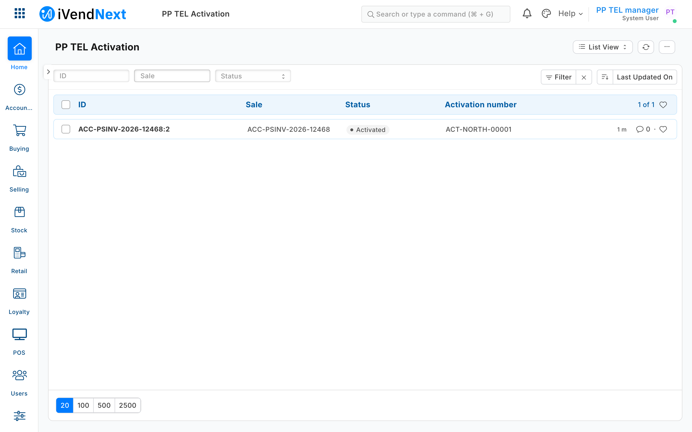

# S52 — Phone plans from a telecom company (`pp_tel`), sold with the phone

*Start from this sample: `python3 tools/manifest/start.py s52_phone_plans --prefix "ACME TEL"` copies it into `apps/` of your repository under your own prefix (your company's first word, then a short name for the app) and checks it ([how](../../recipes/make_it_your_own.md)).*

A phone retailer sells mobile plans from a telecom company at its tills. The plans and their prices are the telecom company's, and they differ from one retailer to the next: each retailer has its own account with the telecom company. This sample links the till to the telecom company through your service, with each retailer's own account, and follows the data the whole way: the cashier sees the plans, the plan's price enters the sale as a line before payment, Pay confirms it with the telecom company, and after payment the plan is activated and its number written back.

**Industries:** Electronics and phones

**When to use it:** any link between the till and an outside system that prices something per retailer account (the outside system confirming each customer at Pay) and must hear about the sale afterwards: a telecom company's plans, an insurer's device cover, a utility's connection. Chapter 1c of the guide walks this sample hop by hop ([How the data travels](../../guide/01c_how_the_data_travels.md)).

## What happens

1. **The cashier scans the phone and presses Plans.** The till sends your service the sale's lines and customer (no prices). Your service reads this retailer's own telecom account from the retailer's settings record, asks the telecom company for the plans that fit this phone and this customer, and answers with a message the till shows: each plan's name, price and code. Nothing is added to the sale.
2. **The cashier adds the chosen plan as its own item** (scan its code, or pick it). The plan is an ordinary item of the retailer's (for example `PP-TEL-S`, in the item group *Mobile plans*), priced from the retailer's price list. Your service keeps that price list in step with the telecom company's prices for this retailer's account, so the till prices the line itself, offline too, and the customer sees it on the sale before paying.
3. **At Pay, the check confirms the plan.** The till's server prices the basket and asks your service; your service asks the telecom company again, for this customer: does the plan fit a phone on this sale, may this customer take it, and is its price still the one on the line? Yes: the payment sheet opens. No: the sale is refused in plain words, for example *"M 50 GB is now USD 35.50 with the telecom company, not USD 35.00. In a minute, take the plan off and add it again."*
4. **After payment, the plan is activated.** The retailer's event feed tells your service the sale was paid. Your service asks the telecom company to activate the plan, with the retailer's site and the sale's line as the call's idempotency key (each plan on its own phone's serial number), and writes the activation number to a **PP TEL Activation** row, listed under the sale (*Phone plans*, in its Connections) and under the customer.



## What the retailer does

1. **Install the app** (the retailer's administrator, from the install screen). It adds **PP TEL Settings**, **PP TEL Activation** (listed under POS Invoice and Customer), the feed registration *PP TEL Sales*, the till key **Plans** and the check at Pay *Phone plan check*. The check and the feed come in switched off; the Plans key comes in ready, with the install's consent, and the store places it on its till in **POS Studio > Apps**. From POS 2.1.0.667 the install also makes the app's own user, `pp_tel@integration.invalid`, holding the role **PP TEL Integration** alone ([chapter 7](../../guide/07_manifests.md)); its key reaches your service when the retailer connects ([chapter 14b](../../guide/14b_deploying_your_app.md#one-app-many-retailers)).
2. **Keep the telecom account in the retailer's own iVendNext.** A System Manager makes the **PP TEL Settings** record named `Default`: the telecom account and its key (as the telecom company gave them), the item group the plans are in, the price list the plans are sold from, and the store's walk-in customers (each POS Profile's default customer, which the till puts on a sale that has none; a plan is never sold to one). Only the System Manager and the app's own role read this record; a cashier never does.
3. **Give the app's role its rights on the retailer's own records** (Role Permissions; a manifest grants rights only on its own record types): **PP TEL Integration** gets *read*, *write* and *create* on Item Price, and *read* on Price List, Item and POS Invoice. ⚠ With these, the app's key could change any item price; the service writes only the prices of items in the plans' item group, but give the role to the app's own user alone.
4. **Make the plans as items** in the plan item group, each with the telecom company's plan code as its item code, not stock items. The app writes their prices; do not type them.
5. **Switch it on.** Tick **POS Invoice** on the feed registration *PP TEL Sales*; consent to and switch on the check *Phone plan check* for the tills that sell plans; place **Plans** on the till in **POS Studio > Apps**.

**What the cashier sees.** *Plans* on the counter and the tablet: a sheet listing the plans for the phone on the sale, or *"No phone on this sale has plans from this telecom company"*, or *"Telecom company not answering … Nothing was added to the sale."* The plan as a line with its price. At Pay, the payment sheet, or *"This sale can't be paid"* with the app's reason. Nothing else changes at the till.

**What leaves the retailer's iVendNext.** To your service: at each press of Plans, the till key's list (the sale's lines' item codes and quantities, the store, the POS Profile, the cashier's login and the customer's id; no price); at each Pay with the check on, the check's list (the priced basket and the customer); through the feed, each paid sale, read with the app's key. To the telecom company, from your service: the retailer's own account and key, the item codes on the sale, the customer's id, and for an activation the plan, the phone, the phone's serial number when the sale carries one, and the sale's name. Nothing is sent while the till is offline.

## The files

| File | What |
|---|---|
| `manifest.json` | the settings record, the activation record (named by its sale line, listed under the sale and the customer), the feed registration, the Plans key and the check at Pay |
| `service/plans.py` | the rules, with no web code: the Plans message, the check's verdict, the activation work and the price changes |
| `service/telecom.py` | the telecom company's three calls, with one retailer's account at a time: **the file you change** for a real telecom company |
| `service/app.py` | the till's two calls (`POST /tel/plans`, `POST /tel/check`), the signature check, and many retailers through the app template's handshake |
| `service/worker.py` | after payment: the feed, the activation, once; and the price list kept in step |
| `service/shop.py` | the retailer's record API, with the app's key (copied from S22) |
| `standin/telecom_api.py`, `standin/accounts.json` | a stand-in telecom company with two accounts and its faults, so the whole flow runs with no network |
| `tests/` | the laptop tests, with two retailers calling at the same moment, and `canaries.py` |
| `app.json`, `Dockerfile` | on CitiXsys hosting a function (each press, and a feed pass each minute); on your own server, the container |

## Run it

```bash
python3 -m unittest discover -s samples/s52_phone_plans/tests -p 'test_*.py'
python3 samples/s52_phone_plans/tests/canaries.py
```

The stand-in telecom company, and the service against a retailer on your laptop (one retailer; its settings in an env file you write, never committed):

```bash
python3 samples/s52_phone_plans/standin/telecom_api.py
```

```bash
python3 samples/s52_phone_plans/service/app.py samples/s52_phone_plans/service/.env.local
```

with `IVN_POINT_SECRET` (the Plans key's secret the install handed back), `IVN_CHECK_SECRET` (the check's), `IVN_SHOP_URL`, `IVN_SHOP_KEY` (the app's user's key, `<api key>:<api secret>`), `TEL_API=http://127.0.0.1:8154`, and `PP_STATE` (a folder). For many retailers on your laptop, use the app template's local mode (`IVN_LOCAL=1`, [the template's README](../../tools/app_template/README.md#local-mode-many-retailers-on-your-laptop)) with `IVN_LIBRARY_APP` and `IVN_SHOPS_FILE` instead.

## Try it at the till

- Scan a phone and press Plans; the till lists its plans.
- Add a plan as its own line and press Pay; the till confirms it with the telecom company.
- Close the till day when you are done.

## Many retailers, one service

One service serves every retailer that installs the app. Each press and each check names its retailer (`X-iVendNext-Site`) and is signed with that retailer's own secret; the service finds the retailer's address and key in its shops store, reads that retailer's telecom account from that retailer's settings record, and calls the telecom company with it. The service keeps nothing between calls but the shops store and each retailer's note of handled feed events, so two retailers pressing Plans at the same second are two separate calls, each answered with its own account and its own prices (`tests/test_service.py`, *TwoRetailersAtOnce*). The activation's idempotency key is the retailer's site and the sale's line, so the same sale name at two retailers is never one activation, however a real telecom company scopes its keys.

## Before you build on it

- **The plan is an item the cashier adds.** No till door adds a priced line by itself: the till key, the capture and the partner page carry no money, and the price door only takes money off ([chapter 3](../../guide/03_ladder_and_never_list.md)). So the price comes from the retailer's price list, which your service keeps in step, and the check at Pay is where the telecom company's word is final.
- **The price list follows within a pass** (a minute on hosting, `PP_WATCH` seconds in a container). A line rung in between is refused at Pay with the new price; after the next pass the cashier takes it off and adds it again. The price is the account's: one price for every customer of the retailer. The check confirms with the telecom company that this customer may take the plan at that price; a telecom company that prices each customer differently needs a priced line the till cannot take from your service today (an extension point to request).
- **One price list per retailer** (the settings' *price list*): every till that sells plans must sell from that list. A store whose POS Profile sells from another list rings the plan at no price or another, and Pay refuses it with no fix but the list; a chain that prices per store runs a settings record and a price list per list it sells from, which this sample does not.
- **Where staff find the activation number:** the **PP TEL Activation** list (filter it by *Sale*), and the Connections of the sale and of the customer where those forms open. On the programme's test bench the sale's form did not open for a System Manager; the list did.
- **A wrong or withdrawn telecom key** is not a failed activation: the plan waits (*Pending*) and is tried again on every pass until the retailer fixes its key.
- **The telecom company down, your service up:** Plans says so; Pay refuses a sale with a plan in plain words (a sale without one is never held up, and the telecom company is not asked).
- **Your service down, or the till offline:** the till cannot ask the check, so it applies the check's declared down answer to every sale on that till. This manifest declares *allow_and_flag*: every sale goes on, and **every sale on that till in that time is flagged** on the *Sales to review* report, plan or not ([the check's page](../../contracts/pages/partner_check.md), sections 5 and 6). The activation after payment still asks the telecom company, so a plan it no longer offers is written *Failed*. *refuse* would stop every sale on the till, phones or not, for as long as your service is down: do not choose it for a check that only some sales need. The Plans key is dimmed offline.
- **An activation the telecom company refuses** is written as *Failed* with its sentence and never retried; the store sorts it out with the customer (a return refunds the plan). An activation whose answer was lost stays *Pending* and is asked again with the same key on the next pass.
- **A return** is not sent to the telecom company: cancelling a plan is the telecom company's own process. A plan sold in an exchange (a return that sells new lines) is refused at Pay: sell it on its own sale.
- **One plan per line, one phone per plan.** A sale with two plans needs two phones they fit; a phone line of two takes two plans, each activated on its own serial number.

## Technical notes

### Why it is built this way

- **How the cashier sees the plans.** *A capture at the scan* (refused: its sheet is yes or no, and it carries no price) · *a partner page over the sale* (works, a richer sheet, but a page your service must host and sign; more than the job needs) · **a till key answering a message** (picked: the 10-line way, one call, and the message says the price without putting money on the sale).
- **How the price enters the sale.** *Money in the key's answer* (refused: no till door carries money) · *a price rule per customer* (refused: the product refuses selling pricing rules) · **an item priced from a list the app keeps in step, confirmed at Pay** (picked: the till prices it, the customer sees it, and the telecom company has the last word before money moves).
- **Where each retailer's telecom account lives.** *The service's own settings* (rejected: one service serves many retailers, and the account is the retailer's) · *the secrets handed over at connect* (rejected: the install makes those, and the retailer cannot add its telecom key to them) · *a password field read with `get_password`* (refused: it is for System Manager, and the app's user holds its own role alone; a password field read through the record API comes back masked) · **a settings record in the retailer's own iVendNext, read with that retailer's key at each call** (picked: the retailer keeps and changes it, only the System Manager and the app's role read it, and the account a call uses always comes from the retailer its signature matched). Proved on the programme's bench (run `pp-20261028T170105Z-24298`): the app's own user read the account whole; a cashier could not read the record.
- **Where the activation number lands.** *A field on the sale written after submit* (rejected: the app's role would need write on POS Invoice) · **a record of the app's own, named by the sale line, listed under the sale** (picked: the app writes only its own record type, and the name makes a second row impossible).

### The calls, exactly

| From | To | Endpoint | Signed with |
|---|---|---|---|
| till (the retailer's iVendNext) | your service | `POST /tel/plans` (remote till key, `returns: message`) | the Plans key's secret, HMAC-SHA256 |
| till (the retailer's iVendNext) | your service | `POST /tel/check` (`check/1`) | the check's secret, HMAC-SHA256 |
| your service | the retailer's iVendNext | `GET /api/resource/PP TEL Settings/Default`; the feed's door; `GET /api/resource/POS Invoice/<sale>`; `Item Price` reads and writes; `PP TEL Activation` writes | the app's user's key |
| your service | the telecom company | `GET /v1/plans`, `POST /v1/offers`, `POST /v1/activations` (the stand-in's) | the retailer's own telecom account and key |

### What was proven where

- **On the laptop:** the tests and canaries above, against the stand-in telecom company running as a web server and in-memory stand-ins for two retailers.
- **On the programme's test bench** (2026-10-28, run `pp-20261028T170105Z-24298`, POS app 2.1.0): installed from this manifest; the install made the app's own user, which read the telecom account whole while a cashier could not read the record; the prices written; Plans pressed through the till's own call and answered over HTTPS; a phone and Plan S confirmed at Pay and booked; refused at Pay with only the walk-in customer, with a moved price and with the telecom company down; the activation written from the real event feed (`ACT-NORTH-00001`); every POS day closed. The steps and checks are chapter 1c's *Technical notes*. Not photographed: the till's plan sheet and the plan's line.

## Versions

### 0.1.0

- First version in the kit: a telecom company's plans sold with the phone, priced, checked at Pay and activated after payment.
- Each setting in app.json says its purpose (the line the Settings screen shows), whether it is required, and which settings go with it.
- A cut-short answer from a retailer's site is handled as an unknown outcome, like a site that cannot be reached, never a crash.
