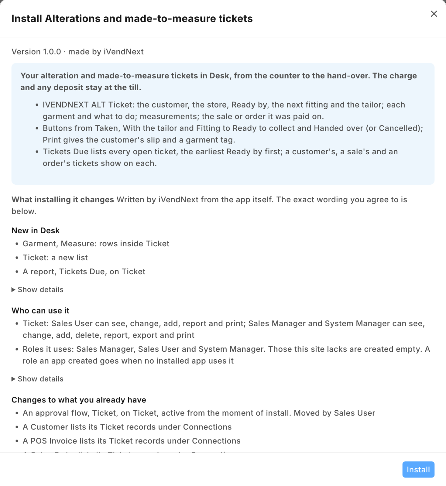
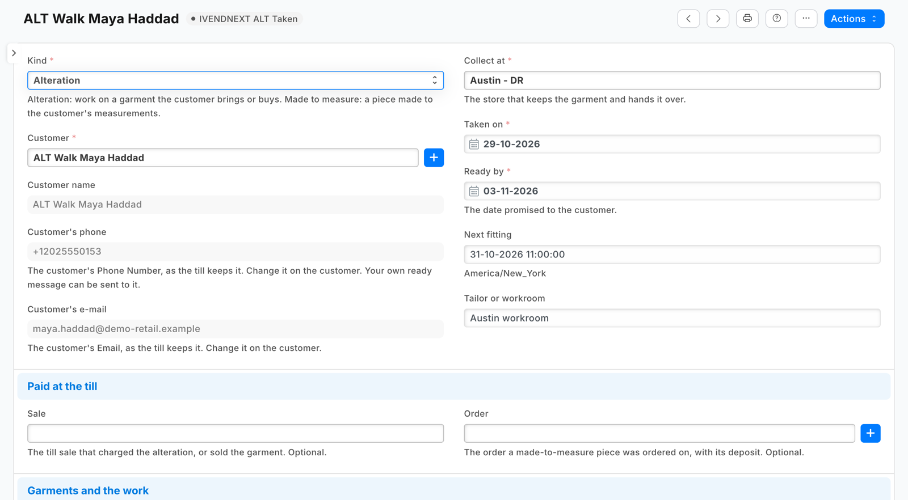
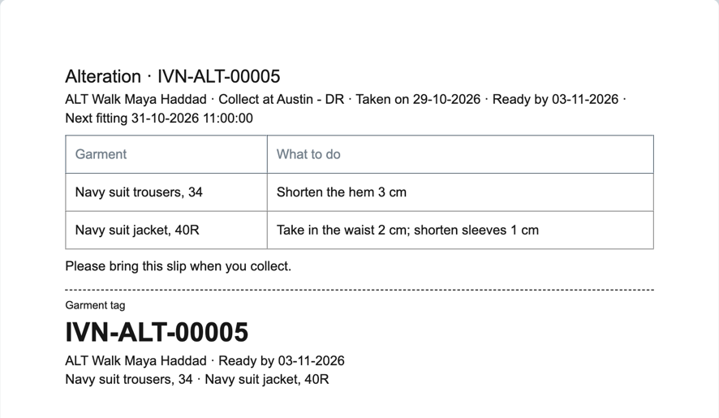
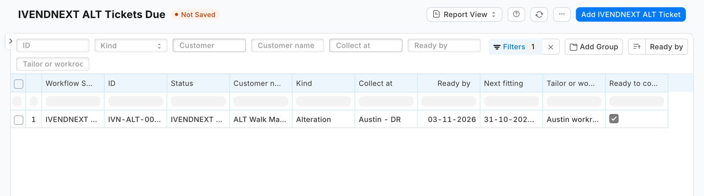

# S53 — Alterations and made-to-measure tickets (`pp_alt`)

*Start from this sample: `python3 tools/manifest/start.py s53_alteration_tickets --prefix "ACME ALT"` copies it into `apps/` of your repository under your own prefix (your company's first word, then a short name for the app) and checks it ([how](../../recipes/make_it_your_own.md)).*

A fashion store's ticket for each alteration and each made-to-measure piece, kept in iVendNext Desk: what to do to which garment, the measurements, the fitting, the date it is ready, the tailor's progress, a slip for the customer with a tag for the garment, the tickets due, and who collected it. The charge and any deposit are rung at the till as before. The app itself calls nothing outside: no service, no outside address. The [recipe](../../recipes/alteration_tickets.md) walks a store through it.

It uses the manifest's `doctypes` (a record type and two child tables), `workflows`, `print_formats`, `reports`, `links` and a `documentation` property setter. **When to use it:** a store alters what it sells (a hem, a waist, a sleeve) or makes to measure (a suit, a dress), and its tickets are on paper today.

## What happens

1. **At the counter.** The cashier rings the alteration at the till as the store already does: a service item (*Hem trousers*), or a surcharge on the garment's line where the retailer set one up; a made-to-measure piece is ordered with its deposit by the till's order or a layaway. Then store staff open **PP ALT Ticket** in Desk, **+ Add**: the customer by name and number, never the store's walk-in customer (its phone and e-mail come from the customer, as the till keeps them; the till's new-customer sheet makes one), the store that hands it over, **Ready by**, and a row per garment with **What to do**. For a made-to-measure piece, choose **Made to measure** and fill **Measurements**. Name the **Sale** or the **Order** it was paid on. Save: the ticket is numbered `ALT-00001` and is **Taken**.
2. **The slip and the tag.** **Print** › *PP ALT Ticket*: the customer's slip (the number large, the store, Ready by, each garment and its work, the measurements) and, under a cut line, the garment's tag.
3. **In the workroom.** **Send to tailor**, **Book a fitting** (write **Next fitting**; **Back to tailor** after it), **Ready**. **Ready** ticks **Ready to collect**; going back for more work unticks it.
4. **The customer is told.** The retailer's own Notification on **Ready to collect** sends *"Your alteration ALT-00042 is ready to collect"* by e-mail or SMS (the recipe's step 4; an SMS one also names `doc.customer_phone` in its condition, or each ticket of a customer with no phone leaves a failed send in the Error Log). The app sends nothing itself.
5. **The hand-over.** For a made-to-measure piece, take the balance at the till first (its order or layaway). Write **Collected by**, then **Hand over**: the ticket is **Closed**, and its history records who did it and when. **Cancel** closes a ticket the customer gave up.
6. **What is due.** The report **PP ALT Tickets Due** lists every ticket not closed, the earliest Ready by first. A customer's, a sale's and an order's tickets show under each, in the form's connections.

| What the store sees (a demo store, the library copy *IVENDNEXT ALT*) | |
|---|---|
| What installing it changes, read before the install |  |
| A ticket for two garments: the customer's phone and e-mail from the customer, Ready by, the next fitting, the workroom |  |
| The slip, and under the cut line the garment's tag |  |
| *Tickets Due*: the open tickets, the earliest Ready by first |  |

## What the retailer does

- Give the people at the counter and in the workroom **Sales User** (they take, move and print tickets; they cannot delete one). A **Sales Manager** may delete a ticket taken in error, and needs **Sales User** too to move one.
- Add its own Notification for the ready message, and, if it wants one, a reminder the day before a fitting (the recipe's step 4).
- Nothing else: the app installs no setting, no role and no switch.

## The files

| File | What |
|---|---|
| `manifest.json` | the ticket (`PP ALT Ticket`) and its two child tables (`PP ALT Garment`, `PP ALT Measure`); the workflow with its six states; the slip and tag print format; the report *Tickets Due*; the ticket list under Customer, POS Invoice and Sales Order; the ticket's help address |
| `tests/test_manifest.py` | the manifest passes the kit's checker and nothing the retailer's install refuses; no outside address and no money field; *Ready* ticks *Ready to collect*, going back unticks it; *Hand over* and *Cancel* tick *Closed* and leave the ticket to a System Manager on Desk's screen; the phone and e-mail are the customer's, read only; the report lists open tickets by Ready by; no child table is required; the print reads only fields that exist and skips a blank measurement row; the Connections; the rights; the help |
| `tests/canaries.py` | each test goes RED when the rule it guards is broken |

## Run it

The tests need nothing but Python:

```bash
python3 -m unittest discover -s samples/s53_alteration_tickets/tests -p 'test_*.py'
python3 samples/s53_alteration_tickets/tests/canaries.py
```

Install the manifest in a retailer's iVendNext through **Extension Packages** (guide chapter 3), then open **PP ALT Ticket**.

## What is refused, and why

- **A money field on the ticket**: the charge and the deposit belong to the till's sale and order, where tax, refunds and the day's takings already handle them. The ticket names them; it holds no amount.
- **A message to the customer from the manifest**: a manifest notifies only the retailer's own users. A message to a customer is the retailer's own Notification on a field the app adds (*Ready to collect*).
- **A required garments table**: Desk drops a row whose list fields are all blank, so *no garments* is a ticket with no rows (a made-to-measure piece may have none until it is cut).

## Make it your own

What a partner usually changes:
- **the ticket from the till:** a till key that writes the ticket from the basket at the counter (garments, customer, store), with the ticket number back on the receipt as a sale detail (recipe [A till key](../../recipes/point_handler.md));
- **the measurements:** a measurement profile kept per customer, copied onto each new ticket; a country's or a brand's own list of measures;
- **the workroom:** an outside workroom's own system, a ticket per tailor, piece rates;
- **the fitting:** a booking calendar, a fitting reminder by WhatsApp from the retailer's own messaging app;
- **the prefix:** `tools/manifest/rename.py` makes your copy under your own reserved prefix in one step (the naming series `ALT-` too: change it in the ticket's `autoname`);
- **its records:** `tools/deploy/copy_records.py` moves tickets between a test site and the retailer's iVendNext.

## Technical notes

### Why it is built this way

A manifest only. The till already charges an alteration (a service item, or a line surcharge) and takes a made-to-measure deposit (its order or a layaway), so the app holds no money and needs no check before payment. A till key that writes the ticket at the counter would press before the sale is booked, so an abandoned sale would leave a ticket behind; that is a partner's version, above. With no service there is nothing to host, no key to keep and no user to add.

### Bounds, stated

- **The ticket is written in Desk**, at the counter or in the workroom; nothing links it to the sale or the order on its own: staff name them.
- **The phone and e-mail are the customer's** (`custom_phone_no`, `custom_email`, the fields the till's new-customer sheet and customer edit write), read only and filled again on each save: change them on the customer. A customer made in Desk with only its contact's mobile and e-mail has a blank phone and e-mail on the ticket until its **Phone Number** and **Email** are set.
- **Desk shows the states and buttons with the prefix** (*PP ALT Ready*, *IVENDNEXT ALT Ready* in the library app).
- **Hand over does not ask for *Collected by*:** staff write it first.
- **Removing the app:** delete your own Notifications on the ticket first (a daily reminder on a removed record would fail every day).
- **A workflow's *who may edit* is a screen rule.** Over the record API, anyone with write may change a ticket in any state; the buttons are the workflow's.
- **A cancelled ticket refunds nothing**: a refund is the till's return.
- **The measurements are personal data** the retailer keeps under its own policy; uninstalling the app removes the tickets (its export keeps a copy).
