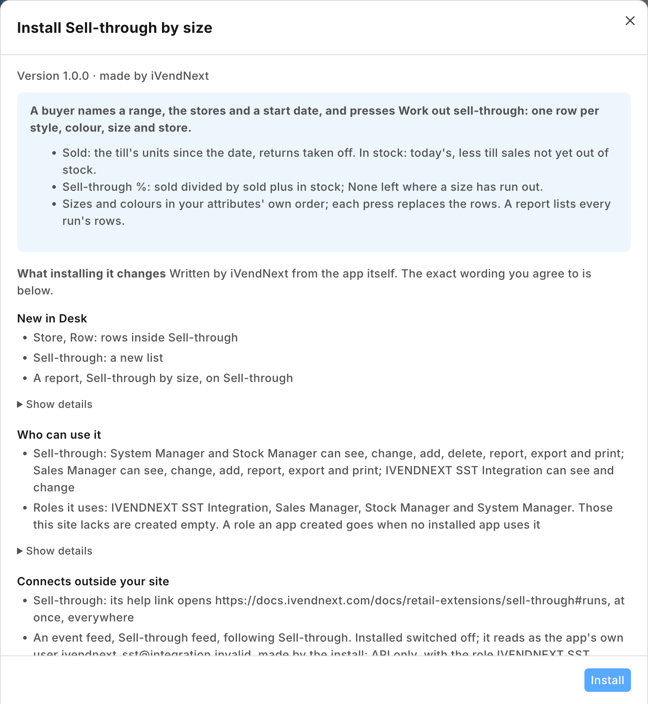

# S54 — Sell-through by size (`pp_sst`): which sizes and colours sell, store by store

A fashion retailer's buyer wants to know which sizes and colours of each style sell out and which sit on the shelf, store by store. The buyer names an item group or one style, the stores and a start date, and presses **Work out sell-through**. The app writes, for each style, colour, size and store, the units sold at the till since that date, the units still in stock, and the sell-through, with the sizes in their attribute's own order. Both figures come from the retailer's own reports, never from a copy.



**Industries:** Fashion and footwear

**When to use it:** the retailer sells styles in sizes and colours (clothing, footwear, sportswear) and wants sell-through per size in each store, from its own till sales and stock.

## Start from it

```bash
ivn new acme_sellthrough --from s54
```

## What to change

What a partner usually changes:

- the figures: stock turn or weeks of cover beside the sell-through, or a size curve the buyer planned, in `sst.py` (`rows_of`, `sell_through`);
- the sales: the online store's or wholesale orders as well as the till's (read *Item-wise Sales Register* too, and add its `report` entry and the reads it needs to `role_rights`), in `service/app.py`;
- what follows: a transfer request for a size sold out in one store and held in another, or a markdown list for sizes that sit;
- the service's address: `allowed_urls` and the endpoint in `manifest.json` name the sample's test address; write your own;
- the record types' prefix: the `SST_PREFIX` setting of the service (default `PP SST`).

More: the [recipe](../../recipes/shop_reports.md).

**The install gives the role its rights.** The manifest's `role_rights` give the role **PP SST Integration** the two reports (*POS Sale Report* and *Stock Projected Quantity*, a `report` entry each), Read and Report on POS Invoice, Read on Item, Item Attribute, Warehouse and UOM, and Select only on POS Profile, Item Group, Customer and Customer Group, so the app's user reads every store's figures in the two reports and the retailer's administrator grants none of them by hand. This needs POS build `2.1.0.697` or later, the first that takes a Report in `role_rights`.

**The customer sets:** the buyers (Stock Managers and Sales Managers) and their *Select* on Item Attribute and Warehouse: a role of the retailer's is the retailer's to grant, so the manifest cannot.

## Run it

```bash
ivn check
ivn try
```

## Try it at the till

- Sell a few sizes of one style.
- In Desk, make a run for that style and press Work out sell-through; the sales show by size.
- Close the till day when you are done.

## Versions

### 1.0.4

- Desk shows plain names (Sell-through run, Sell-through by size) through the manifest's `translations` block, so a search for *sell-through* finds the record. The stored names are unchanged: an installed site keeps its records. Manifest 0.1.4.

### 1.0.3

- The install gives the app's role its two reports and every read and lookup they ask for (`role_rights`, with a `report` entry for each report), so the retailer grants none by hand. A refused report's message no longer asks the retailer to check the rights the setup names. Needs POS build `2.1.0.697`.

### 1.0.2

- An order and the delivery made against it count as one sale: the delivery's units come off, and the order stays the sale. Deliveries made against orders (POS Invoice and its lines) are read with the Read the role already has.

### 1.0.1

- The press asks no confirmation, and a *Sold since* after today runs and shows nothing.

### 1.0.0

- First version in the kit: sell-through by size and colour, store by store, from two of the retailer's own reports.
- Each setting in app.json says its purpose (the line the Settings screen shows), whether it is required, and which settings go with it.
