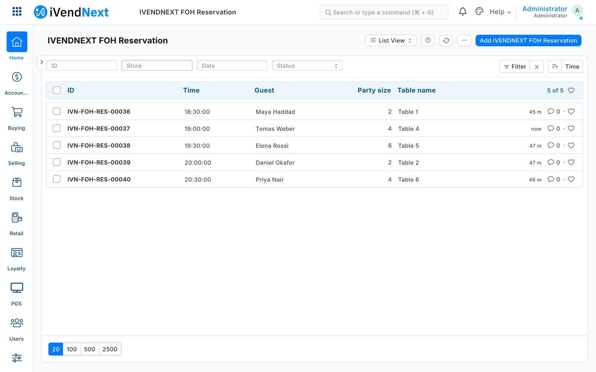

# S55 — Front of house (reservations, a waiting list, seating that opens a check)

A restaurant's host keeps the evening in iVendNext Desk: a **reservation** for each booking (the store, the date and time, the party size, the guest, a table if chosen) and a **waiting list** of walk-ins. **Book** holds the table for the party's stay and refuses an overlapping booking, naming the other one. **Seat** opens the party's check on the till at its table, once, never twice. **No-show** and **Cancel booking** free the table, and a waiting party set to *Table ready* can text the guest. A guest's details are seen only by the host role, and the service never reads them.



**Industries:** Hospitality

## Start from it

```bash
ivn new acme_foh --from s55
```

## What to change

What a partner usually changes:

- **The booking length and the deposit's words:** `minutes` and `no_show_deposit` on each row of `PP FOH Store` in `manifest.json`; `second_check` lets a long shared table take a second check.
- **The buttons and what they do:** the five services in `manifest.json` and the rules in `foh.py`.
- **A booking platform:** write its bookings as `PP FOH Reservation` records through the record API.
- **A reminder:** the retailer's own Notification the day before; table-ready SMS is a Notification on `PP FOH Waitlist Entry` (*Value Change* on *Status*), never the app.
- **The record types' names:** `FOH_PREFIX` for the service.

More: the [recipe](../../recipes/front_of_house.md).

**The customer sets:** the tables as the till's own floor (*Retail Floor Section* and its *Retail Floor Place* records, with **Table Service** ticked on the store's register), one `PP FOH Settings` record for the company with a row per store, the role **PP FOH Host** for hosts and managers, and an SMS provider if guests are texted. Nothing for the app's user: the install makes it (the manifest's `app_user_rights`): its own Retail Permission with only *open a check* and *see the checks*, **Is POS User**, a row for every store (on its Table Service register if it has one), and a Shift Profile.

## Run it

```bash
ivn check
ivn try
```

## Try it at the till

- In Desk, make a reservation with a table, press Book, then Seat.
- The party's check opens on the till at that table; add dishes and take the payment.
- The deposit's path was walked with the whole bill put on the guest's account; charging only the deposit's part on account beside a card (a split payment) is the till's own split and was not walked with this app.
- Close the till day when you are done.

## Versions

### 1.1.2

Needs POS build 2.1.0.682 or later. Manifest 0.2.2.

- The manifest's `app_user_rights` make the app's own user at the install: its own Retail Permission with only *open a check* and *see the checks*, **Is POS User**, a row for every store (on its Table Service register if it has one), and a Shift Profile, so the administrator sets nothing up by hand (a user already set up by hand stays as it is).

### 1.1.1

Manifest 0.2.1.

- The *Seat key* help says what the service does: set when Seat opens the table's check and kept with it, so a second press returns that check; cleared when Seat is refused.
- `role_rights` give **PP FOH Host** *Read* on *Retail Floor Place* and *Select* on *Warehouse*, *POS Invoice* and *Customer*, so a host needs no Role Permissions step.

### 1.1.0

- The set-up words say the install switches the feed on and gives the role its reads (POS build `2.1.0.691` or later). The app does what it did.

### 1.0.3

- *Seat* says what to fix when the till's floor refuses the app's user, for example a user with no register at that store: *"Not seated: the app's user is not assigned to register …"*. Before, the host read *did not answer in time*.

### 1.0.2

- When iVendNext refuses one of your service's calls, or does not answer it, the press's line in your service's log says which call, and iVendNext's status and own words when it gave them (for example *Could not find Company*). The host still reads *did not answer in time*; the cause is in the log (on CitiXsys hosting, your function's log).

### 1.0.1

- Hosts at different stores no longer wait for each other; *Seat* and *Change booking* ask no confirmation.

### 1.0.0

- First version in the kit: reservations, a waiting list and seating that opens the table's check.
- Each setting in app.json says its purpose (the line the Settings screen shows), whether it is required, and which settings go with it.
