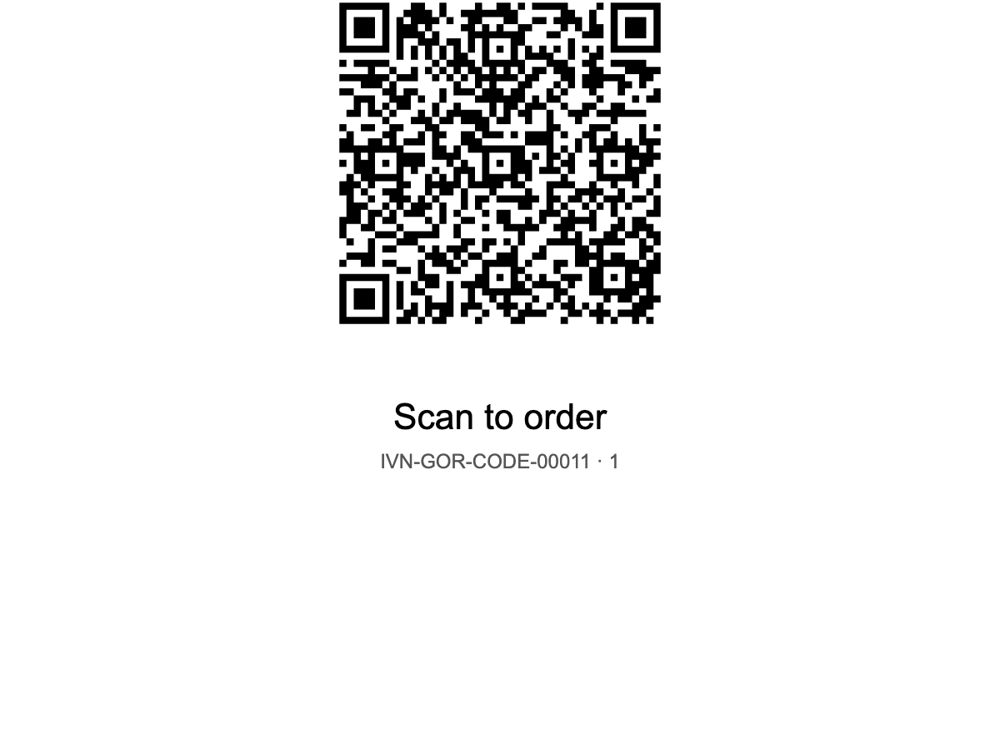

# S56 — Guest ordering (a QR code at the table and a kiosk, to the table's check)

Guests order for themselves. At the table a guest scans the table's QR code, reads the menu on their phone and sends an order: it lands on that table's check on the till, waiting for the server. At a kiosk a counter-service guest orders on a tablet, is shown an order code, and pays at the counter. Staff stay in charge: the app never sends anything to the kitchen and the guest never pays in the app. The page asks no name, phone or e-mail.



**Industries:** Hospitality

## Start from it

```bash
ivn new acme_guest --from s56
```

## What to change

What a partner usually changes:

- **The page:** the look and the languages, in `service/page.css` and the `WORDS` table in `service/page.js`.
- **The menu:** pictures and allergens from the retailer's own records, in the service's menu read. Dishes sold as variants do not reach the guest menu: add them to the service's menu read if you sell them.
- **The limits:** the course word, and the most lines an order and the most of one dish (no limit of their own unless set), on each row of `PP GOR Store` in `manifest.json`.
- **A new channel:** payment at the kiosk through the retailer's gateway, or a delivery or collection channel.
- **The record types' names:** `GOR_PREFIX` for the service.

Keep the rule that a guest's lines wait unsent: an app given *send to the kitchen* turns a stranger's photo of a table card into food cooked for nobody.

More: the [recipe](../../recipes/guest_ordering.md).

**The customer sets:** the register with **Table Service** ticked, its item groups and price list; the tables as the till's own floor; one `PP GOR Settings` record for the company with a row per store (*Orders from the tables*, *Orders from the kiosk*); the role **PP GOR Manager** for whoever makes the codes; and one *PP GOR Code* for each table and kiosk, made with **Make code** and printed. The app's user needs a Retail Permission with only *open a check*, *add to a check* and *see the checks*.

## Run it

```bash
ivn check
ivn try
```

## Try it at the till

- In Desk, press Make code on a table's code and open its link on a phone.
- Send an order from the phone; it waits on the table's check on the till.
- Close the till day when you are done.

## Versions

### 1.0.1

- Two guests at a free table land on one check with no wait; the limits on an order are blank unless the store sets them; a dish sold out since the menu says so.

### 1.0.0

- First version in the kit: a QR code at the table and a self-order kiosk, to the table's check.
- Each setting in app.json says its purpose (the line the Settings screen shows), whether it is required, and which settings go with it.
