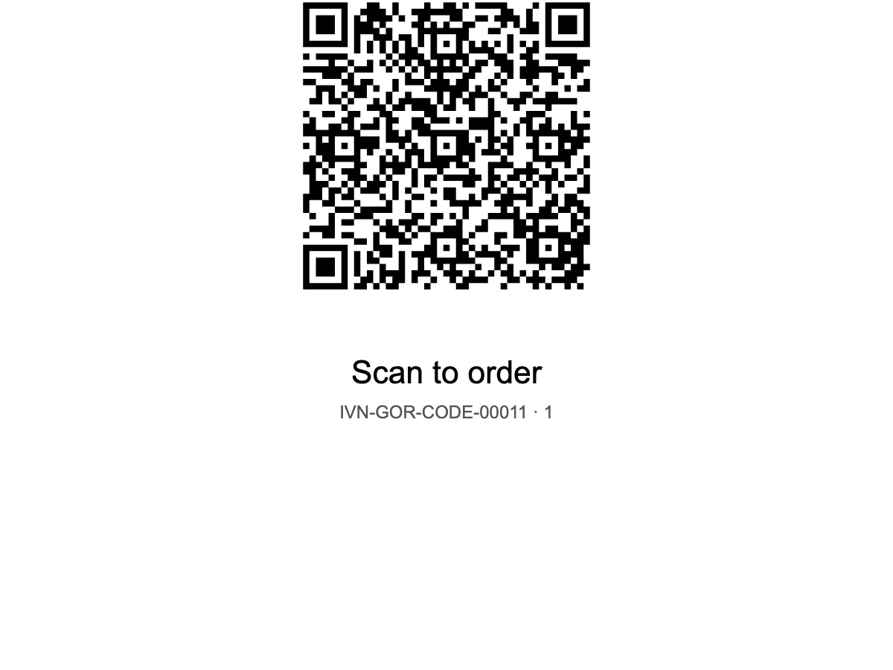
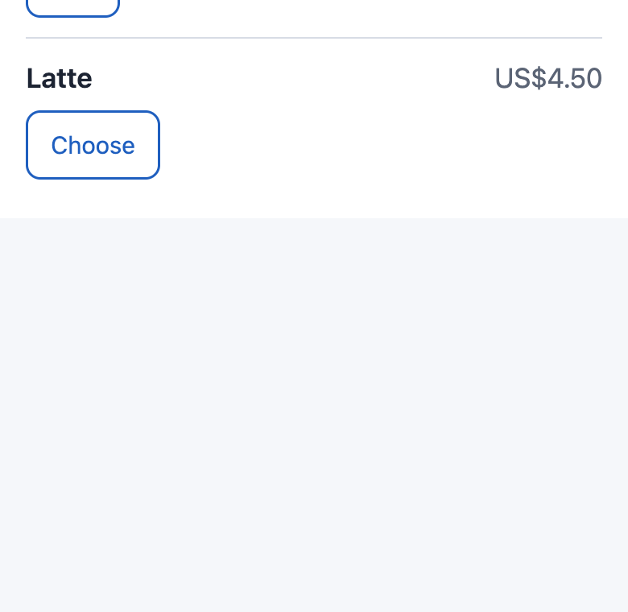
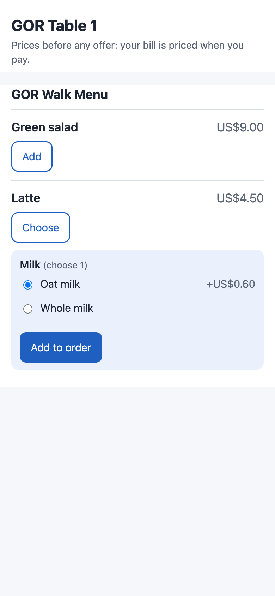
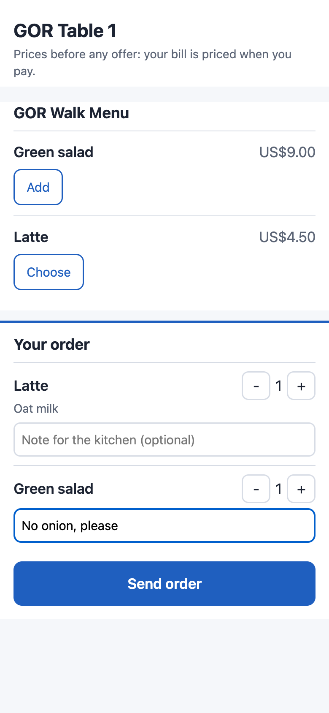
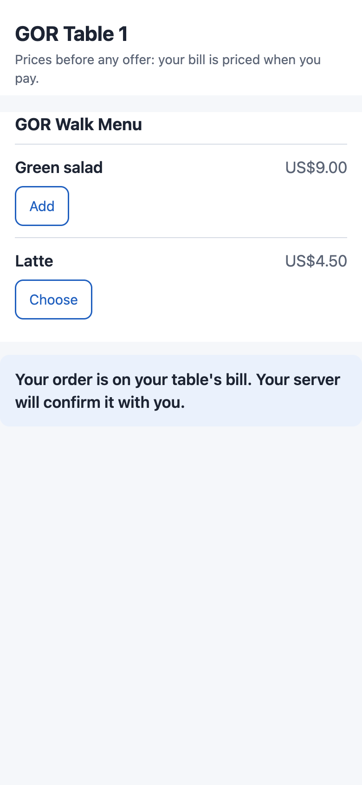
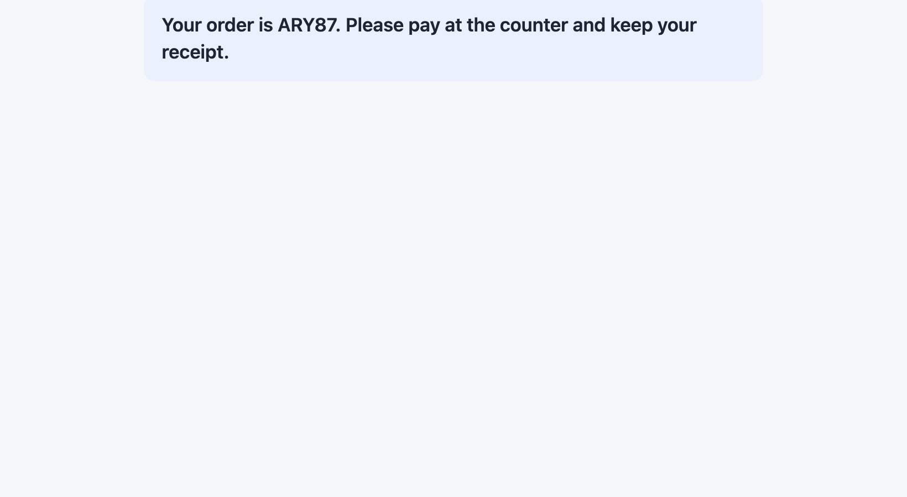

# S56 — Guest ordering (a QR code at the table and a kiosk, to the table's check)

*Start from this sample: `python3 tools/manifest/start.py s56_guest_ordering --prefix "ACME GOR"` copies it into `apps/` of your repository under your own prefix (your company's first word, then a short name for the app) and checks it ([how](../../recipes/make_it_your_own.md)).*

**Industries:** Hospitality

## What the retailer does

Guests order for themselves. **At the table** a guest scans the table's QR code, reads the menu on their phone and sends an order: it lands on that table's check on the till, waiting for the server. **At a kiosk** a counter-service guest orders on a tablet in the store, is shown an order code, and pays at the counter. Staff stay in charge: the app never sends anything to the kitchen and the guest never pays in the app.

| What happens | When |
|---|---|
| A table's **code** (its link and QR picture) is made; the card prints it with the table's name and *Scan to order* | the manager presses **Make code** on a *PP GOR Code* record (or on several ticked in the list), then prints it: **Print**, *PP GOR Table card* |
| The guest's phone shows the **menu**: the register's item groups, each dish with its price, *Choose* for a dish with choices (each group's *choose 1* or *up to 2*, each choice with its price) | the guest scans the code. The prices are the register's price list before any offer: the page says so, and the bill is priced when it is paid |
| The order is **on the table's bill**: the table's check opens if none is open there, or the lines join the one that is | the guest presses **Send order**. Each line waits unsent under the course *Guest order*, with the guest's note for the kitchen |
| **Refused**: *more than one bill open, please ask your server* | the table holds two checks or more (the app cannot tell which party the guest is in) |
| **Refused**: *this table's bill is being paid, please ask your server* | a till is taking the table's payment: lines added now would sit outside it and keep the check open after the party leaves |
| **Wait a few seconds** | another order for the same table was sent less than 15 seconds ago, from any of its cards (one order a table at a time; also the flood limit for orders) |
| One order, never two | the guest presses **Send order** again, reloads the page or scans the card again within ten minutes with the same order after a lost answer: the page sends the same key, and the till's door returns its first answer |
| A **tab** named *Kiosk 7KQ2M* opens with the order; the guest reads *Your order is 7KQ2M. Please pay at the counter and keep your receipt.* | a guest orders at a kiosk. The counter finds the tab on the till's floor under *Tabs* and pays it as any check; staff call it by its code, or by the receipt's call number where the counter register prints call numbers |
| The old card **stops working** (within 15 seconds); the new one works | a code leaked (a photo posted online): press **Make code** again on that record and print its new card. Only that table's card changes |
| The card prints *Press Make code first* instead of a QR code | the record was duplicated in Desk, or its kind, store, table or kiosk name changed since its code was made |
| The code **stops working** until **Make code** is pressed again | the code's kind, store, table or kiosk name was changed after it was made, so a card printed for Table 12 never orders for another table |

**The server's part.** A guest's lines carry the course *Guest order* (the store's own word if its row names one). When the server's own lines wait on the check too, the till's **Send** asks which course to send, so the server sees what the guest ordered before it goes to the kitchen. When a guest's lines are the only ones waiting, **Send** sends them with no question: read the check before you press it. A dish that cannot be made (out of stock) is removed at the till as any line.

**No guest data.** The page asks no name, phone or e-mail and signs in to nothing; the service keeps no order (the check is the record). A note the guest types for the kitchen is kept on the check line like any note.


| What the guest and the store see (a demo store, the library copy *IVENDNEXT GOR*) | |
|---|---|
| **Make code**, then **Print**, *Table card*: the table's name, its QR code and *Scan to order* |  |
| The guest's phone after the scan: the register's menu, each dish with its price |  |
| A dish's choices: oat milk for 0.60 more, or whole milk |  |
| The order before sending: a latte with oat milk, a salad with a note for the kitchen |  |
| After **Send order**: the order is on the table's bill, for the server to confirm |  |
| A kiosk tablet after **Send order**: the order code, paid at the counter |  |

## What the retailer does to set it up

**Before you install:** every `host.docker.internal` address in `manifest.json` (in `allowed_urls`, and in the service) is our test bench's own address for the sample's service, and it resolves only where Docker provides it. Replace it with your own service's address first, or iVendNext's calls never reach your service; if this manifest is already installed, raise its `version` and install it again.

1. Install `manifest.json` (the retailer's administrator, on the install screen; on your sandbox, `tools/deploy/deploy.py`). It adds `PP GOR Settings` and its table `PP GOR Store`, `PP GOR Code`, the print format *PP GOR Table card*, the roles **PP GOR Manager** and **PP GOR Integration**, the button *Make code* and its service (switched off), and the feed registration *PP GOR Guest ordering feed* (leave it off). The install also makes the app's own user, `pp_gor@integration.invalid`, holding PP GOR Integration alone.
2. **The register and the tables.** The store's register (POS Profile) has **Table Service** ticked, lists the menu's **Item Groups** (each group listed: a group's sub-groups are not read; a register with none gives no menu) and its price list. The tables are the till's own floor: *Retail Floor Section* and its *Retail Floor Place* records for the store. A dish's choices are its own *Retail Option Groups* (HB-1). For the kiosk, the counter's register that takes the payment has **Table Service** ticked too (a tab is claimed only there) and rings this register's service mode.
3. **The app's user, in this order** (User `pp_gor@integration.invalid`): keep *Is Desk User* and tick **Is POS User**; choose a **Shift Profile** (any: it never opens a shift); link a **Retail Permission** with *Open Checks*: **open a check**, **add to a check** and **see the checks**, and nothing else; add **one row for each store** to the store access table (each store once): the store and its register there (Table Service on); **Save**; then **Generate Keys**. Without *Is POS User* the save drops the store row and every order is refused. ⚠ Never give it write on Floor Section, or *send to the kitchen*: a guest's order must wait for a person.
4. In **Role Permissions Manager**, give **PP GOR Integration** **Read** on *Item*, *POS Profile* and *Retail Option Group* (the menu, its register and its choice groups). Give **PP GOR Manager** to the people who make the codes, and give it **Read** and **Select** on *Retail Floor Place* (so the form shows the table's name) and **Select** on *Warehouse*. A manager of one store gets a **User Permission** on *Warehouse* for that store, so their codes, list and button reach that store's records alone.
5. Make a **PP GOR Settings** record for the company: a row per store with **the same register** the app's user holds there, *Orders from the tables* and *Orders from the kiosk*, the course word, and the most lines an order and the most of one dish (10 and 10 unless set).
6. In **Retail Extension Subscription**, open *Make code service*, read what it is sent, tick the consent and switch it on; switch the button on in **Retail Desk Action**. Press **Connect again** on the app's package record if the site could not reach the app, or the key was made after the install.
7. Make a *PP GOR Code* for each table (kind *Table*, the store, the table) and for each kiosk (kind *Kiosk*, the store, a name), press **Make code**, print the cards, and open each kiosk's link on its tablet in a full-screen kiosk browser, so its address is not on show: a kiosk link copied from the tablet lets anyone open unpaid tabs (one every 15 seconds) until **Make code** is pressed again. The kiosk clears itself two minutes after the last touch (two minutes after a lost answer).

**Before you remove the app:** pay or close every check it opened (the uninstall deletes the app's user, and a check that user opened can then no longer be changed). A reinstall makes new secrets: make every code again and print it. A new secret on the *Make code service* is accepted beside the old one until the next *Connect again*, so printed cards keep working until then and stop after it. To stop one card, press **Make code** on it.

**Limits.** A check the app opened can be left empty: a guest's order whose dish the till refuses at a free table (an item switched off since the menu was read), or a retry after the bill was paid; the server closes it at the till. A till opening a check at the same moment as a guest's first order can leave two checks at the table; guest orders there are then refused until the server merges them. A store named on two companies' settings uses the first row found. A guest at a place one party already holds (a bar counter, a shared table) joins that party's bill: give each party its own place, or switch *Orders from the tables* off for shared places. A card works whenever the store's row takes orders, the store closed included: switch *Orders from the tables* off at closing. A kiosk tab a guest walks away from stays open: a cashier with *change any line* and *close an empty check* removes its lines and closes it, and a store whose register refuses the last close while checks are open clears them first. Staff call a kiosk order by its code, or by the receipt's call number where the counter register prints one (the guest is told to keep the receipt). The App library's hosted copy serves every retailer from at most 10 copies at once; a cold menu read holds one for a few seconds. A dish sold by weight arrives with no reading and is weighed at the till before it is paid; the weighing replaces the quantity the guest chose, and the menu's price is per unit. One retailer's own service (no App library) takes one secret: changing it stops every card at once. A secret or register change made while a guest's order is being retried is answered *ask staff*, though the first send is on the check. A dish with no price on the register's price list shows 0.00 on the menu.

## What leaves the retailer's iVendNext

iVendNext calls nothing outside but the service's own address (`allowed_urls`), on a press of *Make code*: the pressing user's login and language, and the records' names. The guest's phone calls the service directly with the code's link. The service then **reads**, as the app's own user: the code record, the store's row in the settings, the register (its item groups, price list, currency, company, walk-in customer), the items of those groups, their choice rows and groups, one price per dish and choice from the line pricer (`get_item_details`), and the store's floor (`floor_status`); and **writes**: a code's number, link and QR picture, and the guest's order through the till's door (`check_open`, `check_add_lines`: the store, its register, the table or a kiosk tab's name, the lines with their choices, course and note; never a price). No guest's name, phone or e-mail; no money.

## Run it

```bash
python3 -m unittest discover -s samples/s56_guest_ordering/tests -p 'test_*.py'   # 71 tests, the service with a stand-in site
python3 samples/s56_guest_ordering/tests/canaries.py                                # each guard turned off: its test goes RED
python3 tools/check/check.py samples/s56_guest_ordering                            # the retailer's own install checks
```

The service: `python3 service/app.py service/.env.local` for one store (the env file names the app's user's key, the *Make code* secret the install handed back and the page's address), or as a function on CitiXsys hosting for many (`app.json`). It serves the guest's page itself (`service/page.html`, `page.js`, `page.css`: no inline script, nothing from another site), and draws each code's QR picture itself (`qr.py`, standard library only).

## Try it at the till

- In Desk, press Make code on a table's code and open its link on a phone.
- Send an order from the phone; it waits on the table's check on the till.
- Close the till day when you are done.

## Make it your own

What a partner usually changes: the page's look and its languages (`page.css`, the `WORDS` table in `page.js`), pictures and allergens from the retailer's own records, payment at the kiosk through the retailer's gateway, and a delivery or collection channel. The prefix the service reads is `GOR_PREFIX` (`IVENDNEXT GOR` for the App library's copy), and `tools/deploy/copy_records.py` moves the settings and codes between sites (each code is made again on the new site: its link names the site). A copy keeps the rule that a guest's lines wait unsent: an app given *send to the kitchen* turns a stranger's photo of a table card into food cooked for nobody.

## Versions

### 1.0.0

- First version in the kit: a QR code at the table and a self-order kiosk, to the table's check.
- Each setting in app.json says its purpose (the line the Settings screen shows), whether it is required, and which settings go with it.
