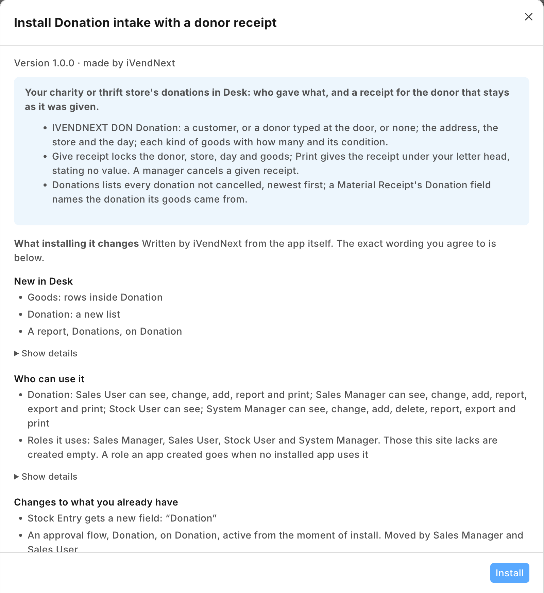

# S57 — Donation intake with a donor receipt (`pp_don`)

A charity or thrift store's record of the goods people give it, kept in iVendNext Desk: who gave (one of the retailer's customers, a donor typed in at the door, or no one named), what came in (each kind of goods, how many, its condition), which store took it in and when, and a **donor receipt** that holds once it is given. When the sorted goods go into stock with the engine's own Material Receipt, the stock entry names the donation. The app moves no money, changes no stock and states no value for the goods. It calls nothing outside: no service, no outside address.



**Industries:** Thrift and resale

**When to use it:** a store takes donated goods in at its door, and its donations and receipts are on paper or nowhere today.

## Start from it

```bash
ivn new acme_donations --from s57
```

## What to change

What a partner usually changes:

- **The donation and its goods:** `PP DON Donation` and its child table `PP DON Goods` in `doctypes` in `manifest.json` (kinds of goods, conditions, units).
- **The steps:** the three states of the workflow in `workflows`.
- **The lock:** the save rule in `save_rules`, which holds the donor, store, day and goods once the receipt is given.
- **The receipt:** the print format `PP DON Donor receipt` in `print_formats`, including its thank-you sentence, and the donation's default print format in `property_setters`. It states no value.
- **The report:** *Donations* in `reports`.
- **The naming series:** `DON-` in the donation's `autoname`.
- **A tax scheme or a till key:** a partner's version on top; the app holds no money field.

More: the [recipe](../../recipes/donation_intake.md).

**The customer sets:** the charity's name, registration number and address on the **Letter Head** the store prints with (chosen in the print window), who gets **Sales User** at the donation door, and a **Stock Entry Type** named *Material Receipt* if its site has none.

## Run it

```bash
ivn check
ivn try
```

## Versions

### 0.1.1

- *Print* opens the donor receipt, not the plain layout (the donation's default print format).

### 0.1.0

- First version in the kit: donated goods recorded in Desk with a donor receipt, from a manifest only.
