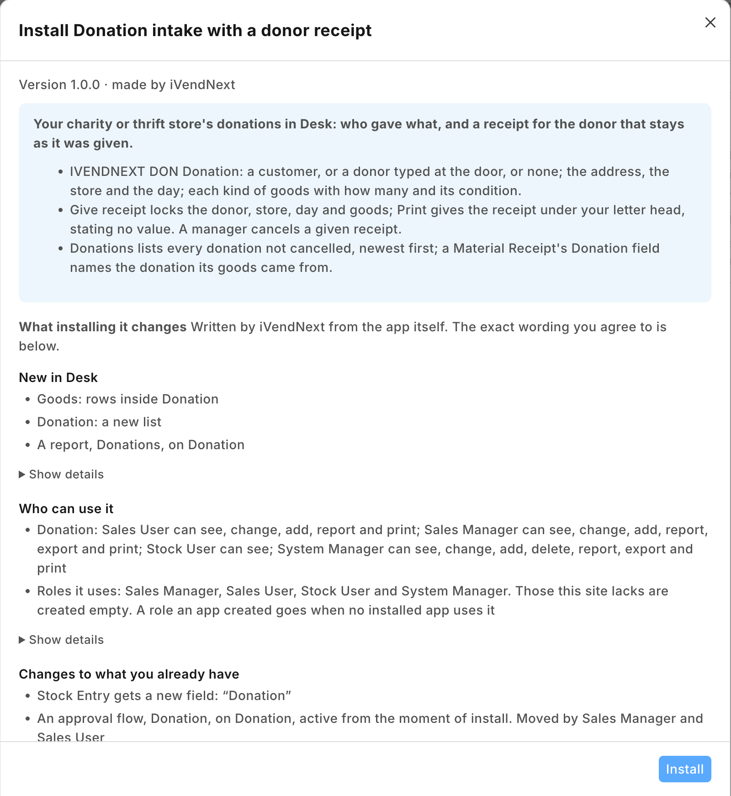
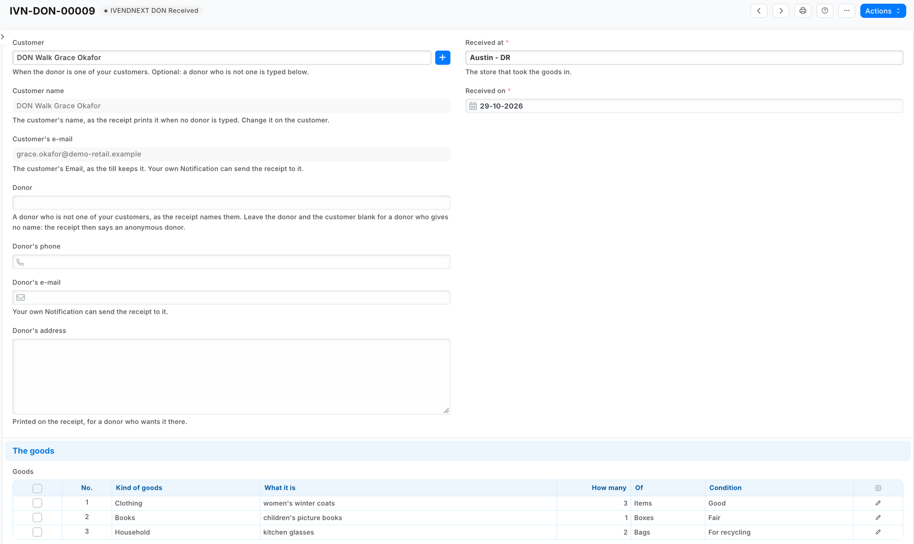
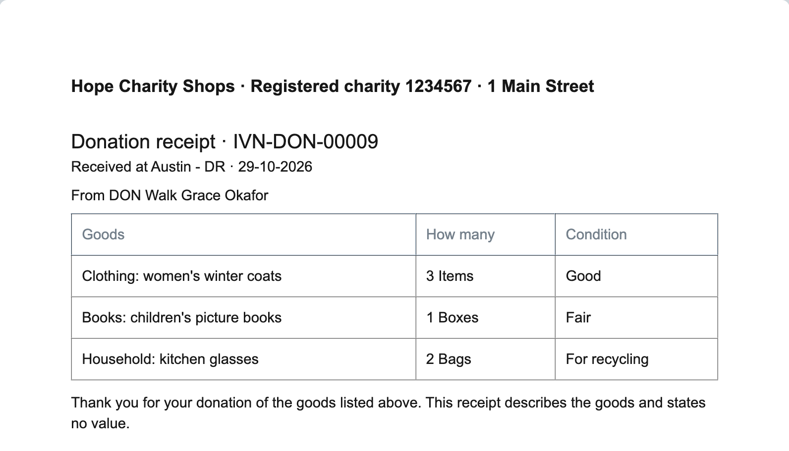
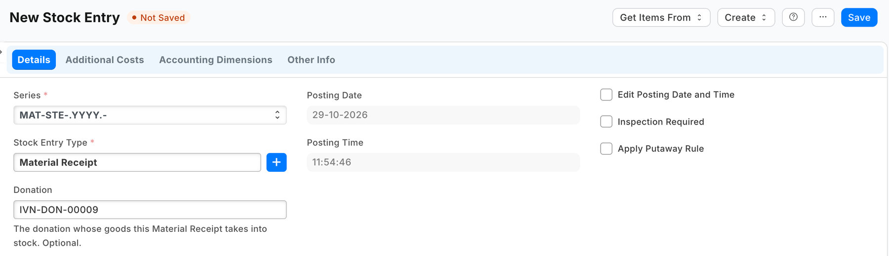

# S57 — Donation intake with a donor receipt (`pp_don`)

*Start from this sample: `python3 tools/manifest/start.py s57_donation_intake --prefix "ACME DON"` copies it into `apps/` of your repository under your own prefix (your company's first word, then a short name for the app) and checks it ([how](../../recipes/make_it_your_own.md)).*

A charity or thrift store's record of the goods people give it, kept in iVendNext Desk: who gave (one of the retailer's customers, a donor typed in at the door, or no one named), what came in (each kind of goods, how many, its condition), which store took it in and when, and a **donor receipt** that holds once it is given. When the sorted goods go into stock with the engine's own Material Receipt, the stock entry names the donation. The app moves no money, changes no stock and states no value for the goods. It calls nothing outside: no service, no outside address. The [recipe](../../recipes/donation_intake.md) walks a store through it.

It uses the manifest's `doctypes` (a record type and a child table), `workflows`, `save_rules` (a lock), `print_formats`, `reports`, `custom_fields` (one field on Stock Entry), `links` and a `documentation` property setter. **When to use it:** a store takes donated goods in at its door, and its donations and receipts are on paper or nowhere today.

## What happens

1. **At the donation door.** Store staff open **PP DON Donation** in Desk, **+ Add**. If the donor is one of the retailer's customers, choose the **Customer**: its name and e-mail show beside it, read only (as the till keeps them). Otherwise type the **Donor**'s name, and the phone and e-mail if the donor gives them; leave both blank for a donor who gives no name. Add the **Donor's address** if the donor wants it on the receipt. **Received at** is the store; **Received on** is today. Add a row per kind of goods: **Kind of goods** (*Clothing*), **What it is** (*children's coats*), **How many** and **Of** (*items*, *bags* or *boxes*), **Condition**. Save: the donation is numbered `DON-00001` and is **Received**.
2. **The receipt.** **Give receipt**: the donation is **Receipt given**, and from now on its donor, store, day and goods cannot change. **Print** › *PP DON Donor receipt*: under the store's own letter head, *Donation receipt · DON-00001*, where and when, the donor (the typed donor, else the customer, else *an anonymous donor*) and address, each line of goods with its count and condition, and *"Thank you for your donation of the goods listed above. This receipt describes the goods and states no value."* The receipt reads the donation's step: printed before **Give receipt** it says *Not yet a receipt* at the top. A donation made by **Duplicate** starts again at **Received** (Desk never copies the step).
3. **A mistake.** **Cancel** a donation still **Received** (store staff), or one whose receipt was given (a store manager only): it is **Cancelled**, keeps its number and prints *Cancelled: this is not a receipt*. Take a new donation for the right goods. A donation is never deleted by the store: the donor may hold its number.
4. **Into stock.** Whoever prices the sorted goods takes them into stock as today, with a **Stock Entry** of type **Material Receipt** into the store, and chooses the donation in its **Donation** field (shown on a Material Receipt only; settable after submit too). The Stock Entry list, filtered by **Donation**, shows where a donation's goods went.
5. **What came in.** The report **PP DON Donations** lists every donation not cancelled, newest first, with its store, its donor and whether its receipt was given. A customer's donations show under the customer, in the form's connections.

| What the store sees (a demo store, the library copy *IVENDNEXT DON*) | |
|---|---|
| What installing it changes, read before the install |  |
| A donation for one of the retailer's customers: the customer's name and e-mail from the customer, the store, three lines of goods |  |
| The donor receipt under the store's letter head |  |
| A Material Receipt naming the donation its goods came from |  |

## What the retailer does

- **Switch the lock on** first: Desk › *Retail Save Rule* › *PP DON donation locked once its receipt is given* › tick **Enabled** › Save. A manifest installs every save rule switched off; until it is on, a given receipt can still be changed.
- Give the people at the donation door **Sales User** (or a role of your own with the same rights on the donation) (they take donations, give receipts, print them and cancel a donation not yet given its receipt). A **Sales Manager** cancels a given receipt. Neither deletes a donation; a System Manager can.
- Put the charity's name, its registration number and its address on the **Letter Head** the store prints with (Desk › *Letter Head*): the receipt prints under it.
- Whoever makes the Material Receipt holds **Stock User**, which reads donations so the **Donation** field can find one. Reading a donation shows the donor's details. Keep the roles they make stock entries with today: on a demo site a user holding Stock User alone was refused the stock entry form's own settings. If the site has no **Stock Entry Type** named *Material Receipt* (a site set up without the setup wizard's records has none), add it once: Desk › *Stock Entry Type* › **+ Add**, name *Material Receipt*, purpose *Material Receipt*.
- Add the goods before **Give receipt**: from then on they cannot change, and a given receipt with no goods is cancelled by a manager.
- If the store gives anything back for a donation (a voucher, say), it says so in its own words: on its letter head, or in its own copy of the print format. If it e-mails receipts: its own Notification (the recipe's step 4). Nothing else: the app installs no setting and no role.

## The files

| File | What |
|---|---|
| `manifest.json` | the donation (`PP DON Donation`) and its child table (`PP DON Goods`); the workflow with its three states; the lock (a save rule); the donor receipt print format; the report *Donations*; the field *Donation* on Stock Entry; the donation list under Customer; the donation's help address |
| `tests/test_manifest.py` | the manifest passes the kit's checker and nothing the retailer's install refuses; no outside address and no money field, and the Stock Entry field optional and settable after submit; no tick box on the record: the receipt reads the step; a given receipt is cancelled by a manager only, and nothing leaves *Cancelled*; the lock holds every field the receipt prints (the customer's own name excepted, below); a customer's name and e-mail are read-only copies and a walk-up donor is typed; the report lists donations not cancelled, newest first; the goods table is not required; the receipt reads only fields that exist, skips a blank row, states no value and claims nothing about what was given back; the Connections; the rights; the help |
| `tests/canaries.py` | each test goes RED when the rule it guards is broken |

## Run it

The tests need nothing but Python:

```bash
python3 -m unittest discover -s samples/s57_donation_intake/tests -p 'test_*.py'
python3 samples/s57_donation_intake/tests/canaries.py
```

Install the manifest in a retailer's iVendNext through **Extension Packages** (guide chapter 3), switch the lock on (above), then open **PP DON Donation**.

## What is refused, and why

- **A value on the receipt, or any money field**: a value for a tax claim is the donor's to state, or a regulated scheme's (a partner's version, below). The receipt describes the goods.
- **A tick box for the receipt**: a read-only box is the browser's rule only, so the API could tick it, and Desk's **Duplicate** copies a box into the new donation. The receipt and the retailer's e-mail read the donation's step, which only the workflow moves and Duplicate never copies.
- **Connections from the donation to its stock entries**: a manifest's link may only list its own records under a retailer's record. The stock entry names the donation; its list filters by it.
- **A required goods table**: Desk drops a row whose list fields are all blank, so *no goods yet* is a donation with no rows.

## Make it your own

What a partner usually changes:
- **a tax scheme:** the UK's Gift Aid (a declaration per donor, the sale proceeds reported back, the claim), or a valuation for a tax deduction where the law lets the charity state one;
- **at the till:** a till key that takes a donation at the till (the donor, the goods, the receipt printed by the till's printer) (recipe [A till key](../../recipes/point_handler.md));
- **sorting:** grading stations, lots with a sale-ready status, the goods into stock from the donation's rows;
- **supporters:** a supporter record and loyalty linked to donors; mission reports (what each store's donations raised);
- **the prefix:** `tools/manifest/rename.py` makes your copy under your own reserved prefix in one step (the naming series `DON-` too: change it in the donation's `autoname`);
- **its records:** `tools/deploy/copy_records.py` moves donations between a test site and the retailer's iVendNext.

## Technical notes

### Why it is built this way

A manifest only. The engine already takes goods into stock (a Material Receipt at the valuation the store chooses) and keeps the store's customers; what nothing holds is the donation itself and its receipt. The receipt's integrity is a save rule rather than code: a workflow state and a lock, on every door. A till key would make the donation at the till, but a donation is taken at the back door, and an app user would cost a seat on every site; that is a partner's version, above. With no service there is nothing to host, no key to keep and no user to add.

### Bounds, stated

- **The lock holds from *Receipt given***, on the customer, the typed donor and address, the store, the day, the goods and the *Receipt given* box (Desk, an import and the API alike). The phone, the e-mails and the notes stay editable: the receipt prints none of them.
- **A customer's name follows the customer.** The name and e-mail beside the customer are fetched again at each save, so they are never locked: a receipt reprinted after the customer is renamed prints the new name. The customer itself cannot change.
- **Duplicating a Material Receipt copies its Donation**: clear it on the copy.
- **Desk shows the states and buttons with the prefix** (*PP DON Give receipt*, *IVENDNEXT DON Give receipt* in the library app).
- **A workflow's *who may edit* is a screen rule**; the lock is not: it refuses the save itself.
- **The Material Receipt's valuation is the store's choice**, as today; the app reads and writes no stock.
- **The donor's details are personal data** the retailer keeps under its own policy, as it keeps its customers'; uninstalling the app removes the donations (its export keeps a copy) and the Stock Entry field.
