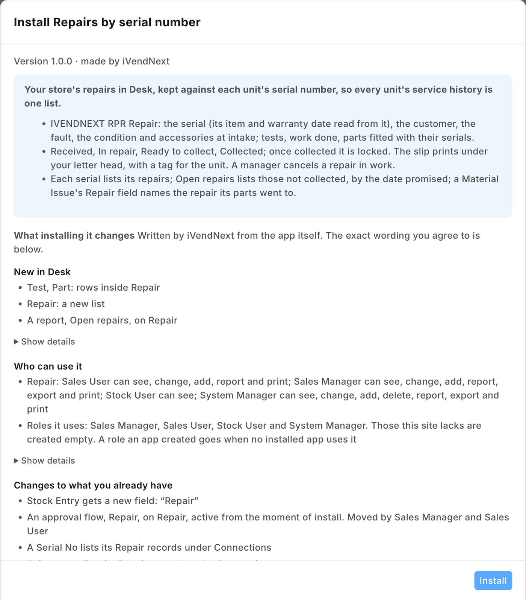
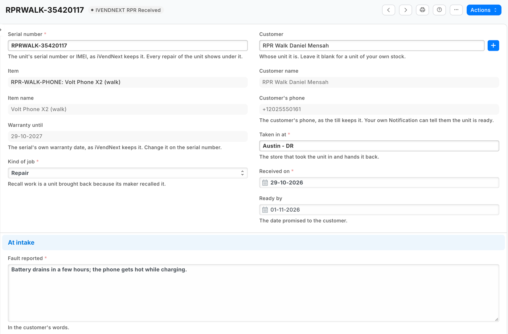
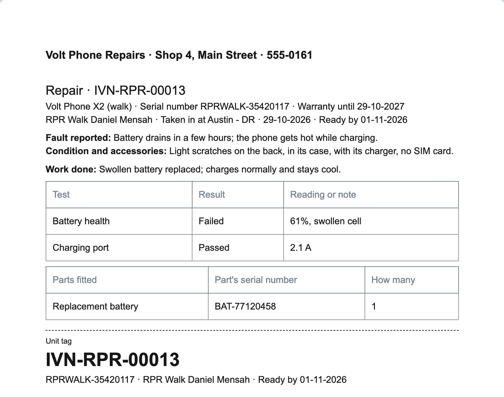
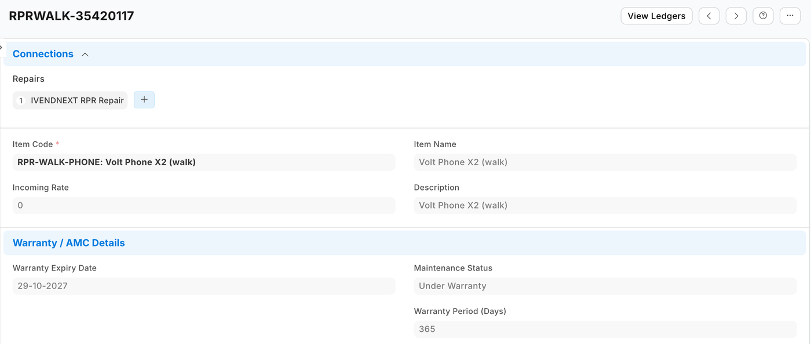
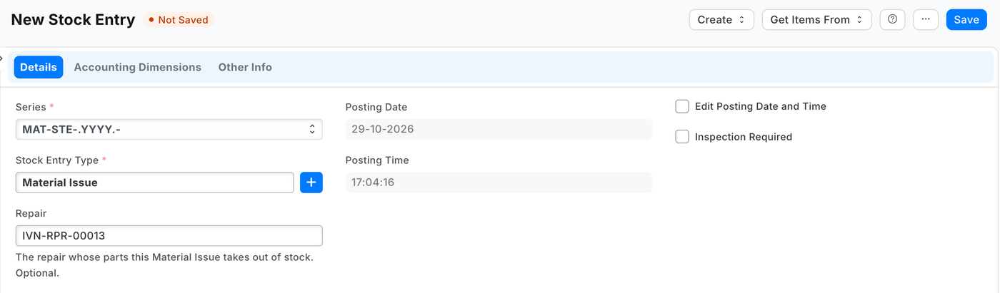

# S58 — Repairs by serial number (`pp_rpr`)

*Start from this sample: `python3 tools/manifest/start.py s58_repairs_by_serial --prefix "ACME RPR"` copies it into `apps/` of your repository under your own prefix (your company's first word, then a short name for the app) and checks it ([how](../../recipes/make_it_your_own.md)).*

An electronics or phone store's repairs and services, kept in iVendNext Desk against each unit's **serial number** (or IMEI): what the customer says is wrong, the unit's condition and what came with it, the tests run and their results, the work done and the parts fitted (each with its own serial where it has one), from the counter to the hand-over. Every repair shows under its serial number, so the unit's **service history** is one list; a repair slip with a unit tag prints under the retailer's own letter head. The parts leave stock with the engine's own Material Issue, which names the repair. The app moves no money: the till charges the repair as a service item, as it charges anything else. It calls nothing outside: no service, no outside address. The [recipe](../../recipes/repairs_by_serial.md) walks a store through it, and through a **recall by serial**, which needs no app.

It uses the manifest's `doctypes` (a record type and two child tables), `workflows`, `save_rules` (a lock), `print_formats`, `reports`, `custom_fields` (one field on Stock Entry), `links` and a `documentation` property setter. **When to use it:** a store repairs or services the units it sells (phones, laptops, appliances), and its repair jobs are on paper or in a separate system today.

## What happens

1. **At the repair counter.** Store staff open **PP RPR Repair** in Desk, **+ Add**. Choose the **Serial number**: the item, its name and the serial's **Warranty until** date show beside it, read only. Choose the **Customer** (blank for a unit of the store's own stock): its name and the phone the till keeps show, read only. **Kind of job** is *Repair*, *Service*, *Test only* or *Recall work*. **Taken in at** is the store; **Received on** is today; **Ready by** is the date promised. Type the **Fault reported** in the customer's words, and the unit's **Condition and accessories** (*a cracked corner, with its charger, no SIM card*). Save: the repair is numbered `RPR-00001` and is **Received**. **Print** › *PP RPR Repair slip*: the customer's slip, *Please bring this slip when you collect*, and a tag for the unit.
2. **The work.** **Start work**: **In repair**. Add a row per **Test** with its **Result** (*Passed*, *Failed*, *Not run*) and a reading (*82% battery health*); type the **Work done** and the **Technician**; add a row per **Part fitted**: the part as an item in your stock, what it is, the part's own serial number and how many. Whoever keeps the stock takes the parts out with a **Stock Entry** of type **Material Issue** and chooses the repair in its **Repair** field (shown on a Material Issue only; settable after submit too). The Stock Entry list, filtered by **Repair**, shows which parts a repair used.
3. **Ready.** **Ready**: **Ready to collect**. The slip now shows the work done, each test and each part with its serial. If the customer is not happy, **Back to work**. A unit that could not be repaired is handed back the same way, with the work done saying so.
4. **The hand-over.** Type **Collected by** if someone else collects, and **Paid by sale** if the till charged for the repair. **Hand over**: **Collected**. From now on the repair's unit, customer, fault, condition, tests, work, parts and dates cannot change: the unit's history holds. **Collected by**, **Paid by sale** and the notes can still be filled in.
5. **A repair that will not go ahead.** **Cancel** one still **Received** (store staff), or one **In repair** (a store manager only): it is **Cancelled**, keeps its number and prints *Cancelled: this repair was not done*. A repair is never deleted by the store.
6. **The history and the queue.** Open the serial number (Desk › *Serial No*): its **Repairs** list every repair of that unit. The repair list, filtered by **Serial number**, shows the same. The report **PP RPR Open repairs** lists the repairs not yet collected, by the date promised. A customer's repairs show under the customer, and a sale's under the sale.

| What the store sees (a demo store, the library copy *IVENDNEXT RPR*) | |
|---|---|
| What installing it changes, read before the install |  |
| A repair taken in: the serial with its item and warranty date, the customer and their phone, the store, the dates and the fault |  |
| The slip under the store's letter head, ready to collect: the work, the tests, the part with its serial and the unit tag |  |
| The serial number listing its repairs |  |
| A Material Issue naming the repair its parts went to |  |

## What the retailer does

- **Switch the lock on** first: Desk › *Retail Save Rule* › *PP RPR repair locked once collected* › tick **Enabled** › Save. A manifest installs every save rule switched off; until it is on, a collected repair can still be changed.
- **Let the repair counter read serial numbers:** Desk › *Role Permissions Manager* › **Serial No** › **Add a New Rule** for **Sales User** (and **Sales Manager**) › Save: the new rule comes with *Read* ticked; keep it. The form needs *Read* to show the serial's item and warranty date when the counter picks a serial; with *Select* alone the search finds it, but the form says *You need Read permission to fetch values*. *Read* also shows the counter the serial's own form, with its repairs, its status and the price it was bought at. *Stock User* reads serial numbers already.
- Give the people at the repair counter **Sales User** (or a role of your own with the same rights on the repair): they take repairs in, record the work, print slips, hand units over and cancel a repair not yet begun. A **Sales Manager** cancels one in repair. Neither deletes a repair; a System Manager can.
- Whoever takes parts out of stock holds **Stock User**, which reads repairs so the **Repair** field can find one. Reading a repair shows the customer's name and phone. If the site has no **Stock Entry Type** named *Material Issue* (a site set up without the setup wizard's records has none), add it once: Desk › *Stock Entry Type* › **+ Add**, name *Material Issue*, purpose *Material Issue*.
- Put the store's name and address on the **Letter Head** the store prints with: the slip prints under it.
- Charge the repair at the till as you charge any service: an item that is not a stock item (*Repair labour*, say), and the parts as their own items if you sell them. Then name the sale on the repair. To tell the customer the unit is ready, add your own Notification (the recipe's step 4).

## Recall by serial — no app needed

When a maker recalls a model, or units between two serial numbers:
- **Who bought them:** Desk › *Stock* › **Serial No Ledger**, the recalled **Item** (the report's one required filter), and the **Serial No** of one recalled unit: its movement out by a sale names its **Party**, the customer the till sold it to. Listed by the item alone, a sale line that carried several units names its voucher and buyer on its first unit's row only, the rest beneath it, so look each recalled unit up by its own serial. A till sale shows there once its day's sales are booked to stock (at once on some sites, at the day's close on others). A walk-in sale names the store's walk-in customer: no one to contact. *Stock User* opens it (the report is on the stock ledger, so *Sales User* is refused it).
- **Stop the rest being sold:** move the recalled units still in stock to a store no till sells from (a quarantine warehouse that is on no POS Profile) with a **Stock Entry** of type **Material Transfer** naming their serial numbers. The till then refuses them: a serial sells only from the till's own store. An offline till learns of the move only when it next syncs: a recalled unit it sold meanwhile is refused then, and that sale stays held on the till until a manager settles it, so its buyer is in no report until then.
- **The units brought back:** a repair of kind **Recall work** for each; the repair list, filtered by **Kind of job**, shows which recalled units have come back.

## The files

| File | What |
|---|---|
| `manifest.json` | the repair (`PP RPR Repair`) and its child tables (`PP RPR Test`, `PP RPR Part`); the workflow with its five states; the lock (a save rule); the repair slip; the report *Open repairs*; the field *Repair* on Stock Entry; repairs listed under Serial No, Customer and POS Invoice; the repair's help address |
| `tests/test_manifest.py` | the manifest passes the kit's checker and nothing the retailer's install refuses; no outside address and no money field, and the Stock Entry field optional, settable after submit and shown on a Material Issue; no tick box on the record: the slip reads the step; the workflow's moves, nothing leaving *Collected* or *Cancelled*, and a repair in work cancelled by a manager only; the lock holds every field the slip prints (the copies from the serial and the customer excepted, below); those copies are read only; the report lists the repairs not collected, by the date promised; no table is required; the slip reads only fields that exist, skips a blank row and shows the work only once the unit is ready; the Connections; the rights; the help |
| `tests/canaries.py` | each test goes RED when the rule it guards is broken |

## Run it

The tests need nothing but Python:

```bash
python3 -m unittest discover -s samples/s58_repairs_by_serial/tests -p 'test_*.py'
python3 samples/s58_repairs_by_serial/tests/canaries.py
```

Install the manifest in a retailer's iVendNext through **Extension Packages** (guide chapter 3), switch the lock on and give *Read* on Serial No (above), then open **PP RPR Repair**.

## What is refused, and why

- **A charge or any money field on the repair**: the till charges it, with its own prices, taxes and payments; the repair names the sale.
- **A tick box for *ready* or *collected***: a read-only box is the browser's rule only, so the API could tick it, and Desk's **Duplicate** copies a box into the new repair. The slip reads the repair's step, which only the workflow moves and Duplicate never copies.
- **Connections from the repair to its stock entries**: a manifest's link may only list its own records under a retailer's record. The stock entry names the repair; its list filters by it.
- **A required table**: Desk drops a row whose list fields are all blank, so *no tests yet* is a repair with no rows.
- **A recall record**: the engine's own ledger already names who bought each serial, and its stock entries already move units out of reach of the till; the app adds only what nothing holds, the repair.

## Make it your own

What a partner usually changes:
- **at the till:** a till key that takes a unit in at the till, or prints the slip on the till's printer (recipe [A till key](../../recipes/point_handler.md));
- **warranty:** a claim to the maker or an insurer from a repair under warranty, an extended-warranty plan, the maker's own repair portal;
- **quotes:** a quote the customer approves before the work, and a deposit at intake;
- **diagnostics:** a test bench's results read in by serial, or a data wipe certificate for a trade-in;
- **the prefix:** `tools/manifest/rename.py` makes your copy under your own reserved prefix in one step (the naming series `RPR-` too: change it in the repair's `autoname`);
- **its records:** `tools/deploy/copy_records.py` moves repairs between a test site and the retailer's iVendNext.

## Technical notes

### Why it is built this way

A manifest only. The engine keeps the serial numbers, their warranty dates, the customers, the stock and the sales; what nothing a retailer sees holds is the repair itself. The engine's own Warranty Claim and Maintenance Visit sit in modules iVendNext hides from Desk, and neither holds tests, parts or a hand-over. The history's integrity is a save rule rather than code: a workflow state and a lock, on every door. With no service there is nothing to host, no key to keep and no user to add.

### Bounds, stated

- **The lock holds from *Collected*** (and on a cancelled repair), on the serial, the kind, the customer, the store, the dates, the fault, the condition, the tests, the work, the technician and the parts (Desk, an import and the API alike). On a collected repair, *Collected by*, *Paid by sale* and the notes stay editable (a cancelled repair is read only in Desk to store staff). The sale is left unlocked on purpose: a till sale cancelled later would leave a link the save refuses, and a locked one could then never be cleared.
- **What is read from the serial and the customer follows them.** The item, its name, the warranty date, the customer's name and phone are fetched again at each save, so they are never locked: a slip reprinted after the customer is renamed prints the new name. The serial and the customer themselves cannot change.
- **Duplicating a Material Issue copies its Repair**: clear it on the copy.
- **Desk shows the states and buttons with the prefix** (*PP RPR Hand over*, *IVENDNEXT RPR Hand over* in the library app).
- **A workflow's *who may edit* is a screen rule**; the lock is not: it refuses the save itself.
- **The customer's details are personal data** the retailer keeps under its own policy, as it keeps its customers'; uninstalling the app removes the repairs (its export keeps a copy) and the Stock Entry field.
