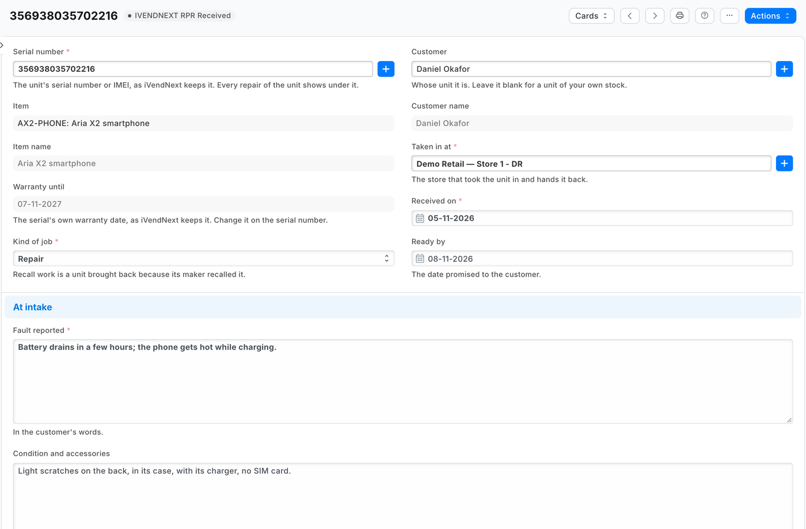

# S58 — Repairs by serial number (`pp_rpr`)

An electronics or phone store's repairs and services, kept in iVendNext Desk against each unit's serial number (or IMEI): what the customer says is wrong, the unit's condition and what came with it, the tests run and their results, the work done and the parts fitted, from the counter to the hand-over. Every repair shows under its serial number, so the unit's service history is one list, and a repair slip with a unit tag prints under the retailer's own letter head. The parts leave stock with the engine's own Material Issue, which names the repair. The app moves no money: the till charges the repair as a service item. It calls nothing outside.



**Industries:** Electronics and phones

**When to use it:** a store repairs or services the units it sells (phones, laptops, appliances), and its repair jobs are on paper or in a separate system today.

## Start from it

```bash
ivn new acme_repairs --from s58
```

## What to change

What a partner usually changes:

- the repair's fields, tests and parts: the `PP RPR Repair` record type and its tables `PP RPR Test` and `PP RPR Part` in `manifest.json`;
- the steps and who moves them: the workflow's states and `allowed` roles in `manifest.json`;
- what a collected repair locks: `locked_fields` of the save rule;
- the slip and the unit tag: the print format *PP RPR Repair slip*, the repair's default;
- the queue: the report *PP RPR Open repairs*;
- the repair's number: the naming series `RPR-`, in the repair's `autoname`.

More: the [recipe](../../recipes/repairs_by_serial.md), which also walks a store through a recall by serial, with no app.

**The customer sets:** *Read* on Serial No for Sales User and Sales Manager in Role Permissions Manager, so the counter's form shows the serial's item and warranty date; who holds Sales User at the repair counter and Stock User for the parts; a Stock Entry Type named *Material Issue* if the site has none; and its name and address on the Letter Head the slip prints under.

## Run it

```bash
ivn check
ivn try
```

## Versions

### 0.1.2

- The repair slip says *Taken in at* with the store's own name (a read-only *Store name* field), not the warehouse's record name with the company suffix. A slip saved before the update prints the old name until it is saved again.

### 0.1.1

- A repair for a customer made in Desk shows that customer's Mobile No in a new *Customer's mobile* field (Desk hides *Customer's phone* while it is empty).
- *Print* opens the repair slip, not the plain layout (the repair's default print format).

### 0.1.0

- First version in the kit: repairs recorded against each unit's serial number, from a manifest only.
