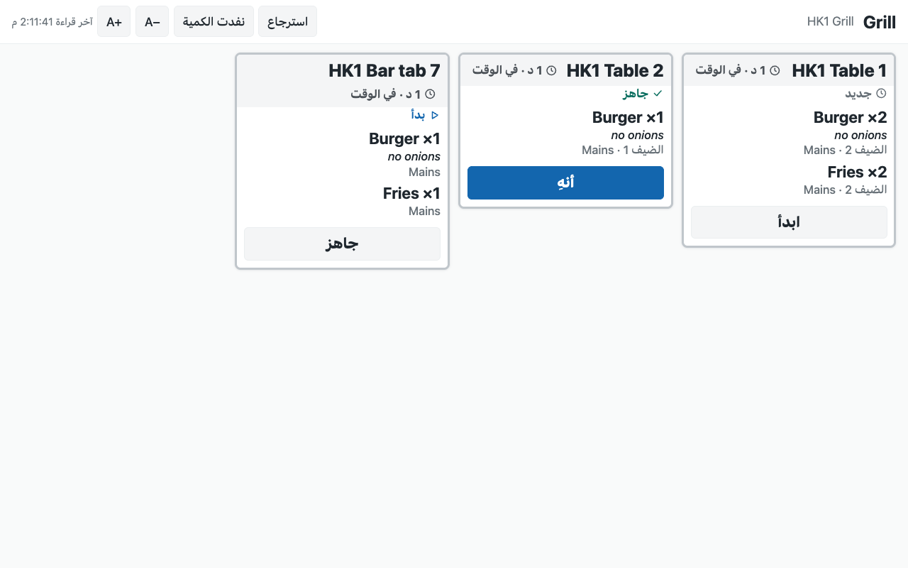

# S59 — Kitchen screen (station screens, an expo and a Now serving board)

*Start from this sample: `python3 tools/manifest/start.py s59_kitchen_screen --prefix "ACME KSC"` copies it into `apps/` of your repository under your own prefix (your company's first word, then a short name for the app) and checks it ([how](../../recipes/make_it_your_own.md)).*

## What the retailer does

The kitchen runs from screens instead of paper. When a till presses *Send*, each kitchen station's ticket shows on that station's screen, oldest first, with how long it has waited. A cook taps it **Start**, then **Ready**, then **Bump**. At the pass, an expo screen shows every station's tickets of one order together and adds up what is still to make. A *Now serving* board in the dining room or at the counter shows the call numbers that are ready. A cook can mark a dish **sold out** at the store, and the tills stop selling it at once (a sale at a till is refused; a dish an app adds to an open check, such as guest ordering, is refused only when the check is paid). The app never voids, comps, changes a line or touches money.

| What happens | When |
|---|---|
| A screen's **link** is made | the manager presses **Make link** on a *PP KSC Screen* record (or on several ticked in the list), then opens the record's link on the screen's browser, full screen |
| A **station screen** shows its stations' tickets: the table or call number, the till, the time waited, each dish with its quantity and its choices under it, the guest and course, the note, the allergen line | a till sends a sale or a table's check with a dish of that station. The screen reads the board every 3 seconds |
| The timer turns **amber** (*Late soon*) then **red** (*Late*) | the store row's *Warn after* and *Late after* minutes pass (8 and 15 unless set); an icon and a word show it as well as the colour |
| One tap moves a ticket **one step**: *Start*, *Ready*, *Bump* | a cook taps the ticket's button. A double tap moves it once; a skip or a step back is refused |
| A **void** ticket shows *Void: stop making* and its dishes struck through | a manager voided a line the kitchen had, at the till. The cook stops it, then bumps it like any ticket |
| **Recall** shows the tickets bumped in the last 30 minutes | a cook wants to read one again. A bumped ticket cannot be moved back |
| The **expo** shows one card per order with each station's part, and a strip *Still to make: 6× Fries · 4× Burger* (whole dishes up to a quarter of the screen, then *+N more dishes*) | an order's tickets are on the board. *Bump order* appears when every station's part is ready, and bumps them all |
| The **Now serving** board shows *Preparing* and *Ready* call numbers | a counter sale's tickets are on the board (tables' checks too when the store row's *Board shows tables* is ticked). A number leaves when its order is bumped |
| A dish is **sold out at this store** until cleared | a cook taps *Sold out* on a station or expo screen and marks a dish on its own stations' tickets (the expo: any station's), or clears one already out. Only when the store row's *Sold out from the screens* is ticked |
| The old link **stops working** (within 15 seconds); the new one works | a link leaked: press **Make link** again and open the new link on the screen |
| The screen says its link was replaced | the screen's kind, store or stations changed since its link was made, or *Make link* was pressed again |

**No guest data kept.** A ticket carries the dishes, the place or call number and the till; no customer's phone or e-mail, and no price. A tab's name is shown as typed at the till (on the *Now serving* board too when *Board shows tables* is ticked): the app adds no name of its own. The service keeps nothing: the till's tickets are the record.

| What the kitchen and the counter see (a test store, the light look) | |
|---|---|
| A station screen on a tablet in landscape: the grill's tickets, oldest first, each with its timer |  |
| The expo at the pass: each order's tickets together, what is still to make |  |
| The *Now serving* board on a TV |  |
| The station screen in Arabic: the English note and dish names on the same right-hand edge as the screen's words |  |

## What the retailer does to set it up

**Before you install:** every `host.docker.internal` address in `manifest.json` (in `allowed_urls`, and in the service) is our test bench's own address for the sample's service, and it resolves only where Docker provides it. Replace it with your own service's address first, or iVendNext's calls never reach your service; if this manifest is already installed, raise its `version` and install it again.

1. Install `manifest.json` (the retailer's administrator, on the install screen; on your sandbox, `tools/deploy/deploy.py`). It adds `PP KSC Settings` and its table `PP KSC Store`, `PP KSC Screen` and its table `PP KSC Screen Station`, the roles **PP KSC Manager** and **PP KSC Integration**, the button *Make link* and its service (switched off), and the feed registration *PP KSC Kitchen screen feed* (leave it off). The install also makes the app's own user, `pp_ksc@integration.invalid`, holding PP KSC Integration alone.
2. **The kitchen.** The stations are the till's own *Kitchen Stations* in Desk; each dish reaches its station by the station on the item, its item group or the register. The register that sends (POS Profile) needs a printer row for each station: a ticket is written only when the station's printer takes it. *Table Service* on the register for tables' checks.
3. **The app's user, in this order** (User `pp_ksc@integration.invalid`): keep *Is Desk User* and tick **Is POS User**; choose a **Shift Profile** (any: it never opens a shift); link a **Retail Permission** with **May Work a Kitchen Screen** (group *Open Checks*) and nothing else: a new Retail Permission may come with another right ticked (*layaway*), untick it; add **one row for each store** to the store access table (each store once), with a register there; **Save**; then **Generate Keys**. Without *Is POS User* the save drops the store row and every screen says it cannot read the tickets. ⚠ A user who ever enrolled a till device is refused: use this user for this app only.
4. **Sold out, only if you want it:** in **Role Permissions Manager**, give **PP KSC Integration** **Read**, **Write** and **Create** on *Retail Item Availability*. ⚠ The till does not limit that right to the user's stores: it lets the user mark any store's items. The app itself marks only the screen's own store, and only a dish on that screen's board or already sold out there.
5. Give **PP KSC Manager** to the people who make the screens, with **Select** on *Kitchen Station* and *Warehouse*. A manager of one store gets a **User Permission** on *Warehouse* for that store, so their screens reach that store alone; it scopes every store-linked record they open across the site, as for any user kept to one store.
6. Make a **PP KSC Settings** record for the company: a row per store with *Sold out from the screens* (off unless ticked), *Warn after* and *Late after*, the screens' look (*Dark* or *Light*), an accent colour (`#rrggbb`), the screens' language, *Ticket size* (*Standard* to start) and *Board shows tables*.
7. In **Retail Extension Subscription**, open *Make link service*, read what it is sent, tick the consent and switch it on; switch the button on in **Retail Desk Action**. Press **Connect again** on the app's package record if the site could not reach the app, or the key was made after the install.
8. Make a **PP KSC Screen** for each screen: its name (shown at its top), its kind (*Station*, *Expo* or *Board*), its store, and for a station screen its stations. Press **Make link**, and open the link on the screen's browser in full screen (a kiosk browser, so its address is not on show): anyone with a station screen's link can move its tickets until *Make link* is pressed again.

**On the screen.** Every size on a screen follows the screen: about 4 tickets across a 10-inch tablet held sideways, 5 on a TV, 2 on a tablet held upright, 1 on a phone. **A−** and **A+** in the screen's top bar make its tickets smaller or larger (*Compact*, *Standard*, *Large*, *Extra large*); the choice is kept on that device and wins over the store's *Ticket size* there. The screen never scrolls: it shows whole tickets only, oldest first, and the rest wait behind *+N more tickets* and the page buttons (a page button turns red while a ticket on another page is late; the screen goes back to its first page a minute after the last touch). A ticket taller than the screen shows its first dishes and *+N more dishes* (or a dish's first choices and *+N more choices*): a tap shows the whole ticket. Only a ticket whose one dish (or, on the expo, a void) is taller than the screen scrolls inside itself, so its button stays in reach. The *Now serving* board counts the numbers that do not fit (*+N*). A retailer's words keep the screen's own reading edge: an English note on an Arabic screen sits on the right, with the dishes.

**Before you remove the app:** nothing to close: the tickets are the till's. A reinstall makes new secrets: make every screen's link again. A new secret on the *Make link service* is accepted beside the old one until the next *Connect again*.

**Limits.** A dish marked sold out stops a till's sale, but a dish an app adds to an open check (guest ordering) is refused only when the check is paid, and a till that is offline sells it until it syncs. A screen keeps itself awake where the browser allows it; set the tablet never to sleep, or use a kiosk browser that does. A ticket is on the board only when its station's printer took it from the till: a station with no printer on the sending register, or a printer that refused, has no ticket. A screen needs the internet: tickets a till printed while the store was offline are on paper only, and never reach the board. A ticket the till's print agent later reports unprinted leaves the board without a bump (its dishes come back on the next *Send*). A screen reads the board every 3 seconds, so a new ticket shows within about 4 seconds; with the live service running beside the service (below), a screen hears of a new ticket within about a second and reads every 10 seconds as well, and whenever the live service is stopped or cannot reach the site the screen reads every 3 seconds again, saying nothing about it. After a lost connection a screen has caught up on its next read, and its corner shows *Last read* in amber when its last good read is older than 15 seconds. A recalled ticket is shown again, never moved back to ready. Sold out needs the item-availability right, which covers every store; a dish marked and then cleared at one store keeps that store's own row, which wins over a later sold out for every store. If the sold-out read is refused (the right missing), the screen keeps showing its tickets and hides *Sold out*. The App library's hosted copy serves every retailer from at most 10 copies at once; the screens of one store share one read. The board's call numbers are the till's: a sale's call number, or a check's place or tab name. Allergens show only where the store's receipt theme shows them.

## What leaves the retailer's iVendNext

iVendNext calls nothing outside but the service's own address (`allowed_urls`), on a press of *Make link*: the pressing user's login and language, and the records' names. The screen's browser calls the service directly with the screen's link, and, when the live service runs, opens a line to it with the same link. The service then **reads**, as the app's own user: the screen record, the store's row in the settings, the store's kitchen board (`station_tickets`) and, when sold out is on, the store's sold-out items (`item_availability`); and **writes**: a screen's number and link, a ticket's next step (`station_ticket_move`) and a dish's sold out at the screen's store (`set_item_availability`). No guest's name, phone or e-mail; no money.

**The live service, when it runs** (`live/`): while a screen is open, it holds the site's own live channel (its socket), signed in as the app's own user with the key the service keeps, and passes on only `{store, station}` from `mpos_station_ticket`: a notice to read again, never a ticket (the socket brings it every event the site sends that user; it drops the rest). When a screen opens its line (and every 5 minutes after), it reads that screen's record and its store's row, as the service does. When the socket refuses the site's address as its name, it reads the site's Desk page once, as the app's user, for the site's own name. It writes nothing.

## The live service (`live/`)

A screen's page asks the service for the board every few seconds, which is what the till's door asks for when no live channel is held. `live/live.py` is a small always-on service beside it (a container: `live/app.json`, `live/Dockerfile`, built from the kit's root) that makes a new ticket show within about a second:

- The screen's page opens one line to it (`POST /ksc/live` with the screen's link in the body, never in an address) when the board's answer names it (the service's `KSC_LIVE_URL`; the page's content policy then lets it reach that one address). The line is admitted by the service's own check of the link (`Service.opened`: the signature, the record's number, what it was made for, the store's row) and carries no ticket: only *the store's channel is up* or *down*, *read now*, and, every 5 minutes, *open me again* (checked again).
- It opens the site's socket (`live/sitesocket.py`, the long-polling transport over plain HTTPS, standard library only) when a screen of that retailer opens its line, and closes it a minute after the last one. A notice for a store wakes that store's screens, no other's. A socket that drops says so to the screens (they read every 3 seconds again) and, back up, every screen reads once for what it missed.
- It reads each retailer's key from the service's own table and never writes it; on CitiXsys hosting the container may read that table and nothing else. It never prints a key, a link or a body.

Without it, nothing changes for a retailer: the screens read every 3 seconds. While it is up, each screen still reads every 10 seconds (some changes send no notice).

**Its bounds.** A link made again stops hearing within 5 minutes 15 seconds (its line's life plus the service's 15-second keep; the line carries no ticket in the meantime). A key replaced by *Connect again* ends the socket signed in with the old key when the next screen of that retailer opens its line, within 5 minutes while a screen is open. A line that goes silent without closing (a tablet changing networks) is given up after 30 seconds, and a socket the site stops answering after about 50; until then that screen reads every 10 seconds. One copy holds at most 2,000 lines (300 for one retailer) and 2,200 connections; past them a screen is refused and reads every 3 seconds. When a site's socket refuses its address, the Desk page is read for the site's name: a Desk page read whole that names no site is read again at most every 30 minutes, and one that could not be read (or a small page the site's edge served instead) at the socket's own back-off, at most once a minute while a screen is open.

**A hosted site's name is not always its address.** The socket's namespace is the site's own name, `/<site name>`, and a hosted site can answer at one address while it names itself under the hosting's domain (a sandbox measured 2026-10-30 did). The socket then refuses the address with *Invalid namespace*; read the name once from the site's Desk page (`/app`, with your user's key): its boot data carries `"sitename"`. `live/live.py` does both. The station-ticket page (`contracts/pages/station_ticket.md` §6, copied from the till's own) does not say so yet.

## Run it

```bash
python3 -m unittest discover -s samples/s59_kitchen_screen/tests -p 'test_*.py'   # the service with a stand-in site
python3 samples/s59_kitchen_screen/tests/canaries.py                                # each guard turned off: its test goes RED (needs node)
python3 tools/check/check.py samples/s59_kitchen_screen                            # the retailer's own install checks
bash kit/design/tools/check_kit.sh samples/s59_kitchen_screen/service/page.html     # the page's kit checks
python3 tools/app_template/validate_app.py samples/s59_kitchen_screen/live           # the live service's settings and image
```

The tests drive the service with a stand-in site. The page's own rules run in `tests/test_page.py` through `tests/page_harness.js`, a small stand-in for the browser with a simple layout (it needs `node`; without it those tests skip and their canaries report GREEN): the size steps and what the device keeps, whole tickets and paging, folding a tall ticket, the strip and the board's counts, the held refusal, the tap hold, the retailer's words in `<bdi>`. How it looks was walked in a browser on our bench after the review's folds (two taps at once, the refusal held six seconds; Arabic, right to left, with real tickets), and the page check's contrast and right-to-left passes run on the page before it has read a board.

The service: `python3 service/app.py service/.env.local` for one store (the env file names the app's user's key, the *Make link* secret the install handed back and the page's address), or as a function on CitiXsys hosting for many (`app.json`). It serves the screen's page itself (`service/page.html`, `page.js`, `page.css`, and its pinned copy of the kit's `ivn-kit.css` and `ivn-kit.js`: no inline script, nothing from another site). The live service: `IVN_LIBRARY_APP=… KSC_PREFIX=… KSC_PAGE_URL=… IVN_SHOPS_FILE=… python3 live/live.py` beside a service that serves many retailers (it reads the same store of retailers), and `KSC_LIVE_URL` on the service names where the screens reach it.

## Make it your own

What a partner usually changes: the ticket's layout and its languages (`page.css`, the `WORDS` table in `page.js`), the timers' colours, a bump bar or a foot pedal, and the screens' sounds. The live service (`live/`) is the path that tells screens at once (the station-ticket page §6); it runs beside a service that serves many retailers (it reads the same store of retailers), or not at all. Give its `live/app.json` your own app name too: `start.py` renames the sample's names, not that one. The prefix the service reads is `KSC_PREFIX` (`IVENDNEXT KSC` for the App library's copy).
