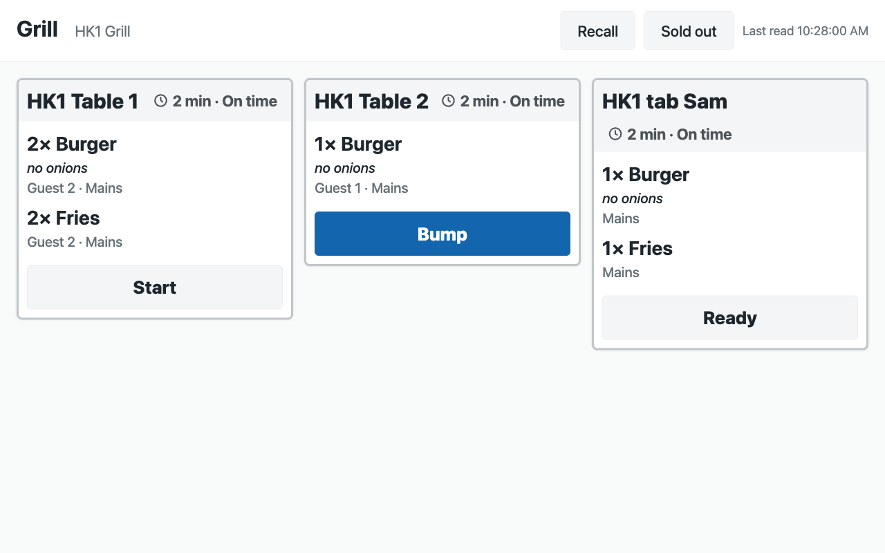

# S59 — Kitchen screen (station screens, an expo and a Now serving board)

The kitchen runs from screens instead of paper. When a till presses *Send*, each station's ticket shows on that station's screen, oldest first, with how long it has waited. A cook taps it **Start**, then **Ready**, then **Bump**. At the pass, an expo screen shows every station's tickets of one order together and adds up what is still to make. A *Now serving* board shows the call numbers that are ready. A cook can mark any dish **sold out**, found by name before anyone orders it, and the tills stop selling it at once. A ticket shows the sale's service mode (*To go*). The app never voids, comps, changes a line or touches money.



**Industries:** Hospitality

## Start from it

```bash
ivn new acme_kitchen --from s59
```

## What to change

What a partner usually changes:

- **The ticket's look and languages:** `service/page.css` and the `WORDS` table in `service/page.js`.
- **The timers:** *Warn after* and *Late after* (8 and 15 minutes unless set), *Ticket size*, *Board shows tables* and *Sold out from the screens* on each row of `PP KSC Store` in `manifest.json`.
- **The screens:** `PP KSC Screen` (kind *Station*, *Expo* or *Board*, its store and its stations) in `manifest.json`.
- **Hearing a ticket within a second:** the always-on service in `live/` (`live/live.py`, `live/app.json`), reached through `KSC_LIVE_URL` on the service. Without it each screen reads every 3 seconds.
- **The record types' names:** `KSC_PREFIX` for the service.

More: the [recipe](../../recipes/kitchen_screen.md).

**The customer sets:** the stations as the till's own *Kitchen Stations*, each station listed on the register that sends (under *Kitchen Printers*, with its printer, or with none for a screen only), one `PP KSC Settings` record for the company with a row per store, the role **PP KSC Manager** for whoever makes the screens, and one `PP KSC Screen` for each screen, with **Make link** pressed and the link opened full screen on its browser. The manifest's `role_rights` give **PP KSC Integration** *Read* on *POS Profile* and *Item* (a ticket in the store's usual service mode shows no pill; a cook finds any dish by name). Only for sold out, give it *Read*, *Write* and *Create* on *Retail Item Availability*. The app's user needs a Retail Permission with only **May Work a Kitchen Screen**.

## Run it

```bash
ivn check
ivn try
```

## Try it at the till

- In Desk, press Make link on a station's screen and open the link in a browser.
- Send a check from the till; its ticket shows on the screen. Tap Start, Ready, Bump.
- Close the till day when you are done.

## Versions

### 1.3.2 (manifest 0.3.1)

- `role_rights` give **PP KSC Integration** *Read* on *POS Profile* and on *Item*: the install does what the retailer's administrator did by hand. The write on *Retail Item Availability* stays the retailer's choice.
- The words say a station with no printer is a kitchen screen: list it on the sending register's *Kitchen Printers* with no printer; offline, its tickets print on the till's paper and are not on the screens.

### 1.3.1

- A ticket in the mode every register of the store defaults to shows no pill (the till stamps a mode on every sale), so *To go* stands out. Registers that default to different modes keep every pill. The app's role needs *Read* on *POS Profile*; without it every ticket keeps its pill.

### 1.3.0

- A cook finds any dish by name in *Sold out* and marks it before anyone orders it (the app's role needs *Read* on *Item*; without it the list keeps the board's dishes and says why).
- A ticket and an expo card show the sale's service mode, as the till names it (*To go*).
- When *Available again* leaves a dish sold out (head office has it sold out for every store, or it is outside the store's own hours), the row says so, and why.

### 1.2.0

- The set-up words say the install switches the feed on and gives the role its reads (POS build `2.1.0.691` or later). The app does what it did.

### 1.1.1

- A cook's quick second tap goes through.

### 1.1.0

- Kitchen screens update within a second, through a small always-on service beside this one (live/).
- The sold-out list names a dish no ticket on the board names, by its item name.
- Each setting in app.json says its purpose (the line the Settings screen shows), whether it is required, and which settings go with it.

### 1.0.0

- First version in the kit: station screens, an expo and a Now serving board that fit the screen.
