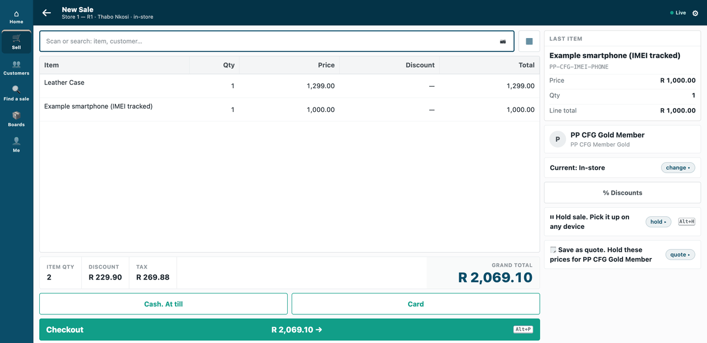
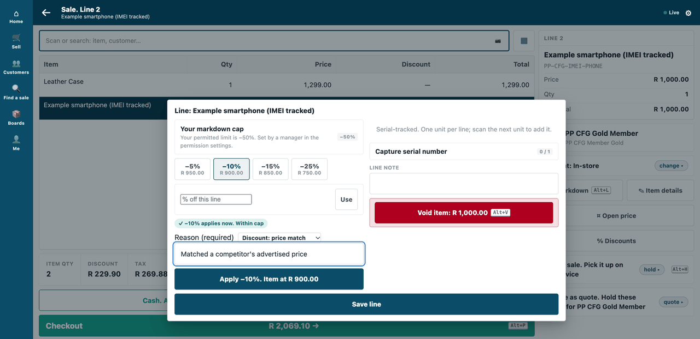
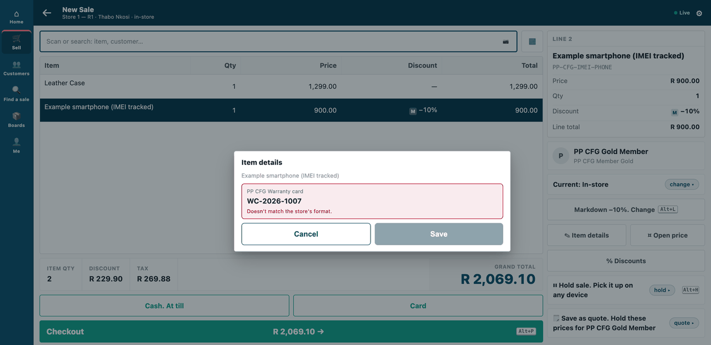
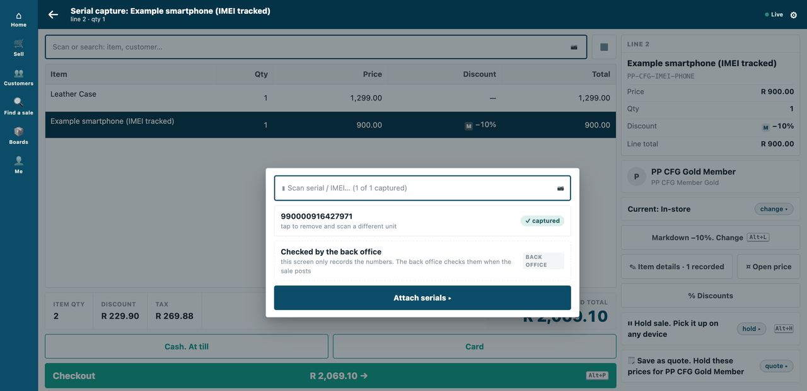
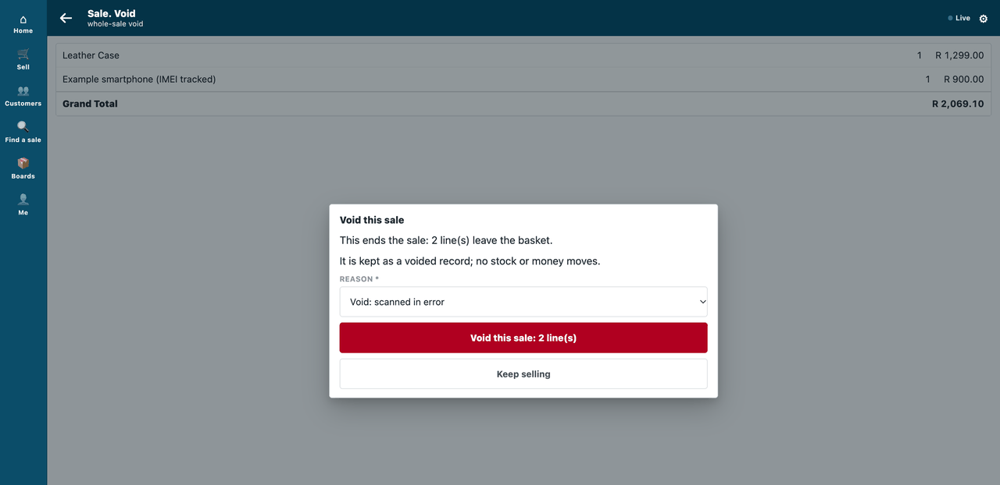

# S5 — the configuration pack: reasons, IMEI, a line detail, member pricing


*What the cashier meets once the pack is applied: a member's price, a reason for a markdown, a checked line detail, a phone's IMEI and a reason for a void.*

Nothing here is code. The pack switches on what iVendNext already has: the till asks for and keeps a coded reason, tracks a phone by its IMEI, captures one more detail per line, and prices members differently. It is for an iVendNext Partner or a retailer's administrator who wants that set-up as one data file they can apply, test and repeat on the next retailer.

Configuration only, applied by a script over the record API and written up as a recipe: [`recipes/configure_no_code.md`](../../recipes/configure_no_code.md).

**When to use it:** what the retailer needs is already in iVendNext and only has to be switched on and filled in.

## What it looks like

The customer, the item and the reasons are the sample's own (`PP CFG …`, in `config.json`). The sale was voided at the end, so nothing was sold.

| Step | Frame | Screenshot |
|---|---|---|
| 1. The gold member's 10% (a promotion for the member group): R 229.90 off the basket, in the totals | the till, 1440 wide |  |
| 2. A 10% markdown on the phone asks for a reason; *price match* also asks for a comment | the till |  |
| 3. The line detail *Warranty card* refuses a value that does not match its pattern (`WC-` and eight digits) | the till |  |
| 4. The phone's IMEI, captured before it can be charged | the till |  |
| 5. A void asks why, and keeps the voided sale on record | the till |  |

## What the retailer does

A retailer that wants these behaviours at its till does this, in the order it meets it. The retailer's administrator, or the partner working for it, does it once:

1. **Make the set-up the retailer's own.** Open `config.json` and change the names, codes and numbers to the retailer's: the reason codes (void, item return, sale return, sale discount, item discount), the item to track by IMEI and its IMEIs, the line detail and its pattern, and the member group and its discount. The sample's names start with `PP CFG` only so its own test can find them again.
2. **Make sure iVendNext has a default Company.** A sale of an item tracked by serial number takes its company from it.
3. **Give the script a key.** The key belongs to a user who may edit those records; the retailer's own roles System Manager, Retail Manager, Item Manager, Stock Manager and Sales Master Manager together are enough. It is the administrator's, used once.
4. **Run it.** `apply_config.py` sets, in the retailer's own settings: the **Reason Code Master** rows and the matching switches in **Retail Setting**; the item (**Has Serial No**) with a price and its IMEIs received into stock; a **Transaction Item Attribute** for the line detail; and a **Customer Group** per member tier with one promotion for it, and an example member. Run twice, nothing doubles. The same things can be set by hand in those Desk screens: the [recipe](../../recipes/configure_no_code.md) lists each one.
5. **Nothing for the cashier to learn.** The till offers the reasons it finds, asks for a tracked item's IMEI, offers the line detail, and applies the member promotion when the member is on the sale.
6. **To undo it,** add `--remove`. It puts the switches back and deletes what it made (a record a booked sale points at is retired instead). It does not undo the stock: the item, its price, the unsold serial numbers and the submitted receipt stay.

**Where it shows.** At the till: the member's price in the totals, a reason (and a comment for *price match*) on a markdown, the line detail refused when it does not match its pattern, the IMEI asked for before a phone is charged, and a reason asked for on a void. In Desk: iVendNext's own screens named above. No report, print layout or number card.

**What leaves the retailer's iVendNext.** Nothing. There is no service and no outside address. The script runs once on the administrator's own computer and calls the retailer's own record API with the administrator's key; it writes a small file, `.s5_before.json`, beside itself so `--remove` can restore the earlier values.

## The files

| File | What |
|---|---|
| `config.json` | the whole set-up as data: five reason codes and their switches · one IMEI-tracked item with three IMEIs · a line detail with a pattern · a member tier |
| `apply_config.py` | applies it (idempotent) · `--remove` undoes it · standard library only |

## Run it

```bash
PP_BASE=https://shop.example PP_KEY=<api key> PP_SECRET=<api secret> python3 samples/s5_config_pack/apply_config.py
```

Run it twice and nothing doubles. Add `--remove` to undo it.

## Before you build on it

- **The member discount is a promotion,** not a pricing rule: this version of iVendNext refuses selling pricing rules.
- **The member price follows the customer's group.** The till's edit sheet lets a cashier change a customer's group, so a cashier could give a non-member the member price. A retailer that must prevent it puts Customer Group at a permission level only its managers write ([S47](../s47_customers_by_store/README.md), step 3).
- **What it does not show.** It hides or requires no till field, refuses no wrong detail when the record is saved, and adds no wallet. Each has shipped as its own extension point: field rules ([S21](../s21_field_rules/README.md)), save rules ([the recipe](../../recipes/save_rules.md)), a partner wallet ([S22](../s22_customer_loyalty/README.md)). A card check has not shipped.

## Technical notes

### The walk

The GIF: nothing here is code: after `apply_config.py`, the till itself gives the gold member their price, asks for a reason (and a comment) on a markdown, checks a line detail against its pattern, asks for the phone's IMEI, and asks why a sale is voided. Frame: the till (`/pos?frame=terminal`, 1440 wide). Walked on our test bench on 2026-10-10, iVendNext POS app at `87812e141`. Built from the same screens as the stills below; every frame is cut above the till's key row.

The cashier is the bench's *Thabo Nkosi*; the customer, the item and the reasons are the sample's own (`PP CFG …`, in `config.json`).

### The tests

| File | What |
|---|---|
| *our test bench's own run (not in the kit)* | the bench tests: read back, till sales through the till's own calls, apply twice, remove |

### Why this way (R6)

*A script over the record API reading one JSON file* (picked: ~170 lines; any retailer's administrator reads it; the same file is the documentation) · *clicking it through in Desk* (rejected: nothing to test, nothing to repeat on the next retailer) · *a manifest* (rejected: a manifest may not touch the retailer's own settings or its stock).

### Not used here

Shipped, and left out because this pack is settings only: hiding or requiring a till field (P-FIELDS, [S21](../s21_field_rules/README.md)), a rule that refuses a wrong detail on save (P-RULES, [the save rules recipe](../../recipes/save_rules.md)), a wallet (P-WALLET, [S22](../s22_customer_loyalty/README.md)). Not shipped: a card check (P-CARDSET). The member discount is the promotion engine's, not a pricing rule (selling pricing rules are refused at this pin).
