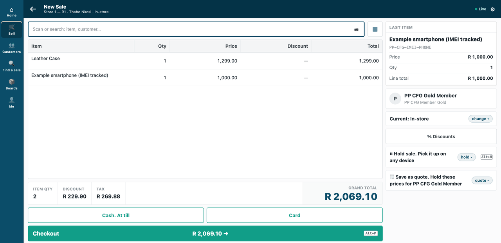

# S5 — the configuration pack: reasons, IMEI, a line detail, member pricing

Nothing here is code. The pack switches on what iVendNext already has: the till asks for and keeps a coded reason, tracks a phone by its IMEI, captures one more detail per line, and prices members differently. The whole set-up is one data file, applied by a script, so it can be tested and repeated on the next retailer.



**Industries:** Electronics and phones

**When to use it:** what the retailer needs is already in iVendNext and only has to be switched on and filled in.

## Start from it

**Set in Desk first: no app needed.** The same settings can be made by hand in iVendNext Desk, or applied from `config.json` by `apply_config.py` with an administrator's API key.

## What to change

What a partner usually changes:

- `reasons` and `reason_flags` in `config.json`: the reason codes (void, item return, sale return, sale discount, item discount) and the matching switches.
- `imei_item`: the item to track by IMEI, its price and its IMEIs.
- `line_attribute`: the line detail and its pattern.
- `member_tiers`: the member group and its discount.

The sample's names start with `PP CFG` only so its own test can find them again; use the retailer's own. Run twice, nothing doubles; add `--remove` to undo it (the item, its price, the unsold serial numbers and the received stock stay).

More: the [recipe](../../recipes/configure_no_code.md).

In a package these rows go under `records` ([the manifest recipe](../../recipes/manifest.md)); the engine's settings (Retail Setting, Stock Settings), a Stock Entry and a Customer stay here.

**The customer sets:** a default Company in iVendNext, which a sale of a serial-tracked item takes its company from, and an API key from a user who may edit these records (System Manager, Retail Manager, Item Manager, Stock Manager and Sales Master Manager together are enough).

## Run it

```bash
PP_BASE=https://shop.example PP_KEY=<api key> PP_SECRET=<api secret> python3 samples/s5_config_pack/apply_config.py
```

## Versions

### 1.0.0

- First version in the kit: reasons, IMEI, a line detail and member pricing, set as configuration.
