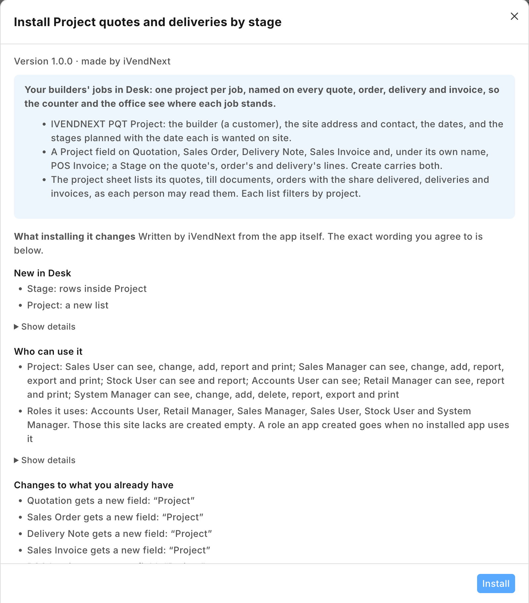

# S60 — Project quotes and deliveries by stage (`pp_pqt`)

A hardware or DIY store's builder projects, kept in iVendNext Desk. A builder buys for a job: the store quotes the job's materials, the builder takes all or part of the quote, and the goods go to site as the work reaches each stage, over months and several orders. iVendNext already quotes, orders, takes deposits and delivers an order in parts; what nothing holds is the builder's project. This sample adds one record per job, a **Project** field on the quote, the order, each delivery and the invoice, a **Stage** on their lines, and a **project sheet** that lists the job's documents together. The app moves no money and no stock, and calls nothing outside.



**Industries:** Hardware and DIY

**When to use it:** a store sells to builders or contractors whose jobs run over several quotes, orders and deliveries, and today it keeps the job on paper or in the builder's purchase order numbers.

## Start from it

```bash
ivn new acme_projects --from s60
```

## What to change

What a partner usually changes:

- the project's fields and stages: the `PP PQT Project` record type and its table `PP PQT Stage` in `manifest.json`;
- the project and stage fields on the documents: `custom_fields` in `manifest.json` (one field name on every document carries the project down Desk's own Create chain; the till's POS Invoice has a field of its own name);
- the project sheet: the print format *PP PQT Project sheet*, which reads each document type with `ivn_rows`;
- the project's number: the naming series `PQT-`, in the project's `autoname`.

More: the [recipe](../../recipes/project_quotes.md).

**The customer sets:** who keeps the projects: Sales User for the trade desk, Stock User for whoever sends goods out, Accounts User for accounts and for naming a booked till sale's project, and Retail Manager to see every section of the sheet; and its name and address on the Letter Head the sheet prints under.

## Run it

```bash
ivn check
ivn try
```

## Versions

### 0.1.2

- *Print* on a project opens the project sheet: the manifest makes *PP PQT Project sheet* the record's default print format (a `default_print_format` property setter), so the sheet prints without picking it from the list.
- Desk shows plain names (Building project, Building project stage, Project sheet) through the manifest's `translations` block, so a search for *building project* finds the record. The stored names are unchanged: an installed site keeps its records.

### 0.1.1

- The project sheet shows the store's own name (a read-only *Store name* field), not the warehouse's record name with the company suffix. A sheet saved before the update prints the old name until it is saved again.

### 0.1.0

- First version in the kit: a builder's project across its quotes, orders and deliveries in stages, from a manifest only.
