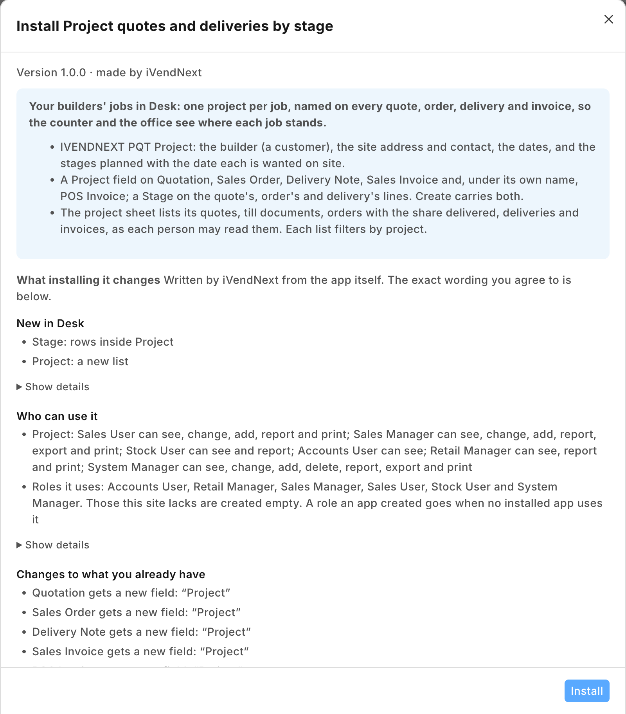
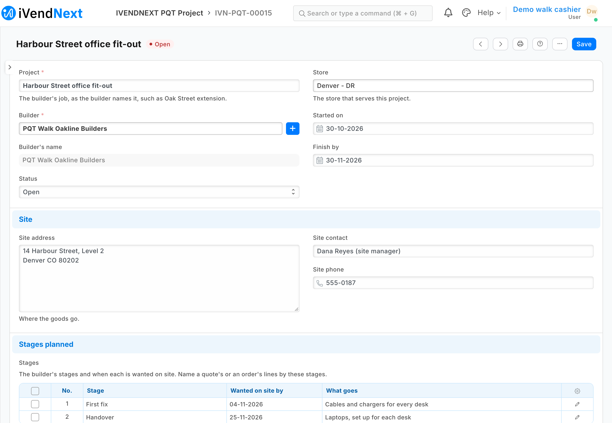
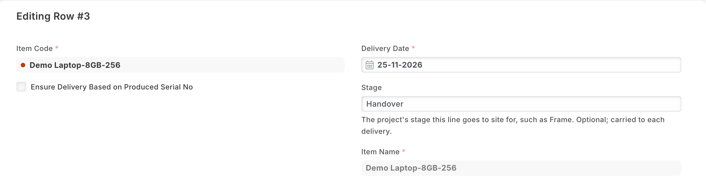
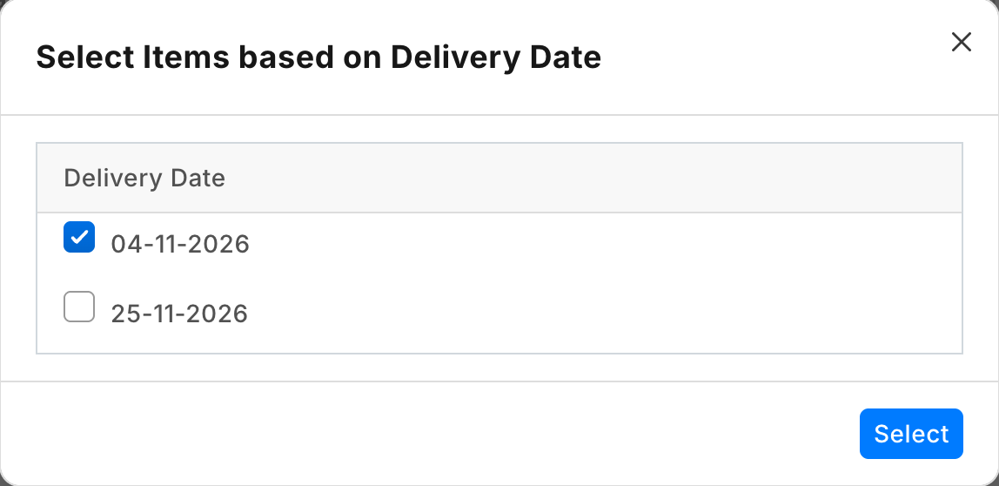
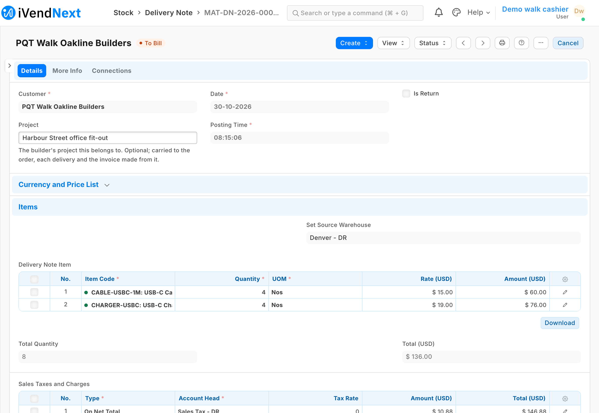
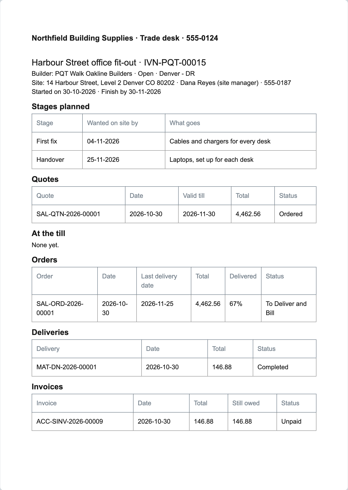

# S60 — Project quotes and deliveries by stage (`pp_pqt`)

*Start from this sample: `python3 tools/manifest/start.py s60_project_quotes --prefix "ACME PQT"` copies it into `apps/` of your repository under your own prefix (your company's first word, then a short name for the app) and checks it ([how](../../recipes/make_it_your_own.md)).*

A hardware or DIY store's **builder projects**, kept in iVendNext Desk. A builder buys for a job (a house, an extension, a store fit-out): the store quotes the job's materials, the builder takes all or part of the quote, and the goods go to site as the work reaches each stage, often over months and several orders. iVendNext already quotes, orders, takes deposits and delivers an order in parts, at the till and in Desk; what nothing holds is **the builder's project**. This sample adds it: one record per job, a **Project** field on the quote, the order, each delivery and the invoice (and one of its own on the till's sales and orders), a **Stage** on the lines of the quote, the order and each delivery, and a **project sheet** that lists the job's documents together. The app moves no money and no stock, and calls nothing outside: no service, no outside address. The [recipe](../../recipes/project_quotes.md) walks a store through it.

It uses the manifest's `doctypes` (a record type and a child table), `custom_fields` (the project on four documents and on the till's own, the stage on three line tables), `print_formats` (the project sheet, reading the documents with `ivn_rows`), `links` and a `documentation` property setter. **When to use it:** a store sells to builders or contractors whose jobs run over several quotes, orders and deliveries, and today it keeps the job on paper or in the builder's purchase order numbers.


| What the store sees (a demo store, the library copy *IVENDNEXT PQT*) | |
|---|---|
| What installing it changes, read before the install |  |
| A project: the builder, the store and the dates, the site and its contact, and two stages with the date each is wanted on site |  |
| A sales order line: its delivery date and, beside it, the stage it goes to site for |  |
| Desk's delivery dates on the order: the first stage's date ticked, the later one unticked |  |
| The delivery note made from it: the project, and only the first stage's lines |  |
| The project sheet under the store's letter head: the stages, the quote, the order two-thirds delivered, the delivery and the invoice still owed |  |

## What happens

1. **The project.** The trade desk opens **PP PQT Project** in Desk, **+ Add**: the **Project** as the builder names it (*Oak Street extension*), the **Builder** (a customer; the builder's name shows beside it, read only), the **Store** that serves it, **Started on** and **Finish by**, the **Site address**, **Site contact** and **Site phone**, and the **Stages planned**: a row per stage with the date it is **Wanted on site by** and **What goes** (*Foundations, blocks and cement*; *Frame, timber*). Save: the project is numbered `PQT-00001` and is **Open**.
2. **The quote.** In Desk, a **Quotation** to the builder: choose the **Project**, and on each line type its **Stage** (*Foundations*, *Frame*). The builder accepts all or part of it.
3. **The order.** On the quote, **Create › Sales Order**: Desk's own Create carries the project and every line's stage to the order. Give each line its own **Delivery Date** (the stage's date); the order's own **Delivery Date** becomes the last of them.
4. **Staged deliveries.** When the first stage is due, on the order **Create › Delivery Note**: Desk asks which delivery dates to send, every date still to deliver ticked; untick the dates not yet due and press **Select**. Desk takes only the lines of the ticked dates, with the project and their stage. The order reads *partly delivered*. The next stage's delivery takes the lines of its own date; each delivery's own **Create › Sales Invoice** carries the project too.
5. **The till.** A sale or an order rung at the till for the builder is a **POS Invoice** in Desk. Once it is booked, an **Accounts User** (Sales User reads no till document) opens it from the POS Invoice list and chooses its **Project**, a field of its own name there, so the day's combined Sales Invoice does not take it. A till quote is not named: name the sale or order it becomes. A till order's Sales Order does not carry the project either: the trade desk chooses it there, and every delivery and invoice Desk makes from that order carries it.
6. **The job in one place.** On the project, **Print › PP PQT Project sheet**: the stages planned, then the project's quotes, the till's documents, its orders with the share delivered, its deliveries and its invoices with what is still owed, each as the person printing may read them. Every one of those lists (Quotation, Sales Order, Delivery Note, Sales Invoice, POS Invoice) filters by **Project**; the builder's projects show under the customer.
7. **Done.** Set the project's **Status** to *Completed* (or *Cancelled*). A project is never deleted by the store.

## What the retailer does

Nothing is required. Give the trade desk **Sales User** (or a role of your own with the same rights on the project): they keep projects, quotes and orders and name each document's project. Whoever sends goods out holds **Stock User**, which reads projects; accounts hold **Accounts User**, which reads them. An **Accounts User** names a booked till sale's or order's project; a **Retail Manager** reads projects and sees every section of the sheet.

## The files

| File | What |
|---|---|
| `manifest.json` | the project (`PP PQT Project`) and its stage table (`PP PQT Stage`); the field *Project* on Quotation, Sales Order, Delivery Note and Sales Invoice, and one of its own name on POS Invoice; the field *Stage* on the quote's, the order's and the delivery's lines; the project sheet; the builder's projects under Customer; the project's help address |
| `tests/test_manifest.py` | the manifest passes the kit's checker and nothing the retailer's install refuses; no outside address, no money field and no rule of its own; the project field one optional Link of one name on the four documents Desk's Create chains and one of its own name on POS Invoice (the day's consolidation copies same-named fields), never `no_copy`, settable after submit, a standard filter on each list; the stage field one optional text field of one name on the three line tables, settable after submit on an order's line, beside its delivery date; the builder required and its name a read-only copy; no table required; the sheet reads each document type with `ivn_rows` filtered on the project, never the framework's own readers, and places the letter head; the Connections; the rights; the help |
| `tests/canaries.py` | each test goes RED when the rule it guards is broken |

## Run it

The tests need nothing but Python:

```bash
python3 -m unittest discover -s samples/s60_project_quotes/tests -p 'test_*.py'
python3 samples/s60_project_quotes/tests/canaries.py
```

Install the manifest in a retailer's iVendNext through **Extension Packages** (guide chapter 3), then open **PP PQT Project**.

## What is refused, and why

- **Connections from the project to its quotes, orders and deliveries**: a manifest's link may only list its own records under a retailer's record. The documents name the project; each list filters by it, and the project sheet lists them all.
- **A report of the deliveries to come, shipped in the manifest**: the retailer's site checks a report against its record type before the install, so a report cannot name a field the same manifest adds to the Sales Order. The sheet shows each order's share delivered; the line view is a report the retailer saves (above).
- **One field name on the till's sales too**: the day's consolidation copies every same-named field of each till sale into the combined Sales Invoice, which may hold the builder's other sales of that day; the till's field has its own name, so the project never reaches that invoice.
- **A money field on the project** (a budget, a retention): the quotes, orders and invoices hold the money; a project's budget is a version of your own.
- **A required table**: Desk drops a row whose list fields are all blank, so *no stages planned yet* is a project with no rows.
- **The ERP's own Project**: iVendNext hides that module and its roles, which bring timesheets and tasks, and a quote has no field for it.

## Make it your own

What a partner usually changes:
- **at the till:** naming the project on the till itself, with a till key or a sale detail (recipe [A till key](../../recipes/point_handler.md));
- **money:** a project budget against what was invoiced, retentions, progress claims;
- **pricing:** a builder's own prices per project (iVendNext's price lists and pricing rules per customer already do most of it);
- **delivery:** each stage's delivery booked to the site address and a delivery slot, or a delivery run;
- **the prefix:** `tools/manifest/rename.py` makes your copy under your own reserved prefix in one step (the naming series `PQT-` too: change it in the project's `autoname`);
- **its records:** `tools/deploy/copy_records.py` moves projects between a test site and the retailer's iVendNext.

## Technical notes

### Why it is built this way

A manifest only. iVendNext keeps the quotes and their validity, the orders and their deposits, the deliveries in parts by each line's date, and the invoices; what nothing a retailer sees holds is the builder's job. Desk's own Create copies a field of the same name from the quote to the order, from the order to each delivery and from a delivery to its invoice (header and lines, unless the field is marked not to be copied), so one field name on every document carries the project down the whole chain with no code. The project sheet reads the documents with `ivn_rows`, which applies the person's own rights. With no service there is nothing to host, no key to keep and no user to add.

### Bounds, stated

- **A till order's Sales Order does not carry the project**: the till makes it with a fixed list of fields. Name the project on that Sales Order in Desk; a delivery or invoice made from it in Desk then carries it.
- **The project on a document is not checked against its customer**: the trade desk chooses the builder's project; the builder's projects show under the customer, and the sheet prints each document.
- **The sheet lists what the person printing may read** (measured on the bench): Sales User the quotes, orders and deliveries; Stock User the orders and deliveries; Accounts User the orders, deliveries, invoices and till sales; Retail Manager all five. A print sent from the e-mail queue lists none (it still prints).
- **A till order and what the till hands over from it** (unmeasured on the bench, which named a till sale): the till's Sales Order and any delivery note the till makes do not carry the project by themselves; name them in Desk. Desk's own Create from a named Sales Order carries it.
- **The sheet lists every document naming the project**: drafts, cancelled ones beside their amendments, and returns (with their negative totals). Each section stops at 200 documents.
- **A document made from several others takes the last one's project** (Desk's *Get Items From* over two orders, or the till day's combination, which is why the till's field has its own name): keep one job per document.
- **A Completed or Cancelled project is still offered** in each Project field, and Desk's **Duplicate** of a quote keeps its project (the field is copied on purpose).
- **The sheet prints its documents' dates as year-month-day** (the rows `ivn_rows` returns are plain values); the project's own dates and the stages print in the site's format.
- **Desk shows the records with the prefix** (*IVENDNEXT PQT Project* in the library app).
- **The builder's details are the retailer's**, kept as it keeps its customers; uninstalling the app removes the projects (its export keeps a copy of them) and the Project and Stage fields from every document, and with the fields goes which project each document named: the export does not keep that.
