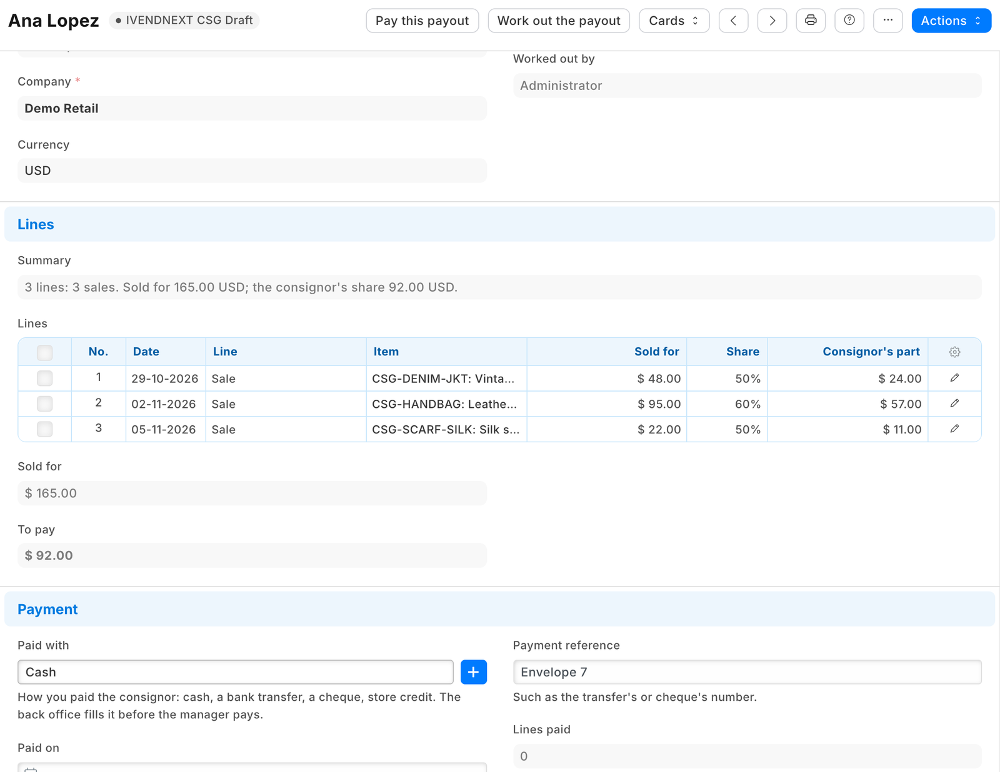

# S61 — Consignment payouts (`pp_csg`): each consignor's share of what sold, paid once

A resale or consignment store sells pieces it does not own. Each piece belongs to a consignor, who is owed an agreed share of what it sold for. The app keeps the consignors, names the consignor on each item, and works each payout out from the retailer's own till sales and Desk invoices: what sold, less what came back, at the share. **Each sold line is paid once:** a line on a payout is never put on another, and a payout is marked paid only after the app's service has checked every line again. A paid payout is locked, and prints as the consignor's statement.



**Industries:** Thrift and resale

**When to use it:** the retailer sells goods on consignment (second-hand clothing, furniture, books, collectables, luxury resale) and pays consignors a share of each sale.

## Start from it

```bash
ivn new acme_consign --from s61
```

## What to change

What a partner usually changes:

- **How a consignor is paid:** store credit at a higher share than cash, a minimum payout, a fee off each payout, or the payout booked as a purchase invoice to the consignor as a supplier (`consign.py`, `service/app.py`).
- **The terms:** a date after which an unsold piece goes back to the consignor, or a markdown by age before the share is worked out.
- **What the consignor sees:** a page of their own, or the statement e-mailed by the retailer's own Notification (the print *PP CSG Payout statement* in `manifest.json`).
- **The fields:** `pp_csg_consignor` and `pp_csg_share` on Item, and the records `PP CSG Consignor` and `PP CSG Payout` in `manifest.json`. `CSG_PREFIX` names them for the service.

More: the [recipe](../../recipes/consignment_payouts.md).

**The customer sets:** each consignor's share and *Consigned since* (set it to the day after the last sale already paid to them: no sale before it is ever theirs), the consignor named on each item, and the roles: Accounts Users work payouts out and record how each was paid, Accounts Managers press *Pay this payout* and cancel a paid one. Write on Item and on the consignor decides what a payout pays, so give it only to whom you trust with prices.

## Run it

```bash
ivn check
ivn try
```

## Try it at the till

- Sell an item that names a consignor.
- In Desk, make a payout for that consignor and press Work out the payout, then Pay this payout.
- Close the till day when you are done.

## Versions

### 1.1.0

- The role's rights beyond the feed's reads move into the manifest (`role_rights`): the install gives the feed's user its reads and the manifest the rest, so the retailer's administrator grants none. Needs POS build `2.1.0.691` or later.

### 1.0.1

- A payout of fewer than 500 lines no longer says lines wait.
- Each setting in app.json says its purpose (the line the Settings screen shows), whether it is required, and which settings go with it.

### 1.0.0

- First version in the kit: each consignor's share of what sold, worked out from the retailer's own sales and paid once.
