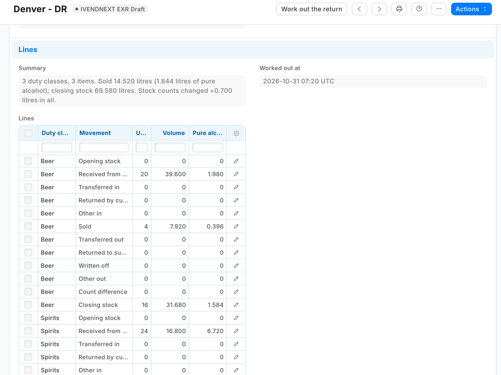

# S62 — Liquor excise returns (`pp_exr`): excise figures from your stock, kept as filed

A liquor store files an excise return every month or quarter: what it held and what moved, in volume, by duty class (spirits, wine, beer ...), and often the volume of pure alcohol too. The app works those figures out from the retailer's own stock: per store and period, for each duty class, the opening stock, what came in, what went out, what stock counts changed and the closing stock, each in units, volume and pure alcohol. A filed return is **kept as filed**: its figures are locked. Nothing changes at the till, and the worksheet prints one table per duty class.



**Industries:** Liquor and wine

**When to use it:** the retailer sells alcohol and reports volumes to an excise or licensing authority. The authority's own form, its codes and duty rates differ by country and state: they are the partner's version, built on these figures.

## Start from it

```bash
ivn new acme_excise --from s62
```

## What to change

What a partner usually changes:

- **The authority's form:** the print *PP EXR Excise return worksheet* in `manifest.json`, in the authority's own layout, line codes or file.
- **The duty:** a rate per class or strength band, worked out from these volumes in `exr.py`.
- **More goods:** tobacco by stick or weight, or sweetened drinks by litre, in place of the item's `pp_exr_ml` and `pp_exr_abv`.
- **The period:** a return per month for every store at once, made by one press.
- **The record types' names:** `EXR_PREFIX` for the service.

More: the [recipe](../../recipes/liquor_excise_returns.md).

**The customer sets:** its duty classes (each with the authority's code), and on each liquor item its **Duty class**, **Millilitres per stock unit** and **Alcohol by volume**: an item with no duty class is left out of every return. Stock Users make returns and work them out; the Stock Manager files them. Close each till's last day of the period before midnight, so that day's sales fall in the right period.

## Run it

```bash
ivn check
ivn try
```

## Try it at the till

- Sell a bottle of an item with a duty class.
- In Desk, make a return for this store and month and press Work out the return; the bottle is under Sold.
- Close the till day when you are done.

## Versions

### 1.1.0

- The role's rights beyond the feed's reads move into the manifest (`role_rights`): the install gives the feed's user its reads and the manifest the rest, so the retailer's administrator grants none. Needs POS build `2.1.0.691` or later.

### 1.0.0

- First version in the kit: excise return figures per store and period, worked out from the stock ledger and kept as filed.
- When a till's sales are dated follows the company's till posting setting.
- Each setting in app.json says its purpose (the line the Settings screen shows), whether it is required, and which settings go with it.
