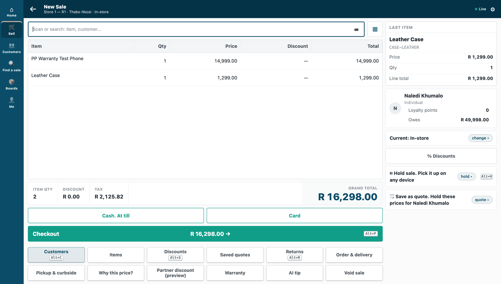

# S6 — the AI till key: a short hint from the customer's own AI model

A cashier presses **AI tip** on a sale and a short hint comes back in the till's own sheet. The till calls this small service during the sale. The service builds a prompt from the sale's item codes, quantities and the store name, asks an AI model the customer chooses and pays for, and answers with a message only. It never changes a price, a total, a payment or stock, and the key works online only.



**Industries:** every industry

**When to use it:** the cashier needs an answer, during the sale, that only your service can give.

**Door:** Till key

## Start from it

**Copy by hand: not an app made here.** Copy this folder into `apps/<your app>/` of a repository made from the kit and change the names, as [Make one of our apps your own](../../recipes/make_it_your_own.md) shows.

## What to change

What a partner usually changes:

- what is sent to the AI model: `SENT_FIELDS` and `build_prompt` in `core.py`; the consent text the customer reads is built from the same list;
- how the answer is read into a message: `message_from` in `core.py`;
- the AI model behind the key: `providers.py` has `stub` (no network, no account) and `chat` (any chat-completions service);
- the key's label, *AI tip*, which is the title of the till's sheet.

More: the [recipe](../../recipes/ai_till_key.md).

**The customer sets:** the AI model it uses, the signing secret both sides hold, and the HTTPS address the service runs behind. A System Manager then adds the key as a *Retail Remote App Key* record in Desk and ticks the customer's consent.

## Run it

```bash
python3 -m unittest discover -s samples/s6_ai_till_key/tests -v
```

## Try it at the till

- On a sale, press AI tip; a short hint comes back in the till's own sheet.
- Close the till day when you are done.

## Versions

### 1.0.0

- First version in the kit: a till key that shows a short hint from the customer's own AI model.
