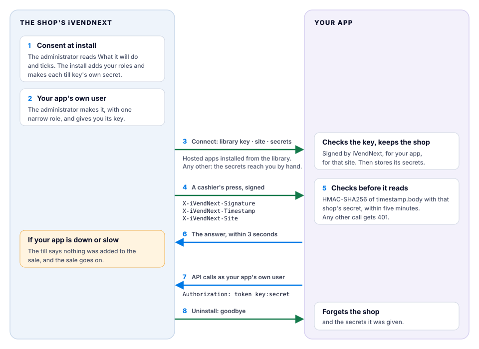

# Security and the handshake

How a shop and your app trust each other, from the shop's consent at install to the goodbye at uninstall. Every step below is what iVendNext and the kit's template do today; where a step does not reach yet, the page says so.



## The path, step by step

1. **The shop consents at install.** Before anything installs, the shop's administrator reads *What it will do*, written by iVendNext from your app itself, and ticks the box. The site refuses an install whose consent does not match what is being installed, and a new version asks again. The install adds the roles your manifest names (they start with your prefix) and makes a secret of its own for each till key.
2. **Your app gets its own user.** The shop's administrator makes (or chooses) one integration user for your app, with one narrow role, and makes its key. For a fiscal reader your manifest declares, the install makes the user, without a key. Your service reads and writes only through the API, as that user, and sees only what the role allows. It never connects to the shop's database. ([Chapter 5](../../guide/05_outside_apps_and_event_feed.md) and the [integration user recipe](../../recipes/integration_user.md).)
3. **The shop's site connects to your app.** When a shop installs a hosted app from the App library's public list, its site sends your app its App library key, its own address, the secrets the install made and, once the administrator has made it, your app's user's key. Your app checks that the key was signed by iVendNext, for your app and for that site, and then keeps the shop's secrets. This call is not signed: the key is its credential.
4. **Every press is signed.** When a cashier presses your till key, the shop's site signs the call with that key's secret and, to an app hosted with us, names itself in a header.
5. **Your app checks the signature before it reads the call.** It refuses a call more than five minutes old, a call signed with another shop's secret and a shop it does not know, each with `401`. The template does all of this (below).
6. **Your app answers within the time.** A till key has 3 seconds unless the shop raises it, and 10 at most.
7. **Your app calls the shop back** at the shop's own address, never at an address a call names, with its user's key.
8. **At uninstall the site says goodbye** to a hosted app installed from the public list, and your app forgets the shop and its secrets. An app on a *Made for you* shelf is not told yet: disconnect that shop yourself. Before it removes anything, the site saves your app's records to a private file of the shop's; then it removes the records, fields, roles and keys the install added.

**Where the connect does not reach yet.** The site connects by itself only to an app hosted at an `*.ivendnext.app` address and installed from the App library's public list. An app on your own server, or an app delivered on one customer's *Made for you* shelf, is connected by hand: you put the shop's secret in your app's settings, and run the template for that one shop.

## The check, as the template does it

Every call is checked against the raw body before anything reads it. This is the template's own function, `tools/app_template/service/app.py`, unchanged:

```python
def verified(secrets: list, headers, raw: bytes) -> bool:
    ts, sig = headers.get("X-iVendNext-Timestamp") or "", headers.get("X-iVendNext-Signature") or ""
    if not (ts.isascii() and ts.isdigit()) or abs(time.time() - int(ts)) > SKEW_S:   # "²" is a digit int() refuses
        return False
    for secret in secrets:
        want = base64.b64encode(hmac.new(secret, ts.encode() + b"." + raw, hashlib.sha256).digest())
        if hmac.compare_digest(want, sig.encode()):
            return True
    return False
```

- **`secrets`** is the one shop's secret, or, when your app serves many shops, the secret of the shop the call names in `X-iVendNext-Site`. A shop your app does not know has no secret, so its call fails.
- **`SKEW_S`** is 300 seconds. Keep your server's clock right.
- **A body over 64 KB** is answered with `413` before it is read.
- **The key check at connect** is `check_key` in `tools/app_template/service/shops.py`: the key's signature, its app and its site.

Write your app on the template and keep this check. A shop's site checks only that your app is at a public HTTPS address; then it checks the answer, its time and its shape.

## Rotating a secret

- **A shop's secret for your app.** When the shop's administrator changes a key's secret and presses *Connect again*, or reinstalls your app, the site sends your app the new secrets. Your app keeps the previous ones until the next connect, so nothing breaks while the shop moves over. To stop a leaked secret working, the shop connects twice.
- **One shop, run by hand.** Set the new secret in the shop, then set the old one as `IVN_POINT_SECRET_PREVIOUS` and the new one as `IVN_POINT_SECRET` in your app. Both are accepted. Remove the old one after a day.
- **Your app's own user.** The shop's administrator presses *Generate Keys* again on the user, and the old secret is refused at once. For a hosted app, the administrator then presses *Connect again*, so your app receives the new key.
- **On CitiXsys hosting,** a container's own secrets are kept in our secret store, never in a file: send us the new one when you rotate. A function keeps no secret of its own; each shop's arrive with its connect.

## When your app is down

The shop keeps selling. The cashier reads one of these, and nothing is added to the sale:

- *"⟨key⟩ did not answer in time. Nothing was added to the sale."* (slow)
- *"⟨key⟩ could not finish. Nothing was added to the sale."* (down, an error, or a bad signature)

Your reconciliation pull catches up on what happened while you were down. [Chapter 6](../../guide/06_till_keys.md) lists every message the cashier can read.

## What a shop can check

Each app's card in the [App library](https://library.ivendnext.app) says where the app sends data, whether an outside service reads and writes through its own user, and how many Desk users it needs. The shop's administrator sees each connected app under *Connected apps*, with *Hosted by CitiXsys* beside an app we host. For the shop's side of this story, see the library's [trust page](https://library.ivendnext.app/trust) and [how apps run](https://library.ivendnext.app/how-apps-run).

## See also

[Host with CitiXsys or run your own](hosting.md) · [API reference](api.md) · [Chapter 14b: Deploying your app](../../guide/14b_deploying_your_app.md) · [Reporting a security problem](../../SECURITY.md)
